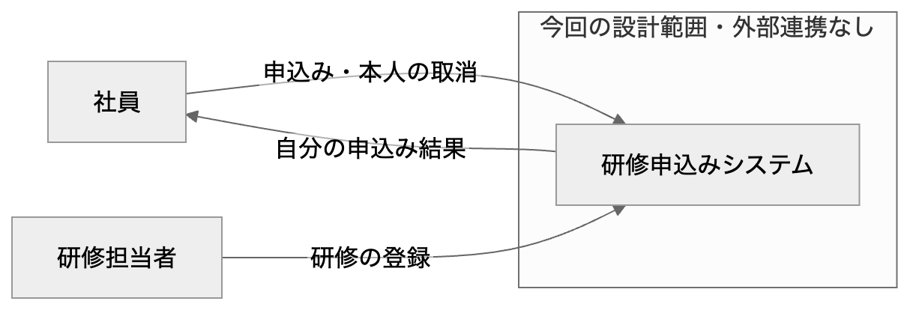
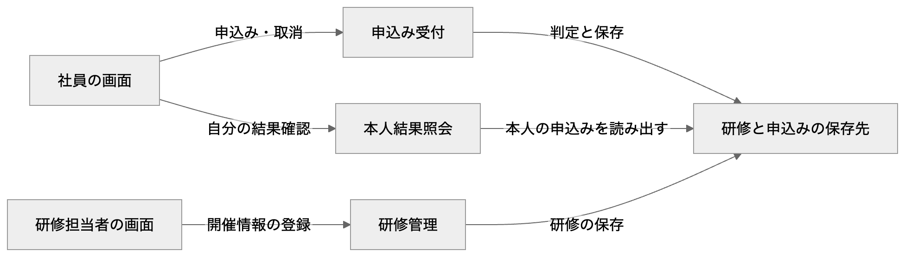
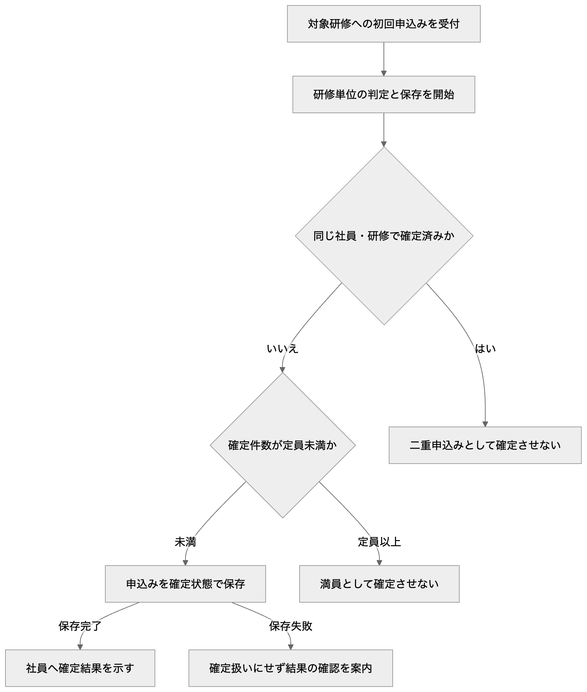
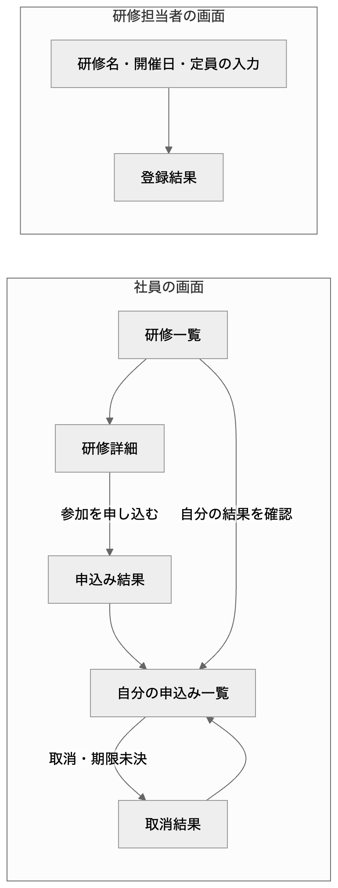
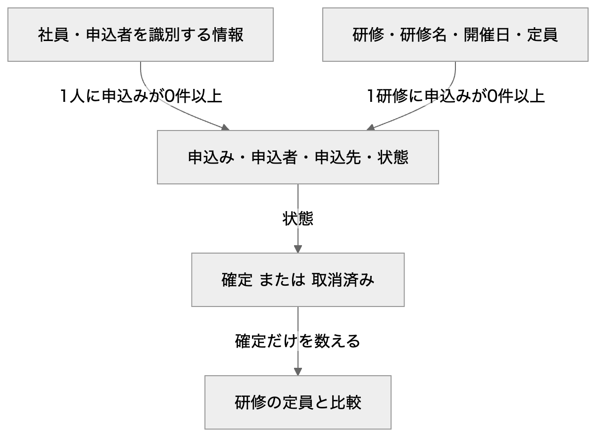
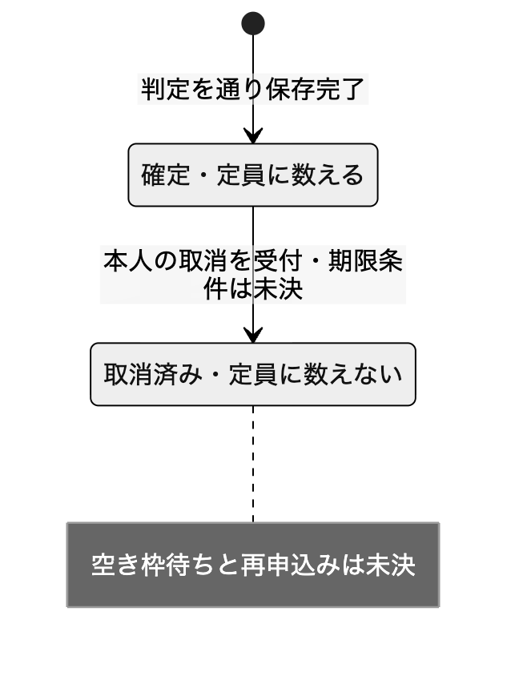

# 社内研修申込みの基本設計書

本書は、開発者が構成・画面・データ・外部連携の実現方式と採用理由を確認し、未決条件を整理して詳細設計へ進めるための基本設計書である。記載する設計案は、採用承認を示すものではない。

研修ごとの申込み受付に二重申込みと定員の判定を集め、判定と保存を一つの処理として扱う案を示す。社員の申込み・結果確認・取消と、研修担当者の登録を分けて設計する。利用技術、取消期限、空き枠待ちの要否は未決であり、採用済みの方式として確定しない。

読者：開発者 / 研修の業務条件を確認する担当者

目次

- [1. 概要](#1-概要)
- [2. 前提と要望](#2-前提と要望)
- [3. 全体構成](#3-全体構成)
- [4. 画面と操作](#4-画面と操作)
- [5. データ設計](#5-データ設計)
- [6. 外部連携](#6-外部連携)
- [7. 品質と運用](#7-品質と運用)
- [8. 未決事項と詳細設計への引継ぎ](#8-未決事項と詳細設計への引継ぎ)
- [9. 根拠と補足](#9-根拠と補足)

## 1. 概要

### 1.1 解く課題

社員が研修を選び、申込み結果を確認し、本人が取り消せる仕組みを作る。

研修担当者が登録した定員を守り、同じ社員の二重申込みを確定させない必要がある。

### 1.2 設計の目的

開発者が責務・画面・論理データと採用理由を理解し、未決の条件を確認したうえで詳細設計へ進めるようにする。

### 1.3 対象

- 社員による研修の選択・参加申込み・本人の取消・自分の申込み結果の確認
- 研修担当者による研修名・開催日・定員の登録
- 同じ社員の二重申込みと定員超過を確定させない受付処理

### 1.4 対象外

- 外部システムとの連携は行わない。

## 2. 前提と要望

用語と役割を確認してから、入力で求められた振る舞いを読む。実現方式と採用理由は後の設計の章で示す。

### 2.1 用語

| 用語 | 意味 | 根拠 |
| --- | --- | --- |
| 研修 | 研修名・開催日・定員を持つ、申込み先となる開催単位。これは論理データの設計案である。 | [研修申込みの会話メモ · input.md 2行目・研修担当者の操作](#92-研修申込みの会話メモ) |
| 確定した申込み | 二重申込みと定員の判定を通り、保存を完了した申込みを指す設計上の状態。 | [研修申込みの会話メモ · input.md 2行目・申込みの確定条件](#93-研修申込みの会話メモ) |
| 取消済みの申込み | 本人の取消を受け付け、確定した申込みから状態を変えたものを指す設計案。取消期限は未決。 | [研修申込みの会話メモ · input.md 2行目・社員の操作](#91-研修申込みの会話メモ)、[研修申込みの会話メモ · input.md 2行目・未定の条件](#96-研修申込みの会話メモ) |
| 空き枠待ち | 取消などで空きが出ることを待つ仕組み。必要かどうかは未決。 | [研修申込みの会話メモ · input.md 2行目・未定の条件](#96-研修申込みの会話メモ) |

### 2.2 利用者と役割

| 利用者 | 行うこと | 根拠 |
| --- | --- | --- |
| 社員 | 研修を選んで参加を申し込み、自分の結果を確認し、本人の申込みを取り消す。 | [研修申込みの会話メモ · input.md 2行目・社員の操作](#91-研修申込みの会話メモ)、[研修申込みの会話メモ · input.md 2行目・結果確認](#94-研修申込みの会話メモ) |
| 研修担当者 | 研修名・開催日・定員を登録する。 | [研修申込みの会話メモ · input.md 2行目・研修担当者の操作](#92-研修申込みの会話メモ) |

### 2.3 研修を選んで参加を申し込む

社員が社内研修を選んで参加を申し込める。

対応する設計：[操作の目的に応じて責務を分ける](#31-操作の目的に応じて責務を分ける)、[判定と保存を研修単位の一つの処理にする](#32-判定と保存を研修単位の一つの処理にする)、[社員の操作と研修担当者の登録を分ける](#41-社員の操作と研修担当者の登録を分ける)、[社員と研修を申込みで結び付ける](#51-社員と研修を申込みで結び付ける)

根拠：[研修申込みの会話メモ · input.md 2行目・社員の操作](#91-研修申込みの会話メモ)

### 2.4 本人が申込みを取り消す

社員が本人の申込みを取り消せる。取消期限は未定。

対応する設計：[操作の目的に応じて責務を分ける](#31-操作の目的に応じて責務を分ける)、[判定と保存を研修単位の一つの処理にする](#32-判定と保存を研修単位の一つの処理にする)、[社員の操作と研修担当者の登録を分ける](#41-社員の操作と研修担当者の登録を分ける)、[社員と研修を申込みで結び付ける](#51-社員と研修を申込みで結び付ける)、[取消の受付条件と空き枠の扱いを確認する](#42-取消の受付条件と空き枠の扱いを確認する)

根拠：[研修申込みの会話メモ · input.md 2行目・社員の操作](#91-研修申込みの会話メモ)、[研修申込みの会話メモ · input.md 2行目・未定の条件](#96-研修申込みの会話メモ)

### 2.5 研修の開催情報を登録する

研修担当者が研修名・開催日・定員を登録する。

対応する設計：[操作の目的に応じて責務を分ける](#31-操作の目的に応じて責務を分ける)、[社員の操作と研修担当者の登録を分ける](#41-社員の操作と研修担当者の登録を分ける)、[社員と研修を申込みで結び付ける](#51-社員と研修を申込みで結び付ける)

根拠：[研修申込みの会話メモ · input.md 2行目・研修担当者の操作](#92-研修申込みの会話メモ)

### 2.6 二重申込みと定員超過を確定させない

同じ社員の二重申込みと、定員を超える申込みは確定させない。

対応する設計：[操作の目的に応じて責務を分ける](#31-操作の目的に応じて責務を分ける)、[判定と保存を研修単位の一つの処理にする](#32-判定と保存を研修単位の一つの処理にする)、[社員と研修を申込みで結び付ける](#51-社員と研修を申込みで結び付ける)、[利用技術と配置を運用条件から決める](#33-利用技術と配置を運用条件から決める)

根拠：[研修申込みの会話メモ · input.md 2行目・申込みの確定条件](#93-研修申込みの会話メモ)

### 2.7 自分の申込み結果を確認する

社員が自分の申込み結果を確認できる。

対応する設計：[操作の目的に応じて責務を分ける](#31-操作の目的に応じて責務を分ける)、[判定と保存を研修単位の一つの処理にする](#32-判定と保存を研修単位の一つの処理にする)、[社員の操作と研修担当者の登録を分ける](#41-社員の操作と研修担当者の登録を分ける)、[社員と研修を申込みで結び付ける](#51-社員と研修を申込みで結び付ける)

根拠：[研修申込みの会話メモ · input.md 2行目・結果確認](#94-研修申込みの会話メモ)

## 3. 全体構成

利用者と対象範囲を分け、研修登録・受付判定・結果照会・保存の責務と処理順を説明する。

根拠：[研修申込みの会話メモ · input.md 2行目・社員の操作](#91-研修申込みの会話メモ)、[研修申込みの会話メモ · input.md 2行目・研修担当者の操作](#92-研修申込みの会話メモ)、[研修申込みの会話メモ · input.md 2行目・申込みの確定条件](#93-研修申込みの会話メモ)、[研修申込みの会話メモ · input.md 2行目・連携の範囲](#95-研修申込みの会話メモ)

確認する条件：[利用技術と実行場所](#81-利用技術と実行場所)

### 3.1 操作の目的に応じて責務を分ける

状態：設計案

研修管理・申込み受付・本人結果照会と、それらが使う保存先を分ける設計案とする。社員と研修担当者は、それぞれの目的に合う画面から操作する。

- 研修管理は研修名・開催日・定員の登録を扱う。申込み受付は申込みと本人の取消を扱う。
- 本人結果照会は自分の申込みだけを読み出す。本人と研修担当者を確認する方式は「利用者と権限の確認方式」で確かめる。
- 外部システム連携は入力に従って設けない。図の責務は製品や実行場所を決めるものではない。

採用理由：研修担当者が開催情報を登録する操作と、社員が枠を確保する操作では更新する内容が異なるため、判定の責任が混ざらないようにする。

元の要望：[研修を選んで参加を申し込む](#23-研修を選んで参加を申し込む)、[本人が申込みを取り消す](#24-本人が申込みを取り消す)、[研修の開催情報を登録する](#25-研修の開催情報を登録する)、[二重申込みと定員超過を確定させない](#26-二重申込みと定員超過を確定させない)、[自分の申込み結果を確認する](#27-自分の申込み結果を確認する)

関連図：[利用者と対象システムの境界](#34-利用者と対象システムの境界)、[登録と受付と照会の責務](#35-登録と受付と照会の責務)

確認する条件：[利用者と権限の確認方式](#84-利用者と権限の確認方式)

根拠：[研修申込みの会話メモ · input.md 2行目・社員の操作](#91-研修申込みの会話メモ)、[研修申込みの会話メモ · input.md 2行目・研修担当者の操作](#92-研修申込みの会話メモ)、[研修申込みの会話メモ · input.md 2行目・申込みの確定条件](#93-研修申込みの会話メモ)、[研修申込みの会話メモ · input.md 2行目・結果確認](#94-研修申込みの会話メモ)、[研修申込みの会話メモ · input.md 2行目・連携の範囲](#95-研修申込みの会話メモ)、[研修申込みの会話メモ · input.md 2行目・未定の条件](#96-研修申込みの会話メモ)

### 3.2 判定と保存を研修単位の一つの処理にする

状態：設計案

同じ社員・同じ研修に確定した申込みがあるかを調べ、なければ確定件数と定員を比較し、空きがあるときだけ申込みを保存する案とする。この判定と保存の途中に、同じ研修の別の更新を割り込ませない。

- 二重申込みまたは満員の場合は確定した申込みを追加せず、社員に理由を示す。
- 申込み結果の確定表示は保存の完了後に返す。保存が失敗した場合は確定扱いにせず、結果を確認してから再操作する案とする。
- 同じ研修の取消もこの処理単位に従い、確定件数と状態の食い違いを避ける。同時更新を順番に扱う実装方式は利用技術が決まってから定める。
- 同時に届いた申込みの優先順は入力にないため、「同時申込みの優先順」で確認する。
- 処理図は初回申込みの案を示す。取消後の再申込みに適用する条件は「取消後の再申込み」で確認してから加える。

採用理由：画面の空き表示だけでは同時申込みを防げないため、受付側の一つの処理で最新の申込み状態を使って判定し、二重申込みと定員超過を防ぐ。

元の要望：[研修を選んで参加を申し込む](#23-研修を選んで参加を申し込む)、[本人が申込みを取り消す](#24-本人が申込みを取り消す)、[二重申込みと定員超過を確定させない](#26-二重申込みと定員超過を確定させない)、[自分の申込み結果を確認する](#27-自分の申込み結果を確認する)

関連図：[登録と受付と照会の責務](#35-登録と受付と照会の責務)、[申込みの確定と拒否の順序](#36-申込みの確定と拒否の順序)

確認する条件：[利用技術と実行場所](#81-利用技術と実行場所)、[同時申込みの優先順](#87-同時申込みの優先順)、[取消後の再申込み](#86-取消後の再申込み)

根拠：[研修申込みの会話メモ · input.md 2行目・社員の操作](#91-研修申込みの会話メモ)、[研修申込みの会話メモ · input.md 2行目・申込みの確定条件](#93-研修申込みの会話メモ)、[研修申込みの会話メモ · input.md 2行目・結果確認](#94-研修申込みの会話メモ)、[研修申込みの会話メモ · input.md 2行目・未定の条件](#96-研修申込みの会話メモ)

### 3.3 利用技術と配置を運用条件から決める

状態：未決

画面・受付処理・保存先に使う技術と実行場所は未決とし、既存の運用環境を確認してから選ぶ。

- 判定と保存を一つの処理として実現できることを、技術選定の条件に含める。

採用理由：利用技術が会話で未定とされており、製品や配置を採用済みと扱えないため。

元の要望：[二重申込みと定員超過を確定させない](#26-二重申込みと定員超過を確定させない)

関連図：[登録と受付と照会の責務](#35-登録と受付と照会の責務)

確認する条件：[利用技術と実行場所](#81-利用技術と実行場所)、[利用量と運用条件](#85-利用量と運用条件)

根拠：[研修申込みの会話メモ · input.md 2行目・申込みの確定条件](#93-研修申込みの会話メモ)、[研修申込みの会話メモ · input.md 2行目・未定の条件](#96-研修申込みの会話メモ)

### 3.4 利用者と対象システムの境界

社員と研修担当者が何を行い、今回どこまでを設計するかを見る。

[図を拡大する](diagrams/d-01-context.png) · [図の定義を確認する](diagrams/d-01-context.mmd)

要点：社員の申込み・取消・自分の結果確認と、研修担当者の開催情報登録を対象にする。外部システムへの連携は設けない。

関連設計：[操作の目的に応じて責務を分ける](#31-操作の目的に応じて責務を分ける)

根拠：[研修申込みの会話メモ · input.md 2行目・社員の操作](#91-研修申込みの会話メモ)、[研修申込みの会話メモ · input.md 2行目・研修担当者の操作](#92-研修申込みの会話メモ)、[研修申込みの会話メモ · input.md 2行目・結果確認](#94-研修申込みの会話メモ)、[研修申込みの会話メモ · input.md 2行目・連携の範囲](#95-研修申込みの会話メモ)

### 3.5 登録と受付と照会の責務

開催情報の登録、申込みの判定、本人結果照会がどこへ渡り、何を保存するかを見る。

[図を拡大する](diagrams/d-02-component.png) · [図の定義を確認する](diagrams/d-02-component.mmd)

要点：申込み受付が判定と保存をまとめ、研修管理と本人結果照会も同じ保存先を使う案である。利用技術と実行場所は未決。

関連設計：[操作の目的に応じて責務を分ける](#31-操作の目的に応じて責務を分ける)、[判定と保存を研修単位の一つの処理にする](#32-判定と保存を研修単位の一つの処理にする)、[利用技術と配置を運用条件から決める](#33-利用技術と配置を運用条件から決める)

根拠：[研修申込みの会話メモ · input.md 2行目・社員の操作](#91-研修申込みの会話メモ)、[研修申込みの会話メモ · input.md 2行目・研修担当者の操作](#92-研修申込みの会話メモ)、[研修申込みの会話メモ · input.md 2行目・申込みの確定条件](#93-研修申込みの会話メモ)、[研修申込みの会話メモ · input.md 2行目・結果確認](#94-研修申込みの会話メモ)、[研修申込みの会話メモ · input.md 2行目・未定の条件](#96-研修申込みの会話メモ)

### 3.6 申込みの確定と拒否の順序

初回申込みについて、同一研修への二重申込みと満員を判定し、保存後に確定結果を返す順序を見る。取消後の再申込みに適用する条件は未決。

[図を拡大する](diagrams/d-03-workflow.png) · [図の定義を確認する](diagrams/d-03-workflow.mmd)

要点：二重申込みと満員では確定させず、判定と保存を同じ研修の一つの処理にまとめる案である。同時申込みの優先順と実装方式は未決。

関連設計：[判定と保存を研修単位の一つの処理にする](#32-判定と保存を研修単位の一つの処理にする)

根拠：[研修申込みの会話メモ · input.md 2行目・社員の操作](#91-研修申込みの会話メモ)、[研修申込みの会話メモ · input.md 2行目・申込みの確定条件](#93-研修申込みの会話メモ)、[研修申込みの会話メモ · input.md 2行目・結果確認](#94-研修申込みの会話メモ)、[研修申込みの会話メモ · input.md 2行目・未定の条件](#96-研修申込みの会話メモ)

## 4. 画面と操作

社員の申込み・結果確認・取消と、研修担当者の登録画面を区別する。

根拠：[研修申込みの会話メモ · input.md 2行目・社員の操作](#91-研修申込みの会話メモ)、[研修申込みの会話メモ · input.md 2行目・研修担当者の操作](#92-研修申込みの会話メモ)、[研修申込みの会話メモ · input.md 2行目・結果確認](#94-研修申込みの会話メモ)

確認する条件：[取消期限](#82-取消期限)、[利用者と権限の確認方式](#84-利用者と権限の確認方式)

### 4.1 社員の操作と研修担当者の登録を分ける

状態：設計案

社員には研修一覧・研修詳細・申込み結果・自分の申込み一覧・取消結果を設け、研修担当者には研修登録画面と登録結果を設ける案とする。

- 研修一覧から開催日と定員を確認して研修詳細へ進み、対象の研修への参加を申し込む。
- 申込み結果では確定、二重申込み、満員、保存未完了を区別する。空き表示は参考であり、申込み受付の判定結果を表示する。
- 自分の申込み一覧から結果を確認し、本人の申込みを取り消す。取消可否と期限の表示は「取消期限」で決める。
- 研修担当者は研修名・開催日・定員を入力する。入力値の形式と受付条件は詳細設計で具体化する。
- 空き枠待ちの画面を追加するかは「空き枠待ちの要否」で決める。

採用理由：社員が申込先と結果を確認でき、本人の取消を他人の申込みに対する操作と取り違えずに行えるため。

元の要望：[研修を選んで参加を申し込む](#23-研修を選んで参加を申し込む)、[本人が申込みを取り消す](#24-本人が申込みを取り消す)、[研修の開催情報を登録する](#25-研修の開催情報を登録する)、[自分の申込み結果を確認する](#27-自分の申込み結果を確認する)

関連図：[申込みと登録の画面遷移](#43-申込みと登録の画面遷移)

確認する条件：[取消期限](#82-取消期限)、[空き枠待ちの要否](#83-空き枠待ちの要否)、[利用者と権限の確認方式](#84-利用者と権限の確認方式)

根拠：[研修申込みの会話メモ · input.md 2行目・社員の操作](#91-研修申込みの会話メモ)、[研修申込みの会話メモ · input.md 2行目・研修担当者の操作](#92-研修申込みの会話メモ)、[研修申込みの会話メモ · input.md 2行目・結果確認](#94-研修申込みの会話メモ)、[研修申込みの会話メモ · input.md 2行目・未定の条件](#96-研修申込みの会話メモ)

### 4.2 取消の受付条件と空き枠の扱いを確認する

状態：未決

本人の取消を受け付ける入口は設けるが、取消期限と取消後の空き枠の扱いは条件が決まるまで確定しない。

- 状態図は取消が受け付けられた場合の変化だけを示し、無期限に取消できることは意味しない。
- 取消後の再申込みの可否と履歴の扱いも確認し、画面の再申込み操作と受付条件へ反映する。

採用理由：取消できることは要望にある一方、いつまで取り消せるかと空き枠待ちの要否は未定のため。

元の要望：[本人が申込みを取り消す](#24-本人が申込みを取り消す)

関連図：[申込みと登録の画面遷移](#43-申込みと登録の画面遷移)、[確定した申込みと取消の状態](#53-確定した申込みと取消の状態)

確認する条件：[取消期限](#82-取消期限)、[空き枠待ちの要否](#83-空き枠待ちの要否)、[取消後の再申込み](#86-取消後の再申込み)

根拠：[研修申込みの会話メモ · input.md 2行目・社員の操作](#91-研修申込みの会話メモ)、[研修申込みの会話メモ · input.md 2行目・未定の条件](#96-研修申込みの会話メモ)

### 4.3 申込みと登録の画面遷移

社員が結果確認と取消へ進む入口と、研修担当者が登録する入口を見る。

[図を拡大する](diagrams/d-04-screen.png) · [図の定義を確認する](diagrams/d-04-screen.mmd)

要点：社員は研修詳細から申し込み、自分の申込み一覧から結果確認と取消を行う案である。取消期限と空き枠待ちによる追加画面は未決。

関連設計：[社員の操作と研修担当者の登録を分ける](#41-社員の操作と研修担当者の登録を分ける)、[取消の受付条件と空き枠の扱いを確認する](#42-取消の受付条件と空き枠の扱いを確認する)

根拠：[研修申込みの会話メモ · input.md 2行目・社員の操作](#91-研修申込みの会話メモ)、[研修申込みの会話メモ · input.md 2行目・研修担当者の操作](#92-研修申込みの会話メモ)、[研修申込みの会話メモ · input.md 2行目・結果確認](#94-研修申込みの会話メモ)、[研修申込みの会話メモ · input.md 2行目・未定の条件](#96-研修申込みの会話メモ)

## 5. データ設計

社員・研修・申込みの関係と、定員に数える状態を明らかにする。

根拠：[研修申込みの会話メモ · input.md 2行目・社員の操作](#91-研修申込みの会話メモ)、[研修申込みの会話メモ · input.md 2行目・研修担当者の操作](#92-研修申込みの会話メモ)、[研修申込みの会話メモ · input.md 2行目・申込みの確定条件](#93-研修申込みの会話メモ)

確認する条件：[空き枠待ちの要否](#83-空き枠待ちの要否)、[取消後の再申込み](#86-取消後の再申込み)

### 5.1 社員と研修を申込みで結び付ける

状態：設計案

社員・研修・申込みを論理的に分け、申込みが一人の社員と一つの研修に属する設計案とする。申込みには確定と取消済みの状態を保持する。

- 研修は研修名・開催日・定員を保持する。申込みは申込者・申込先・状態を保持する。社員の識別情報の供給方法は「利用者と権限の確認方式」で確認する。
- 社員一人と研修一つには、それぞれ申込みがゼロ件以上対応する。同じ社員・同じ研修に対して確定した申込みは最大一件とする案である。
- 定員に数えるのは確定した申込みだけとし、取消済みの履歴を残す案とする。取消と状態更新は受付処理で一緒に行う。
- 取消後に誰が空き枠を申し込めるか、取消後の再申込みをどう記録するかは未決である。空き枠待ちや再申込みの状態を確定したものとして追加しない。

採用理由：申込者と申込先をたどれるようにして、本人結果照会と同一研修への二重申込み判定を同じ情報に基づいて行うため。

元の要望：[研修を選んで参加を申し込む](#23-研修を選んで参加を申し込む)、[本人が申込みを取り消す](#24-本人が申込みを取り消す)、[研修の開催情報を登録する](#25-研修の開催情報を登録する)、[二重申込みと定員超過を確定させない](#26-二重申込みと定員超過を確定させない)、[自分の申込み結果を確認する](#27-自分の申込み結果を確認する)

関連図：[社員と研修と申込みの論理関係](#52-社員と研修と申込みの論理関係)、[確定した申込みと取消の状態](#53-確定した申込みと取消の状態)

確認する条件：[空き枠待ちの要否](#83-空き枠待ちの要否)、[利用者と権限の確認方式](#84-利用者と権限の確認方式)、[取消後の再申込み](#86-取消後の再申込み)

根拠：[研修申込みの会話メモ · input.md 2行目・社員の操作](#91-研修申込みの会話メモ)、[研修申込みの会話メモ · input.md 2行目・研修担当者の操作](#92-研修申込みの会話メモ)、[研修申込みの会話メモ · input.md 2行目・申込みの確定条件](#93-研修申込みの会話メモ)、[研修申込みの会話メモ · input.md 2行目・結果確認](#94-研修申込みの会話メモ)、[研修申込みの会話メモ · input.md 2行目・未定の条件](#96-研修申込みの会話メモ)

### 5.2 社員と研修と申込みの論理関係

申込みが誰とどの研修に属し、どの状態を定員へ数えるかを見る。

[図を拡大する](diagrams/d-05-data.png) · [図の定義を確認する](diagrams/d-05-data.mmd)

要点：申込みを社員と研修に関連付け、確定と取消済みを保持する案である。同じ社員・同じ研修の確定は最大一件とし、定員には確定分だけを数える。

関連設計：[社員と研修を申込みで結び付ける](#51-社員と研修を申込みで結び付ける)

根拠：[研修申込みの会話メモ · input.md 2行目・社員の操作](#91-研修申込みの会話メモ)、[研修申込みの会話メモ · input.md 2行目・研修担当者の操作](#92-研修申込みの会話メモ)、[研修申込みの会話メモ · input.md 2行目・申込みの確定条件](#93-研修申込みの会話メモ)、[研修申込みの会話メモ · input.md 2行目・結果確認](#94-研修申込みの会話メモ)、[研修申込みの会話メモ · input.md 2行目・未定の条件](#96-研修申込みの会話メモ)

### 5.3 確定した申込みと取消の状態

本人の取消を受け付けたときに、申込みの状態と定員の数え方がどう変わるかを見る。

[図を拡大する](diagrams/d-06-state.png) · [図の定義を確認する](diagrams/d-06-state.mmd)

要点：確定した申込みが取消済みへ移り、取消済みは定員へ数えない案である。期限条件、空き枠待ち、取消後の再申込みは確認事項が決まるまで確定しない。

関連設計：[社員と研修を申込みで結び付ける](#51-社員と研修を申込みで結び付ける)、[取消の受付条件と空き枠の扱いを確認する](#42-取消の受付条件と空き枠の扱いを確認する)

根拠：[研修申込みの会話メモ · input.md 2行目・社員の操作](#91-研修申込みの会話メモ)、[研修申込みの会話メモ · input.md 2行目・申込みの確定条件](#93-研修申込みの会話メモ)、[研修申込みの会話メモ · input.md 2行目・未定の条件](#96-研修申込みの会話メモ)

## 6. 外部連携

会話メモで外部システムとの連携はないと指定されているため、外部への受け渡しを設計しない。

根拠：[研修申込みの会話メモ · input.md 2行目・連携の範囲](#95-研修申込みの会話メモ)

この観点の設計は今回の対象に含めていない。理由と確認する条件は上記に示す。

## 7. 品質と運用

品質と運用の条件を確認する。入力の事実・設計案・未決を分け、未指定の目標値は確定しない。

### 7.1 性能

状態：未決

利用人数、同時申込み数、結果表示までの許容時間は未指定。「利用量と運用条件」で目標を確認する。

根拠：[研修申込みの会話メモ · input.md 2行目・申込みの確定条件](#93-研修申込みの会話メモ)、[研修申込みの会話メモ · input.md 2行目・未定の条件](#96-研修申込みの会話メモ)

確認する条件：[利用量と運用条件](#85-利用量と運用条件)

### 7.2 可用性

状態：未決

申込みを受け付ける時間帯と停止を許容する範囲は未指定。「利用量と運用条件」が決まるまで、稼働と復旧の目標を確定しない。

根拠：[研修申込みの会話メモ · input.md 2行目・社員の操作](#91-研修申込みの会話メモ)、[研修申込みの会話メモ · input.md 2行目・未定の条件](#96-研修申込みの会話メモ)

確認する条件：[利用量と運用条件](#85-利用量と運用条件)

### 7.3 セキュリティ

状態：設計案

申込み・取消・本人結果照会では社員本人を確認し、研修登録では研修担当者の権限を確認する案とする。確認方式は未決。

設計の確認条件

- 別の社員の申込みを本人の一覧へ表示しない。
- 本人以外の取消と、研修担当者以外の研修登録を受け付けない。

根拠：[研修申込みの会話メモ · input.md 2行目・社員の操作](#91-研修申込みの会話メモ)、[研修申込みの会話メモ · input.md 2行目・研修担当者の操作](#92-研修申込みの会話メモ)、[研修申込みの会話メモ · input.md 2行目・結果確認](#94-研修申込みの会話メモ)

確認する条件：[利用者と権限の確認方式](#84-利用者と権限の確認方式)

### 7.4 個人情報

状態：未決

申込み履歴と社員の識別情報の保持期間、閲覧できる人の範囲は未指定。「利用量と運用条件」で確認する。

根拠：[研修申込みの会話メモ · input.md 2行目・社員の操作](#91-研修申込みの会話メモ)、[研修申込みの会話メモ · input.md 2行目・結果確認](#94-研修申込みの会話メモ)

確認する条件：[利用量と運用条件](#85-利用量と運用条件)

### 7.5 運用

状態：未決

保存失敗や結果不明の調査、記録の保管、障害時の復旧と問い合わせ担当は「利用量と運用条件」で確認する。

根拠：[研修申込みの会話メモ · input.md 2行目・申込みの確定条件](#93-研修申込みの会話メモ)、[研修申込みの会話メモ · input.md 2行目・結果確認](#94-研修申込みの会話メモ)、[研修申込みの会話メモ · input.md 2行目・未定の条件](#96-研修申込みの会話メモ)

確認する条件：[利用量と運用条件](#85-利用量と運用条件)

### 7.6 アクセシビリティ

状態：設計案

操作名と受付結果を文字で示し、キーボードだけでも主要操作に到達できる案とする。必要な対応範囲は「利用量と運用条件」で確認する。

設計の確認条件

- 確定・二重申込み・満員・保存未完了を色だけで区別しない。
- 申込み、結果確認、取消、研修登録の操作にキーボードで到達できる。

根拠：[研修申込みの会話メモ · input.md 2行目・社員の操作](#91-研修申込みの会話メモ)、[研修申込みの会話メモ · input.md 2行目・研修担当者の操作](#92-研修申込みの会話メモ)、[研修申込みの会話メモ · input.md 2行目・結果確認](#94-研修申込みの会話メモ)

確認する条件：[利用量と運用条件](#85-利用量と運用条件)

### 7.7 指定された制約

外部システムとの連携は行わない。

根拠：[研修申込みの会話メモ · input.md 2行目・連携の範囲](#95-研修申込みの会話メモ)

## 8. 未決事項と詳細設計への引継ぎ

次の質問に、決まるまで確定できない範囲を添える。その後で、詳細設計で具体化する作業を示す。

### 8.1 利用技術と実行場所

既存の技術、利用可能な保存先、配備と運用の制約は何か。決まるまで、製品・配置・判定と保存の実装方式を確定できない。

根拠：[研修申込みの会話メモ · input.md 2行目・未定の条件](#96-研修申込みの会話メモ)

### 8.2 取消期限

開催日の何日前まで、またはどの時刻まで本人の取消を受け付けるか。決まるまで、取消ボタンの可否表示と受付処理の期限判定を確定できない。

根拠：[研修申込みの会話メモ · input.md 2行目・未定の条件](#96-研修申込みの会話メモ)

### 8.3 空き枠待ちの要否

取消後の空き枠を待つ仕組みは必要か。必要なら待つ順序と繰上げ時の確定方法はどうするか。決まるまで、空き枠の再配分処理・追加画面・追加状態とデータを確定できない。

根拠：[研修申込みの会話メモ · input.md 2行目・未定の条件](#96-研修申込みの会話メモ)

### 8.4 利用者と権限の確認方式

社員本人と研修担当者をどの情報で識別し、誰が権限を管理するか。外部連携なしで満たす方式を確認する。決まるまで、本人限定操作の確認方式と社員情報の保持方法を確定できない。

根拠：[研修申込みの会話メモ · input.md 2行目・社員の操作](#91-研修申込みの会話メモ)、[研修申込みの会話メモ · input.md 2行目・研修担当者の操作](#92-研修申込みの会話メモ)、[研修申込みの会話メモ · input.md 2行目・結果確認](#94-研修申込みの会話メモ)、[研修申込みの会話メモ · input.md 2行目・連携の範囲](#95-研修申込みの会話メモ)

### 8.5 利用量と運用条件

利用人数・同時申込み数・応答時間、稼働時間と復旧目標、情報の保持期間と閲覧範囲、障害調査と問い合わせの担当、必要な操作支援の範囲は何か。決まるまで、品質目標・容量・監視と保管・復旧・操作支援の検証基準を確定できない。

根拠：[研修申込みの会話メモ · input.md 2行目・社員の操作](#91-研修申込みの会話メモ)、[研修申込みの会話メモ · input.md 2行目・研修担当者の操作](#92-研修申込みの会話メモ)、[研修申込みの会話メモ · input.md 2行目・申込みの確定条件](#93-研修申込みの会話メモ)、[研修申込みの会話メモ · input.md 2行目・結果確認](#94-研修申込みの会話メモ)、[研修申込みの会話メモ · input.md 2行目・未定の条件](#96-研修申込みの会話メモ)

### 8.6 取消後の再申込み

取消済みの社員は同じ研修へ再申込みできるか。できる場合、取消の履歴と再申込みをどう扱うか。決まるまで、再申込みの操作・受付条件・履歴の論理関係を確定できない。

根拠：[研修申込みの会話メモ · input.md 2行目・社員の操作](#91-研修申込みの会話メモ)、[研修申込みの会話メモ · input.md 2行目・申込みの確定条件](#93-研修申込みの会話メモ)、[研修申込みの会話メモ · input.md 2行目・未定の条件](#96-研修申込みの会話メモ)

### 8.7 同時申込みの優先順

残り一枠へ同時に申し込まれた場合、どの時点の順序で受付を優先するか。決まるまで、競合時の選択順とその説明・検証条件を確定できない。二重申込みと定員超過を確定させない条件は維持する。

根拠：[研修申込みの会話メモ · input.md 2行目・申込みの確定条件](#93-研修申込みの会話メモ)

### 8.8 詳細設計へ引き継ぐ作業

- 利用者と権限の確認方式を確定し、各画面の入力・表示・本人限定操作と研修担当者の操作を具体化する。取消期限を取消画面と受付条件へ反映する。
- 社員・研修・申込みの論理関係から物理列・型・制約・検索のための索引を定め、利用技術に応じて判定と保存の同時更新の制御・失敗時の取り消し・結果不明時の確認を設計する。同時の二重申込みと残り一枠への申込みで上限を守れることを検証する。
- 空き枠待ちの要否、取消後の再申込み、同時申込みの優先順を確定し、追加される画面・受付処理・状態・履歴を整合させる。
- 利用量と運用条件を確認し、容量と性能の目標、監視・調査・保管・復旧の手順、操作支援の受入基準と検証方法を具体化する。

## 9. 根拠と補足

設計の根拠を、資料の場所と実際の記述で確かめる。「入力に記載」は資料にあるという意味であり、承認済みを意味しない。

### 9.1 研修申込みの会話メモ

input.md 2行目・社員の操作

> 社員が社内研修を選んで参加を申し込み、本人が取り消せるようにします。

### 9.2 研修申込みの会話メモ

input.md 2行目・研修担当者の操作

> 研修担当者は研修名、開催日、定員を登録します。

### 9.3 研修申込みの会話メモ

input.md 2行目・申込みの確定条件

> 同じ社員の二重申込みと、定員を超える申込みは確定させません。

### 9.4 研修申込みの会話メモ

input.md 2行目・結果確認

> 社員は自分の申込み結果を確認できます。

### 9.5 研修申込みの会話メモ

input.md 2行目・連携の範囲

> 外部システムとの連携はありません。

### 9.6 研修申込みの会話メモ

input.md 2行目・未定の条件

> 使う技術、取消期限、取消後の空き枠を待つ仕組みの要否は未定です。

### 9.7 図を選んだ理由・省いた理由

| 図 | 採否 | 理由 | 根拠 |
| --- | --- | --- | --- |
| 境界と外部の関係図 | 採用 | 社員と研修担当者の操作、対象システムの境界、外部連携がないことを示す。 | [研修申込みの会話メモ · input.md 2行目・社員の操作](#91-研修申込みの会話メモ)、[研修申込みの会話メモ · input.md 2行目・研修担当者の操作](#92-研修申込みの会話メモ)、[研修申込みの会話メモ · input.md 2行目・連携の範囲](#95-研修申込みの会話メモ) |
| 責務の分担図 | 採用 | 研修管理・申込み受付・本人結果照会と保存先の分担を示す。 | [研修申込みの会話メモ · input.md 2行目・社員の操作](#91-研修申込みの会話メモ)、[研修申込みの会話メモ · input.md 2行目・研修担当者の操作](#92-研修申込みの会話メモ)、[研修申込みの会話メモ · input.md 2行目・申込みの確定条件](#93-研修申込みの会話メモ)、[研修申込みの会話メモ · input.md 2行目・結果確認](#94-研修申込みの会話メモ) |
| 処理フロー図 | 採用 | 二重申込みと定員を確認し、保存完了後に確定結果を返す順序を示す。 | [研修申込みの会話メモ · input.md 2行目・申込みの確定条件](#93-研修申込みの会話メモ)、[研修申込みの会話メモ · input.md 2行目・結果確認](#94-研修申込みの会話メモ) |
| 画面遷移図 | 採用 | 社員の申込み・結果確認・取消と担当者の研修登録を画面の入口から追えるようにする。 | [研修申込みの会話メモ · input.md 2行目・社員の操作](#91-研修申込みの会話メモ)、[研修申込みの会話メモ · input.md 2行目・研修担当者の操作](#92-研修申込みの会話メモ)、[研修申込みの会話メモ · input.md 2行目・結果確認](#94-研修申込みの会話メモ) |
| 論理データの関係図 | 採用 | 社員・研修・申込みの論理関係と、状態による定員の数え方を示す。 | [研修申込みの会話メモ · input.md 2行目・社員の操作](#91-研修申込みの会話メモ)、[研修申込みの会話メモ · input.md 2行目・研修担当者の操作](#92-研修申込みの会話メモ)、[研修申込みの会話メモ · input.md 2行目・申込みの確定条件](#93-研修申込みの会話メモ) |
| 連携のシーケンス図 | 省略 | 外部システムとの連携を行わないため、外部受け渡しの時系列は作成しない。 | [研修申込みの会話メモ · input.md 2行目・連携の範囲](#95-研修申込みの会話メモ) |
| 状態遷移図 | 採用 | 本人の取消による確定から取消済みへの変化と、未決の条件を示す。 | [研修申込みの会話メモ · input.md 2行目・社員の操作](#91-研修申込みの会話メモ)、[研修申込みの会話メモ · input.md 2行目・申込みの確定条件](#93-研修申込みの会話メモ)、[研修申込みの会話メモ · input.md 2行目・未定の条件](#96-研修申込みの会話メモ) |
| 配置図 | 省略 | 利用技術と実行場所が未定のため、配置を採用済みとして描かない。「利用技術と実行場所」で確認する。 | [研修申込みの会話メモ · input.md 2行目・未定の条件](#96-研修申込みの会話メモ) |
