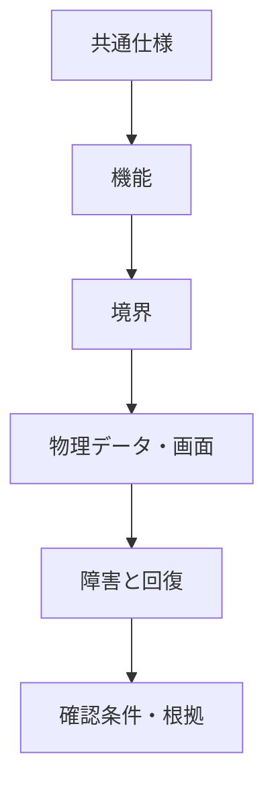
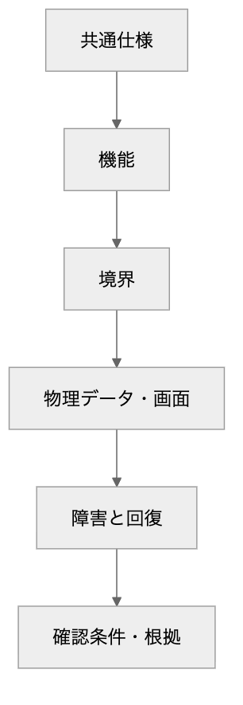

<!-- generated-by: write-detailed-design-document; body-sha256: 3936242a6a8c1b00ff98343732d12b43a91f9d44c363e124b833e2d26929f3a3 -->
# 備品予約の詳細設計書

利用者は数量を指定して10分間の予約を作成する。保存側で在庫と予約と受付結果を同時に確定し、取消と期限切れの返却を一度に制限する。本書は入力資料を具体化した未承認の設計案であり、実装・実DB・外部サービス接続・負荷試験は未実施である。文書と図の検査は採用承認や動作検証を意味しない。

本書は設計書である。文書検査の通過は、採用承認・実装・結合試験の完了を意味しない。

## 対象と状態

備品予約の作成・取消・期限処理・切断後の結果照会と、それを支える画面・保存・確認条件を設計する。

対象外: 備品の登録・補充・廃棄と認証基盤の実装は対象外とする。備品の総数は予約中に変更しない前提で設計する。 貸出・決済・メール・外部実行基盤は入力資料にないため対象外とする。 実装、実DBや外部サービスへの接続試験、設計採用の承認は行わず、U001〜U003へ残す。

機能 / 要件 / 未決: 4 / 5 / 3

## 読む順序

- [共通仕様](common.md) — 責務、用語、状態、時間条件を先に定義し、機能ごとの判断を揃える。
- [機能ごとの詳細](features.md) — 開始条件から保存と結果までを追い、異常時の回復と確認方法へつなぐ。
- [境界の契約](interfaces.md) — 境界の両側が同じ意味で実装できるよう、入力、出力、失敗、切断と再送を定義する。
- [物理データ](data.md) — 状態を何に保存し、どの制約と更新単位で整合性を保つかを定義する。
- [画面と操作](ui.md) — 利用者が保存状態と操作結果を判断できるよう、項目、操作、表示とフォーカスを定義する。
- [障害と再起動](recovery.md) — 停止した場所ごとに確定した内容と残る情報を分け、再開と再試行の条件を定義する。
- [要件との対応と確認条件](verification.md) — 要件を設計と観測できる結果へ対応付ける。試験条件は実施結果を意味しない。
- [根拠と未決事項と変更](evidence.md) — 引き継いだ記述と追加提案を分け、未決の影響と要件変更の判断を辿れるようにする。

- [分野別の閲覧と確認](review.html)

設計の正本: [design.json](design.json)

Design SHA-256: `f0cbdfe993bfaf8112d110abb75214eab2cae1f6fdcaa4b3f27c42a14d438726`

## 図の読み方

処理順は機能図とG001のシーケンス図、状態と遷移はST001・ST002の状態図、物理列と関係は表のER図とG002で示す。各項目直下に図とPNGを置き、図の省略部分は同項目の全文で確かめる。クラス図は実装言語とクラスを固定しないため省く。画面の配置図は操作契約の方が実装と試験の共通条件になるため省き、UI001の項目・フォーカスを正本とする。

#### 読む順序

矢印は文書を読む順序を示す。実行順序ではない。

Mermaidの記述を確認する

Mermaid: [local-overview.mmd](diagrams/local-overview.mmd) — 矢印は文書を読む順序を示す。実行順序ではない。
