<!-- generated-by: write-detailed-design-document; body-sha256: a8c32e47b1d991864185e0fd625fba362e889bada93636de9c9adb5ebb4e461e -->
# 共通仕様

[入口に戻る](README.md)

責務、用語、状態、時間条件を先に定義し、機能ごとの判断を揃える。

## 用語と時刻

保存側のPostgreSQL時刻をUTC・マイクロ秒精度で扱う。作成時は備品行ロック取得後のclock_timestamp()を一度採りcreated_atとし、expires_at=created_at+interval '10 minutes'とする。取消・期限処理は必要な行ロックを全て取得した後に判定時刻を一度採る。判定時刻<expires_atだけ取消でき、等号と直後は期限切れとする。待機前のトランザクション開始時刻や画面時刻を判定に使わない。JSONはYYYY-MM-DDTHH:mm:ss.ffffffZとする。読取りのobserved_atも保存側から取得する。10分は引継ぎ条件、精度と取得関数はD002の提案である。

- **受付用識別子**: request_idである。利用者が明示した作成または取消の一回をUUIDで識別し、owner_idと組で生存期間中ずっと再使用しない。通信再送は同じ識別子と内容を使う。
- **同じ内容**: 作成はoperation=create、item_id、quantity、取消はoperation=cancel、reservation_idの構造化値が等しいことである。owner_idは照合キーに含む。JSON空白と順序は無視し、UUIDは正規形に統一し、未知・重複キーを拒否する。数値は整数だけを許可する。
- **確定結果**: 受付結果表へ業務更新と同じコミットで記録した不変の応答である。作成時のactiveとavailable_at_resultは過去の値であり、後の期限切れで書き換えない。現在値はIF005で別に得る。
- **未確認**: 画面またはサーバーがコミットの有無を判断できないことである。予約の業務状態ではなく、ST002のunknownで示す。未確認を保存不成立や予約不存在と同一視しない。
- **数量と残数**: quantityは1〜1000000、capacityとavailableは0〜1000000000の整数とする提案である。availableは確定済みactiveの引当を除いた残数であり、期限処理待ちも引当を保持する。
- **共通応答**: IF001・IF002とIF004のresultで用いる同一形のJSONである。全9項目を常に返し、NULLの条件を各項目に定義する。durable=trueだけが保存済みの操作結果である。HTTP受信やタイムアウトだけでは確定を表さない。

## modules

### M001 ブラウザ画面・HTTP受付

| 項目 | 内容 |
| --- | --- |
| 責務 | 画面は入力と操作結果を表示し、受付は認証済みowner_id、サイズとJSON形を検査する。クライアントのowner_idを信用しない。 |
| 依存先 | [M002](common.md#M002) — 作成・取消・照会の規則と権利を検査し、IF001〜IF005の保存境界へ正規化済み項目を渡す。保存不成立と確定不明を分ける。 |

#### M001 ブラウザ画面・HTTP受付

矢印は項目と条件の対応を示す。実行順序ではない。厳密な全文は同じ項目の表にある。

Mermaidの記述を確認する

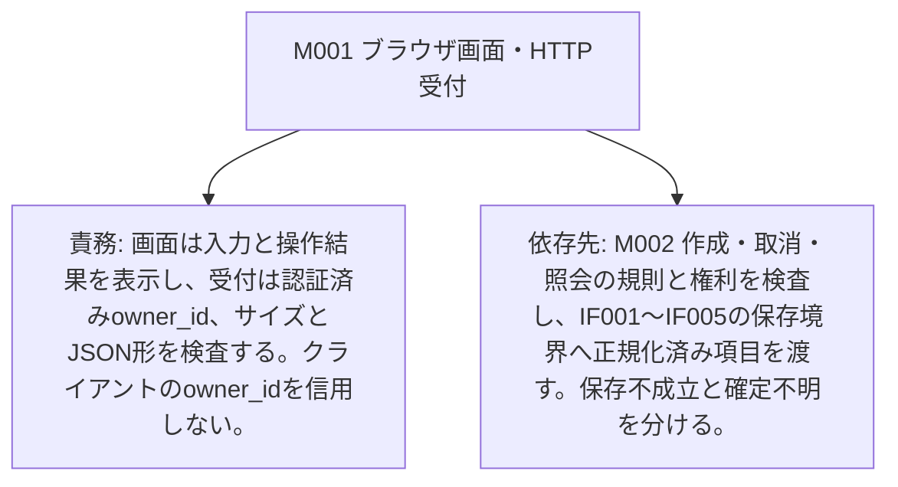

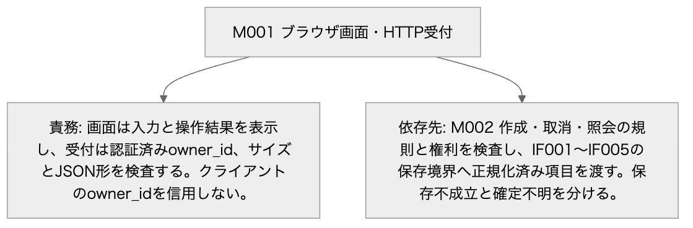

Mermaid: [local-M001.mmd](diagrams/local-M001.mmd) — 矢印は項目と条件の対応を示す。実行順序ではない。厳密な全文は同じ項目の表にある。

### M002 予約サービス

| 項目 | 内容 |
| --- | --- |
| 責務 | 作成・取消・照会の規則と権利を検査し、IF001〜IF005の保存境界へ正規化済み項目を渡す。保存不成立と確定不明を分ける。 |
| 依存先 | [M004](common.md#M004) — PostgreSQLの行ロック・条件付き更新・受付結果の衝突を一つのトランザクションに閉じ、コミット成立後にのみ確定結果を返す。スナップショット読取りは書込みを行わない。 |

[IF001](interfaces.md#IF001)

> 同じrequest_idと正規化内容を受付・サービス・保存で引き継ぐ。内部の数量を再生成しない。 / 応答候補の全項目を返す。確定した業務結果だけを保存し、コミット結果不明を保存済み拒否に変えない。 / CREATED、NO_STOCK、NOT_FOUND、VERSION_LIMIT、INVALID_INPUT、TOO_LARGE、UNSUPPORTED_MEDIA、UNAUTHENTICATED、FORBIDDEN、ID_CONFLICT、SAVE_FAILED、COMMIT_UNKNOWNを共通応答のcodeで判別する。 / 入力: context.owner_id: string(uuid) 必須 NULL不可, サーバー認証で確定した利用者。クライアントからの指定を許可しない。 / body.request_id: string(uuid) 必須 NULL不可, 小文字ハイフン付きUUID正規形36文字。異なる世代の操作に再利用しない。 / body.item_id: string(uuid) 必須 NULL不可, 登録済み備品ID。 / body.quantity: integer 必須 NULL不可, 1〜1000000の整数。 / 応答: created: 201 CREATED。新しい予約と在庫・受付結果のCOMMITを確認した応答でありdurable=trueとする。 (request_id: string(uuid) or null 必須 NULL可, 妥当な識別子を受理済みならその値を返す。欠落・不正・識別前の拒否ではnullとする。; code: string 必須 NULL不可, CREATEDだけを返す。; message: string 必須 NULL不可, 1〜200 Unicode文字かつUTF-8で800バイト以下。利用者向け理由を返し内部例外は含めない。; reservation_id: string(uuid) or null 必須 NULL可, 予約に結び付く確定結果ではそのID、それ以外はnullとする。; state_at_result: string or null 必須 NULL可, 結果確定時のactive・cancelled・expired。予約がない拒否・保存不成立・確定不明はnullとする。; expires_at: string(datetime) or null 必須 NULL可, 予約に結び付く結果では共通UTC形式、それ以外はnullとする。; available_at_result: integer or null 必須 NULL可, 0〜1000000000。保存単位で取得した残数。備品がない場合、入力拒否、保存不成立、確定不明はnullとする。; result_at: string(datetime) or null 必須 NULL可, durable=trueの確定結果では共通UTC形式の確定判断時刻、durable=falseではnullとする。COMMIT完了時刻と同一とは限らない。; durable: boolean 必須 NULL不可, T003へCOMMITした応答はtrue、入力拒否・ID_CONFLICT・SAVE_FAILED・COMMIT_UNKNOWN等の非保存応答はfalseとする。) / replay: 保存済み結果と同じHTTP状態・共通応答を返す。CREATED、NO_STOCK、NOT_FOUND、VERSION_LIMITの元コードを変更しない。 (request_id: string(uuid) or null 必須 NULL可, 妥当な識別子を受理済みならその値を返す。欠落・不正・識別前の拒否ではnullとする。; code: string 必須 NULL不可, CREATED、NO_STOCK、NOT_FOUND、VERSION_LIMITだけを返す。; message: string 必須 NULL不可, 1〜200 Unicode文字かつUTF-8で800バイト以下。利用者向け理由を返し内部例外は含めない。; reservation_id: string(uuid) or null 必須 NULL可, 予約に結び付く確定結果ではそのID、それ以外はnullとする。; state_at_result: string or null 必須 NULL可, 結果確定時のactive・cancelled・expired。予約がない拒否・保存不成立・確定不明はnullとする。; expires_at: string(datetime) or null 必須 NULL可, 予約に結び付く結果では共通UTC形式、それ以外はnullとする。; available_at_result: integer or null 必須 NULL可, 0〜1000000000。保存単位で取得した残数。備品がない場合、入力拒否、保存不成立、確定不明はnullとする。; result_at: string(datetime) or null 必須 NULL可, durable=trueの確定結果では共通UTC形式の確定判断時刻、durable=falseではnullとする。COMMIT完了時刻と同一とは限らない。; durable: boolean 必須 NULL不可, T003へCOMMITした応答はtrue、入力拒否・ID_CONFLICT・SAVE_FAILED・COMMIT_UNKNOWN等の非保存応答はfalseとする。) / rejected: 400 INVALID_INPUT、413 TOO_LARGE、415 UNSUPPORTED_MEDIA、401 UNAUTHENTICATED、403 FORBIDDEN、404 NOT_FOUND、409 ID_CONFLICT、503 SAVE_FAILED、503 VERSION_LIMITとする。SAVE_FAILEDはROLLBACK確認済みに限る。NOT_FOUNDとVERSION_LIMITの有効要求はdurable=trueとして記録し、それ以外の事前拒否はfalseとする。 在庫不足は409 NO_STOCK、durable=trueとする。 (request_id: string(uuid) or null 必須 NULL可, 妥当な識別子を受理済みならその値を返す。欠落・不正・識別前の拒否ではnullとする。; code: string 必須 NULL不可, INVALID_INPUT、TOO_LARGE、UNSUPPORTED_MEDIA、UNAUTHENTICATED、FORBIDDEN、NOT_FOUND、ID_CONFLICT、SAVE_FAILED、VERSION_LIMIT、NO_STOCKだけを返す。; message: string 必須 NULL不可, 1〜200 Unicode文字かつUTF-8で800バイト以下。利用者向け理由を返し内部例外は含めない。; reservation_id: string(uuid) or null 必須 NULL可, 予約に結び付く確定結果ではそのID、それ以外はnullとする。; state_at_result: string or null 必須 NULL可, 結果確定時のactive・cancelled・expired。予約がない拒否・保存不成立・確定不明はnullとする。; expires_at: string(datetime) or null 必須 NULL可, 予約に結び付く結果では共通UTC形式、それ以外はnullとする。; available_at_result: integer or null 必須 NULL可, 0〜1000000000。保存単位で取得した残数。備品がない場合、入力拒否、保存不成立、確定不明はnullとする。; result_at: string(datetime) or null 必須 NULL可, durable=trueの確定結果では共通UTC形式の確定判断時刻、durable=falseではnullとする。COMMIT完了時刻と同一とは限らない。; durable: boolean 必須 NULL不可, T003へCOMMITした応答はtrue、入力拒否・ID_CONFLICT・SAVE_FAILED・COMMIT_UNKNOWN等の非保存応答はfalseとする。) / unconfirmed: 503 COMMIT_UNKNOWN。結果が不明でありdurable=false、予約・状態・期限・残数・result_atはnullとする。応答不能ならHTTP応答はなく、画面が切断からunknownへ進む。 (request_id: string(uuid) or null 必須 NULL可, 妥当な識別子を受理済みならその値を返す。欠落・不正・識別前の拒否ではnullとする。; code: string 必須 NULL不可, COMMIT_UNKNOWNだけを返す。; message: string 必須 NULL不可, 1〜200 Unicode文字かつUTF-8で800バイト以下。利用者向け理由を返し内部例外は含めない。; reservation_id: string(uuid) or null 必須 NULL可, 予約に結び付く確定結果ではそのID、それ以外はnullとする。; state_at_result: string or null 必須 NULL可, 結果確定時のactive・cancelled・expired。予約がない拒否・保存不成立・確定不明はnullとする。; expires_at: string(datetime) or null 必須 NULL可, 予約に結び付く結果では共通UTC形式、それ以外はnullとする。; available_at_result: integer or null 必須 NULL可, 0〜1000000000。保存単位で取得した残数。備品がない場合、入力拒否、保存不成立、確定不明はnullとする。; result_at: string(datetime) or null 必須 NULL可, durable=trueの確定結果では共通UTC形式の確定判断時刻、durable=falseではnullとする。COMMIT完了時刻と同一とは限らない。; durable: boolean 必須 NULL不可, T003へCOMMITした応答はtrue、入力拒否・ID_CONFLICT・SAVE_FAILED・COMMIT_UNKNOWN等の非保存応答はfalseとする。) / 最大サイズ: 要求本文4096バイト以下、応答8192バイト以下とする。HTTPパスとヘッダーは合計2048バイト以下とする提案である。

#### M002 予約サービス

矢印は項目と条件の対応を示す。実行順序ではない。厳密な全文は同じ項目の表にある。

Mermaidの記述を確認する

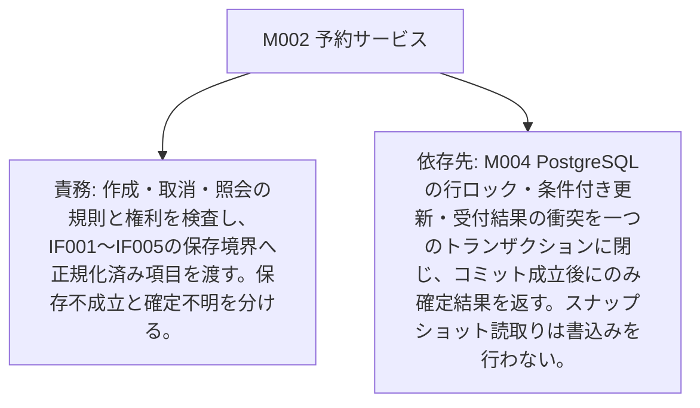

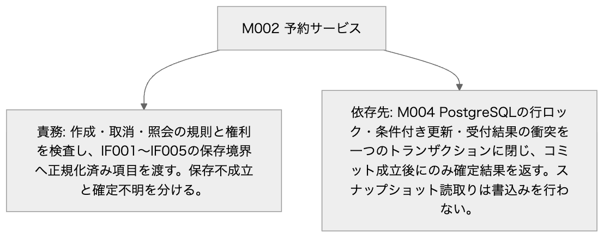

Mermaid: [local-M002.mmd](diagrams/local-M002.mmd) — 矢印は項目と条件の対応を示す。実行順序ではない。厳密な全文は同じ項目の表にある。

### M003 期限監視

| 項目 | 内容 |
| --- | --- |
| 責務 | 起動時と1秒ごとの候補検索でactiveかつ期限到達の予約IDを最大100件取得し、各IDをIF003へ渡す。処理単位は1予約であり、候補検索の時点で返却を確定しない。間隔と件数はD002の未検証提案である。 |
| 依存先 | [M002](common.md#M002) — 作成・取消・照会の規則と権利を検査し、IF001〜IF005の保存境界へ正規化済み項目を渡す。保存不成立と確定不明を分ける。 [M004](common.md#M004) — PostgreSQLの行ロック・条件付き更新・受付結果の衝突を一つのトランザクションに閉じ、コミット成立後にのみ確定結果を返す。スナップショット読取りは書込みを行わない。 |

#### M003 期限監視

矢印は項目と条件の対応を示す。実行順序ではない。厳密な全文は同じ項目の表にある。

Mermaidの記述を確認する

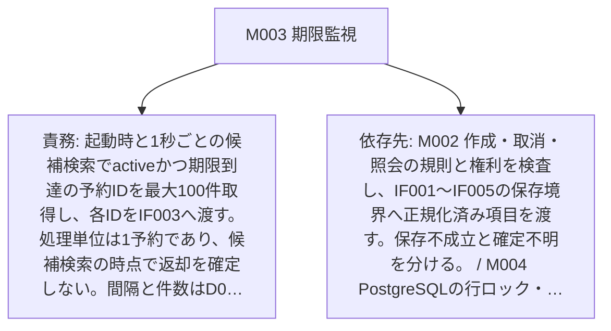

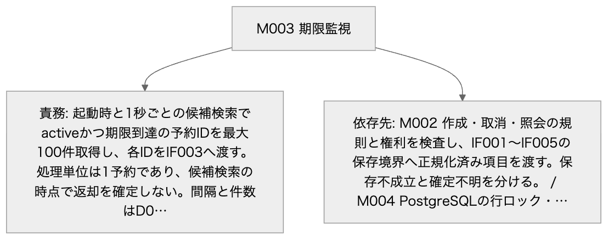

Mermaid: [local-M003.mmd](diagrams/local-M003.mmd) — 矢印は項目と条件の対応を示す。実行順序ではない。厳密な全文は同じ項目の表にある。

### M004 保存リポジトリ

| 項目 | 内容 |
| --- | --- |
| 責務 | PostgreSQLの行ロック・条件付き更新・受付結果の衝突を一つのトランザクションに閉じ、コミット成立後にのみ確定結果を返す。スナップショット読取りは書込みを行わない。 |
| 依存先 | なし |

#### M004 保存リポジトリ

矢印は項目と条件の対応を示す。実行順序ではない。厳密な全文は同じ項目の表にある。

Mermaidの記述を確認する

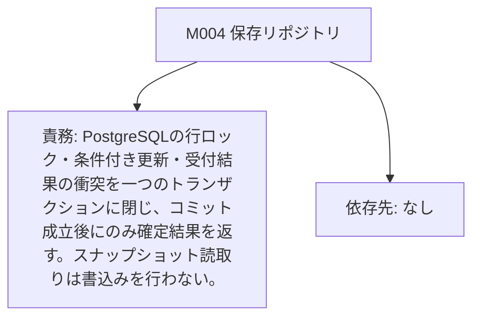

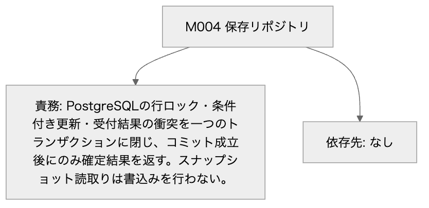

Mermaid: [local-M004.mmd](diagrams/local-M004.mmd) — 矢印は項目と条件の対応を示す。実行順序ではない。厳密な全文は同じ項目の表にある。

## state_sets

### ST001 予約の業務状態

| 項目 | 内容 |
| --- | --- |
| 対象 | 予約の業務状態 |
| 状態と意味 | 名前: absent 意味: 予約が存在しない仮想状態である。DBへabsent行は保存しない。 名前: active 意味: 数量を在庫から引き当てた予約である。期限到達後も返却コミットまで引当は保持し、取消受付では時刻を再検査する。 名前: cancelled 意味: 期限より前の利用者取消により一回の返却を確定した終端である。 名前: expired 意味: 期限到達により一回の返却を確定した終端である。 |

#### ST001 予約の業務状態

共通定義の状態名と実在する遷移だけを示す。競合の勝敗、保存の原子性、等号条件は同じ項目の表にある。

Mermaidの記述を確認する

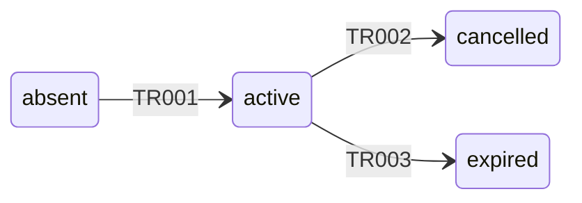

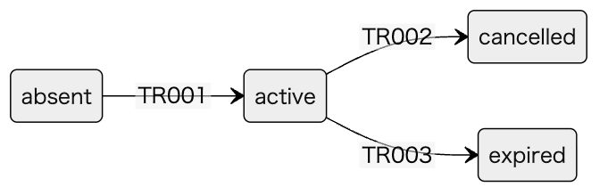

Mermaid: [local-ST001.mmd](diagrams/local-ST001.mmd) — 共通定義の状態名と実在する遷移だけを示す。競合の勝敗、保存の原子性、等号条件は同じ項目の表にある。

> TR001: absent → active / 作成成功 / 在庫行ロック後に数量と上限を検査し受付結果の競合がない。

> TR002: active → cancelled / 期限内の取消 / 全行ロック後の判定時刻<expires_atである。

> TR003: active → expired / 期限到達 / 全行ロック後の判定時刻>=expires_atである。取消または期限監視が同じ条件を使う。

### ST002 画面の操作結果確認状態

| 項目 | 内容 |
| --- | --- |
| 対象 | 画面の操作結果確認状態 |
| 状態と意味 | 名前: ready 意味: 新しい操作を入力できる状態である。 名前: sending 意味: 一つの作成または取消の応答を待つ状態である。 名前: known 意味: 応答または照会により今回の確定結果、更新前拒否、保存不成立のいずれかを確認した状態である。 名前: unknown 意味: 切断・コミット結果不明・受付結果未記録により成否を断定できない状態である。 |

#### ST002 画面の操作結果確認状態

共通定義の状態名と実在する遷移だけを示す。競合の勝敗、保存の原子性、等号条件は同じ項目の表にある。

Mermaidの記述を確認する

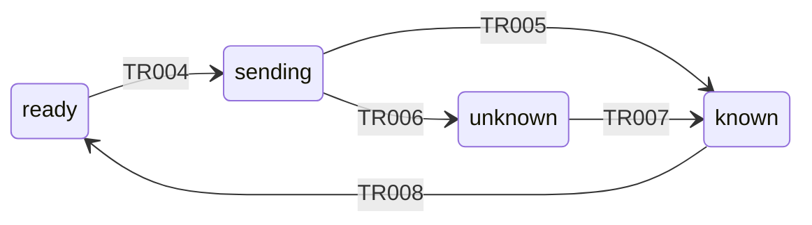

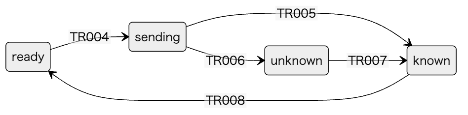

Mermaid: [local-ST002.mmd](diagrams/local-ST002.mmd) — 共通定義の状態名と実在する遷移だけを示す。競合の勝敗、保存の原子性、等号条件は同じ項目の表にある。

> TR004: ready → sending / 新しい操作の送信 / 画面入力検査を通り、操作識別子を保存し一回だけPOSTする。

> TR005: sending → known / 確定応答または保存不成立を受信 / IF001/IF002のunconfirmed以外を受信した。SAVE_FAILEDはROLLBACK確認済みである。

> TR006: sending → unknown / 応答切断または確定不明 / 応答未受信、通信切断、503 COMMIT_UNKNOWNである。

> TR007: unknown → known / 識別子で確定結果を取得 / IF004のfoundでdurable=trueの保存済み結果を得た。

> TR008: known → ready / 利用者が新しい操作を開始 / 既存結果を確認し、最新のIF005スナップショットを取得した。

## decisions

### D001

| 項目 | 内容 |
| --- | --- |
| 区分 | inherited |
| 内容 | HTTP JSON、PostgreSQL、責務の分離、作成の同時確定、状態条件による一回返却、保存側UTCと確定後応答を引き継ぐ。基本設計自身が設計案と明記しており、採用済みや実装検証済みとは扱わない。 |
| 根拠 | [S006](evidence.md#S006) — この資料は設計案である。実装と負荷・競合試験は未実施である。 [S007](evidence.md#S007) — ブラウザ画面はHTTPのJSON APIを呼ぶ。サーバー側は受付・予約サービス・期限監視・保存リポジトリを分け、PostgreSQLへ備品と予約と受付結果を保存する。外部の実行基盤やエージェントは使わない。 [S008](evidence.md#S008) — 作成は在庫確認と数量の引当と予約と受付結果を一つの保存単位で確定する。同時再送は受付用識別子の一意制約で照合する。取消と期限処理は同じ予約の状態を条件にして一方だけが在庫を戻す。 時刻は保存側のUTCとし、画面の押下時刻を期限判定に使わない。期限処理が遅れても、取消の受付では期限を再検査する。 通知は保存確定後に画面へ返す。通信切断後や再起動後も受付用識別子で確定結果を照会し、外部への更新を再実行したことにしない。 |
| 採用判断 | proposed |
| 判断の証拠 | なし |
| 検証内容・状態 | unverified |
| 検証の証拠 | なし |
| 外部検証への依存 | false |
| 関連する未決 | [U001](evidence.md#U001) — PostgreSQL対象版・実装・実DBの原子性、競合、停止注入、負荷と移行は未検証である。外部サービスへの接続試験も今回実施していない。 / 全不変条件・返却一回・確定結果照会が観測値で一致し、期限監視の遅延と負荷の目標値を関係者が決定し実測が満たすことを採用条件とする。文書検査では代替しない。 / 検証: 開発側が対象版を記録し、C001〜C014、READ COMMITTEDの待機後再読、受付結果衝突の全ROLLBACK、時刻精度、DB回復、索引実行計画と移行失敗を隔離環境で試験する。外部サービスは採用する場合に別途接続契約を検証する。 [U003](evidence.md#U003) — 設計案の採用承認、取消識別子の拡張、保管期間・容量、数値上限と監視間隔の合意は未実施である。 / 選択条件と制約が明示され判断の出典が残った場合だけadoptionをacceptedへ変更する。現段階では全件proposedを維持する。 / 検証: 設計責任者と運用担当がD001〜D004の提案、結果照会の保持保証、削除しない場合の容量見積りと個人情報保管をレビューし、判断記録を残す。 |

[S006](evidence.md#S006)

> この資料は設計案である。実装と負荷・競合試験は未実施である。

出典: [docs/basic-design.md 3行目](/private/tmp/detailed-design-public-nu7gtxsu/docs/basic-design.md:3:1)

[S007](evidence.md#S007)

> ブラウザ画面はHTTPのJSON APIを呼ぶ。サーバー側は受付・予約サービス・期限監視・保存リポジトリを分け、PostgreSQLへ備品と予約と受付結果を保存する。外部の実行基盤やエージェントは使わない。

出典: [docs/basic-design.md 5行目](/private/tmp/detailed-design-public-nu7gtxsu/docs/basic-design.md:5:1)

[S008](evidence.md#S008)

> 作成は在庫確認と数量の引当と予約と受付結果を一つの保存単位で確定する。同時再送は受付用識別子の一意制約で照合する。取消と期限処理は同じ予約の状態を条件にして一方だけが在庫を戻す。
> 時刻は保存側のUTCとし、画面の押下時刻を期限判定に使わない。期限処理が遅れても、取消の受付では期限を再検査する。
> 通知は保存確定後に画面へ返す。通信切断後や再起動後も受付用識別子で確定結果を照会し、外部への更新を再実行したことにしない。

出典: [docs/basic-design.md 6行目](/private/tmp/detailed-design-public-nu7gtxsu/docs/basic-design.md:6:1)

#### D001 D001

矢印は項目と条件の対応を示す。実行順序ではない。厳密な全文は同じ項目の表にある。

Mermaidの記述を確認する

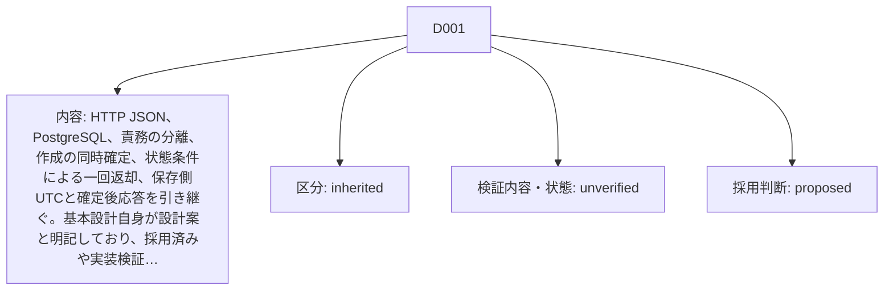

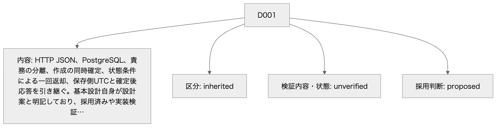

Mermaid: [local-D001.mmd](diagrams/local-D001.mmd) — 矢印は項目と条件の対応を示す。実行順序ではない。厳密な全文は同じ項目の表にある。

### D002

| 項目 | 内容 |
| --- | --- |
| 区分 | proposed |
| 内容 | API v1、UUID正規形、数量・在庫の上限、JSONの4096バイト上限、UTC精度、物理型、READ COMMITTEDと行ロック、受付結果最終登録、期限監視1秒・100件、索引・移行・エラーを提案する。PostgreSQLの対象版は未選定であり、ロック待機後の時刻と競合ロールバックを実DBで検証してから採用する。 |
| 根拠 | [S009](evidence.md#S009) — APIの項目・サイズ・エラー、物理列・索引・移行、取得順と原子性、画面の操作可否と更新、試験条件は詳細設計で具体化する。 |
| 採用判断 | proposed |
| 判断の証拠 | なし |
| 検証内容・状態 | unverified |
| 検証の証拠 | なし |
| 外部検証への依存 | true |
| 関連する未決 | [U001](evidence.md#U001) — PostgreSQL対象版・実装・実DBの原子性、競合、停止注入、負荷と移行は未検証である。外部サービスへの接続試験も今回実施していない。 / 全不変条件・返却一回・確定結果照会が観測値で一致し、期限監視の遅延と負荷の目標値を関係者が決定し実測が満たすことを採用条件とする。文書検査では代替しない。 / 検証: 開発側が対象版を記録し、C001〜C014、READ COMMITTEDの待機後再読、受付結果衝突の全ROLLBACK、時刻精度、DB回復、索引実行計画と移行失敗を隔離環境で試験する。外部サービスは採用する場合に別途接続契約を検証する。 [U003](evidence.md#U003) — 設計案の採用承認、取消識別子の拡張、保管期間・容量、数値上限と監視間隔の合意は未実施である。 / 選択条件と制約が明示され判断の出典が残った場合だけadoptionをacceptedへ変更する。現段階では全件proposedを維持する。 / 検証: 設計責任者と運用担当がD001〜D004の提案、結果照会の保持保証、削除しない場合の容量見積りと個人情報保管をレビューし、判断記録を残す。 |

[S009](evidence.md#S009)

> APIの項目・サイズ・エラー、物理列・索引・移行、取得順と原子性、画面の操作可否と更新、試験条件は詳細設計で具体化する。

出典: [docs/basic-design.md 9行目](/private/tmp/detailed-design-public-nu7gtxsu/docs/basic-design.md:9:1)

#### D002 D002

矢印は項目と条件の対応を示す。実行順序ではない。厳密な全文は同じ項目の表にある。

Mermaidの記述を確認する

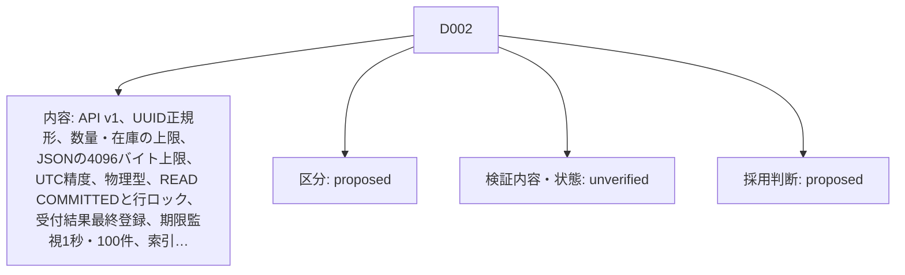

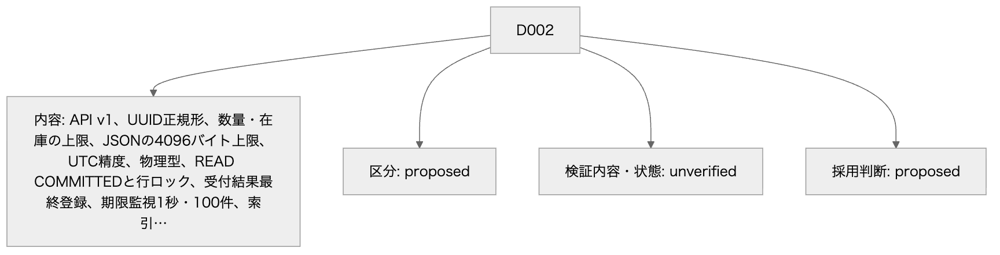

Mermaid: [local-D002.mmd](diagrams/local-D002.mmd) — 矢印は項目と条件の対応を示す。実行順序ではない。厳密な全文は同じ項目の表にある。

### D003

| 項目 | 内容 |
| --- | --- |
| 区分 | proposed |
| 内容 | 認証済みowner_idをサーバーの信頼済み文脈として渡し、本人の予約と受付結果だけを操作・照会する。画面の状態、最大5秒間隔の読取り更新とキーボード操作を提案する。認証方式とアダプターの写像は未検証である。 |
| 根拠 | [S005](evidence.md#S005) — 画面は在庫数、予約の状態、操作結果を表示し、期限切れ後は取消を受け付けない。キーボードで予約・取消・結果照会を行える。 [S009](evidence.md#S009) — APIの項目・サイズ・エラー、物理列・索引・移行、取得順と原子性、画面の操作可否と更新、試験条件は詳細設計で具体化する。 |
| 採用判断 | proposed |
| 判断の証拠 | なし |
| 検証内容・状態 | unverified |
| 検証の証拠 | なし |
| 外部検証への依存 | true |
| 関連する未決 | [U002](evidence.md#U002) — 認証方式・権限の供給とHTTP/画面実装は未確認である。 / 利用者が他人の予約・結果を読書きできず、期限・状態・操作結果とフォーカスがUI001と一致することを採用条件とする。 / 検証: owner_idとworker_roleの信頼境界、本人以外の照会拒否、JSONとNULLの写像、キーボード・ライブ領域・sessionStorage復元とログアウトを実装で試験する。外部認証サービスへは接続していない。 [U003](evidence.md#U003) — 設計案の採用承認、取消識別子の拡張、保管期間・容量、数値上限と監視間隔の合意は未実施である。 / 選択条件と制約が明示され判断の出典が残った場合だけadoptionをacceptedへ変更する。現段階では全件proposedを維持する。 / 検証: 設計責任者と運用担当がD001〜D004の提案、結果照会の保持保証、削除しない場合の容量見積りと個人情報保管をレビューし、判断記録を残す。 |

[S005](evidence.md#S005)

> 画面は在庫数、予約の状態、操作結果を表示し、期限切れ後は取消を受け付けない。キーボードで予約・取消・結果照会を行える。

出典: [docs/requirement.md 7行目](/private/tmp/detailed-design-public-nu7gtxsu/docs/requirement.md:7:1)

[S009](evidence.md#S009)

> APIの項目・サイズ・エラー、物理列・索引・移行、取得順と原子性、画面の操作可否と更新、試験条件は詳細設計で具体化する。

出典: [docs/basic-design.md 9行目](/private/tmp/detailed-design-public-nu7gtxsu/docs/basic-design.md:9:1)

#### D003 D003

矢印は項目と条件の対応を示す。実行順序ではない。厳密な全文は同じ項目の表にある。

Mermaidの記述を確認する

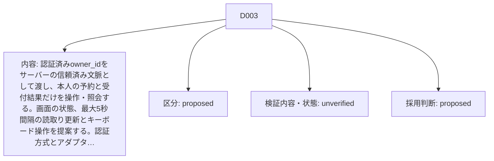

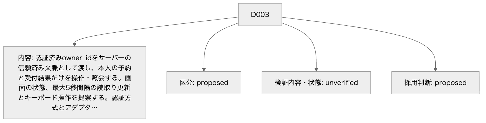

Mermaid: [local-D003.mmd](diagrams/local-D003.mmd) — 矢印は項目と条件の対応を示す。実行順序ではない。厳密な全文は同じ項目の表にある。

### D004

| 項目 | 内容 |
| --- | --- |
| 区分 | proposed |
| 内容 | 取消にも受付用識別子を設け、作成と同じ結果台帳へ保存する。結果照会の保証を守るため備品・予約・受付結果をこの範囲では自動削除しない。容量・個人情報の保管期間と運用承認が必要である。識別子再利用を認める変更は互換性を別途設計する。 |
| 根拠 | [S003](evidence.md#S003) — 作成の同じ受付用識別子・同じ内容の再送は新しい予約を作らない。違う内容なら競合として返す。 [S004](evidence.md#S004) — 保存確定後に応答する。応答切断後は識別子で確定した結果を照会し、予約や在庫の更新を自動で繰り返さない。 [S008](evidence.md#S008) — 作成は在庫確認と数量の引当と予約と受付結果を一つの保存単位で確定する。同時再送は受付用識別子の一意制約で照合する。取消と期限処理は同じ予約の状態を条件にして一方だけが在庫を戻す。 時刻は保存側のUTCとし、画面の押下時刻を期限判定に使わない。期限処理が遅れても、取消の受付では期限を再検査する。 通知は保存確定後に画面へ返す。通信切断後や再起動後も受付用識別子で確定結果を照会し、外部への更新を再実行したことにしない。 |
| 採用判断 | proposed |
| 判断の証拠 | なし |
| 検証内容・状態 | unverified |
| 検証の証拠 | なし |
| 外部検証への依存 | false |
| 関連する未決 | [U003](evidence.md#U003) — 設計案の採用承認、取消識別子の拡張、保管期間・容量、数値上限と監視間隔の合意は未実施である。 / 選択条件と制約が明示され判断の出典が残った場合だけadoptionをacceptedへ変更する。現段階では全件proposedを維持する。 / 検証: 設計責任者と運用担当がD001〜D004の提案、結果照会の保持保証、削除しない場合の容量見積りと個人情報保管をレビューし、判断記録を残す。 |

[S003](evidence.md#S003)

> 作成の同じ受付用識別子・同じ内容の再送は新しい予約を作らない。違う内容なら競合として返す。

出典: [docs/requirement.md 5行目](/private/tmp/detailed-design-public-nu7gtxsu/docs/requirement.md:5:1)

[S004](evidence.md#S004)

> 保存確定後に応答する。応答切断後は識別子で確定した結果を照会し、予約や在庫の更新を自動で繰り返さない。

出典: [docs/requirement.md 6行目](/private/tmp/detailed-design-public-nu7gtxsu/docs/requirement.md:6:1)

[S008](evidence.md#S008)

> 作成は在庫確認と数量の引当と予約と受付結果を一つの保存単位で確定する。同時再送は受付用識別子の一意制約で照合する。取消と期限処理は同じ予約の状態を条件にして一方だけが在庫を戻す。
> 時刻は保存側のUTCとし、画面の押下時刻を期限判定に使わない。期限処理が遅れても、取消の受付では期限を再検査する。
> 通知は保存確定後に画面へ返す。通信切断後や再起動後も受付用識別子で確定結果を照会し、外部への更新を再実行したことにしない。

出典: [docs/basic-design.md 6行目](/private/tmp/detailed-design-public-nu7gtxsu/docs/basic-design.md:6:1)

#### D004 D004

矢印は項目と条件の対応を示す。実行順序ではない。厳密な全文は同じ項目の表にある。

Mermaidの記述を確認する

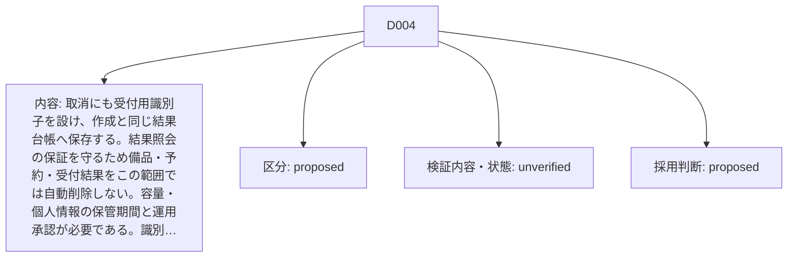

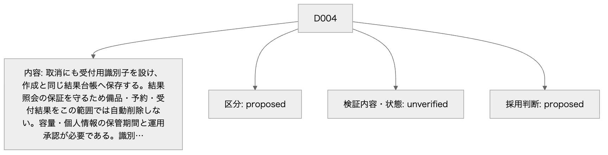

Mermaid: [local-D004.mmd](diagrams/local-D004.mmd) — 矢印は項目と条件の対応を示す。実行順序ではない。厳密な全文は同じ項目の表にある。

## transitions

### TR001

| 項目 | 内容 |
| --- | --- |
| 状態定義 | [ST001](common.md#ST001) — absent: 予約が存在しない仮想状態である。DBへabsent行は保存しない。 / active: 数量を在庫から引き当てた予約である。期限到達後も返却コミットまで引当は保持し、取消受付では時刻を再検査する。 / cancelled: 期限より前の利用者取消により一回の返却を確定した終端である。 / expired: 期限到達により一回の返却を確定した終端である。 |
| 現在状態 | absent |
| イベント | 作成成功 |
| 遷移条件 | 在庫行ロック後に数量と上限を検査し受付結果の競合がない。 |
| 次状態 | active |
| 保存の内容と原子性 | 在庫減算・予約INSERT・受付結果INSERTを同じCOMMITで確定する。 |
| 通知 | CREATEDをCOMMIT成立後に返す。 |
| 確認条件 | [C001](verification.md#C001) — 在庫3、本人の新しい受付用識別子、quantity=2を用意する。 / IF001で作成し、IF004とIF005を読む。 / CREATED、予約active、残数1、expires_at=created_at+10分、受付結果一件となる。保存済み共通応答と操作表示が一致する。 [C003](verification.md#C003) — 同じ備品のavailable=1と異なる受付識別子二つを用意する。 / quantity=1の作成を同期して同時到着させる。 / CREATEDは一件、他方NO_STOCK、available=0、active合計=1となる。二件の受付結果を記録し、負在庫と二重引当を生じない。 [C008](verification.md#C008) — 同一owner_id+request_idで同じ作成内容または同じ取消内容を二件用意する。 / 同時に送信し、受付結果最終INSERTの前後で待機を注入する。 / 共通応答は一つの保存結果に一致し、作成予約は一件、取消返却は一回である。仮更新敗者は全ROLLBACKし、再送で期限を延ばさない。 |

#### TR001 TR001

共通定義の状態名と実在する遷移だけを示す。競合の勝敗、保存の原子性、等号条件は同じ項目の表にある。

Mermaidの記述を確認する

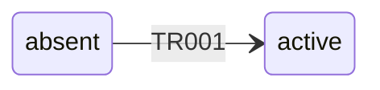

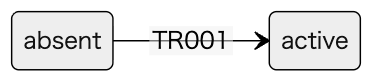

Mermaid: [local-TR001.mmd](diagrams/local-TR001.mmd) — 共通定義の状態名と実在する遷移だけを示す。競合の勝敗、保存の原子性、等号条件は同じ項目の表にある。

> TR001: absent → active / 作成成功 / 在庫行ロック後に数量と上限を検査し受付結果の競合がない。

### TR002

| 項目 | 内容 |
| --- | --- |
| 状態定義 | [ST001](common.md#ST001) — absent: 予約が存在しない仮想状態である。DBへabsent行は保存しない。 / active: 数量を在庫から引き当てた予約である。期限到達後も返却コミットまで引当は保持し、取消受付では時刻を再検査する。 / cancelled: 期限より前の利用者取消により一回の返却を確定した終端である。 / expired: 期限到達により一回の返却を確定した終端である。 |
| 現在状態 | active |
| イベント | 期限内の取消 |
| 遷移条件 | 全行ロック後の判定時刻<expires_atである。 |
| 次状態 | cancelled |
| 保存の内容と原子性 | 状態条件activeで更新し在庫加算・version増加・取消受付結果を同時COMMITする。 |
| 通知 | CANCELLEDと操作時点の残数を返す。 |
| 確認条件 | [C004](verification.md#C004) — active予約の期限をTとし、ロック後に採る判定時刻をT-1マイクロ秒に固定できる試験構成とする。 / 本人がIF002で取消する。 / TR002でcancelled、一回だけquantityを返却しCANCELLEDを記録する。ended_at<Tであり受付結果・在庫・状態が同時確定する。 [C006](verification.md#C006) — active予約に本人取消二件と期限処理を用意し、期限直前・等号・直後を制御する。 / 全処理を同時開始し備品ロック待機を注入する。 / ロック取得後の時刻で勝敗が決まり、期限前に確定した取消だけcancelled、期限到達ならexpiredとなる。available増分はquantity一回、version増分一回で終端を覆さない。待機前時刻を使わない。 |

#### TR002 TR002

共通定義の状態名と実在する遷移だけを示す。競合の勝敗、保存の原子性、等号条件は同じ項目の表にある。

Mermaidの記述を確認する

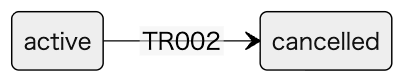

Mermaid: [local-TR002.mmd](diagrams/local-TR002.mmd) — 共通定義の状態名と実在する遷移だけを示す。競合の勝敗、保存の原子性、等号条件は同じ項目の表にある。

> TR002: active → cancelled / 期限内の取消 / 全行ロック後の判定時刻<expires_atである。

### TR003

| 項目 | 内容 |
| --- | --- |
| 状態定義 | [ST001](common.md#ST001) — absent: 予約が存在しない仮想状態である。DBへabsent行は保存しない。 / active: 数量を在庫から引き当てた予約である。期限到達後も返却コミットまで引当は保持し、取消受付では時刻を再検査する。 / cancelled: 期限より前の利用者取消により一回の返却を確定した終端である。 / expired: 期限到達により一回の返却を確定した終端である。 |
| 現在状態 | active |
| イベント | 期限到達 |
| 遷移条件 | 全行ロック後の判定時刻>=expires_atである。取消または期限監視が同じ条件を使う。 |
| 次状態 | expired |
| 保存の内容と原子性 | 状態条件activeで更新し在庫加算・version増加を同時COMMITする。取消起点ならEXPIREDの受付結果も含める。 |
| 通知 | 取消にはEXPIRED、監視にはappliedを返し、画面は次の読取りで更新する。 |
| 確認条件 | [C005](verification.md#C005) — active予約の期限T、監視遅延、判定時刻TとT+1マイクロ秒の二条件を用意する。 / IF002またはIF003を呼び、後で同じ予約を再処理する。 / どちらもTR003でexpiredと一回返却になる。取消の応答はEXPIRED、監視はappliedであり、次回はterminal/no_opで二回目の返却がない。 [C006](verification.md#C006) — active予約に本人取消二件と期限処理を用意し、期限直前・等号・直後を制御する。 / 全処理を同時開始し備品ロック待機を注入する。 / ロック取得後の時刻で勝敗が決まり、期限前に確定した取消だけcancelled、期限到達ならexpiredとなる。available増分はquantity一回、version増分一回で終端を覆さない。待機前時刻を使わない。 [C007](verification.md#C007) — 期限到達activeを含む複数予約と監視停止・再起動を用意する。 / 監視を止め期限を越え、起動時に候補を最大100件ずつ処理する。 / 期限到達activeは返却まで処理待ち表示となり取消受付は期限再検査でEXPIREDとなる。各予約の返却一回と不変条件を保ち、候補が次の走査で消失しない。 |

#### TR003 TR003

共通定義の状態名と実在する遷移だけを示す。競合の勝敗、保存の原子性、等号条件は同じ項目の表にある。

Mermaidの記述を確認する

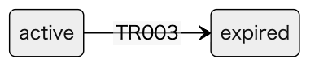

Mermaid: [local-TR003.mmd](diagrams/local-TR003.mmd) — 共通定義の状態名と実在する遷移だけを示す。競合の勝敗、保存の原子性、等号条件は同じ項目の表にある。

> TR003: active → expired / 期限到達 / 全行ロック後の判定時刻>=expires_atである。取消または期限監視が同じ条件を使う。

### TR004

| 項目 | 内容 |
| --- | --- |
| 状態定義 | [ST002](common.md#ST002) — ready: 新しい操作を入力できる状態である。 / sending: 一つの作成または取消の応答を待つ状態である。 / known: 応答または照会により今回の確定結果、更新前拒否、保存不成立のいずれかを確認した状態である。 / unknown: 切断・コミット結果不明・受付結果未記録により成否を断定できない状態である。 |
| 現在状態 | ready |
| イベント | 新しい操作の送信 |
| 遷移条件 | 画面入力検査を通り、操作識別子を保存し一回だけPOSTする。 |
| 次状態 | sending |
| 保存の内容と原子性 | 画面メモリとsessionStorageに操作種別・識別子・正規化内容を保存する。業務更新はF001/F002へ委ねる。 |
| 通知 | 作成・取消・結果照会の重複起動を抑止する。 |
| 確認条件 | [C013](verification.md#C013) — UI001をキーボードだけで操作し、在庫変化と入力不正・成功・切断を用意する。 / 予約・取消・結果照会・現在値更新と新しい操作への移行を行う。 / フォーカス順・エラー復帰・結果ライブ通知が機能し、sending多重送信を防ぐ。unknownは照会だけ、knownからは最新取得後readyへ進む。旧世代の読取応答で現在値を巻き戻さない。 |

#### TR004 TR004

共通定義の状態名と実在する遷移だけを示す。競合の勝敗、保存の原子性、等号条件は同じ項目の表にある。

Mermaidの記述を確認する

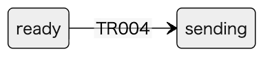

Mermaid: [local-TR004.mmd](diagrams/local-TR004.mmd) — 共通定義の状態名と実在する遷移だけを示す。競合の勝敗、保存の原子性、等号条件は同じ項目の表にある。

> TR004: ready → sending / 新しい操作の送信 / 画面入力検査を通り、操作識別子を保存し一回だけPOSTする。

### TR005

| 項目 | 内容 |
| --- | --- |
| 状態定義 | [ST002](common.md#ST002) — ready: 新しい操作を入力できる状態である。 / sending: 一つの作成または取消の応答を待つ状態である。 / known: 応答または照会により今回の確定結果、更新前拒否、保存不成立のいずれかを確認した状態である。 / unknown: 切断・コミット結果不明・受付結果未記録により成否を断定できない状態である。 |
| 現在状態 | sending |
| イベント | 確定応答または保存不成立を受信 |
| 遷移条件 | IF001/IF002のunconfirmed以外を受信した。SAVE_FAILEDはROLLBACK確認済みである。 |
| 次状態 | known |
| 保存の内容と原子性 | 結果を画面とsessionStorageへ保持する。durable=falseの拒否は保存済み結果と表示を分ける。 |
| 通知 | 成功・期限切れ・拒否・保存不成立を文字で通知する。 |
| 確認条件 | [C010](verification.md#C010) — 作成・取消・期限処理で在庫更新後、予約更新後、受付結果INSERT後、COMMIT前に失敗を注入する。 / ROLLBACK成立を確認し、DBと応答を読む。 / 旧在庫・旧状態・旧受付結果を保ちSAVE_FAILEDを返す。新規予約や返却だけが残らない。version上限では更新しない。作成・取消はVERSION_LIMITの受付結果を記録し、期限処理はVERSION_LIMITのfailedを返して監視に残す。実行前検査拒否と保存不成立を区別する。 [C013](verification.md#C013) — UI001をキーボードだけで操作し、在庫変化と入力不正・成功・切断を用意する。 / 予約・取消・結果照会・現在値更新と新しい操作への移行を行う。 / フォーカス順・エラー復帰・結果ライブ通知が機能し、sending多重送信を防ぐ。unknownは照会だけ、knownからは最新取得後readyへ進む。旧世代の読取応答で現在値を巻き戻さない。 |

[IF001](interfaces.md#IF001)

> 同じrequest_idと正規化内容を受付・サービス・保存で引き継ぐ。内部の数量を再生成しない。 / 応答候補の全項目を返す。確定した業務結果だけを保存し、コミット結果不明を保存済み拒否に変えない。 / CREATED、NO_STOCK、NOT_FOUND、VERSION_LIMIT、INVALID_INPUT、TOO_LARGE、UNSUPPORTED_MEDIA、UNAUTHENTICATED、FORBIDDEN、ID_CONFLICT、SAVE_FAILED、COMMIT_UNKNOWNを共通応答のcodeで判別する。 / 入力: context.owner_id: string(uuid) 必須 NULL不可, サーバー認証で確定した利用者。クライアントからの指定を許可しない。 / body.request_id: string(uuid) 必須 NULL不可, 小文字ハイフン付きUUID正規形36文字。異なる世代の操作に再利用しない。 / body.item_id: string(uuid) 必須 NULL不可, 登録済み備品ID。 / body.quantity: integer 必須 NULL不可, 1〜1000000の整数。 / 応答: created: 201 CREATED。新しい予約と在庫・受付結果のCOMMITを確認した応答でありdurable=trueとする。 (request_id: string(uuid) or null 必須 NULL可, 妥当な識別子を受理済みならその値を返す。欠落・不正・識別前の拒否ではnullとする。; code: string 必須 NULL不可, CREATEDだけを返す。; message: string 必須 NULL不可, 1〜200 Unicode文字かつUTF-8で800バイト以下。利用者向け理由を返し内部例外は含めない。; reservation_id: string(uuid) or null 必須 NULL可, 予約に結び付く確定結果ではそのID、それ以外はnullとする。; state_at_result: string or null 必須 NULL可, 結果確定時のactive・cancelled・expired。予約がない拒否・保存不成立・確定不明はnullとする。; expires_at: string(datetime) or null 必須 NULL可, 予約に結び付く結果では共通UTC形式、それ以外はnullとする。; available_at_result: integer or null 必須 NULL可, 0〜1000000000。保存単位で取得した残数。備品がない場合、入力拒否、保存不成立、確定不明はnullとする。; result_at: string(datetime) or null 必須 NULL可, durable=trueの確定結果では共通UTC形式の確定判断時刻、durable=falseではnullとする。COMMIT完了時刻と同一とは限らない。; durable: boolean 必須 NULL不可, T003へCOMMITした応答はtrue、入力拒否・ID_CONFLICT・SAVE_FAILED・COMMIT_UNKNOWN等の非保存応答はfalseとする。) / replay: 保存済み結果と同じHTTP状態・共通応答を返す。CREATED、NO_STOCK、NOT_FOUND、VERSION_LIMITの元コードを変更しない。 (request_id: string(uuid) or null 必須 NULL可, 妥当な識別子を受理済みならその値を返す。欠落・不正・識別前の拒否ではnullとする。; code: string 必須 NULL不可, CREATED、NO_STOCK、NOT_FOUND、VERSION_LIMITだけを返す。; message: string 必須 NULL不可, 1〜200 Unicode文字かつUTF-8で800バイト以下。利用者向け理由を返し内部例外は含めない。; reservation_id: string(uuid) or null 必須 NULL可, 予約に結び付く確定結果ではそのID、それ以外はnullとする。; state_at_result: string or null 必須 NULL可, 結果確定時のactive・cancelled・expired。予約がない拒否・保存不成立・確定不明はnullとする。; expires_at: string(datetime) or null 必須 NULL可, 予約に結び付く結果では共通UTC形式、それ以外はnullとする。; available_at_result: integer or null 必須 NULL可, 0〜1000000000。保存単位で取得した残数。備品がない場合、入力拒否、保存不成立、確定不明はnullとする。; result_at: string(datetime) or null 必須 NULL可, durable=trueの確定結果では共通UTC形式の確定判断時刻、durable=falseではnullとする。COMMIT完了時刻と同一とは限らない。; durable: boolean 必須 NULL不可, T003へCOMMITした応答はtrue、入力拒否・ID_CONFLICT・SAVE_FAILED・COMMIT_UNKNOWN等の非保存応答はfalseとする。) / rejected: 400 INVALID_INPUT、413 TOO_LARGE、415 UNSUPPORTED_MEDIA、401 UNAUTHENTICATED、403 FORBIDDEN、404 NOT_FOUND、409 ID_CONFLICT、503 SAVE_FAILED、503 VERSION_LIMITとする。SAVE_FAILEDはROLLBACK確認済みに限る。NOT_FOUNDとVERSION_LIMITの有効要求はdurable=trueとして記録し、それ以外の事前拒否はfalseとする。 在庫不足は409 NO_STOCK、durable=trueとする。 (request_id: string(uuid) or null 必須 NULL可, 妥当な識別子を受理済みならその値を返す。欠落・不正・識別前の拒否ではnullとする。; code: string 必須 NULL不可, INVALID_INPUT、TOO_LARGE、UNSUPPORTED_MEDIA、UNAUTHENTICATED、FORBIDDEN、NOT_FOUND、ID_CONFLICT、SAVE_FAILED、VERSION_LIMIT、NO_STOCKだけを返す。; message: string 必須 NULL不可, 1〜200 Unicode文字かつUTF-8で800バイト以下。利用者向け理由を返し内部例外は含めない。; reservation_id: string(uuid) or null 必須 NULL可, 予約に結び付く確定結果ではそのID、それ以外はnullとする。; state_at_result: string or null 必須 NULL可, 結果確定時のactive・cancelled・expired。予約がない拒否・保存不成立・確定不明はnullとする。; expires_at: string(datetime) or null 必須 NULL可, 予約に結び付く結果では共通UTC形式、それ以外はnullとする。; available_at_result: integer or null 必須 NULL可, 0〜1000000000。保存単位で取得した残数。備品がない場合、入力拒否、保存不成立、確定不明はnullとする。; result_at: string(datetime) or null 必須 NULL可, durable=trueの確定結果では共通UTC形式の確定判断時刻、durable=falseではnullとする。COMMIT完了時刻と同一とは限らない。; durable: boolean 必須 NULL不可, T003へCOMMITした応答はtrue、入力拒否・ID_CONFLICT・SAVE_FAILED・COMMIT_UNKNOWN等の非保存応答はfalseとする。) / unconfirmed: 503 COMMIT_UNKNOWN。結果が不明でありdurable=false、予約・状態・期限・残数・result_atはnullとする。応答不能ならHTTP応答はなく、画面が切断からunknownへ進む。 (request_id: string(uuid) or null 必須 NULL可, 妥当な識別子を受理済みならその値を返す。欠落・不正・識別前の拒否ではnullとする。; code: string 必須 NULL不可, COMMIT_UNKNOWNだけを返す。; message: string 必須 NULL不可, 1〜200 Unicode文字かつUTF-8で800バイト以下。利用者向け理由を返し内部例外は含めない。; reservation_id: string(uuid) or null 必須 NULL可, 予約に結び付く確定結果ではそのID、それ以外はnullとする。; state_at_result: string or null 必須 NULL可, 結果確定時のactive・cancelled・expired。予約がない拒否・保存不成立・確定不明はnullとする。; expires_at: string(datetime) or null 必須 NULL可, 予約に結び付く結果では共通UTC形式、それ以外はnullとする。; available_at_result: integer or null 必須 NULL可, 0〜1000000000。保存単位で取得した残数。備品がない場合、入力拒否、保存不成立、確定不明はnullとする。; result_at: string(datetime) or null 必須 NULL可, durable=trueの確定結果では共通UTC形式の確定判断時刻、durable=falseではnullとする。COMMIT完了時刻と同一とは限らない。; durable: boolean 必須 NULL不可, T003へCOMMITした応答はtrue、入力拒否・ID_CONFLICT・SAVE_FAILED・COMMIT_UNKNOWN等の非保存応答はfalseとする。) / 最大サイズ: 要求本文4096バイト以下、応答8192バイト以下とする。HTTPパスとヘッダーは合計2048バイト以下とする提案である。

#### TR005 TR005

共通定義の状態名と実在する遷移だけを示す。競合の勝敗、保存の原子性、等号条件は同じ項目の表にある。

Mermaidの記述を確認する

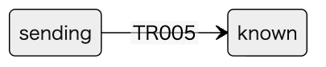

Mermaid: [local-TR005.mmd](diagrams/local-TR005.mmd) — 共通定義の状態名と実在する遷移だけを示す。競合の勝敗、保存の原子性、等号条件は同じ項目の表にある。

> TR005: sending → known / 確定応答または保存不成立を受信 / IF001/IF002のunconfirmed以外を受信した。SAVE_FAILEDはROLLBACK確認済みである。

### TR006

| 項目 | 内容 |
| --- | --- |
| 状態定義 | [ST002](common.md#ST002) — ready: 新しい操作を入力できる状態である。 / sending: 一つの作成または取消の応答を待つ状態である。 / known: 応答または照会により今回の確定結果、更新前拒否、保存不成立のいずれかを確認した状態である。 / unknown: 切断・コミット結果不明・受付結果未記録により成否を断定できない状態である。 |
| 現在状態 | sending |
| イベント | 応答切断または確定不明 |
| 遷移条件 | 応答未受信、通信切断、503 COMMIT_UNKNOWNである。 |
| 次状態 | unknown |
| 保存の内容と原子性 | 実DB状態を断定せず操作識別子を保持する。 |
| 通知 | 未確認と結果照会を表示する。 |
| 確認条件 | [C011](verification.md#C011) — 作成と取消のCOMMIT送信中、COMMIT後応答前、応答受信後の各切断位置とブラウザ再読込みを用意する。 / 元request_idでIF004を繰り返し読み、IF005も読む。 / 確定済みならfoundの元結果が一致しunknown→known、未記録/照会失敗ならunknownを保つ。送信中切断を旧状態維持と断定しない。作成・取消の自動再実行が0回であり、現在値だけで元操作の成功を断定しない。 |

#### TR006 TR006

共通定義の状態名と実在する遷移だけを示す。競合の勝敗、保存の原子性、等号条件は同じ項目の表にある。

Mermaidの記述を確認する

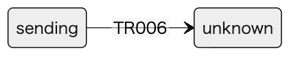

Mermaid: [local-TR006.mmd](diagrams/local-TR006.mmd) — 共通定義の状態名と実在する遷移だけを示す。競合の勝敗、保存の原子性、等号条件は同じ項目の表にある。

> TR006: sending → unknown / 応答切断または確定不明 / 応答未受信、通信切断、503 COMMIT_UNKNOWNである。

### TR007

| 項目 | 内容 |
| --- | --- |
| 状態定義 | [ST002](common.md#ST002) — ready: 新しい操作を入力できる状態である。 / sending: 一つの作成または取消の応答を待つ状態である。 / known: 応答または照会により今回の確定結果、更新前拒否、保存不成立のいずれかを確認した状態である。 / unknown: 切断・コミット結果不明・受付結果未記録により成否を断定できない状態である。 |
| 現在状態 | unknown |
| イベント | 識別子で確定結果を取得 |
| 遷移条件 | IF004のfoundでdurable=trueの保存済み結果を得た。 |
| 次状態 | known |
| 保存の内容と原子性 | 元操作の共通応答を表示する。現在値はIF005で別に得る。 |
| 通知 | 結果照会で確認できた旨を通知する。 |
| 確認条件 | [C011](verification.md#C011) — 作成と取消のCOMMIT送信中、COMMIT後応答前、応答受信後の各切断位置とブラウザ再読込みを用意する。 / 元request_idでIF004を繰り返し読み、IF005も読む。 / 確定済みならfoundの元結果が一致しunknown→known、未記録/照会失敗ならunknownを保つ。送信中切断を旧状態維持と断定しない。作成・取消の自動再実行が0回であり、現在値だけで元操作の成功を断定しない。 [C014](verification.md#C014) — 作成成功の受付結果を残し、その予約を期限切れにする。他人のID・欠落ID・任意予約ID未指定の読取りも用意する。 / IF004とIF005を呼ぶ。 / IF004は元CREATED・activeを固定して返し、IF005は現在expiredと返却後残数を返す。終端結果をpendingにしない。他人の結果はNOT_RECORDED、他人/別備品予約はNOT_FOUND、任意予約ID欠落は在庫だけで予約各項目null、指定nullはINVALID_INPUTとなる。 |

#### TR007 TR007

共通定義の状態名と実在する遷移だけを示す。競合の勝敗、保存の原子性、等号条件は同じ項目の表にある。

Mermaidの記述を確認する

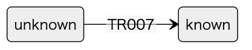

Mermaid: [local-TR007.mmd](diagrams/local-TR007.mmd) — 共通定義の状態名と実在する遷移だけを示す。競合の勝敗、保存の原子性、等号条件は同じ項目の表にある。

> TR007: unknown → known / 識別子で確定結果を取得 / IF004のfoundでdurable=trueの保存済み結果を得た。

### TR008

| 項目 | 内容 |
| --- | --- |
| 状態定義 | [ST002](common.md#ST002) — ready: 新しい操作を入力できる状態である。 / sending: 一つの作成または取消の応答を待つ状態である。 / known: 応答または照会により今回の確定結果、更新前拒否、保存不成立のいずれかを確認した状態である。 / unknown: 切断・コミット結果不明・受付結果未記録により成否を断定できない状態である。 |
| 現在状態 | known |
| イベント | 利用者が新しい操作を開始 |
| 遷移条件 | 既存結果を確認し、最新のIF005スナップショットを取得した。 |
| 次状態 | ready |
| 保存の内容と原子性 | 過去の操作結果を履歴表示に残し、新操作には新しいrequest_idを発行する。 |
| 通知 | 新たな入力へフォーカスを移す。 |
| 確認条件 | [C013](verification.md#C013) — UI001をキーボードだけで操作し、在庫変化と入力不正・成功・切断を用意する。 / 予約・取消・結果照会・現在値更新と新しい操作への移行を行う。 / フォーカス順・エラー復帰・結果ライブ通知が機能し、sending多重送信を防ぐ。unknownは照会だけ、knownからは最新取得後readyへ進む。旧世代の読取応答で現在値を巻き戻さない。 |

#### TR008 TR008

共通定義の状態名と実在する遷移だけを示す。競合の勝敗、保存の原子性、等号条件は同じ項目の表にある。

Mermaidの記述を確認する

Mermaid: [local-TR008.mmd](diagrams/local-TR008.mmd) — 共通定義の状態名と実在する遷移だけを示す。競合の勝敗、保存の原子性、等号条件は同じ項目の表にある。

> TR008: known → ready / 利用者が新しい操作を開始 / 既存結果を確認し、最新のIF005スナップショットを取得した。

## concurrency

### P001

| 項目 | 内容 |
| --- | --- |
| 保護するデータ | 同一備品のavailable・versionと予約quantity、予約状態、受付用識別子の確定結果を保護する。 |
| 排他の範囲 | READ COMMITTEDでinventory行をFOR UPDATEし、取消/期限処理は対応するreservations行もロックする。request_resultsの複合主キー競合を最終判定とする。画面のボタン無効だけに依存しない。 |
| 取得順序 | 書込みは備品行→既存予約行→受付結果の最終INSERTの順である。作成は予約行INSERT、期限処理は受付結果なしである。予約IDからitem_idを先に非ロック読取りしても、その値は不変としロック後に再読する。1保存単位は1備品・1予約・1受付結果までとし、複数候補を一括ロックしない。 |
| 確保する時点 | 入力と認証後に行ロックを取得し、ロック後に状態・数量・期限・受付結果を再検査する。仮の在庫確保を別保存単位へ持ち出さない。 |
| 解放する時点 | COMMITまたは全ROLLBACKで全ロックを解放する。HTTP応答・画面更新を待ちながらロックしない。 |
| 上限の更新 | 在庫の減算/加算とversion増加は同じCOMMITである。versionのBIGINT上限は更新前に検査し、作成・取消はVERSION_LIMITを受付結果として確定し、期限処理はfailedで返し監視に残す。capacity超過や負在庫は制約違反として全ROLLBACKしSAVE_FAILEDとし、運用調査する。プロセスの実行枠は在庫引当と別物であり本機能に枠数設定はない。 |
| 時刻と等号 | 数量の勝敗はロック後のavailable、期限の勝敗はロック後の一度の保存側時刻で決める。期限と等しい取消はexpiredへ進む。 |
| 競合の勝敗 | 最後の1個への別識別子の同時作成は先に確定した一件が成功し、他方はNO_STOCKとなる。取消と期限処理はactiveを最初に確定した一件だけが返却し、終端を覆さない。 |
| 確認条件 | [C003](verification.md#C003) — 同じ備品のavailable=1と異なる受付識別子二つを用意する。 / quantity=1の作成を同期して同時到着させる。 / CREATEDは一件、他方NO_STOCK、available=0、active合計=1となる。二件の受付結果を記録し、負在庫と二重引当を生じない。 [C005](verification.md#C005) — active予約の期限T、監視遅延、判定時刻TとT+1マイクロ秒の二条件を用意する。 / IF002またはIF003を呼び、後で同じ予約を再処理する。 / どちらもTR003でexpiredと一回返却になる。取消の応答はEXPIRED、監視はappliedであり、次回はterminal/no_opで二回目の返却がない。 [C006](verification.md#C006) — active予約に本人取消二件と期限処理を用意し、期限直前・等号・直後を制御する。 / 全処理を同時開始し備品ロック待機を注入する。 / ロック取得後の時刻で勝敗が決まり、期限前に確定した取消だけcancelled、期限到達ならexpiredとなる。available増分はquantity一回、version増分一回で終端を覆さない。待機前時刻を使わない。 [C007](verification.md#C007) — 期限到達activeを含む複数予約と監視停止・再起動を用意する。 / 監視を止め期限を越え、起動時に候補を最大100件ずつ処理する。 / 期限到達activeは返却まで処理待ち表示となり取消受付は期限再検査でEXPIREDとなる。各予約の返却一回と不変条件を保ち、候補が次の走査で消失しない。 |

#### P001 P001

矢印は項目と条件の対応を示す。実行順序ではない。厳密な全文は同じ項目の表にある。

Mermaidの記述を確認する

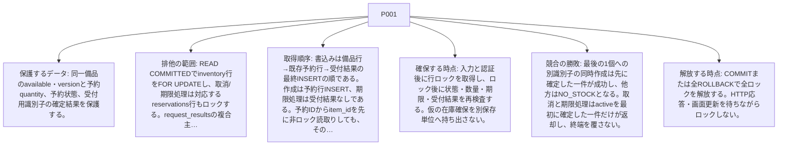

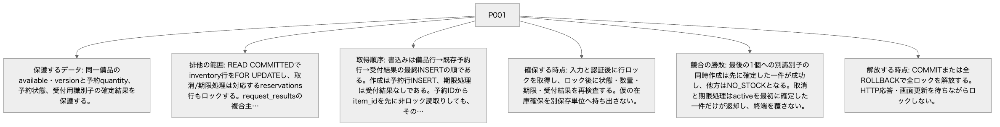

Mermaid: [local-P001.mmd](diagrams/local-P001.mmd) — 矢印は項目と条件の対応を示す。実行順序ではない。厳密な全文は同じ項目の表にある。

### P002

| 項目 | 内容 |
| --- | --- |
| 保護するデータ | owner_id+request_idの同時再送と、異なる内容の衝突を保護する。 |
| 排他の範囲 | 受付結果は最終INSERTの複合主キーで勝者を決める。受付結果を読むだけの事前照合を排他の代用にしない。 |
| 取得順序 | P001の順を守る。競合する受付結果INSERTが失敗したら在庫と予約を含め全ROLLBACKし、ロック解放後に新たな読取りトランザクションで勝者結果を取得する。 |
| 確保する時点 | 備品ロック後にも受付結果を再読する。異なる備品や操作の同じ識別子でも最終INSERTを省略しない。 |
| 解放する時点 | 勝者のCOMMIT/ROLLBACKで識別子競合が解消する。敗者はROLLBACK後にだけ結果を返す。 |
| 上限の更新 | 同内容の再送を新たな引当回数に数えない。衝突による仮更新も全ROLLBACKする。識別子数の上限と受付結果の削除はU003の保管設計で決め、ここでは削除しない。 |
| 時刻と等号 | 勝者の保存済み期限と結果を再利用する。再送の到着時刻から10分を延ばさない。 |
| 競合の勝敗 | 同内容は勝者の同じ応答、異内容はID_CONFLICTとなる。勝者が業務拒否ならその拒否も固定する。識別子衝突で負けた仮の在庫更新は残らない。 |
| 確認条件 | [C008](verification.md#C008) — 同一owner_id+request_idで同じ作成内容または同じ取消内容を二件用意する。 / 同時に送信し、受付結果最終INSERTの前後で待機を注入する。 / 共通応答は一つの保存結果に一致し、作成予約は一件、取消返却は一回である。仮更新敗者は全ROLLBACKし、再送で期限を延ばさない。 [C009](verification.md#C009) — 同一受付識別子で異なるquantity・item_id・操作種別を用意する。既存結果ありと未登録の同時到着を分ける。 / IF001/IF002を競合させる。 / 勝者の結果だけが固定され、相違側はID_CONFLICT、相違側の在庫・予約仮更新は全て戻る。別ownerの同じIDは独立し情報を漏らさない。 [C011](verification.md#C011) — 作成と取消のCOMMIT送信中、COMMIT後応答前、応答受信後の各切断位置とブラウザ再読込みを用意する。 / 元request_idでIF004を繰り返し読み、IF005も読む。 / 確定済みならfoundの元結果が一致しunknown→known、未記録/照会失敗ならunknownを保つ。送信中切断を旧状態維持と断定しない。作成・取消の自動再実行が0回であり、現在値だけで元操作の成功を断定しない。 |

#### P002 P002

矢印は項目と条件の対応を示す。実行順序ではない。厳密な全文は同じ項目の表にある。

Mermaidの記述を確認する

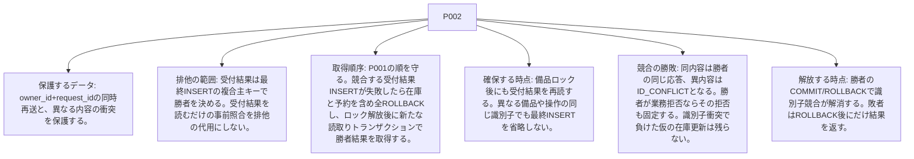

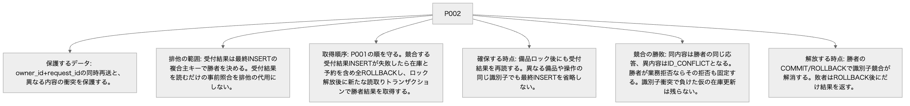

Mermaid: [local-P002.mmd](diagrams/local-P002.mmd) — 矢印は項目と条件の対応を示す。実行順序ではない。厳密な全文は同じ項目の表にある。
