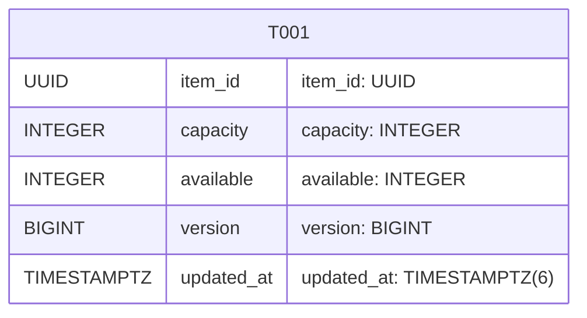
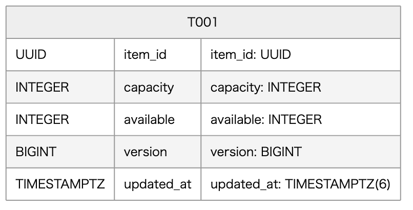
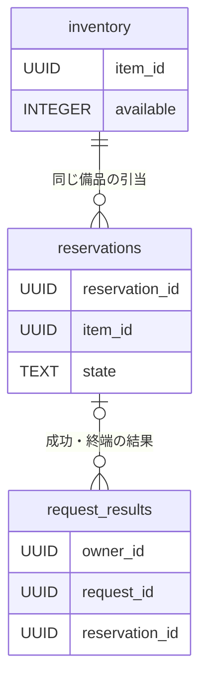
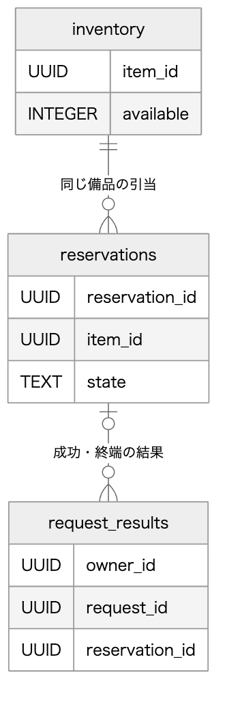
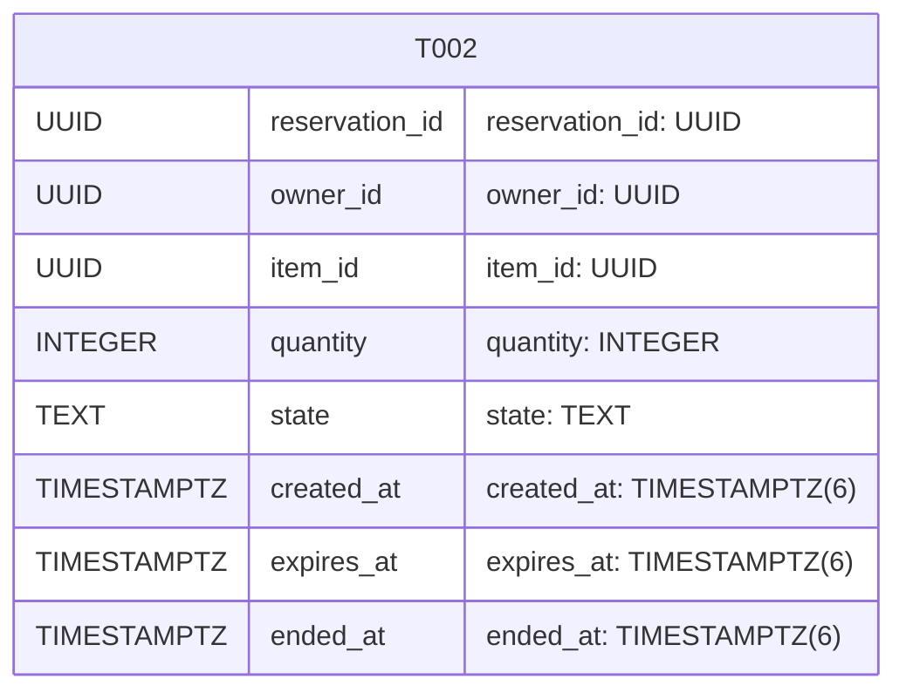
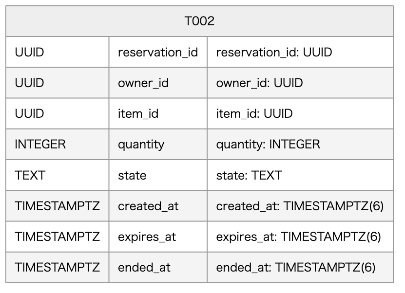
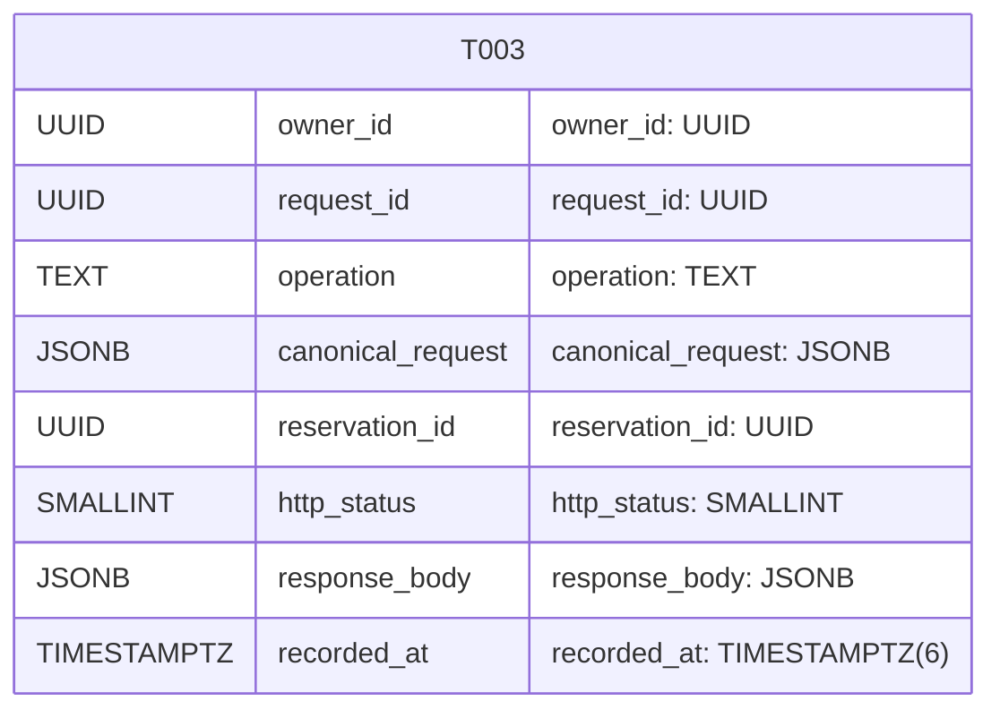
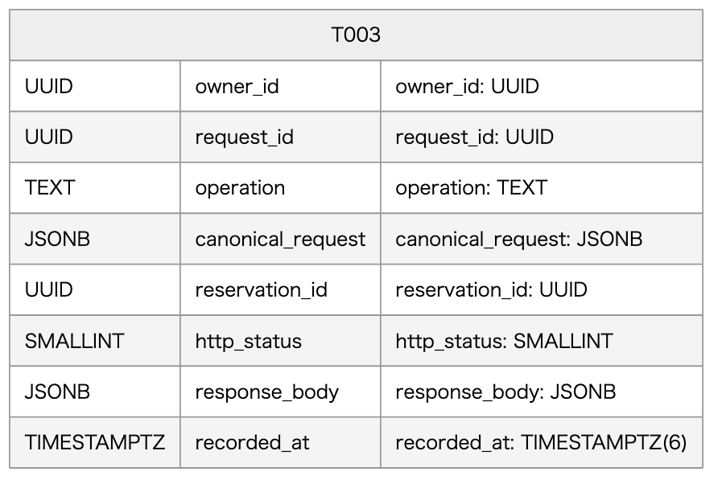

<!-- generated-by: write-detailed-design-document; body-sha256: bd7089a862ac71dfafe1d6698876ced7b955f10b229dcd29537f26af567244c6 -->
# 物理データ

[入口に戻る](README.md)

状態を何に保存し、どの制約と更新単位で整合性を保つかを定義する。

## tables

### T001 inventory

| 項目 | 内容 |
| --- | --- |
| 目的 | 備品一種類ごとの総数・残数と在庫更新版を保持する。 |
| 主キーの列構成 | item_id |
| 一意キーの列構成 | なし |
| キーの理由 | item_idで一種類を識別する。追加の一意キーは設けない。 |
| 制約 | 予約作成・返却ではavailableとversionを同じ行更新で変更する。 capacity=available+同備品のactive予約quantity合計を全成功コミットの不変条件とする。期限到達後もactiveなら合計に含む。集約CHECKは設けずサービスの同一ロックと検査で守る。 |
| 索引 | なし |
| 索引の採用理由 | item_idによる行ロックと取得だけのため追加索引は置かない。 |
| 更新の単位 | F001〜F003で予約・必要な受付結果と一つのトランザクションにする。 |
| 削除の単位と順序 | この設計範囲で自動削除・補充・capacity変更は行わない。 |
| 移行手順 | 初回導入はサービス受付・期限監視を停止した状態で移行トランザクションに表・CHECK・参照制約・索引を作成し、全成功後だけ開始する。既存データの上書きはしない。失敗は全ROLLBACKして旧版を維持し受付を開始しない。将来変更は拡張→データ検査→切替の順とし、削除や型縮小は本案の対象外とする。実DB移行はU001で未実施である。 |

#### 物理列

| 名前 | 型 | NULL可否 | 既定値 | 制約 | 参照先 | 状態定義 | キーへの所属 |
| --- | --- | --- | --- | --- | --- | --- | --- |
| item_id | UUID | false | 既定値なし。必須値を明示する。 | 登録済み備品の識別子。 | 参照先なし。 | 非該当 | PK 1 |
| capacity | INTEGER | false | 既定値なし。必須値を明示する。 | CHECK 0<=capacity AND capacity<=1000000000。 | 参照先なし。 | 非該当 | — |
| available | INTEGER | false | 既定値なし。必須値を明示する。 | CHECK 0<=available AND available<=capacity。 | 参照先なし。 | 非該当 | — |
| version | BIGINT | false | 0 | CHECK 0<=version。更新時に上限未満を検査して1増やす。 | 参照先なし。 | 非該当 | — |
| updated_at | TIMESTAMPTZ(6) | false | 既定値なし。必須値を明示する。 | 在庫を更新した保存側UTC時刻。 | 参照先なし。 | 非該当 | — |

[F001](features.md#F001)

> 在庫を超えずに予約を一回だけ確定し、後から同じ結果を確認できるようにする。

#### T001 inventory

表の物理列を示す。列名・型の全文、キー構成、参照先、更新・削除単位は直下の表を正本とする。

Mermaidの記述を確認する

Mermaid: [local-T001.mmd](diagrams/local-T001.mmd) — 表の物理列を示す。列名・型の全文、キー構成、参照先、更新・削除単位は直下の表を正本とする。

#### 在庫と予約と受付結果の関係

備品は複数予約を持ち、予約に結び付かない在庫不足等の受付結果も存在する。受付結果の識別はowner_idとrequest_idの組でありreservation_idではない。

Mermaidの記述を確認する

Mermaid: [local-G002-T001.mmd](diagrams/local-G002-T001.mmd) — 備品は複数予約を持ち、予約に結び付かない在庫不足等の受付結果も存在する。受付結果の識別はowner_idとrequest_idの組でありreservation_idではない。

> T001 — 備品一種類ごとの総数・残数と在庫更新版を保持する。 / F001〜F003で予約・必要な受付結果と一つのトランザクションにする。 / この設計範囲で自動削除・補充・capacity変更は行わない。

> T002 — 引当数量と期限、返却確定状態を保存する。 / activeからの状態更新と在庫返却は必ず同じトランザクションにする。 / 終端を含め自動削除しない。参照先の備品を消さず、結果照会を継続する。

> T003 — 本人の受付識別子と正規化内容、確定した共通応答を不変で保持する。 / 成功時の在庫・予約の更新と受付結果INSERTは同じCOMMIT。NO_STOCK・NOT_FOUND・VERSION_LIMIT等の業務拒否は受付結果だけをCOMMITする。 / 自動削除しない。識別子再利用と過去結果の喪失を防ぐ。保管期間と容量の承認はU003に残す。

### T002 reservations

| 項目 | 内容 |
| --- | --- |
| 目的 | 引当数量と期限、返却確定状態を保存する。 |
| 主キーの列構成 | reservation_id |
| 一意キーの列構成 | なし |
| キーの理由 | reservation_idで識別する。本人照合はowner_id条件で行い、追加の一意キーは設けない。 |
| 制約 | CHECK (state=active AND ended_at IS NULL) OR (state=cancelled AND ended_at IS NOT NULL AND ended_at>=created_at AND ended_at<expires_at) OR (state=expired AND ended_at IS NOT NULL AND ended_at>=expires_at)を満たす。 activeからcancelledまたはexpiredだけを許す更新をサービスと状態条件で守る。owner_id・item_id・quantity・時刻は不変とする。 |
| 索引 | idx_reservations_due(expires_at,reservation_id) WHERE state='active'。期限候補の先頭から走査する。 idx_reservations_item_state(item_id,state)。不変条件の照合と運用確認に用いる。 |
| 索引の採用理由 | 期限検索と整合確認の走査を抑える提案であり、負荷・実行計画はU001で未確認である。 |
| 更新の単位 | activeからの状態更新と在庫返却は必ず同じトランザクションにする。 |
| 削除の単位と順序 | 終端を含め自動削除しない。参照先の備品を消さず、結果照会を継続する。 |
| 移行手順 | 初回導入はサービス受付・期限監視を停止した状態で移行トランザクションに表・CHECK・参照制約・索引を作成し、全成功後だけ開始する。既存データの上書きはしない。失敗は全ROLLBACKして旧版を維持し受付を開始しない。将来変更は拡張→データ検査→切替の順とし、削除や型縮小は本案の対象外とする。実DB移行はU001で未実施である。 |

#### 物理列

| 名前 | 型 | NULL可否 | 既定値 | 制約 | 参照先 | 状態定義 | キーへの所属 |
| --- | --- | --- | --- | --- | --- | --- | --- |
| reservation_id | UUID | false | 既定値なし。必須値を明示する。 | サーバーが作成する予約ID。 | 参照先なし。 | 非該当 | PK 1 |
| owner_id | UUID | false | 既定値なし。必須値を明示する。 | 認証済み利用者ID。外部認証DBへの参照制約は置かない。 | 参照先なし。 | 非該当 | — |
| item_id | UUID | false | 既定値なし。必須値を明示する。 | 作成後変更しない。 | T001.inventory.item_idへの参照制約。削除RESTRICT。 | 非該当 | — |
| quantity | INTEGER | false | 既定値なし。必須値を明示する。 | CHECK 1<=quantity AND quantity<=1000000。作成後変更しない。 | 参照先なし。 | 非該当 | — |
| state | TEXT | false | 既定値なし。必須値を明示する。 | CHECK state IN ('active','cancelled','expired')。absentを保存しない。 | 参照先なし。 | [ST001](common.md#ST001) — absent: 予約が存在しない仮想状態である。DBへabsent行は保存しない。 / active: 数量を在庫から引き当てた予約である。期限到達後も返却コミットまで引当は保持し、取消受付では時刻を再検査する。 / cancelled: 期限より前の利用者取消により一回の返却を確定した終端である。 / expired: 期限到達により一回の返却を確定した終端である。 | — |
| created_at | TIMESTAMPTZ(6) | false | 既定値なし。必須値を明示する。 | 行ロック後の作成判定時刻。作成後変更しない。 | 参照先なし。 | 非該当 | — |
| expires_at | TIMESTAMPTZ(6) | false | 既定値なし。必須値を明示する。 | CHECK expires_at=created_at+interval '10 minutes'。作成後変更しない。 | 参照先なし。 | 非該当 | — |
| ended_at | TIMESTAMPTZ(6) | true | NULL | activeではNULL、cancelledとexpiredでは必須。cancelledはcreated_at<=ended_at<expires_at、expiredはended_at>=expires_at。 | 参照先なし。 | 非該当 | — |

[T001](data.md#T001)

> 備品一種類ごとの総数・残数と在庫更新版を保持する。 / F001〜F003で予約・必要な受付結果と一つのトランザクションにする。 / この設計範囲で自動削除・補充・capacity変更は行わない。

#### T002 reservations

表の物理列を示す。列名・型の全文、キー構成、参照先、更新・削除単位は直下の表を正本とする。

Mermaidの記述を確認する

Mermaid: [local-T002.mmd](diagrams/local-T002.mmd) — 表の物理列を示す。列名・型の全文、キー構成、参照先、更新・削除単位は直下の表を正本とする。

### T003 request_results

| 項目 | 内容 |
| --- | --- |
| 目的 | 本人の受付識別子と正規化内容、確定した共通応答を不変で保持する。 |
| 主キーの列構成 | owner_id request_id |
| 一意キーの列構成 | なし |
| キーの理由 | owner_idとrequest_idの複合主キーで、操作種別をまたいで一回の受付を識別する。request_id単独の一意性は要求しない。 |
| 制約 | operationとcanonical_requestのキー・型、response_bodyのキー・型・NULL条件はアプリケーションで検査し、NOT NULLとコード集合・durable=trueはCHECKも設ける。 確定行は更新しない。作成/取消の成功と業務拒否を最後にINSERTし、衝突した試行は在庫・予約を含め全ROLLBACKして勝者を再読する。 |
| 索引 | なし |
| 索引の採用理由 | 本人と受付識別子の完全一致取得だけのため追加索引は置かない。 |
| 更新の単位 | 成功時の在庫・予約の更新と受付結果INSERTは同じCOMMIT。NO_STOCK・NOT_FOUND・VERSION_LIMIT等の業務拒否は受付結果だけをCOMMITする。 |
| 削除の単位と順序 | 自動削除しない。識別子再利用と過去結果の喪失を防ぐ。保管期間と容量の承認はU003に残す。 |
| 移行手順 | 初回導入はサービス受付・期限監視を停止した状態で移行トランザクションに表・CHECK・参照制約・索引を作成し、全成功後だけ開始する。既存データの上書きはしない。失敗は全ROLLBACKして旧版を維持し受付を開始しない。将来変更は拡張→データ検査→切替の順とし、削除や型縮小は本案の対象外とする。実DB移行はU001で未実施である。 |

#### 物理列

| 名前 | 型 | NULL可否 | 既定値 | 制約 | 参照先 | 状態定義 | キーへの所属 |
| --- | --- | --- | --- | --- | --- | --- | --- |
| owner_id | UUID | false | 既定値なし。必須値を明示する。 | サーバー認証で得た利用者ID。 | 参照先なし。 | 非該当 | PK 1 |
| request_id | UUID | false | 既定値なし。必須値を明示する。 | クライアントが一操作ごとに生成した受付用識別子。 | 参照先なし。 | 非該当 | PK 2 |
| operation | TEXT | false | 既定値なし。必須値を明示する。 | CHECK operation IN ('create','cancel')。 | 参照先なし。 | 非該当 | — |
| canonical_request | JSONB | false | 既定値なし。必須値を明示する。 | createではitem_idとquantity、cancelではreservation_idを正規型で持つ。operationと合わせて構造比較し、未知キーを持たない。 | 参照先なし。 | 非該当 | — |
| reservation_id | UUID | true | NULL | 実在予約に結び付く結果ではそのID、備品なし・在庫不足等の予約なし拒否ではNULL。 | T002.reservations.reservation_idへの参照制約。削除RESTRICT。 | 非該当 | — |
| http_status | SMALLINT | false | 既定値なし。必須値を明示する。 | 200・201・404・409・503の保存対象だけを許可する。 | 参照先なし。 | 非該当 | — |
| response_body | JSONB | false | 既定値なし。必須値を明示する。 | IF001・IF002の共通9項目を欠落なく保存する。durable=true、request_idは列と同じ、result_atは非NULL。COMMIT_UNKNOWN、SAVE_FAILED、事前拒否とID_CONFLICTは保存しない。 | 参照先なし。 | 非該当 | — |
| recorded_at | TIMESTAMPTZ(6) | false | 既定値なし。必須値を明示する。 | 応答構築時の保存側UTC時刻。response_body.result_atと同じ値。 | 参照先なし。 | 非該当 | — |

[T002](data.md#T002)

> 引当数量と期限、返却確定状態を保存する。 / activeからの状態更新と在庫返却は必ず同じトランザクションにする。 / 終端を含め自動削除しない。参照先の備品を消さず、結果照会を継続する。

[IF001](interfaces.md#IF001)

> 同じrequest_idと正規化内容を受付・サービス・保存で引き継ぐ。内部の数量を再生成しない。 / 応答候補の全項目を返す。確定した業務結果だけを保存し、コミット結果不明を保存済み拒否に変えない。 / CREATED、NO_STOCK、NOT_FOUND、VERSION_LIMIT、INVALID_INPUT、TOO_LARGE、UNSUPPORTED_MEDIA、UNAUTHENTICATED、FORBIDDEN、ID_CONFLICT、SAVE_FAILED、COMMIT_UNKNOWNを共通応答のcodeで判別する。 / 入力: context.owner_id: string(uuid) 必須 NULL不可, サーバー認証で確定した利用者。クライアントからの指定を許可しない。 / body.request_id: string(uuid) 必須 NULL不可, 小文字ハイフン付きUUID正規形36文字。異なる世代の操作に再利用しない。 / body.item_id: string(uuid) 必須 NULL不可, 登録済み備品ID。 / body.quantity: integer 必須 NULL不可, 1〜1000000の整数。 / 応答: created: 201 CREATED。新しい予約と在庫・受付結果のCOMMITを確認した応答でありdurable=trueとする。 (request_id: string(uuid) or null 必須 NULL可, 妥当な識別子を受理済みならその値を返す。欠落・不正・識別前の拒否ではnullとする。; code: string 必須 NULL不可, CREATEDだけを返す。; message: string 必須 NULL不可, 1〜200 Unicode文字かつUTF-8で800バイト以下。利用者向け理由を返し内部例外は含めない。; reservation_id: string(uuid) or null 必須 NULL可, 予約に結び付く確定結果ではそのID、それ以外はnullとする。; state_at_result: string or null 必須 NULL可, 結果確定時のactive・cancelled・expired。予約がない拒否・保存不成立・確定不明はnullとする。; expires_at: string(datetime) or null 必須 NULL可, 予約に結び付く結果では共通UTC形式、それ以外はnullとする。; available_at_result: integer or null 必須 NULL可, 0〜1000000000。保存単位で取得した残数。備品がない場合、入力拒否、保存不成立、確定不明はnullとする。; result_at: string(datetime) or null 必須 NULL可, durable=trueの確定結果では共通UTC形式の確定判断時刻、durable=falseではnullとする。COMMIT完了時刻と同一とは限らない。; durable: boolean 必須 NULL不可, T003へCOMMITした応答はtrue、入力拒否・ID_CONFLICT・SAVE_FAILED・COMMIT_UNKNOWN等の非保存応答はfalseとする。) / replay: 保存済み結果と同じHTTP状態・共通応答を返す。CREATED、NO_STOCK、NOT_FOUND、VERSION_LIMITの元コードを変更しない。 (request_id: string(uuid) or null 必須 NULL可, 妥当な識別子を受理済みならその値を返す。欠落・不正・識別前の拒否ではnullとする。; code: string 必須 NULL不可, CREATED、NO_STOCK、NOT_FOUND、VERSION_LIMITだけを返す。; message: string 必須 NULL不可, 1〜200 Unicode文字かつUTF-8で800バイト以下。利用者向け理由を返し内部例外は含めない。; reservation_id: string(uuid) or null 必須 NULL可, 予約に結び付く確定結果ではそのID、それ以外はnullとする。; state_at_result: string or null 必須 NULL可, 結果確定時のactive・cancelled・expired。予約がない拒否・保存不成立・確定不明はnullとする。; expires_at: string(datetime) or null 必須 NULL可, 予約に結び付く結果では共通UTC形式、それ以外はnullとする。; available_at_result: integer or null 必須 NULL可, 0〜1000000000。保存単位で取得した残数。備品がない場合、入力拒否、保存不成立、確定不明はnullとする。; result_at: string(datetime) or null 必須 NULL可, durable=trueの確定結果では共通UTC形式の確定判断時刻、durable=falseではnullとする。COMMIT完了時刻と同一とは限らない。; durable: boolean 必須 NULL不可, T003へCOMMITした応答はtrue、入力拒否・ID_CONFLICT・SAVE_FAILED・COMMIT_UNKNOWN等の非保存応答はfalseとする。) / rejected: 400 INVALID_INPUT、413 TOO_LARGE、415 UNSUPPORTED_MEDIA、401 UNAUTHENTICATED、403 FORBIDDEN、404 NOT_FOUND、409 ID_CONFLICT、503 SAVE_FAILED、503 VERSION_LIMITとする。SAVE_FAILEDはROLLBACK確認済みに限る。NOT_FOUNDとVERSION_LIMITの有効要求はdurable=trueとして記録し、それ以外の事前拒否はfalseとする。 在庫不足は409 NO_STOCK、durable=trueとする。 (request_id: string(uuid) or null 必須 NULL可, 妥当な識別子を受理済みならその値を返す。欠落・不正・識別前の拒否ではnullとする。; code: string 必須 NULL不可, INVALID_INPUT、TOO_LARGE、UNSUPPORTED_MEDIA、UNAUTHENTICATED、FORBIDDEN、NOT_FOUND、ID_CONFLICT、SAVE_FAILED、VERSION_LIMIT、NO_STOCKだけを返す。; message: string 必須 NULL不可, 1〜200 Unicode文字かつUTF-8で800バイト以下。利用者向け理由を返し内部例外は含めない。; reservation_id: string(uuid) or null 必須 NULL可, 予約に結び付く確定結果ではそのID、それ以外はnullとする。; state_at_result: string or null 必須 NULL可, 結果確定時のactive・cancelled・expired。予約がない拒否・保存不成立・確定不明はnullとする。; expires_at: string(datetime) or null 必須 NULL可, 予約に結び付く結果では共通UTC形式、それ以外はnullとする。; available_at_result: integer or null 必須 NULL可, 0〜1000000000。保存単位で取得した残数。備品がない場合、入力拒否、保存不成立、確定不明はnullとする。; result_at: string(datetime) or null 必須 NULL可, durable=trueの確定結果では共通UTC形式の確定判断時刻、durable=falseではnullとする。COMMIT完了時刻と同一とは限らない。; durable: boolean 必須 NULL不可, T003へCOMMITした応答はtrue、入力拒否・ID_CONFLICT・SAVE_FAILED・COMMIT_UNKNOWN等の非保存応答はfalseとする。) / unconfirmed: 503 COMMIT_UNKNOWN。結果が不明でありdurable=false、予約・状態・期限・残数・result_atはnullとする。応答不能ならHTTP応答はなく、画面が切断からunknownへ進む。 (request_id: string(uuid) or null 必須 NULL可, 妥当な識別子を受理済みならその値を返す。欠落・不正・識別前の拒否ではnullとする。; code: string 必須 NULL不可, COMMIT_UNKNOWNだけを返す。; message: string 必須 NULL不可, 1〜200 Unicode文字かつUTF-8で800バイト以下。利用者向け理由を返し内部例外は含めない。; reservation_id: string(uuid) or null 必須 NULL可, 予約に結び付く確定結果ではそのID、それ以外はnullとする。; state_at_result: string or null 必須 NULL可, 結果確定時のactive・cancelled・expired。予約がない拒否・保存不成立・確定不明はnullとする。; expires_at: string(datetime) or null 必須 NULL可, 予約に結び付く結果では共通UTC形式、それ以外はnullとする。; available_at_result: integer or null 必須 NULL可, 0〜1000000000。保存単位で取得した残数。備品がない場合、入力拒否、保存不成立、確定不明はnullとする。; result_at: string(datetime) or null 必須 NULL可, durable=trueの確定結果では共通UTC形式の確定判断時刻、durable=falseではnullとする。COMMIT完了時刻と同一とは限らない。; durable: boolean 必須 NULL不可, T003へCOMMITした応答はtrue、入力拒否・ID_CONFLICT・SAVE_FAILED・COMMIT_UNKNOWN等の非保存応答はfalseとする。) / 最大サイズ: 要求本文4096バイト以下、応答8192バイト以下とする。HTTPパスとヘッダーは合計2048バイト以下とする提案である。

#### T003 request_results

表の物理列を示す。列名・型の全文、キー構成、参照先、更新・削除単位は直下の表を正本とする。

Mermaidの記述を確認する

Mermaid: [local-T003.mmd](diagrams/local-T003.mmd) — 表の物理列を示す。列名・型の全文、キー構成、参照先、更新・削除単位は直下の表を正本とする。
