<!-- generated-by: write-detailed-design-document; body-sha256: 16c8d6852f7796d6872f9fea7a53328f33e3bc27a335d06927df89f81d13f344 -->
# 根拠と未決事項と変更

[入口に戻る](README.md)

引き継いだ記述と追加提案を分け、未決の影響と要件変更の判断を辿れるようにする。

## sources

### S001

[requirement.md 3行目](/private/tmp/detailed-design-public-nu7gtxsu/docs/requirement.md:3:1)

> 利用者は備品の数量を指定して予約し、予約結果と残数を確認できる。最後の1個へ同時に予約しても、在庫は負にならず、成立する予約は1件だけである。

SHA-256: `f48dfbbb161879d79830f2066cc45fa5c3e8db6c5f24a9a26986bd194d39ed22` / requirement

#### S001 S001

矢印は項目と条件の対応を示す。実行順序ではない。厳密な全文は同じ項目の表にある。

Mermaidの記述を確認する

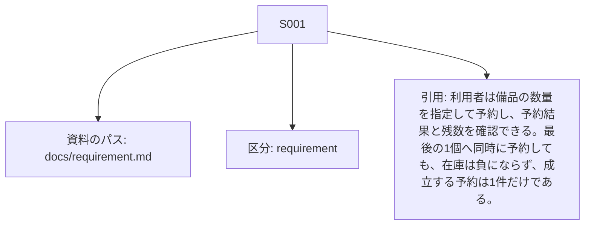

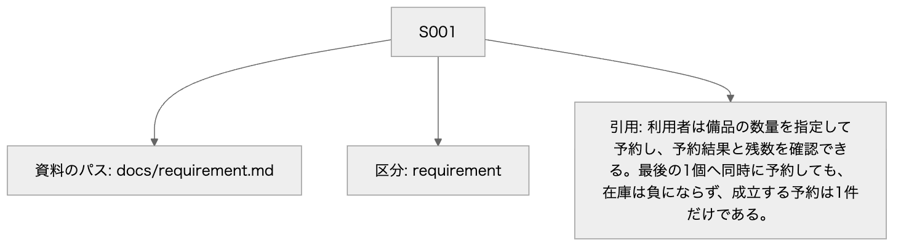

Mermaid: [local-S001.mmd](diagrams/local-S001.mmd) — 矢印は項目と条件の対応を示す。実行順序ではない。厳密な全文は同じ項目の表にある。

### S002

[requirement.md 4行目](/private/tmp/detailed-design-public-nu7gtxsu/docs/requirement.md:4:1)

> 予約の有効期間は作成から10分とする。利用者の取消か期限切れで予約分の数量を在庫へ戻す。取消と期限処理が競合しても返却は1回だけとする。保存側の判定時刻が期限と等しければ期限切れとする。

SHA-256: `f48dfbbb161879d79830f2066cc45fa5c3e8db6c5f24a9a26986bd194d39ed22` / requirement

#### S002 S002

矢印は項目と条件の対応を示す。実行順序ではない。厳密な全文は同じ項目の表にある。

Mermaidの記述を確認する

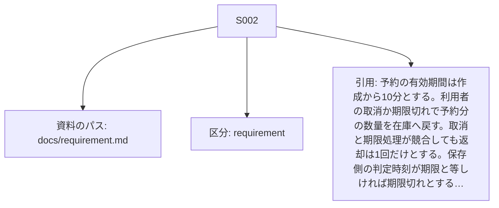

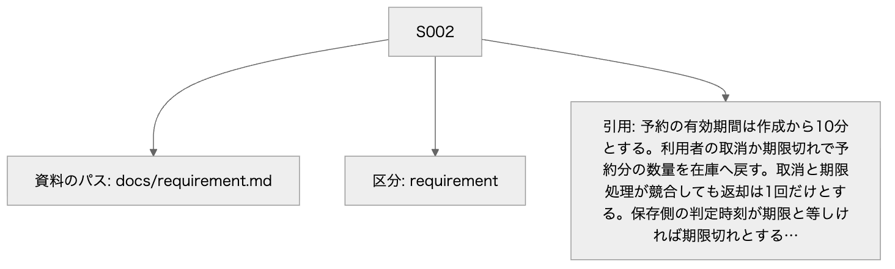

Mermaid: [local-S002.mmd](diagrams/local-S002.mmd) — 矢印は項目と条件の対応を示す。実行順序ではない。厳密な全文は同じ項目の表にある。

### S003

[requirement.md 5行目](/private/tmp/detailed-design-public-nu7gtxsu/docs/requirement.md:5:1)

> 作成の同じ受付用識別子・同じ内容の再送は新しい予約を作らない。違う内容なら競合として返す。

SHA-256: `f48dfbbb161879d79830f2066cc45fa5c3e8db6c5f24a9a26986bd194d39ed22` / requirement

#### S003 S003

矢印は項目と条件の対応を示す。実行順序ではない。厳密な全文は同じ項目の表にある。

Mermaidの記述を確認する

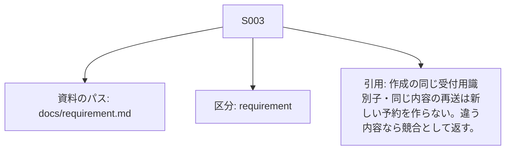

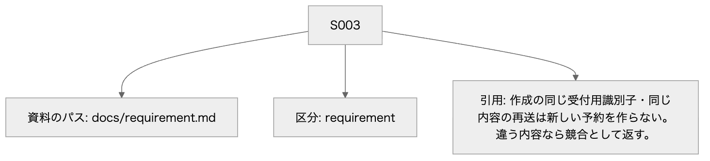

Mermaid: [local-S003.mmd](diagrams/local-S003.mmd) — 矢印は項目と条件の対応を示す。実行順序ではない。厳密な全文は同じ項目の表にある。

### S004

[requirement.md 6行目](/private/tmp/detailed-design-public-nu7gtxsu/docs/requirement.md:6:1)

> 保存確定後に応答する。応答切断後は識別子で確定した結果を照会し、予約や在庫の更新を自動で繰り返さない。

SHA-256: `f48dfbbb161879d79830f2066cc45fa5c3e8db6c5f24a9a26986bd194d39ed22` / requirement

#### S004 S004

矢印は項目と条件の対応を示す。実行順序ではない。厳密な全文は同じ項目の表にある。

Mermaidの記述を確認する

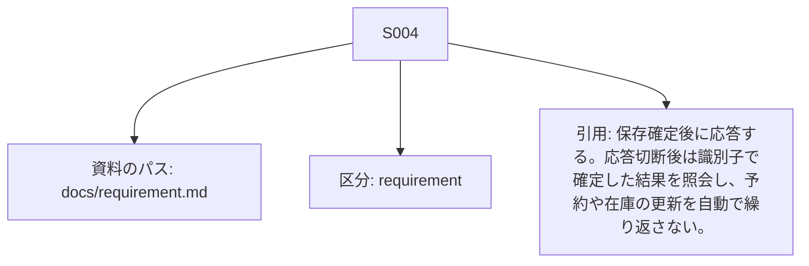

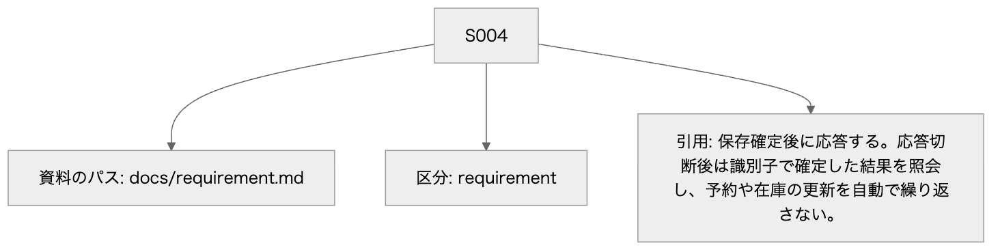

Mermaid: [local-S004.mmd](diagrams/local-S004.mmd) — 矢印は項目と条件の対応を示す。実行順序ではない。厳密な全文は同じ項目の表にある。

### S005

[requirement.md 7行目](/private/tmp/detailed-design-public-nu7gtxsu/docs/requirement.md:7:1)

> 画面は在庫数、予約の状態、操作結果を表示し、期限切れ後は取消を受け付けない。キーボードで予約・取消・結果照会を行える。

SHA-256: `f48dfbbb161879d79830f2066cc45fa5c3e8db6c5f24a9a26986bd194d39ed22` / requirement

#### S005 S005

矢印は項目と条件の対応を示す。実行順序ではない。厳密な全文は同じ項目の表にある。

Mermaidの記述を確認する

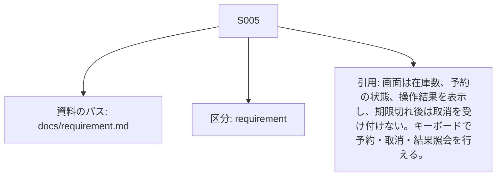

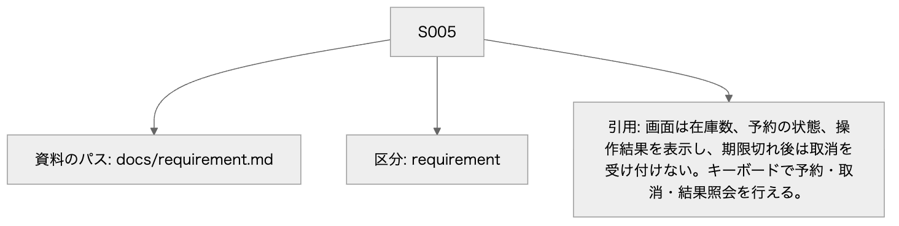

Mermaid: [local-S005.mmd](diagrams/local-S005.mmd) — 矢印は項目と条件の対応を示す。実行順序ではない。厳密な全文は同じ項目の表にある。

### S006

[basic-design.md 3行目](/private/tmp/detailed-design-public-nu7gtxsu/docs/basic-design.md:3:1)

> この資料は設計案である。実装と負荷・競合試験は未実施である。

SHA-256: `887f247ad827415e314ad00b16904c4ec5b131074f92101d17537b9629b6c3d2` / basic_design

#### S006 S006

矢印は項目と条件の対応を示す。実行順序ではない。厳密な全文は同じ項目の表にある。

Mermaidの記述を確認する

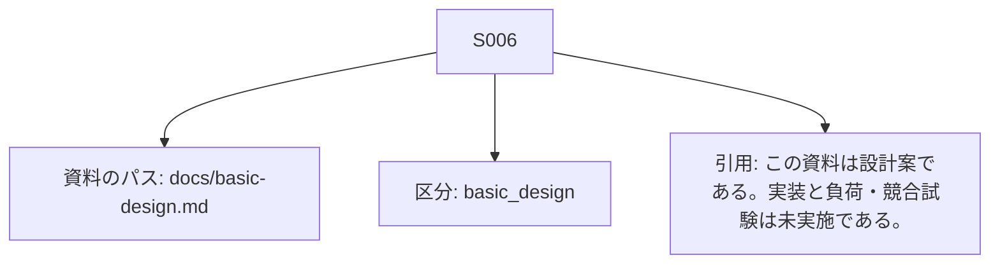

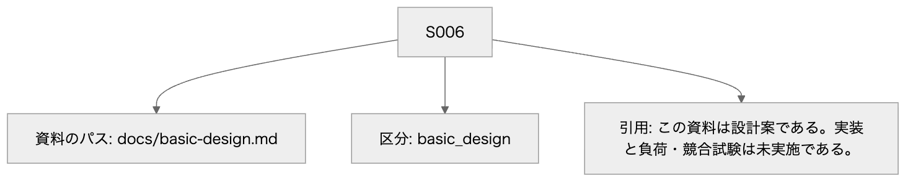

Mermaid: [local-S006.mmd](diagrams/local-S006.mmd) — 矢印は項目と条件の対応を示す。実行順序ではない。厳密な全文は同じ項目の表にある。

### S007

[basic-design.md 5行目](/private/tmp/detailed-design-public-nu7gtxsu/docs/basic-design.md:5:1)

> ブラウザ画面はHTTPのJSON APIを呼ぶ。サーバー側は受付・予約サービス・期限監視・保存リポジトリを分け、PostgreSQLへ備品と予約と受付結果を保存する。外部の実行基盤やエージェントは使わない。

SHA-256: `887f247ad827415e314ad00b16904c4ec5b131074f92101d17537b9629b6c3d2` / basic_design

#### S007 S007

矢印は項目と条件の対応を示す。実行順序ではない。厳密な全文は同じ項目の表にある。

Mermaidの記述を確認する

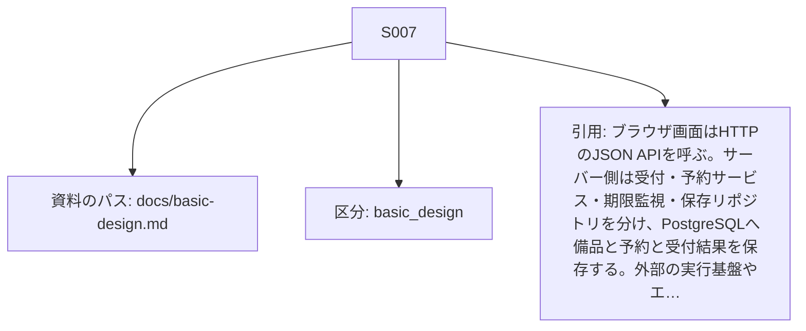

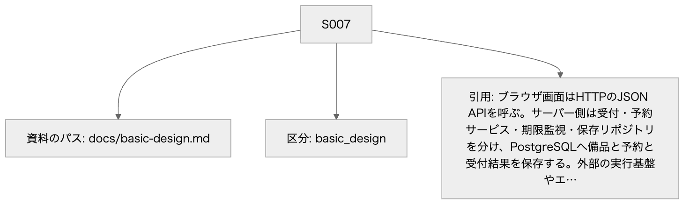

Mermaid: [local-S007.mmd](diagrams/local-S007.mmd) — 矢印は項目と条件の対応を示す。実行順序ではない。厳密な全文は同じ項目の表にある。

### S008

[basic-design.md 6行目](/private/tmp/detailed-design-public-nu7gtxsu/docs/basic-design.md:6:1)

> 作成は在庫確認と数量の引当と予約と受付結果を一つの保存単位で確定する。同時再送は受付用識別子の一意制約で照合する。取消と期限処理は同じ予約の状態を条件にして一方だけが在庫を戻す。
> 時刻は保存側のUTCとし、画面の押下時刻を期限判定に使わない。期限処理が遅れても、取消の受付では期限を再検査する。
> 通知は保存確定後に画面へ返す。通信切断後や再起動後も受付用識別子で確定結果を照会し、外部への更新を再実行したことにしない。

SHA-256: `887f247ad827415e314ad00b16904c4ec5b131074f92101d17537b9629b6c3d2` / basic_design

#### S008 S008

矢印は項目と条件の対応を示す。実行順序ではない。厳密な全文は同じ項目の表にある。

Mermaidの記述を確認する

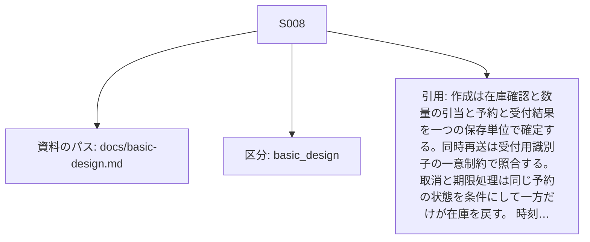

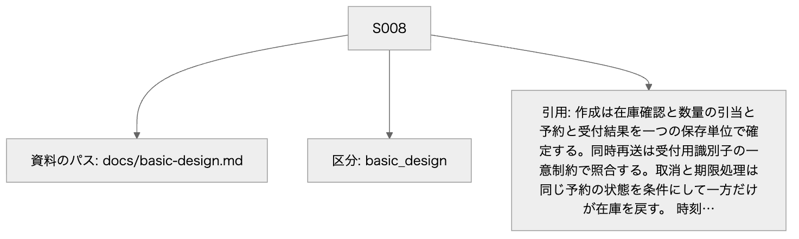

Mermaid: [local-S008.mmd](diagrams/local-S008.mmd) — 矢印は項目と条件の対応を示す。実行順序ではない。厳密な全文は同じ項目の表にある。

### S009

[basic-design.md 9行目](/private/tmp/detailed-design-public-nu7gtxsu/docs/basic-design.md:9:1)

> APIの項目・サイズ・エラー、物理列・索引・移行、取得順と原子性、画面の操作可否と更新、試験条件は詳細設計で具体化する。

SHA-256: `887f247ad827415e314ad00b16904c4ec5b131074f92101d17537b9629b6c3d2` / basic_design

#### S009 S009

矢印は項目と条件の対応を示す。実行順序ではない。厳密な全文は同じ項目の表にある。

Mermaidの記述を確認する

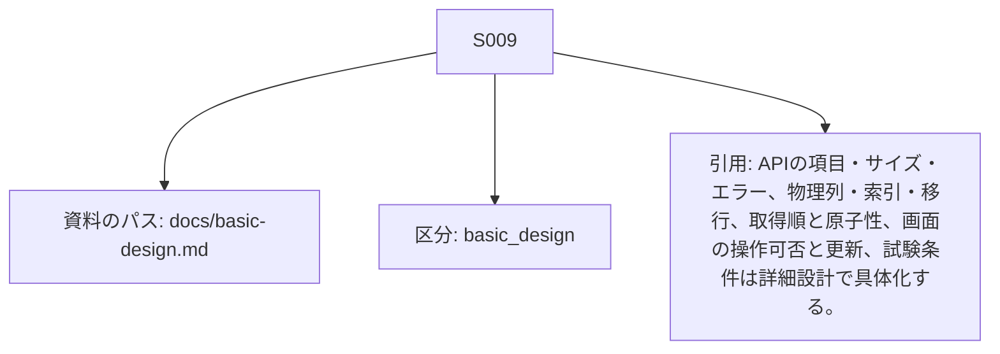

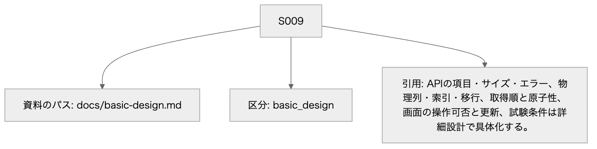

Mermaid: [local-S009.mmd](diagrams/local-S009.mmd) — 矢印は項目と条件の対応を示す。実行順序ではない。厳密な全文は同じ項目の表にある。

## issues

### U001 PostgreSQL対象版・実装・実DBの原子性、競合、停止注入、負荷と移行は未検証である。外部サービスへの接続試験も今回実施していない。

| 項目 | 内容 |
| --- | --- |
| 未決の内容 | PostgreSQL対象版・実装・実DBの原子性、競合、停止注入、負荷と移行は未検証である。外部サービスへの接続試験も今回実施していない。 |
| 検証内容・状態 | 開発側が対象版を記録し、C001〜C014、READ COMMITTEDの待機後再読、受付結果衝突の全ROLLBACK、時刻精度、DB回復、索引実行計画と移行失敗を隔離環境で試験する。外部サービスは採用する場合に別途接続契約を検証する。 |
| 採用できる結果 | 全不変条件・返却一回・確定結果照会が観測値で一致し、期限監視の遅延と負荷の目標値を関係者が決定し実測が満たすことを採用条件とする。文書検査では代替しない。 |
| 確認する担当 | 実装・DB・試験担当 |
| 影響する設計 | [D001](common.md#D001) — HTTP JSON、PostgreSQL、責務の分離、作成の同時確定、状態条件による一回返却、保存側UTCと確定後応答を引き継ぐ。基本設計自身が設計案と明記しており、採用済みや実装検証済みとは扱わない。 / 採用: proposed / 検証: unverified [D002](common.md#D002) — API v1、UUID正規形、数量・在庫の上限、JSONの4096バイト上限、UTC精度、物理型、READ COMMITTEDと行ロック、受付結果最終登録、期限監視1秒・100件、索引・移行・エラーを提案する。PostgreSQLの対象版は未選定であり、ロック待機後の時刻と競合ロールバックを実DBで検証してから採用する。 / 採用: proposed / 検証: unverified [F001](features.md#F001) — 在庫を超えずに予約を一回だけ確定し、後から同じ結果を確認できるようにする。 [F002](features.md#F002) — 期限内の本人取消または期限到達の確定を一回の返却に制限する。 [F003](features.md#F003) — 監視遅延や再起動があっても期限切れの引当を一回だけ解放する。 [F004](features.md#F004) — 切断後の確定結果を識別子で読み、過去の操作と現在の在庫・予約を区別する。 [P001](common.md#P001) — 最後の1個への別識別子の同時作成は先に確定した一件が成功し、他方はNO_STOCKとなる。取消と期限処理はactiveを最初に確定した一件だけが返却し、終端を覆さない。 / READ COMMITTEDでinventory行をFOR UPDATEし、取消/期限処理は対応するreservations行もロックする。request_resultsの複合主キー競合を最終判定とする。画面のボタン無効だけに依存しない。 [P002](common.md#P002) — 同内容は勝者の同じ応答、異内容はID_CONFLICTとなる。勝者が業務拒否ならその拒否も固定する。識別子衝突で負けた仮の在庫更新は残らない。 / 受付結果は最終INSERTの複合主キーで勝者を決める。受付結果を読むだけの事前照合を排他の代用にしない。 [T001](data.md#T001) — 備品一種類ごとの総数・残数と在庫更新版を保持する。 / F001〜F003で予約・必要な受付結果と一つのトランザクションにする。 / この設計範囲で自動削除・補充・capacity変更は行わない。 [T002](data.md#T002) — 引当数量と期限、返却確定状態を保存する。 / activeからの状態更新と在庫返却は必ず同じトランザクションにする。 / 終端を含め自動削除しない。参照先の備品を消さず、結果照会を継続する。 [T003](data.md#T003) — 本人の受付識別子と正規化内容、確定した共通応答を不変で保持する。 / 成功時の在庫・予約の更新と受付結果INSERTは同じCOMMIT。NO_STOCK・NOT_FOUND・VERSION_LIMIT等の業務拒否は受付結果だけをCOMMITする。 / 自動削除しない。識別子再利用と過去結果の喪失を防ぐ。保管期間と容量の承認はU003に残す。 |
| 独立して進める範囲 | APIモック、画面、台帳の対応、試験データ・停止点の設計は独立して進められる。 |

[C001](verification.md#C001)

> 在庫3、本人の新しい受付用識別子、quantity=2を用意する。 / IF001で作成し、IF004とIF005を読む。 / CREATED、予約active、残数1、expires_at=created_at+10分、受付結果一件となる。保存済み共通応答と操作表示が一致する。

[C014](verification.md#C014)

> 作成成功の受付結果を残し、その予約を期限切れにする。他人のID・欠落ID・任意予約ID未指定の読取りも用意する。 / IF004とIF005を呼ぶ。 / IF004は元CREATED・activeを固定して返し、IF005は現在expiredと返却後残数を返す。終端結果をpendingにしない。他人の結果はNOT_RECORDED、他人/別備品予約はNOT_FOUND、任意予約ID欠落は在庫だけで予約各項目null、指定nullはINVALID_INPUTとなる。

#### U001 PostgreSQL対象版・実装・実DBの原子性、競合、停止注入、負荷と移行は未検証である。外部サービスへの接続試験も今回実施していない。

矢印は項目と条件の対応を示す。実行順序ではない。厳密な全文は同じ項目の表にある。

Mermaidの記述を確認する

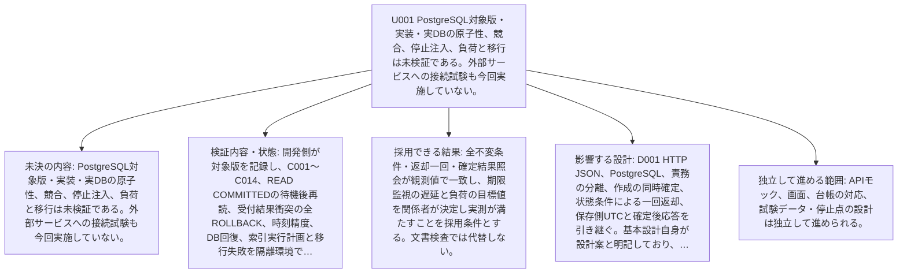

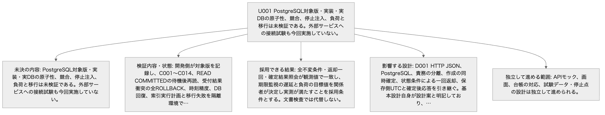

Mermaid: [local-U001.mmd](diagrams/local-U001.mmd) — 矢印は項目と条件の対応を示す。実行順序ではない。厳密な全文は同じ項目の表にある。

### U002 認証方式・権限の供給とHTTP/画面実装は未確認である。

| 項目 | 内容 |
| --- | --- |
| 未決の内容 | 認証方式・権限の供給とHTTP/画面実装は未確認である。 |
| 検証内容・状態 | owner_idとworker_roleの信頼境界、本人以外の照会拒否、JSONとNULLの写像、キーボード・ライブ領域・sessionStorage復元とログアウトを実装で試験する。外部認証サービスへは接続していない。 |
| 採用できる結果 | 利用者が他人の予約・結果を読書きできず、期限・状態・操作結果とフォーカスがUI001と一致することを採用条件とする。 |
| 確認する担当 | 認証・画面・試験担当 |
| 影響する設計 | [D003](common.md#D003) — 認証済みowner_idをサーバーの信頼済み文脈として渡し、本人の予約と受付結果だけを操作・照会する。画面の状態、最大5秒間隔の読取り更新とキーボード操作を提案する。認証方式とアダプターの写像は未検証である。 / 採用: proposed / 検証: unverified [IF001](interfaces.md#IF001) — 同じrequest_idと正規化内容を受付・サービス・保存で引き継ぐ。内部の数量を再生成しない。 / 応答候補の全項目を返す。確定した業務結果だけを保存し、コミット結果不明を保存済み拒否に変えない。 / CREATED、NO_STOCK、NOT_FOUND、VERSION_LIMIT、INVALID_INPUT、TOO_LARGE、UNSUPPORTED_MEDIA、UNAUTHENTICATED、FORBIDDEN、ID_CONFLICT、SAVE_FAILED、COMMIT_UNKNOWNを共通応答のcodeで判別する。 / 入力: context.owner_id: string(uuid) 必須 NULL不可, サーバー認証で確定した利用者。クライアントからの指定を許可しない。 / body.request_id: string(uuid) 必須 NULL不可, 小文字ハイフン付きUUID正規形36文字。異なる世代の操作に再利用しない。 / body.item_id: string(uuid) 必須 NULL不可, 登録済み備品ID。 / body.quantity: integer 必須 NULL不可, 1〜1000000の整数。 / 応答: created: 201 CREATED。新しい予約と在庫・受付結果のCOMMITを確認した応答でありdurable=trueとする。 (request_id: string(uuid) or null 必須 NULL可, 妥当な識別子を受理済みならその値を返す。欠落・不正・識別前の拒否ではnullとする。; code: string 必須 NULL不可, CREATEDだけを返す。; message: string 必須 NULL不可, 1〜200 Unicode文字かつUTF-8で800バイト以下。利用者向け理由を返し内部例外は含めない。; reservation_id: string(uuid) or null 必須 NULL可, 予約に結び付く確定結果ではそのID、それ以外はnullとする。; state_at_result: string or null 必須 NULL可, 結果確定時のactive・cancelled・expired。予約がない拒否・保存不成立・確定不明はnullとする。; expires_at: string(datetime) or null 必須 NULL可, 予約に結び付く結果では共通UTC形式、それ以外はnullとする。; available_at_result: integer or null 必須 NULL可, 0〜1000000000。保存単位で取得した残数。備品がない場合、入力拒否、保存不成立、確定不明はnullとする。; result_at: string(datetime) or null 必須 NULL可, durable=trueの確定結果では共通UTC形式の確定判断時刻、durable=falseではnullとする。COMMIT完了時刻と同一とは限らない。; durable: boolean 必須 NULL不可, T003へCOMMITした応答はtrue、入力拒否・ID_CONFLICT・SAVE_FAILED・COMMIT_UNKNOWN等の非保存応答はfalseとする。) / replay: 保存済み結果と同じHTTP状態・共通応答を返す。CREATED、NO_STOCK、NOT_FOUND、VERSION_LIMITの元コードを変更しない。 (request_id: string(uuid) or null 必須 NULL可, 妥当な識別子を受理済みならその値を返す。欠落・不正・識別前の拒否ではnullとする。; code: string 必須 NULL不可, CREATED、NO_STOCK、NOT_FOUND、VERSION_LIMITだけを返す。; message: string 必須 NULL不可, 1〜200 Unicode文字かつUTF-8で800バイト以下。利用者向け理由を返し内部例外は含めない。; reservation_id: string(uuid) or null 必須 NULL可, 予約に結び付く確定結果ではそのID、それ以外はnullとする。; state_at_result: string or null 必須 NULL可, 結果確定時のactive・cancelled・expired。予約がない拒否・保存不成立・確定不明はnullとする。; expires_at: string(datetime) or null 必須 NULL可, 予約に結び付く結果では共通UTC形式、それ以外はnullとする。; available_at_result: integer or null 必須 NULL可, 0〜1000000000。保存単位で取得した残数。備品がない場合、入力拒否、保存不成立、確定不明はnullとする。; result_at: string(datetime) or null 必須 NULL可, durable=trueの確定結果では共通UTC形式の確定判断時刻、durable=falseではnullとする。COMMIT完了時刻と同一とは限らない。; durable: boolean 必須 NULL不可, T003へCOMMITした応答はtrue、入力拒否・ID_CONFLICT・SAVE_FAILED・COMMIT_UNKNOWN等の非保存応答はfalseとする。) / rejected: 400 INVALID_INPUT、413 TOO_LARGE、415 UNSUPPORTED_MEDIA、401 UNAUTHENTICATED、403 FORBIDDEN、404 NOT_FOUND、409 ID_CONFLICT、503 SAVE_FAILED、503 VERSION_LIMITとする。SAVE_FAILEDはROLLBACK確認済みに限る。NOT_FOUNDとVERSION_LIMITの有効要求はdurable=trueとして記録し、それ以外の事前拒否はfalseとする。 在庫不足は409 NO_STOCK、durable=trueとする。 (request_id: string(uuid) or null 必須 NULL可, 妥当な識別子を受理済みならその値を返す。欠落・不正・識別前の拒否ではnullとする。; code: string 必須 NULL不可, INVALID_INPUT、TOO_LARGE、UNSUPPORTED_MEDIA、UNAUTHENTICATED、FORBIDDEN、NOT_FOUND、ID_CONFLICT、SAVE_FAILED、VERSION_LIMIT、NO_STOCKだけを返す。; message: string 必須 NULL不可, 1〜200 Unicode文字かつUTF-8で800バイト以下。利用者向け理由を返し内部例外は含めない。; reservation_id: string(uuid) or null 必須 NULL可, 予約に結び付く確定結果ではそのID、それ以外はnullとする。; state_at_result: string or null 必須 NULL可, 結果確定時のactive・cancelled・expired。予約がない拒否・保存不成立・確定不明はnullとする。; expires_at: string(datetime) or null 必須 NULL可, 予約に結び付く結果では共通UTC形式、それ以外はnullとする。; available_at_result: integer or null 必須 NULL可, 0〜1000000000。保存単位で取得した残数。備品がない場合、入力拒否、保存不成立、確定不明はnullとする。; result_at: string(datetime) or null 必須 NULL可, durable=trueの確定結果では共通UTC形式の確定判断時刻、durable=falseではnullとする。COMMIT完了時刻と同一とは限らない。; durable: boolean 必須 NULL不可, T003へCOMMITした応答はtrue、入力拒否・ID_CONFLICT・SAVE_FAILED・COMMIT_UNKNOWN等の非保存応答はfalseとする。) / unconfirmed: 503 COMMIT_UNKNOWN。結果が不明でありdurable=false、予約・状態・期限・残数・result_atはnullとする。応答不能ならHTTP応答はなく、画面が切断からunknownへ進む。 (request_id: string(uuid) or null 必須 NULL可, 妥当な識別子を受理済みならその値を返す。欠落・不正・識別前の拒否ではnullとする。; code: string 必須 NULL不可, COMMIT_UNKNOWNだけを返す。; message: string 必須 NULL不可, 1〜200 Unicode文字かつUTF-8で800バイト以下。利用者向け理由を返し内部例外は含めない。; reservation_id: string(uuid) or null 必須 NULL可, 予約に結び付く確定結果ではそのID、それ以外はnullとする。; state_at_result: string or null 必須 NULL可, 結果確定時のactive・cancelled・expired。予約がない拒否・保存不成立・確定不明はnullとする。; expires_at: string(datetime) or null 必須 NULL可, 予約に結び付く結果では共通UTC形式、それ以外はnullとする。; available_at_result: integer or null 必須 NULL可, 0〜1000000000。保存単位で取得した残数。備品がない場合、入力拒否、保存不成立、確定不明はnullとする。; result_at: string(datetime) or null 必須 NULL可, durable=trueの確定結果では共通UTC形式の確定判断時刻、durable=falseではnullとする。COMMIT完了時刻と同一とは限らない。; durable: boolean 必須 NULL不可, T003へCOMMITした応答はtrue、入力拒否・ID_CONFLICT・SAVE_FAILED・COMMIT_UNKNOWN等の非保存応答はfalseとする。) / 最大サイズ: 要求本文4096バイト以下、応答8192バイト以下とする。HTTPパスとヘッダーは合計2048バイト以下とする提案である。 [IF002](interfaces.md#IF002) — 取消はreservation_idだけから保存済みitem_id・quantity・expires_atを読み、クライアントの数量を受け付けない。 / 応答候補の全項目を返す。確定した業務結果だけを保存し、コミット結果不明を保存済み拒否に変えない。 / CANCELLED、ALREADY_CANCELLED、EXPIRED、NOT_FOUND、VERSION_LIMIT、INVALID_INPUT、TOO_LARGE、UNSUPPORTED_MEDIA、UNAUTHENTICATED、FORBIDDEN、ID_CONFLICT、SAVE_FAILED、COMMIT_UNKNOWNをcodeに返す。 / 入力: context.owner_id: string(uuid) 必須 NULL不可, サーバー認証で確定した利用者。クライアントからの指定を許可しない。 / body.request_id: string(uuid) 必須 NULL不可, 小文字ハイフン付きUUID正規形36文字。異なる世代の操作に再利用しない。 / params.reservation_id: string(uuid) 必須 NULL不可, 本人の予約ID。 / 応答: cancelled: 200 CANCELLED。activeかつ期限前の判定でcancelledと返却をCOMMITしdurable=trueとする。 (request_id: string(uuid) or null 必須 NULL可, 妥当な識別子を受理済みならその値を返す。欠落・不正・識別前の拒否ではnullとする。; code: string 必須 NULL不可, CANCELLEDだけを返す。; message: string 必須 NULL不可, 1〜200 Unicode文字かつUTF-8で800バイト以下。利用者向け理由を返し内部例外は含めない。; reservation_id: string(uuid) or null 必須 NULL可, 予約に結び付く確定結果ではそのID、それ以外はnullとする。; state_at_result: string or null 必須 NULL可, 結果確定時のactive・cancelled・expired。予約がない拒否・保存不成立・確定不明はnullとする。; expires_at: string(datetime) or null 必須 NULL可, 予約に結び付く結果では共通UTC形式、それ以外はnullとする。; available_at_result: integer or null 必須 NULL可, 0〜1000000000。保存単位で取得した残数。備品がない場合、入力拒否、保存不成立、確定不明はnullとする。; result_at: string(datetime) or null 必須 NULL可, durable=trueの確定結果では共通UTC形式の確定判断時刻、durable=falseではnullとする。COMMIT完了時刻と同一とは限らない。; durable: boolean 必須 NULL不可, T003へCOMMITした応答はtrue、入力拒否・ID_CONFLICT・SAVE_FAILED・COMMIT_UNKNOWN等の非保存応答はfalseとする。) / expired_now: 409 EXPIRED。activeかつ期限到達の判定でexpiredと返却をCOMMITしdurable=trueとする。 (request_id: string(uuid) or null 必須 NULL可, 妥当な識別子を受理済みならその値を返す。欠落・不正・識別前の拒否ではnullとする。; code: string 必須 NULL不可, EXPIREDだけを返す。; message: string 必須 NULL不可, 1〜200 Unicode文字かつUTF-8で800バイト以下。利用者向け理由を返し内部例外は含めない。; reservation_id: string(uuid) or null 必須 NULL可, 予約に結び付く確定結果ではそのID、それ以外はnullとする。; state_at_result: string or null 必須 NULL可, 結果確定時のactive・cancelled・expired。予約がない拒否・保存不成立・確定不明はnullとする。; expires_at: string(datetime) or null 必須 NULL可, 予約に結び付く結果では共通UTC形式、それ以外はnullとする。; available_at_result: integer or null 必須 NULL可, 0〜1000000000。保存単位で取得した残数。備品がない場合、入力拒否、保存不成立、確定不明はnullとする。; result_at: string(datetime) or null 必須 NULL可, durable=trueの確定結果では共通UTC形式の確定判断時刻、durable=falseではnullとする。COMMIT完了時刻と同一とは限らない。; durable: boolean 必須 NULL不可, T003へCOMMITした応答はtrue、入力拒否・ID_CONFLICT・SAVE_FAILED・COMMIT_UNKNOWN等の非保存応答はfalseとする。) / terminal: 既存cancelledは200 ALREADY_CANCELLED、既存expiredは409 EXPIRED。再返却せずその結果をdurable=trueとして記録する。 (request_id: string(uuid) or null 必須 NULL可, 妥当な識別子を受理済みならその値を返す。欠落・不正・識別前の拒否ではnullとする。; code: string 必須 NULL不可, ALREADY_CANCELLED、EXPIREDだけを返す。; message: string 必須 NULL不可, 1〜200 Unicode文字かつUTF-8で800バイト以下。利用者向け理由を返し内部例外は含めない。; reservation_id: string(uuid) or null 必須 NULL可, 予約に結び付く確定結果ではそのID、それ以外はnullとする。; state_at_result: string or null 必須 NULL可, 結果確定時のactive・cancelled・expired。予約がない拒否・保存不成立・確定不明はnullとする。; expires_at: string(datetime) or null 必須 NULL可, 予約に結び付く結果では共通UTC形式、それ以外はnullとする。; available_at_result: integer or null 必須 NULL可, 0〜1000000000。保存単位で取得した残数。備品がない場合、入力拒否、保存不成立、確定不明はnullとする。; result_at: string(datetime) or null 必須 NULL可, durable=trueの確定結果では共通UTC形式の確定判断時刻、durable=falseではnullとする。COMMIT完了時刻と同一とは限らない。; durable: boolean 必須 NULL不可, T003へCOMMITした応答はtrue、入力拒否・ID_CONFLICT・SAVE_FAILED・COMMIT_UNKNOWN等の非保存応答はfalseとする。) / replay: 元の取消または拒否結果と同じHTTP状態・共通応答を返す。 (request_id: string(uuid) or null 必須 NULL可, 妥当な識別子を受理済みならその値を返す。欠落・不正・識別前の拒否ではnullとする。; code: string 必須 NULL不可, CANCELLED、EXPIRED、ALREADY_CANCELLED、NOT_FOUND、VERSION_LIMITだけを返す。; message: string 必須 NULL不可, 1〜200 Unicode文字かつUTF-8で800バイト以下。利用者向け理由を返し内部例外は含めない。; reservation_id: string(uuid) or null 必須 NULL可, 予約に結び付く確定結果ではそのID、それ以外はnullとする。; state_at_result: string or null 必須 NULL可, 結果確定時のactive・cancelled・expired。予約がない拒否・保存不成立・確定不明はnullとする。; expires_at: string(datetime) or null 必須 NULL可, 予約に結び付く結果では共通UTC形式、それ以外はnullとする。; available_at_result: integer or null 必須 NULL可, 0〜1000000000。保存単位で取得した残数。備品がない場合、入力拒否、保存不成立、確定不明はnullとする。; result_at: string(datetime) or null 必須 NULL可, durable=trueの確定結果では共通UTC形式の確定判断時刻、durable=falseではnullとする。COMMIT完了時刻と同一とは限らない。; durable: boolean 必須 NULL不可, T003へCOMMITした応答はtrue、入力拒否・ID_CONFLICT・SAVE_FAILED・COMMIT_UNKNOWN等の非保存応答はfalseとする。) / rejected: 400 INVALID_INPUT、413 TOO_LARGE、415 UNSUPPORTED_MEDIA、401 UNAUTHENTICATED、403 FORBIDDEN、404 NOT_FOUND、409 ID_CONFLICT、503 SAVE_FAILED、503 VERSION_LIMITとする。SAVE_FAILEDはROLLBACK確認済みに限る。NOT_FOUNDとVERSION_LIMITの有効要求はdurable=trueとして記録し、それ以外の事前拒否はfalseとする。 (request_id: string(uuid) or null 必須 NULL可, 妥当な識別子を受理済みならその値を返す。欠落・不正・識別前の拒否ではnullとする。; code: string 必須 NULL不可, INVALID_INPUT、TOO_LARGE、UNSUPPORTED_MEDIA、UNAUTHENTICATED、FORBIDDEN、NOT_FOUND、ID_CONFLICT、SAVE_FAILED、VERSION_LIMITだけを返す。; message: string 必須 NULL不可, 1〜200 Unicode文字かつUTF-8で800バイト以下。利用者向け理由を返し内部例外は含めない。; reservation_id: string(uuid) or null 必須 NULL可, 予約に結び付く確定結果ではそのID、それ以外はnullとする。; state_at_result: string or null 必須 NULL可, 結果確定時のactive・cancelled・expired。予約がない拒否・保存不成立・確定不明はnullとする。; expires_at: string(datetime) or null 必須 NULL可, 予約に結び付く結果では共通UTC形式、それ以外はnullとする。; available_at_result: integer or null 必須 NULL可, 0〜1000000000。保存単位で取得した残数。備品がない場合、入力拒否、保存不成立、確定不明はnullとする。; result_at: string(datetime) or null 必須 NULL可, durable=trueの確定結果では共通UTC形式の確定判断時刻、durable=falseではnullとする。COMMIT完了時刻と同一とは限らない。; durable: boolean 必須 NULL不可, T003へCOMMITした応答はtrue、入力拒否・ID_CONFLICT・SAVE_FAILED・COMMIT_UNKNOWN等の非保存応答はfalseとする。) / unconfirmed: 503 COMMIT_UNKNOWN。durable=falseとし予約・状態・期限・残数・result_atをnullとする。応答不能は画面でunknownとして扱う。 (request_id: string(uuid) or null 必須 NULL可, 妥当な識別子を受理済みならその値を返す。欠落・不正・識別前の拒否ではnullとする。; code: string 必須 NULL不可, COMMIT_UNKNOWNだけを返す。; message: string 必須 NULL不可, 1〜200 Unicode文字かつUTF-8で800バイト以下。利用者向け理由を返し内部例外は含めない。; reservation_id: string(uuid) or null 必須 NULL可, 予約に結び付く確定結果ではそのID、それ以外はnullとする。; state_at_result: string or null 必須 NULL可, 結果確定時のactive・cancelled・expired。予約がない拒否・保存不成立・確定不明はnullとする。; expires_at: string(datetime) or null 必須 NULL可, 予約に結び付く結果では共通UTC形式、それ以外はnullとする。; available_at_result: integer or null 必須 NULL可, 0〜1000000000。保存単位で取得した残数。備品がない場合、入力拒否、保存不成立、確定不明はnullとする。; result_at: string(datetime) or null 必須 NULL可, durable=trueの確定結果では共通UTC形式の確定判断時刻、durable=falseではnullとする。COMMIT完了時刻と同一とは限らない。; durable: boolean 必須 NULL不可, T003へCOMMITした応答はtrue、入力拒否・ID_CONFLICT・SAVE_FAILED・COMMIT_UNKNOWN等の非保存応答はfalseとする。) / 最大サイズ: 要求本文4096バイト以下、応答8192バイト以下とする。HTTPパスとヘッダーは合計2048バイト以下とする提案である。 [IF003](interfaces.md#IF003) — 引数は候補の予約IDとworker権利だけとし、数量や時刻は保存側から再取得する。 / 応答候補の全項目を返す。確定した業務結果だけを保存し、コミット結果不明を保存済み拒否に変えない。 / EXPIRED、NOT_DUE、ALREADY_TERMINAL、NOT_FOUND、INVALID_INPUT、FORBIDDEN、SAVE_FAILED、VERSION_LIMIT、COMMIT_UNKNOWNをcodeに返す。 / 入力: reservation_id: string(uuid) 必須 NULL不可, 候補検索で取得したID。 / context.worker_role: string 必須 NULL不可, サーバーが付与するexpiry-worker固定値。 / 応答: applied: EXPIRED。activeからexpiredと返却をCOMMITした結果。 (reservation_id: string(uuid) or null 必須 NULL可, 有効な要求IDを返し、不正・欠落ならnull。; code: string 必須 NULL不可, EXPIREDだけを返す。; state: string or null 必須 NULL可, 確認したactive・cancelled・expired。不存在、不正、確定不明ではnull。; available: integer or null 必須 NULL可, 0〜1000000000。確定したスナップショットがある場合だけ返し、それ以外はnull。; evaluated_at: string(datetime) or null 必須 NULL可, ロック後に判定できた共通UTC時刻。確定不明・入力拒否ではnull。) / no_op: activeで未到達はNOT_DUE、cancelled/expiredはALREADY_TERMINAL、予約なしはNOT_FOUND。DB変更なし。 (reservation_id: string(uuid) or null 必須 NULL可, 有効な要求IDを返し、不正・欠落ならnull。; code: string 必須 NULL不可, NOT_DUE、ALREADY_TERMINAL、NOT_FOUNDだけを返す。; state: string or null 必須 NULL可, 確認したactive・cancelled・expired。不存在、不正、確定不明ではnull。; available: integer or null 必須 NULL可, 0〜1000000000。確定したスナップショットがある場合だけ返し、それ以外はnull。; evaluated_at: string(datetime) or null 必須 NULL可, ロック後に判定できた共通UTC時刻。確定不明・入力拒否ではnull。) / failed: INVALID_INPUT、FORBIDDEN、VERSION_LIMITまたはROLLBACK確認済みSAVE_FAILED。DB更新なし。 (reservation_id: string(uuid) or null 必須 NULL可, 有効な要求IDを返し、不正・欠落ならnull。; code: string 必須 NULL不可, INVALID_INPUT、FORBIDDEN、SAVE_FAILED、VERSION_LIMITだけを返す。; state: string or null 必須 NULL可, 確認したactive・cancelled・expired。不存在、不正、確定不明ではnull。; available: integer or null 必須 NULL可, 0〜1000000000。確定したスナップショットがある場合だけ返し、それ以外はnull。; evaluated_at: string(datetime) or null 必須 NULL可, ロック後に判定できた共通UTC時刻。確定不明・入力拒否ではnull。) / unconfirmed: COMMIT_UNKNOWN。業務状態と返却回数を断定しない。 (reservation_id: string(uuid) or null 必須 NULL可, 有効な要求IDを返し、不正・欠落ならnull。; code: string 必須 NULL不可, COMMIT_UNKNOWNだけを返す。; state: string or null 必須 NULL可, 確認したactive・cancelled・expired。不存在、不正、確定不明ではnull。; available: integer or null 必須 NULL可, 0〜1000000000。確定したスナップショットがある場合だけ返し、それ以外はnull。; evaluated_at: string(datetime) or null 必須 NULL可, ロック後に判定できた共通UTC時刻。確定不明・入力拒否ではnull。) / 最大サイズ: 内部要求256バイト相当以下、応答1024バイト以下とする提案である。 [IF004](interfaces.md#IF004) — 本人の受付用識別子で保存済みの元結果だけを取得する。 / 応答候補の全項目を返す。確定した業務結果だけを保存し、コミット結果不明を保存済み拒否に変えない。 / NOT_RECORDED、INVALID_INPUT、UNAUTHENTICATED、FORBIDDEN、TOO_LARGE、LOOKUP_FAILEDはcodeに返す。foundのresult.codeはIF001・IF002の保存済みコードをそのまま返す。 / 入力: context.owner_id: string(uuid) 必須 NULL不可, サーバー認証で確定した利用者。クライアントからの指定を許可しない。 / params.request_id: string(uuid) 必須 NULL不可, 小文字ハイフン付きUUID正規形36文字。異なる世代の操作に再利用しない。 / 応答: found: HTTP 200。コミット済みの元の応答をresultへ返す。元が拒否でもfoundであり、現在の予約状態を意味しない。 (request_id: string(uuid) 必須 NULL不可, 照会対象の妥当なID。; result.request_id: string(uuid) 必須 NULL不可, 照会対象request_idと同じ保存済みUUIDを必ず返す。NULLを許可しない。; result.code: string 必須 NULL不可, CREATED、NO_STOCK、NOT_FOUND、VERSION_LIMIT、CANCELLED、ALREADY_CANCELLED、EXPIREDの保存済み元コードを返す。; result.message: string 必須 NULL不可, 1〜200 Unicode文字かつUTF-8で800バイト以下。利用者向け理由を返し内部例外は含めない。 保存済み共通応答でありresult.durableはtrue固定、result.request_idとresult.result_atはnull不可である。; result.reservation_id: string(uuid) or null 必須 NULL可, 予約に結び付く確定結果ではそのID、それ以外はnullとする。 保存済み共通応答でありresult.durableはtrue固定、result.request_idとresult.result_atはnull不可である。; result.state_at_result: string or null 必須 NULL可, 結果確定時のactive・cancelled・expired。予約がない拒否・保存不成立・確定不明はnullとする。 保存済み共通応答でありresult.durableはtrue固定、result.request_idとresult.result_atはnull不可である。; result.expires_at: string(datetime) or null 必須 NULL可, 予約に結び付く結果では共通UTC形式、それ以外はnullとする。 保存済み共通応答でありresult.durableはtrue固定、result.request_idとresult.result_atはnull不可である。; result.available_at_result: integer or null 必須 NULL可, 0〜1000000000。保存単位で取得した残数。備品がない場合、入力拒否、保存不成立、確定不明はnullとする。 保存済み共通応答でありresult.durableはtrue固定、result.request_idとresult.result_atはnull不可である。; result.result_at: string(datetime) 必須 NULL不可, 保存済みの確定判断時刻を共通UTC形式で必ず返す。NULLを許可しない。COMMIT完了時刻と同一とは限らない。; result.durable: boolean 必須 NULL不可, 保存済み結果なのでtrue固定とする。; http_status: integer 必須 NULL不可, 保存済み元応答の200・201・404・409・503のいずれか。; observed_at: string(datetime) 必須 NULL不可, 照会時の保存側UTC時刻。) / unrecorded: HTTP 404 NOT_RECORDED。現時点で本人の受付結果が見えない。未着と処理中と保存不成立を区別しない。 (request_id: string(uuid) or null 必須 NULL可, 妥当なID受理済みなら値、欠落・不正ではnull。; code: string 必須 NULL不可, NOT_RECORDEDだけを返す。; message: string 必須 NULL不可, 1〜200文字かつUTF-8で800バイト以下。) / failed: HTTP 400 INVALID_INPUT、401 UNAUTHENTICATED、403 FORBIDDEN、413 TOO_LARGEまたは503 LOOKUP_FAILED。 (request_id: string(uuid) or null 必須 NULL可, 妥当なID受理済みなら値、欠落・不正ではnull。; code: string 必須 NULL不可, INVALID_INPUT、UNAUTHENTICATED、FORBIDDEN、TOO_LARGE、LOOKUP_FAILEDだけを返す。; message: string 必須 NULL不可, 1〜200文字かつUTF-8で800バイト以下。) / 最大サイズ: GET本文0バイト、パス・ヘッダー2048バイト以下、応答12288バイト以下とする提案である。 [IF005](interfaces.md#IF005) — 現在値だけを取得し、過去の操作結果を推測しない。 / 応答候補の全項目を返す。確定した業務結果だけを保存し、コミット結果不明を保存済み拒否に変えない。 / INVALID_INPUT、UNAUTHENTICATED、FORBIDDEN、TOO_LARGE、NOT_FOUND、LOOKUP_FAILEDをcodeで返す。 / 入力: context.owner_id: string(uuid) 必須 NULL不可, サーバー認証で確定した利用者。クライアントからの指定を許可しない。 / params.item_id: string(uuid) 必須 NULL不可, 登録済み備品ID。 / query.reservation_id: string(uuid) 任意 NULL不可, 欠落時は備品だけを取得する。指定時は本人かつ同じ備品の予約であることを検査する。 / 応答: snapshot: HTTP 200。現在の在庫と任意の予約を同一読取りスナップショットで返す。 (item_id: string(uuid) 必須 NULL不可, 対象備品ID。; available: integer 必須 NULL不可, 0〜1000000000。observed_atの同一スナップショットの残数。; capacity: integer 必須 NULL不可, 0〜1000000000の登録済み総数。; inventory_version: string 必須 NULL不可, 0〜9223372036854775807の10進文字列。JavaScriptの丸めを避ける。; observed_at: string(datetime) 必須 NULL不可, 保存側の共通UTC時刻。; reservation_id: string(uuid) or null 必須 NULL可, 任意の予約IDを指定し本人の予約を確認した場合だけ値、未指定ならnull。; state: string or null 必須 NULL可, 予約指定時active・cancelled・expired、未指定ならnull。; created_at: string(datetime) or null 必須 NULL可, 予約指定時の保存値、未指定ならnull。; expires_at: string(datetime) or null 必須 NULL可, 予約指定時の保存値、未指定ならnull。; due: boolean or null 必須 NULL可, 予約指定時はobserved_at>=expires_at。未指定ならnull。activeかつtrueは期限処理待ちであり、読取りは状態変更しない。) / failed: 400 INVALID_INPUT、401 UNAUTHENTICATED、403 FORBIDDEN、413 TOO_LARGE、404 NOT_FOUND、503 LOOKUP_FAILED。指定予約がない・他人・別備品の場合はNOT_FOUND。 (code: string 必須 NULL不可, INVALID_INPUT、UNAUTHENTICATED、FORBIDDEN、TOO_LARGE、NOT_FOUND、LOOKUP_FAILEDだけを返す。; message: string 必須 NULL不可, 1〜200文字かつUTF-8で800バイト以下。) / 最大サイズ: GET本文0バイト、パス・ヘッダー2048バイト以下、応答4096バイト以下とする提案である。 [UI001](ui.md#UI001) — CREATED、CANCELLED、期限切れ、在庫不足、識別子競合、保存不成立、成否未確認を文字で区別する。durable=trueの操作結果は確定時残数として示し、IF005の現在残数と混同しない。IF004のNOT_RECORDEDではunknownを保つ。 / ST002のready=入力可能、sending=結果待ち、known=結果確認済み、unknown=成否未確認とする。初回読込・読取中は状態表示に読込中を添え、結果取得まで該当操作を無効にする。読取失敗は旧値に取得時刻と失敗を添える。activeかつdue=trueは期限到達・返却処理待ちを添え、expiredとは分ける。 |
| 独立して進める範囲 | 認証スタブを用いるAPI契約・画面設計・試験条件は独立して進められる。 |

#### U002 認証方式・権限の供給とHTTP/画面実装は未確認である。

矢印は項目と条件の対応を示す。実行順序ではない。厳密な全文は同じ項目の表にある。

Mermaidの記述を確認する

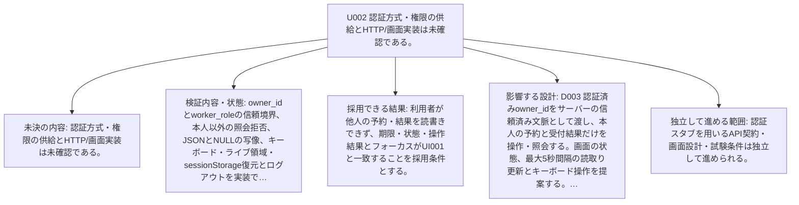

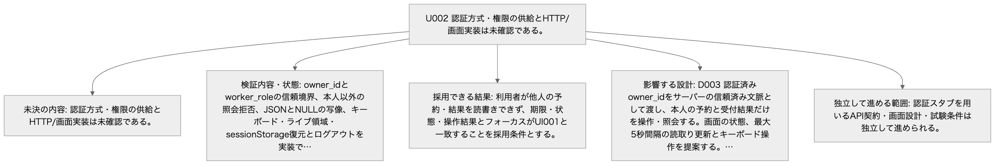

Mermaid: [local-U002.mmd](diagrams/local-U002.mmd) — 矢印は項目と条件の対応を示す。実行順序ではない。厳密な全文は同じ項目の表にある。

### U003 設計案の採用承認、取消識別子の拡張、保管期間・容量、数値上限と監視間隔の合意は未実施である。

| 項目 | 内容 |
| --- | --- |
| 未決の内容 | 設計案の採用承認、取消識別子の拡張、保管期間・容量、数値上限と監視間隔の合意は未実施である。 |
| 検証内容・状態 | 設計責任者と運用担当がD001〜D004の提案、結果照会の保持保証、削除しない場合の容量見積りと個人情報保管をレビューし、判断記録を残す。 |
| 採用できる結果 | 選択条件と制約が明示され判断の出典が残った場合だけadoptionをacceptedへ変更する。現段階では全件proposedを維持する。 |
| 確認する担当 | 設計責任者・運用担当 |
| 影響する設計 | [D001](common.md#D001) — HTTP JSON、PostgreSQL、責務の分離、作成の同時確定、状態条件による一回返却、保存側UTCと確定後応答を引き継ぐ。基本設計自身が設計案と明記しており、採用済みや実装検証済みとは扱わない。 / 採用: proposed / 検証: unverified [D002](common.md#D002) — API v1、UUID正規形、数量・在庫の上限、JSONの4096バイト上限、UTC精度、物理型、READ COMMITTEDと行ロック、受付結果最終登録、期限監視1秒・100件、索引・移行・エラーを提案する。PostgreSQLの対象版は未選定であり、ロック待機後の時刻と競合ロールバックを実DBで検証してから採用する。 / 採用: proposed / 検証: unverified [D003](common.md#D003) — 認証済みowner_idをサーバーの信頼済み文脈として渡し、本人の予約と受付結果だけを操作・照会する。画面の状態、最大5秒間隔の読取り更新とキーボード操作を提案する。認証方式とアダプターの写像は未検証である。 / 採用: proposed / 検証: unverified [D004](common.md#D004) — 取消にも受付用識別子を設け、作成と同じ結果台帳へ保存する。結果照会の保証を守るため備品・予約・受付結果をこの範囲では自動削除しない。容量・個人情報の保管期間と運用承認が必要である。識別子再利用を認める変更は互換性を別途設計する。 / 採用: proposed / 検証: unverified [T003](data.md#T003) — 本人の受付識別子と正規化内容、確定した共通応答を不変で保持する。 / 成功時の在庫・予約の更新と受付結果INSERTは同じCOMMIT。NO_STOCK・NOT_FOUND・VERSION_LIMIT等の業務拒否は受付結果だけをCOMMITする。 / 自動削除しない。識別子再利用と過去結果の喪失を防ぐ。保管期間と容量の承認はU003に残す。 [UI001](ui.md#UI001) — CREATED、CANCELLED、期限切れ、在庫不足、識別子競合、保存不成立、成否未確認を文字で区別する。durable=trueの操作結果は確定時残数として示し、IF005の現在残数と混同しない。IF004のNOT_RECORDEDではunknownを保つ。 / ST002のready=入力可能、sending=結果待ち、known=結果確認済み、unknown=成否未確認とする。初回読込・読取中は状態表示に読込中を添え、結果取得まで該当操作を無効にする。読取失敗は旧値に取得時刻と失敗を添える。activeかつdue=trueは期限到達・返却処理待ちを添え、expiredとは分ける。 |
| 独立して進める範囲 | 本書とAPIモック・確認条件をレビュー可能な案として作成できる。承認済みや動作保証として公開しない。 |

#### U003 設計案の採用承認、取消識別子の拡張、保管期間・容量、数値上限と監視間隔の合意は未実施である。

矢印は項目と条件の対応を示す。実行順序ではない。厳密な全文は同じ項目の表にある。

Mermaidの記述を確認する

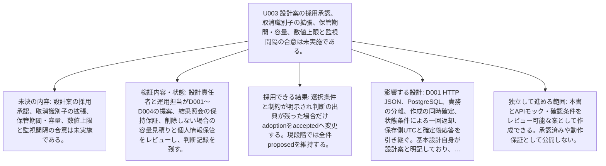

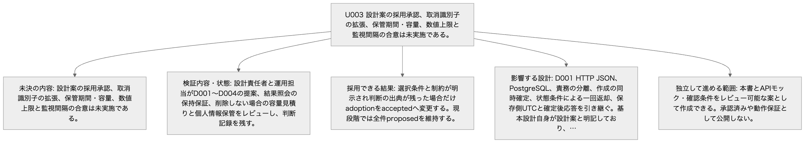

Mermaid: [local-U003.mmd](diagrams/local-U003.mmd) — 矢印は項目と条件の対応を示す。実行順序ではない。厳密な全文は同じ項目の表にある。

## changes

資料間の不一致と要件変更はない。詳細化した方式・上限・認証と保管はD002〜D004の未承認提案として扱う。
