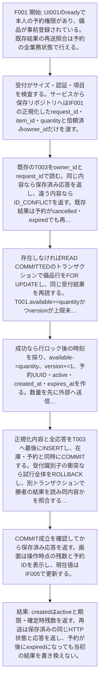
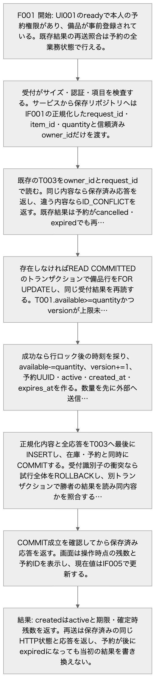
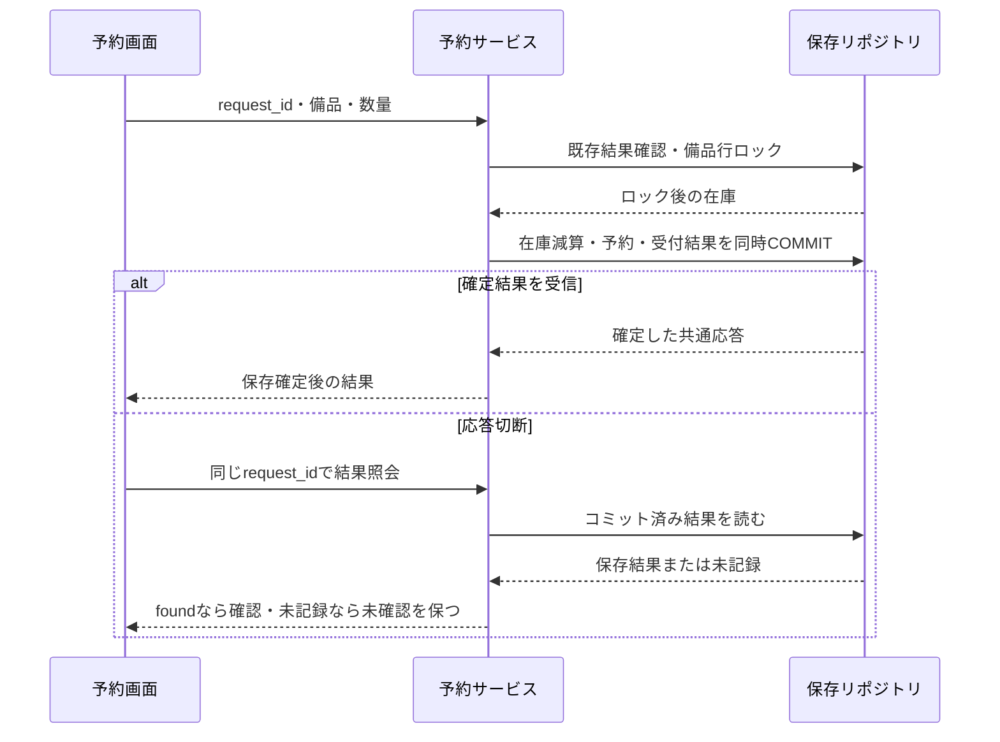
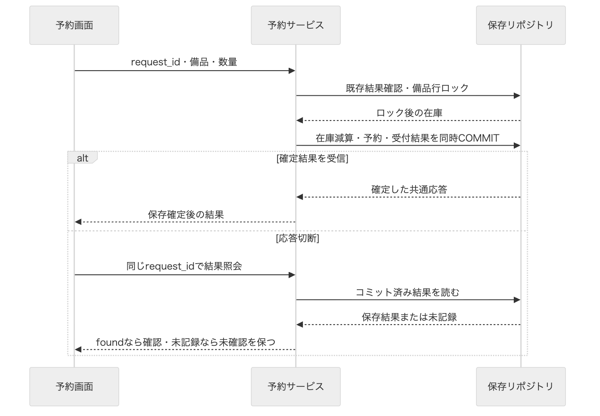
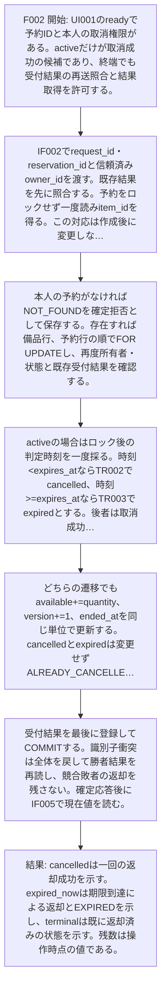
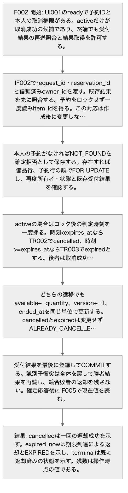
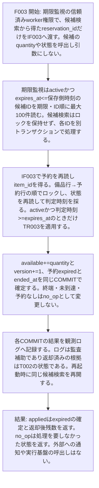
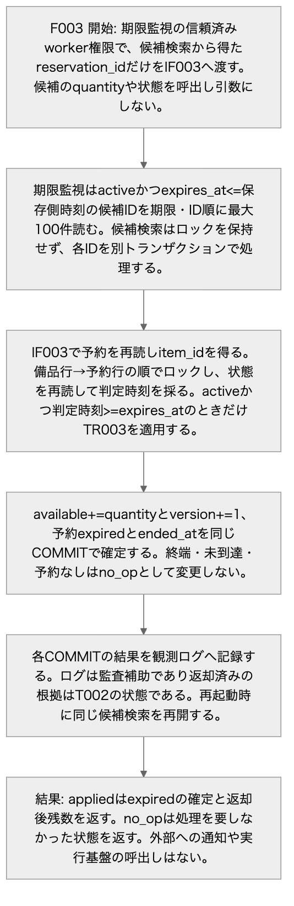
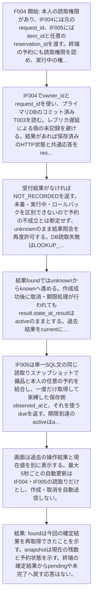
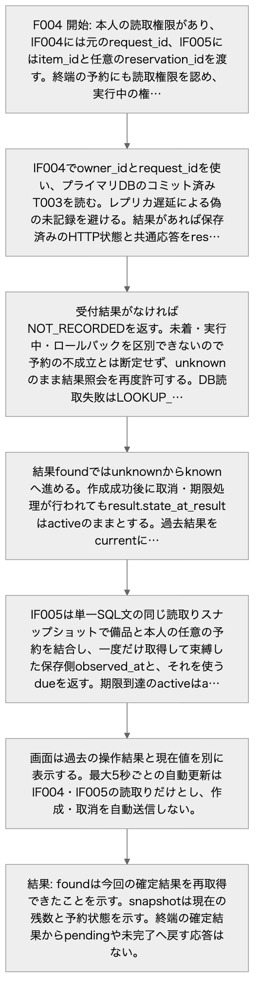

<!-- generated-by: write-detailed-design-document; body-sha256: f7dc20145250f03f6918bfbc7544eb8d2864612e9a93c0d6019b23fce13180d8 -->
# 機能ごとの詳細

[入口に戻る](README.md)

開始条件から保存と結果までを追い、異常時の回復と確認方法へつなぐ。

## features

## F001 予約を作成する

### 目的と根拠

在庫を超えずに予約を一回だけ確定し、後から同じ結果を確認できるようにする。
[S001](evidence.md#S001) — 利用者は備品の数量を指定して予約し、予約結果と残数を確認できる。最後の1個へ同時に予約しても、在庫は負にならず、成立する予約は1件だけである。 [S003](evidence.md#S003) — 作成の同じ受付用識別子・同じ内容の再送は新しい予約を作らない。違う内容なら競合として返す。 [S004](evidence.md#S004) — 保存確定後に応答する。応答切断後は識別子で確定した結果を照会し、予約や在庫の更新を自動で繰り返さない。 [S007](evidence.md#S007) — ブラウザ画面はHTTPのJSON APIを呼ぶ。サーバー側は受付・予約サービス・期限監視・保存リポジトリを分け、PostgreSQLへ備品と予約と受付結果を保存する。外部の実行基盤やエージェントは使わない。 [S008](evidence.md#S008) — 作成は在庫確認と数量の引当と予約と受付結果を一つの保存単位で確定する。同時再送は受付用識別子の一意制約で照合する。取消と期限処理は同じ予約の状態を条件にして一方だけが在庫を戻す。 時刻は保存側のUTCとし、画面の押下時刻を期限判定に使わない。期限処理が遅れても、取消の受付では期限を再検査する。 通知は保存確定後に画面へ返す。通信切断後や再起動後も受付用識別子で確定結果を照会し、外部への更新を再実行したことにしない。
[M001](common.md#M001) — 画面は入力と操作結果を表示し、受付は認証済みowner_id、サイズとJSON形を検査する。クライアントのowner_idを信用しない。 [M002](common.md#M002) — 作成・取消・照会の規則と権利を検査し、IF001〜IF005の保存境界へ正規化済み項目を渡す。保存不成立と確定不明を分ける。 [M004](common.md#M004) — PostgreSQLの行ロック・条件付き更新・受付結果の衝突を一つのトランザクションに閉じ、コミット成立後にのみ確定結果を返す。スナップショット読取りは書込みを行わない。

[S001](evidence.md#S001)

> 利用者は備品の数量を指定して予約し、予約結果と残数を確認できる。最後の1個へ同時に予約しても、在庫は負にならず、成立する予約は1件だけである。

出典: [docs/requirement.md 3行目](/private/tmp/detailed-design-public-nu7gtxsu/docs/requirement.md:3:1)

[S003](evidence.md#S003)

> 作成の同じ受付用識別子・同じ内容の再送は新しい予約を作らない。違う内容なら競合として返す。

出典: [docs/requirement.md 5行目](/private/tmp/detailed-design-public-nu7gtxsu/docs/requirement.md:5:1)

[S004](evidence.md#S004)

> 保存確定後に応答する。応答切断後は識別子で確定した結果を照会し、予約や在庫の更新を自動で繰り返さない。

出典: [docs/requirement.md 6行目](/private/tmp/detailed-design-public-nu7gtxsu/docs/requirement.md:6:1)

[S007](evidence.md#S007)

> ブラウザ画面はHTTPのJSON APIを呼ぶ。サーバー側は受付・予約サービス・期限監視・保存リポジトリを分け、PostgreSQLへ備品と予約と受付結果を保存する。外部の実行基盤やエージェントは使わない。

出典: [docs/basic-design.md 5行目](/private/tmp/detailed-design-public-nu7gtxsu/docs/basic-design.md:5:1)

[S008](evidence.md#S008)

> 作成は在庫確認と数量の引当と予約と受付結果を一つの保存単位で確定する。同時再送は受付用識別子の一意制約で照合する。取消と期限処理は同じ予約の状態を条件にして一方だけが在庫を戻す。
> 時刻は保存側のUTCとし、画面の押下時刻を期限判定に使わない。期限処理が遅れても、取消の受付では期限を再検査する。
> 通知は保存確定後に画面へ返す。通信切断後や再起動後も受付用識別子で確定結果を照会し、外部への更新を再実行したことにしない。

出典: [docs/basic-design.md 6行目](/private/tmp/detailed-design-public-nu7gtxsu/docs/basic-design.md:6:1)

[T001](data.md#T001)

> 備品一種類ごとの総数・残数と在庫更新版を保持する。 / F001〜F003で予約・必要な受付結果と一つのトランザクションにする。 / この設計範囲で自動削除・補充・capacity変更は行わない。

### 開始条件と入力

UI001のreadyで本人の予約権限があり、備品が事前登録されている。既存結果の再送照合は予約の全業務状態で行える。
[IF001](interfaces.md#IF001) — 同じrequest_idと正規化内容を受付・サービス・保存で引き継ぐ。内部の数量を再生成しない。 / 応答候補の全項目を返す。確定した業務結果だけを保存し、コミット結果不明を保存済み拒否に変えない。 / CREATED、NO_STOCK、NOT_FOUND、VERSION_LIMIT、INVALID_INPUT、TOO_LARGE、UNSUPPORTED_MEDIA、UNAUTHENTICATED、FORBIDDEN、ID_CONFLICT、SAVE_FAILED、COMMIT_UNKNOWNを共通応答のcodeで判別する。 / 入力: context.owner_id: string(uuid) 必須 NULL不可, サーバー認証で確定した利用者。クライアントからの指定を許可しない。 / body.request_id: string(uuid) 必須 NULL不可, 小文字ハイフン付きUUID正規形36文字。異なる世代の操作に再利用しない。 / body.item_id: string(uuid) 必須 NULL不可, 登録済み備品ID。 / body.quantity: integer 必須 NULL不可, 1〜1000000の整数。 / 応答: created: 201 CREATED。新しい予約と在庫・受付結果のCOMMITを確認した応答でありdurable=trueとする。 (request_id: string(uuid) or null 必須 NULL可, 妥当な識別子を受理済みならその値を返す。欠落・不正・識別前の拒否ではnullとする。; code: string 必須 NULL不可, CREATEDだけを返す。; message: string 必須 NULL不可, 1〜200 Unicode文字かつUTF-8で800バイト以下。利用者向け理由を返し内部例外は含めない。; reservation_id: string(uuid) or null 必須 NULL可, 予約に結び付く確定結果ではそのID、それ以外はnullとする。; state_at_result: string or null 必須 NULL可, 結果確定時のactive・cancelled・expired。予約がない拒否・保存不成立・確定不明はnullとする。; expires_at: string(datetime) or null 必須 NULL可, 予約に結び付く結果では共通UTC形式、それ以外はnullとする。; available_at_result: integer or null 必須 NULL可, 0〜1000000000。保存単位で取得した残数。備品がない場合、入力拒否、保存不成立、確定不明はnullとする。; result_at: string(datetime) or null 必須 NULL可, durable=trueの確定結果では共通UTC形式の確定判断時刻、durable=falseではnullとする。COMMIT完了時刻と同一とは限らない。; durable: boolean 必須 NULL不可, T003へCOMMITした応答はtrue、入力拒否・ID_CONFLICT・SAVE_FAILED・COMMIT_UNKNOWN等の非保存応答はfalseとする。) / replay: 保存済み結果と同じHTTP状態・共通応答を返す。CREATED、NO_STOCK、NOT_FOUND、VERSION_LIMITの元コードを変更しない。 (request_id: string(uuid) or null 必須 NULL可, 妥当な識別子を受理済みならその値を返す。欠落・不正・識別前の拒否ではnullとする。; code: string 必須 NULL不可, CREATED、NO_STOCK、NOT_FOUND、VERSION_LIMITだけを返す。; message: string 必須 NULL不可, 1〜200 Unicode文字かつUTF-8で800バイト以下。利用者向け理由を返し内部例外は含めない。; reservation_id: string(uuid) or null 必須 NULL可, 予約に結び付く確定結果ではそのID、それ以外はnullとする。; state_at_result: string or null 必須 NULL可, 結果確定時のactive・cancelled・expired。予約がない拒否・保存不成立・確定不明はnullとする。; expires_at: string(datetime) or null 必須 NULL可, 予約に結び付く結果では共通UTC形式、それ以外はnullとする。; available_at_result: integer or null 必須 NULL可, 0〜1000000000。保存単位で取得した残数。備品がない場合、入力拒否、保存不成立、確定不明はnullとする。; result_at: string(datetime) or null 必須 NULL可, durable=trueの確定結果では共通UTC形式の確定判断時刻、durable=falseではnullとする。COMMIT完了時刻と同一とは限らない。; durable: boolean 必須 NULL不可, T003へCOMMITした応答はtrue、入力拒否・ID_CONFLICT・SAVE_FAILED・COMMIT_UNKNOWN等の非保存応答はfalseとする。) / rejected: 400 INVALID_INPUT、413 TOO_LARGE、415 UNSUPPORTED_MEDIA、401 UNAUTHENTICATED、403 FORBIDDEN、404 NOT_FOUND、409 ID_CONFLICT、503 SAVE_FAILED、503 VERSION_LIMITとする。SAVE_FAILEDはROLLBACK確認済みに限る。NOT_FOUNDとVERSION_LIMITの有効要求はdurable=trueとして記録し、それ以外の事前拒否はfalseとする。 在庫不足は409 NO_STOCK、durable=trueとする。 (request_id: string(uuid) or null 必須 NULL可, 妥当な識別子を受理済みならその値を返す。欠落・不正・識別前の拒否ではnullとする。; code: string 必須 NULL不可, INVALID_INPUT、TOO_LARGE、UNSUPPORTED_MEDIA、UNAUTHENTICATED、FORBIDDEN、NOT_FOUND、ID_CONFLICT、SAVE_FAILED、VERSION_LIMIT、NO_STOCKだけを返す。; message: string 必須 NULL不可, 1〜200 Unicode文字かつUTF-8で800バイト以下。利用者向け理由を返し内部例外は含めない。; reservation_id: string(uuid) or null 必須 NULL可, 予約に結び付く確定結果ではそのID、それ以外はnullとする。; state_at_result: string or null 必須 NULL可, 結果確定時のactive・cancelled・expired。予約がない拒否・保存不成立・確定不明はnullとする。; expires_at: string(datetime) or null 必須 NULL可, 予約に結び付く結果では共通UTC形式、それ以外はnullとする。; available_at_result: integer or null 必須 NULL可, 0〜1000000000。保存単位で取得した残数。備品がない場合、入力拒否、保存不成立、確定不明はnullとする。; result_at: string(datetime) or null 必須 NULL可, durable=trueの確定結果では共通UTC形式の確定判断時刻、durable=falseではnullとする。COMMIT完了時刻と同一とは限らない。; durable: boolean 必須 NULL不可, T003へCOMMITした応答はtrue、入力拒否・ID_CONFLICT・SAVE_FAILED・COMMIT_UNKNOWN等の非保存応答はfalseとする。) / unconfirmed: 503 COMMIT_UNKNOWN。結果が不明でありdurable=false、予約・状態・期限・残数・result_atはnullとする。応答不能ならHTTP応答はなく、画面が切断からunknownへ進む。 (request_id: string(uuid) or null 必須 NULL可, 妥当な識別子を受理済みならその値を返す。欠落・不正・識別前の拒否ではnullとする。; code: string 必須 NULL不可, COMMIT_UNKNOWNだけを返す。; message: string 必須 NULL不可, 1〜200 Unicode文字かつUTF-8で800バイト以下。利用者向け理由を返し内部例外は含めない。; reservation_id: string(uuid) or null 必須 NULL可, 予約に結び付く確定結果ではそのID、それ以外はnullとする。; state_at_result: string or null 必須 NULL可, 結果確定時のactive・cancelled・expired。予約がない拒否・保存不成立・確定不明はnullとする。; expires_at: string(datetime) or null 必須 NULL可, 予約に結び付く結果では共通UTC形式、それ以外はnullとする。; available_at_result: integer or null 必須 NULL可, 0〜1000000000。保存単位で取得した残数。備品がない場合、入力拒否、保存不成立、確定不明はnullとする。; result_at: string(datetime) or null 必須 NULL可, durable=trueの確定結果では共通UTC形式の確定判断時刻、durable=falseではnullとする。COMMIT完了時刻と同一とは限らない。; durable: boolean 必須 NULL不可, T003へCOMMITした応答はtrue、入力拒否・ID_CONFLICT・SAVE_FAILED・COMMIT_UNKNOWN等の非保存応答はfalseとする。) / 最大サイズ: 要求本文4096バイト以下、応答8192バイト以下とする。HTTPパスとヘッダーは合計2048バイト以下とする提案である。

### 処理の流れ

1. 受付がサイズ・認証・項目を検査する。サービスから保存リポジトリへはIF001の正規化したrequest_id・item_id・quantityと信頼済みowner_idだけを渡す。
2. 既存のT003をowner_idとrequest_idで読む。同じ内容なら保存済み応答を返し、違う内容ならID_CONFLICTを返す。既存結果は予約がcancelled・expiredでも再利用する。
3. 存在しなければREAD COMMITTEDのトランザクションで備品行をFOR UPDATEし、同じ受付結果を再読する。T001.available>=quantityかつversionが上限未満を確認する。備品なしと在庫不足も業務上の確定拒否として受付結果へ残す。
4. 成功なら行ロック後の時刻を採り、available-=quantity、version+=1、予約UUID・active・created_at・expires_atを作る。数量を先に外部へ送信しない。
5. 正規化内容と全応答をT003へ最後にINSERTし、在庫・予約と同時にCOMMITする。受付識別子の衝突なら試行全体をROLLBACKし、別トランザクションで勝者の結果を読み同内容かを照合する。
6. COMMIT成立を確認してから保存済み応答を返す。画面は操作時点の残数と予約IDを表示し、現在値はIF005で更新する。
[T001](data.md#T001) — 備品一種類ごとの総数・残数と在庫更新版を保持する。 / F001〜F003で予約・必要な受付結果と一つのトランザクションにする。 / この設計範囲で自動削除・補充・capacity変更は行わない。 [T002](data.md#T002) — 引当数量と期限、返却確定状態を保存する。 / activeからの状態更新と在庫返却は必ず同じトランザクションにする。 / 終端を含め自動削除しない。参照先の備品を消さず、結果照会を継続する。 [T003](data.md#T003) — 本人の受付識別子と正規化内容、確定した共通応答を不変で保持する。 / 成功時の在庫・予約の更新と受付結果INSERTは同じCOMMIT。NO_STOCK・NOT_FOUND・VERSION_LIMIT等の業務拒否は受付結果だけをCOMMITする。 / 自動削除しない。識別子再利用と過去結果の喪失を防ぐ。保管期間と容量の承認はU003に残す。
[ST001](common.md#ST001) — absent: 予約が存在しない仮想状態である。DBへabsent行は保存しない。 / active: 数量を在庫から引き当てた予約である。期限到達後も返却コミットまで引当は保持し、取消受付では時刻を再検査する。 / cancelled: 期限より前の利用者取消により一回の返却を確定した終端である。 / expired: 期限到達により一回の返却を確定した終端である。 [ST002](common.md#ST002) — ready: 新しい操作を入力できる状態である。 / sending: 一つの作成または取消の応答を待つ状態である。 / known: 応答または照会により今回の確定結果、更新前拒否、保存不成立のいずれかを確認した状態である。 / unknown: 切断・コミット結果不明・受付結果未記録により成否を断定できない状態である。

#### F001 予約を作成する

矢印はこの機能の処理順を示す。異常・競合の条件は直下の本文で確認する。

Mermaidの記述を確認する

Mermaid: [local-F001.mmd](diagrams/local-F001.mmd) — 矢印はこの機能の処理順を示す。異常・競合の条件は直下の本文で確認する。

#### 同時作成と応答切断

処理順と確定後応答、切断後に読取りだけを行うことを示す。受付結果INSERT衝突は全ROLLBACK後に勝者結果を読む。保存結果と現在値は別の照会である。

Mermaidの記述を確認する

Mermaid: [local-G001-F001.mmd](diagrams/local-G001-F001.mmd) — 処理順と確定後応答、切断後に読取りだけを行うことを示す。受付結果INSERT衝突は全ROLLBACK後に勝者結果を読む。保存結果と現在値は別の照会である。

> F001 — 在庫を超えずに予約を一回だけ確定し、後から同じ結果を確認できるようにする。

> P002 — 同内容は勝者の同じ応答、異内容はID_CONFLICTとなる。勝者が業務拒否ならその拒否も固定する。識別子衝突で負けた仮の在庫更新は残らない。 / 受付結果は最終INSERTの複合主キーで勝者を決める。受付結果を読むだけの事前照合を排他の代用にしない。

> RC002 — IF004を本人権限で呼ぶ。foundなら保存済み結果を返しunknown→knownとする。unrecordedとfailedならunknownを保ち、IF005の現在値とは区別する。再読み込み時にsendingが残っていた画面はunknownとして復元する。 / 過去のCREATEDと現在expiredが同時に表示されても矛盾しない。前者は操作確定時点、後者は現在値である。terminalからpendingへ戻さない。

### 結果

createdはactiveと期限・確定時残数を返す。再送は保存済みの同じHTTP状態と応答を返し、予約が後にexpiredになっても当初の結果を書き換えない。
[UI001](ui.md#UI001) — CREATED、CANCELLED、期限切れ、在庫不足、識別子競合、保存不成立、成否未確認を文字で区別する。durable=trueの操作結果は確定時残数として示し、IF005の現在残数と混同しない。IF004のNOT_RECORDEDではunknownを保つ。 / ST002のready=入力可能、sending=結果待ち、known=結果確認済み、unknown=成否未確認とする。初回読込・読取中は状態表示に読込中を添え、結果取得まで該当操作を無効にする。読取失敗は旧値に取得時刻と失敗を添える。activeかつdue=trueは期限到達・返却処理待ちを添え、expiredとは分ける。

### 異常・競合・中断

検査不正は更新前に拒否する。保存不成立をROLLBACKで確認できたときだけSAVE_FAILEDを返す。COMMIT結果不明と応答切断はunknownとし、実DB状態を断定せずIF004で照会する。在庫更新は自動再実行しない。
[RC001](recovery.md#RC001) — DB回復後に受付結果と現在値を読む。保存不成立が確認できた応答だけSAVE_FAILEDとする。期限監視はactive候補を再検索できる。 / ROLLBACK確認済みのSAVE_FAILEDを受け取った画面はknownの保存不成立、未受信の画面はunknownである。IF004の未記録だけではROLLBACKを推論しない。 [RC002](recovery.md#RC002) — IF004を本人権限で呼ぶ。foundなら保存済み結果を返しunknown→knownとする。unrecordedとfailedならunknownを保ち、IF005の現在値とは区別する。再読み込み時にsendingが残っていた画面はunknownとして復元する。 / 過去のCREATEDと現在expiredが同時に表示されても矛盾しない。前者は操作確定時点、後者は現在値である。terminalからpendingへ戻さない。
[U001](evidence.md#U001) — PostgreSQL対象版・実装・実DBの原子性、競合、停止注入、負荷と移行は未検証である。外部サービスへの接続試験も今回実施していない。 / 全不変条件・返却一回・確定結果照会が観測値で一致し、期限監視の遅延と負荷の目標値を関係者が決定し実測が満たすことを採用条件とする。文書検査では代替しない。 / 検証: 開発側が対象版を記録し、C001〜C014、READ COMMITTEDの待機後再読、受付結果衝突の全ROLLBACK、時刻精度、DB回復、索引実行計画と移行失敗を隔離環境で試験する。外部サービスは採用する場合に別途接続契約を検証する。 [U002](evidence.md#U002) — 認証方式・権限の供給とHTTP/画面実装は未確認である。 / 利用者が他人の予約・結果を読書きできず、期限・状態・操作結果とフォーカスがUI001と一致することを採用条件とする。 / 検証: owner_idとworker_roleの信頼境界、本人以外の照会拒否、JSONとNULLの写像、キーボード・ライブ領域・sessionStorage復元とログアウトを実装で試験する。外部認証サービスへは接続していない。 [U003](evidence.md#U003) — 設計案の採用承認、取消識別子の拡張、保管期間・容量、数値上限と監視間隔の合意は未実施である。 / 選択条件と制約が明示され判断の出典が残った場合だけadoptionをacceptedへ変更する。現段階では全件proposedを維持する。 / 検証: 設計責任者と運用担当がD001〜D004の提案、結果照会の保持保証、削除しない場合の容量見積りと個人情報保管をレビューし、判断記録を残す。

### 確認方法

[C001](verification.md#C001) — 在庫3、本人の新しい受付用識別子、quantity=2を用意する。 / IF001で作成し、IF004とIF005を読む。 / CREATED、予約active、残数1、expires_at=created_at+10分、受付結果一件となる。保存済み共通応答と操作表示が一致する。 [C002](verification.md#C002) — 数量0・1・1000000・1000001、小数・真偽値・文字列、UUID不正、必須欠落、null、未知/重複キー、4096/4097バイトの要求を用意する。 / IF001とIF002を呼ぶ。 / 整数と範囲・サイズ・形を全て満たす要求だけが業務処理へ進む。不正はINVALID_INPUTまたはTOO_LARGE等で在庫・予約・受付結果を更新しない。欠落IDの応答request_idはnullであり欠落値を必須UUIDとして返さない。 [C003](verification.md#C003) — 同じ備品のavailable=1と異なる受付識別子二つを用意する。 / quantity=1の作成を同期して同時到着させる。 / CREATEDは一件、他方NO_STOCK、available=0、active合計=1となる。二件の受付結果を記録し、負在庫と二重引当を生じない。 [C008](verification.md#C008) — 同一owner_id+request_idで同じ作成内容または同じ取消内容を二件用意する。 / 同時に送信し、受付結果最終INSERTの前後で待機を注入する。 / 共通応答は一つの保存結果に一致し、作成予約は一件、取消返却は一回である。仮更新敗者は全ROLLBACKし、再送で期限を延ばさない。 [C009](verification.md#C009) — 同一受付識別子で異なるquantity・item_id・操作種別を用意する。既存結果ありと未登録の同時到着を分ける。 / IF001/IF002を競合させる。 / 勝者の結果だけが固定され、相違側はID_CONFLICT、相違側の在庫・予約仮更新は全て戻る。別ownerの同じIDは独立し情報を漏らさない。 [C010](verification.md#C010) — 作成・取消・期限処理で在庫更新後、予約更新後、受付結果INSERT後、COMMIT前に失敗を注入する。 / ROLLBACK成立を確認し、DBと応答を読む。 / 旧在庫・旧状態・旧受付結果を保ちSAVE_FAILEDを返す。新規予約や返却だけが残らない。version上限では更新しない。作成・取消はVERSION_LIMITの受付結果を記録し、期限処理はVERSION_LIMITのfailedを返して監視に残す。実行前検査拒否と保存不成立を区別する。 [C011](verification.md#C011) — 作成と取消のCOMMIT送信中、COMMIT後応答前、応答受信後の各切断位置とブラウザ再読込みを用意する。 / 元request_idでIF004を繰り返し読み、IF005も読む。 / 確定済みならfoundの元結果が一致しunknown→known、未記録/照会失敗ならunknownを保つ。送信中切断を旧状態維持と断定しない。作成・取消の自動再実行が0回であり、現在値だけで元操作の成功を断定しない。 [C013](verification.md#C013) — UI001をキーボードだけで操作し、在庫変化と入力不正・成功・切断を用意する。 / 予約・取消・結果照会・現在値更新と新しい操作への移行を行う。 / フォーカス順・エラー復帰・結果ライブ通知が機能し、sending多重送信を防ぐ。unknownは照会だけ、knownからは最新取得後readyへ進む。旧世代の読取応答で現在値を巻き戻さない。

## F002 予約を取消する

### 目的と根拠

期限内の本人取消または期限到達の確定を一回の返却に制限する。
[S002](evidence.md#S002) — 予約の有効期間は作成から10分とする。利用者の取消か期限切れで予約分の数量を在庫へ戻す。取消と期限処理が競合しても返却は1回だけとする。保存側の判定時刻が期限と等しければ期限切れとする。 [S004](evidence.md#S004) — 保存確定後に応答する。応答切断後は識別子で確定した結果を照会し、予約や在庫の更新を自動で繰り返さない。 [S005](evidence.md#S005) — 画面は在庫数、予約の状態、操作結果を表示し、期限切れ後は取消を受け付けない。キーボードで予約・取消・結果照会を行える。 [S008](evidence.md#S008) — 作成は在庫確認と数量の引当と予約と受付結果を一つの保存単位で確定する。同時再送は受付用識別子の一意制約で照合する。取消と期限処理は同じ予約の状態を条件にして一方だけが在庫を戻す。 時刻は保存側のUTCとし、画面の押下時刻を期限判定に使わない。期限処理が遅れても、取消の受付では期限を再検査する。 通知は保存確定後に画面へ返す。通信切断後や再起動後も受付用識別子で確定結果を照会し、外部への更新を再実行したことにしない。
[M001](common.md#M001) — 画面は入力と操作結果を表示し、受付は認証済みowner_id、サイズとJSON形を検査する。クライアントのowner_idを信用しない。 [M002](common.md#M002) — 作成・取消・照会の規則と権利を検査し、IF001〜IF005の保存境界へ正規化済み項目を渡す。保存不成立と確定不明を分ける。 [M004](common.md#M004) — PostgreSQLの行ロック・条件付き更新・受付結果の衝突を一つのトランザクションに閉じ、コミット成立後にのみ確定結果を返す。スナップショット読取りは書込みを行わない。

[S002](evidence.md#S002)

> 予約の有効期間は作成から10分とする。利用者の取消か期限切れで予約分の数量を在庫へ戻す。取消と期限処理が競合しても返却は1回だけとする。保存側の判定時刻が期限と等しければ期限切れとする。

出典: [docs/requirement.md 4行目](/private/tmp/detailed-design-public-nu7gtxsu/docs/requirement.md:4:1)

[S004](evidence.md#S004)

> 保存確定後に応答する。応答切断後は識別子で確定した結果を照会し、予約や在庫の更新を自動で繰り返さない。

出典: [docs/requirement.md 6行目](/private/tmp/detailed-design-public-nu7gtxsu/docs/requirement.md:6:1)

[S005](evidence.md#S005)

> 画面は在庫数、予約の状態、操作結果を表示し、期限切れ後は取消を受け付けない。キーボードで予約・取消・結果照会を行える。

出典: [docs/requirement.md 7行目](/private/tmp/detailed-design-public-nu7gtxsu/docs/requirement.md:7:1)

[S008](evidence.md#S008)

> 作成は在庫確認と数量の引当と予約と受付結果を一つの保存単位で確定する。同時再送は受付用識別子の一意制約で照合する。取消と期限処理は同じ予約の状態を条件にして一方だけが在庫を戻す。
> 時刻は保存側のUTCとし、画面の押下時刻を期限判定に使わない。期限処理が遅れても、取消の受付では期限を再検査する。
> 通知は保存確定後に画面へ返す。通信切断後や再起動後も受付用識別子で確定結果を照会し、外部への更新を再実行したことにしない。

出典: [docs/basic-design.md 6行目](/private/tmp/detailed-design-public-nu7gtxsu/docs/basic-design.md:6:1)

### 開始条件と入力

UI001のreadyで予約IDと本人の取消権限がある。activeだけが取消成功の候補であり、終端でも受付結果の再送照合と結果取得を許可する。
[IF002](interfaces.md#IF002) — 取消はreservation_idだけから保存済みitem_id・quantity・expires_atを読み、クライアントの数量を受け付けない。 / 応答候補の全項目を返す。確定した業務結果だけを保存し、コミット結果不明を保存済み拒否に変えない。 / CANCELLED、ALREADY_CANCELLED、EXPIRED、NOT_FOUND、VERSION_LIMIT、INVALID_INPUT、TOO_LARGE、UNSUPPORTED_MEDIA、UNAUTHENTICATED、FORBIDDEN、ID_CONFLICT、SAVE_FAILED、COMMIT_UNKNOWNをcodeに返す。 / 入力: context.owner_id: string(uuid) 必須 NULL不可, サーバー認証で確定した利用者。クライアントからの指定を許可しない。 / body.request_id: string(uuid) 必須 NULL不可, 小文字ハイフン付きUUID正規形36文字。異なる世代の操作に再利用しない。 / params.reservation_id: string(uuid) 必須 NULL不可, 本人の予約ID。 / 応答: cancelled: 200 CANCELLED。activeかつ期限前の判定でcancelledと返却をCOMMITしdurable=trueとする。 (request_id: string(uuid) or null 必須 NULL可, 妥当な識別子を受理済みならその値を返す。欠落・不正・識別前の拒否ではnullとする。; code: string 必須 NULL不可, CANCELLEDだけを返す。; message: string 必須 NULL不可, 1〜200 Unicode文字かつUTF-8で800バイト以下。利用者向け理由を返し内部例外は含めない。; reservation_id: string(uuid) or null 必須 NULL可, 予約に結び付く確定結果ではそのID、それ以外はnullとする。; state_at_result: string or null 必須 NULL可, 結果確定時のactive・cancelled・expired。予約がない拒否・保存不成立・確定不明はnullとする。; expires_at: string(datetime) or null 必須 NULL可, 予約に結び付く結果では共通UTC形式、それ以外はnullとする。; available_at_result: integer or null 必須 NULL可, 0〜1000000000。保存単位で取得した残数。備品がない場合、入力拒否、保存不成立、確定不明はnullとする。; result_at: string(datetime) or null 必須 NULL可, durable=trueの確定結果では共通UTC形式の確定判断時刻、durable=falseではnullとする。COMMIT完了時刻と同一とは限らない。; durable: boolean 必須 NULL不可, T003へCOMMITした応答はtrue、入力拒否・ID_CONFLICT・SAVE_FAILED・COMMIT_UNKNOWN等の非保存応答はfalseとする。) / expired_now: 409 EXPIRED。activeかつ期限到達の判定でexpiredと返却をCOMMITしdurable=trueとする。 (request_id: string(uuid) or null 必須 NULL可, 妥当な識別子を受理済みならその値を返す。欠落・不正・識別前の拒否ではnullとする。; code: string 必須 NULL不可, EXPIREDだけを返す。; message: string 必須 NULL不可, 1〜200 Unicode文字かつUTF-8で800バイト以下。利用者向け理由を返し内部例外は含めない。; reservation_id: string(uuid) or null 必須 NULL可, 予約に結び付く確定結果ではそのID、それ以外はnullとする。; state_at_result: string or null 必須 NULL可, 結果確定時のactive・cancelled・expired。予約がない拒否・保存不成立・確定不明はnullとする。; expires_at: string(datetime) or null 必須 NULL可, 予約に結び付く結果では共通UTC形式、それ以外はnullとする。; available_at_result: integer or null 必須 NULL可, 0〜1000000000。保存単位で取得した残数。備品がない場合、入力拒否、保存不成立、確定不明はnullとする。; result_at: string(datetime) or null 必須 NULL可, durable=trueの確定結果では共通UTC形式の確定判断時刻、durable=falseではnullとする。COMMIT完了時刻と同一とは限らない。; durable: boolean 必須 NULL不可, T003へCOMMITした応答はtrue、入力拒否・ID_CONFLICT・SAVE_FAILED・COMMIT_UNKNOWN等の非保存応答はfalseとする。) / terminal: 既存cancelledは200 ALREADY_CANCELLED、既存expiredは409 EXPIRED。再返却せずその結果をdurable=trueとして記録する。 (request_id: string(uuid) or null 必須 NULL可, 妥当な識別子を受理済みならその値を返す。欠落・不正・識別前の拒否ではnullとする。; code: string 必須 NULL不可, ALREADY_CANCELLED、EXPIREDだけを返す。; message: string 必須 NULL不可, 1〜200 Unicode文字かつUTF-8で800バイト以下。利用者向け理由を返し内部例外は含めない。; reservation_id: string(uuid) or null 必須 NULL可, 予約に結び付く確定結果ではそのID、それ以外はnullとする。; state_at_result: string or null 必須 NULL可, 結果確定時のactive・cancelled・expired。予約がない拒否・保存不成立・確定不明はnullとする。; expires_at: string(datetime) or null 必須 NULL可, 予約に結び付く結果では共通UTC形式、それ以外はnullとする。; available_at_result: integer or null 必須 NULL可, 0〜1000000000。保存単位で取得した残数。備品がない場合、入力拒否、保存不成立、確定不明はnullとする。; result_at: string(datetime) or null 必須 NULL可, durable=trueの確定結果では共通UTC形式の確定判断時刻、durable=falseではnullとする。COMMIT完了時刻と同一とは限らない。; durable: boolean 必須 NULL不可, T003へCOMMITした応答はtrue、入力拒否・ID_CONFLICT・SAVE_FAILED・COMMIT_UNKNOWN等の非保存応答はfalseとする。) / replay: 元の取消または拒否結果と同じHTTP状態・共通応答を返す。 (request_id: string(uuid) or null 必須 NULL可, 妥当な識別子を受理済みならその値を返す。欠落・不正・識別前の拒否ではnullとする。; code: string 必須 NULL不可, CANCELLED、EXPIRED、ALREADY_CANCELLED、NOT_FOUND、VERSION_LIMITだけを返す。; message: string 必須 NULL不可, 1〜200 Unicode文字かつUTF-8で800バイト以下。利用者向け理由を返し内部例外は含めない。; reservation_id: string(uuid) or null 必須 NULL可, 予約に結び付く確定結果ではそのID、それ以外はnullとする。; state_at_result: string or null 必須 NULL可, 結果確定時のactive・cancelled・expired。予約がない拒否・保存不成立・確定不明はnullとする。; expires_at: string(datetime) or null 必須 NULL可, 予約に結び付く結果では共通UTC形式、それ以外はnullとする。; available_at_result: integer or null 必須 NULL可, 0〜1000000000。保存単位で取得した残数。備品がない場合、入力拒否、保存不成立、確定不明はnullとする。; result_at: string(datetime) or null 必須 NULL可, durable=trueの確定結果では共通UTC形式の確定判断時刻、durable=falseではnullとする。COMMIT完了時刻と同一とは限らない。; durable: boolean 必須 NULL不可, T003へCOMMITした応答はtrue、入力拒否・ID_CONFLICT・SAVE_FAILED・COMMIT_UNKNOWN等の非保存応答はfalseとする。) / rejected: 400 INVALID_INPUT、413 TOO_LARGE、415 UNSUPPORTED_MEDIA、401 UNAUTHENTICATED、403 FORBIDDEN、404 NOT_FOUND、409 ID_CONFLICT、503 SAVE_FAILED、503 VERSION_LIMITとする。SAVE_FAILEDはROLLBACK確認済みに限る。NOT_FOUNDとVERSION_LIMITの有効要求はdurable=trueとして記録し、それ以外の事前拒否はfalseとする。 (request_id: string(uuid) or null 必須 NULL可, 妥当な識別子を受理済みならその値を返す。欠落・不正・識別前の拒否ではnullとする。; code: string 必須 NULL不可, INVALID_INPUT、TOO_LARGE、UNSUPPORTED_MEDIA、UNAUTHENTICATED、FORBIDDEN、NOT_FOUND、ID_CONFLICT、SAVE_FAILED、VERSION_LIMITだけを返す。; message: string 必須 NULL不可, 1〜200 Unicode文字かつUTF-8で800バイト以下。利用者向け理由を返し内部例外は含めない。; reservation_id: string(uuid) or null 必須 NULL可, 予約に結び付く確定結果ではそのID、それ以外はnullとする。; state_at_result: string or null 必須 NULL可, 結果確定時のactive・cancelled・expired。予約がない拒否・保存不成立・確定不明はnullとする。; expires_at: string(datetime) or null 必須 NULL可, 予約に結び付く結果では共通UTC形式、それ以外はnullとする。; available_at_result: integer or null 必須 NULL可, 0〜1000000000。保存単位で取得した残数。備品がない場合、入力拒否、保存不成立、確定不明はnullとする。; result_at: string(datetime) or null 必須 NULL可, durable=trueの確定結果では共通UTC形式の確定判断時刻、durable=falseではnullとする。COMMIT完了時刻と同一とは限らない。; durable: boolean 必須 NULL不可, T003へCOMMITした応答はtrue、入力拒否・ID_CONFLICT・SAVE_FAILED・COMMIT_UNKNOWN等の非保存応答はfalseとする。) / unconfirmed: 503 COMMIT_UNKNOWN。durable=falseとし予約・状態・期限・残数・result_atをnullとする。応答不能は画面でunknownとして扱う。 (request_id: string(uuid) or null 必須 NULL可, 妥当な識別子を受理済みならその値を返す。欠落・不正・識別前の拒否ではnullとする。; code: string 必須 NULL不可, COMMIT_UNKNOWNだけを返す。; message: string 必須 NULL不可, 1〜200 Unicode文字かつUTF-8で800バイト以下。利用者向け理由を返し内部例外は含めない。; reservation_id: string(uuid) or null 必須 NULL可, 予約に結び付く確定結果ではそのID、それ以外はnullとする。; state_at_result: string or null 必須 NULL可, 結果確定時のactive・cancelled・expired。予約がない拒否・保存不成立・確定不明はnullとする。; expires_at: string(datetime) or null 必須 NULL可, 予約に結び付く結果では共通UTC形式、それ以外はnullとする。; available_at_result: integer or null 必須 NULL可, 0〜1000000000。保存単位で取得した残数。備品がない場合、入力拒否、保存不成立、確定不明はnullとする。; result_at: string(datetime) or null 必須 NULL可, durable=trueの確定結果では共通UTC形式の確定判断時刻、durable=falseではnullとする。COMMIT完了時刻と同一とは限らない。; durable: boolean 必須 NULL不可, T003へCOMMITした応答はtrue、入力拒否・ID_CONFLICT・SAVE_FAILED・COMMIT_UNKNOWN等の非保存応答はfalseとする。) / 最大サイズ: 要求本文4096バイト以下、応答8192バイト以下とする。HTTPパスとヘッダーは合計2048バイト以下とする提案である。

### 処理の流れ

1. IF002でrequest_id・reservation_idと信頼済みowner_idを渡す。既存結果を先に照合する。予約をロックせず一度読みitem_idを得る。この対応は作成後に変更しない。
2. 本人の予約がなければNOT_FOUNDを確定拒否として保存する。存在すれば備品行、予約行の順でFOR UPDATEし、再度所有者・状態と既存受付結果を確認する。
3. activeの場合はロック後の判定時刻を一度採る。時刻<expires_atならTR002でcancelled、時刻>=expires_atならTR003でexpiredとする。後者は取消成功にせずEXPIREDを返す。
4. どちらの遷移でもavailable+=quantity、version+=1、ended_atを同じ単位で更新する。cancelledとexpiredは変更せずALREADY_CANCELLEDまたはEXPIREDを返す。
5. 受付結果を最後に登録してCOMMITする。識別子衝突は全体を戻して勝者結果を再読し、競合敗者の返却を残さない。確定応答後にIF005で現在値を読む。
[T001](data.md#T001) — 備品一種類ごとの総数・残数と在庫更新版を保持する。 / F001〜F003で予約・必要な受付結果と一つのトランザクションにする。 / この設計範囲で自動削除・補充・capacity変更は行わない。 [T002](data.md#T002) — 引当数量と期限、返却確定状態を保存する。 / activeからの状態更新と在庫返却は必ず同じトランザクションにする。 / 終端を含め自動削除しない。参照先の備品を消さず、結果照会を継続する。 [T003](data.md#T003) — 本人の受付識別子と正規化内容、確定した共通応答を不変で保持する。 / 成功時の在庫・予約の更新と受付結果INSERTは同じCOMMIT。NO_STOCK・NOT_FOUND・VERSION_LIMIT等の業務拒否は受付結果だけをCOMMITする。 / 自動削除しない。識別子再利用と過去結果の喪失を防ぐ。保管期間と容量の承認はU003に残す。
[ST001](common.md#ST001) — absent: 予約が存在しない仮想状態である。DBへabsent行は保存しない。 / active: 数量を在庫から引き当てた予約である。期限到達後も返却コミットまで引当は保持し、取消受付では時刻を再検査する。 / cancelled: 期限より前の利用者取消により一回の返却を確定した終端である。 / expired: 期限到達により一回の返却を確定した終端である。 [ST002](common.md#ST002) — ready: 新しい操作を入力できる状態である。 / sending: 一つの作成または取消の応答を待つ状態である。 / known: 応答または照会により今回の確定結果、更新前拒否、保存不成立のいずれかを確認した状態である。 / unknown: 切断・コミット結果不明・受付結果未記録により成否を断定できない状態である。

#### F002 予約を取消する

矢印はこの機能の処理順を示す。異常・競合の条件は直下の本文で確認する。

Mermaidの記述を確認する

Mermaid: [local-F002.mmd](diagrams/local-F002.mmd) — 矢印はこの機能の処理順を示す。異常・競合の条件は直下の本文で確認する。

### 結果

cancelledは一回の返却成功を示す。expired_nowは期限到達による返却とEXPIREDを示し、terminalは既に返却済みの状態を示す。残数は操作時点の値である。
[UI001](ui.md#UI001) — CREATED、CANCELLED、期限切れ、在庫不足、識別子競合、保存不成立、成否未確認を文字で区別する。durable=trueの操作結果は確定時残数として示し、IF005の現在残数と混同しない。IF004のNOT_RECORDEDではunknownを保つ。 / ST002のready=入力可能、sending=結果待ち、known=結果確認済み、unknown=成否未確認とする。初回読込・読取中は状態表示に読込中を添え、結果取得まで該当操作を無効にする。読取失敗は旧値に取得時刻と失敗を添える。activeかつdue=trueは期限到達・返却処理待ちを添え、expiredとは分ける。

### 異常・競合・中断

同時取消・期限監視では備品→予約の同じロック順とactiveの条件で一方だけが返却する。検査拒否・確定ロールバックは状態を保つ。COMMIT不明は業務状態を断定せずunknownとしてIF004で結果を照会する。
[RC001](recovery.md#RC001) — DB回復後に受付結果と現在値を読む。保存不成立が確認できた応答だけSAVE_FAILEDとする。期限監視はactive候補を再検索できる。 / ROLLBACK確認済みのSAVE_FAILEDを受け取った画面はknownの保存不成立、未受信の画面はunknownである。IF004の未記録だけではROLLBACKを推論しない。 [RC002](recovery.md#RC002) — IF004を本人権限で呼ぶ。foundなら保存済み結果を返しunknown→knownとする。unrecordedとfailedならunknownを保ち、IF005の現在値とは区別する。再読み込み時にsendingが残っていた画面はunknownとして復元する。 / 過去のCREATEDと現在expiredが同時に表示されても矛盾しない。前者は操作確定時点、後者は現在値である。terminalからpendingへ戻さない。 [RC003](recovery.md#RC003) — 起動時に期限到達activeを検索し、IF003へ予約IDだけを渡す。expired/cancelledはno_op、activeはロック後の期限再検査でTR003を適用する。取消からも同じ期限条件で返却できる。 / 処理待ちactiveかつdue=trueは画面で期限到達・処理待ちと示し取消を無効にする。返却確定後はexpiredと最新在庫を表示する。
[U001](evidence.md#U001) — PostgreSQL対象版・実装・実DBの原子性、競合、停止注入、負荷と移行は未検証である。外部サービスへの接続試験も今回実施していない。 / 全不変条件・返却一回・確定結果照会が観測値で一致し、期限監視の遅延と負荷の目標値を関係者が決定し実測が満たすことを採用条件とする。文書検査では代替しない。 / 検証: 開発側が対象版を記録し、C001〜C014、READ COMMITTEDの待機後再読、受付結果衝突の全ROLLBACK、時刻精度、DB回復、索引実行計画と移行失敗を隔離環境で試験する。外部サービスは採用する場合に別途接続契約を検証する。 [U002](evidence.md#U002) — 認証方式・権限の供給とHTTP/画面実装は未確認である。 / 利用者が他人の予約・結果を読書きできず、期限・状態・操作結果とフォーカスがUI001と一致することを採用条件とする。 / 検証: owner_idとworker_roleの信頼境界、本人以外の照会拒否、JSONとNULLの写像、キーボード・ライブ領域・sessionStorage復元とログアウトを実装で試験する。外部認証サービスへは接続していない。 [U003](evidence.md#U003) — 設計案の採用承認、取消識別子の拡張、保管期間・容量、数値上限と監視間隔の合意は未実施である。 / 選択条件と制約が明示され判断の出典が残った場合だけadoptionをacceptedへ変更する。現段階では全件proposedを維持する。 / 検証: 設計責任者と運用担当がD001〜D004の提案、結果照会の保持保証、削除しない場合の容量見積りと個人情報保管をレビューし、判断記録を残す。

### 確認方法

[C004](verification.md#C004) — active予約の期限をTとし、ロック後に採る判定時刻をT-1マイクロ秒に固定できる試験構成とする。 / 本人がIF002で取消する。 / TR002でcancelled、一回だけquantityを返却しCANCELLEDを記録する。ended_at<Tであり受付結果・在庫・状態が同時確定する。 [C005](verification.md#C005) — active予約の期限T、監視遅延、判定時刻TとT+1マイクロ秒の二条件を用意する。 / IF002またはIF003を呼び、後で同じ予約を再処理する。 / どちらもTR003でexpiredと一回返却になる。取消の応答はEXPIRED、監視はappliedであり、次回はterminal/no_opで二回目の返却がない。 [C006](verification.md#C006) — active予約に本人取消二件と期限処理を用意し、期限直前・等号・直後を制御する。 / 全処理を同時開始し備品ロック待機を注入する。 / ロック取得後の時刻で勝敗が決まり、期限前に確定した取消だけcancelled、期限到達ならexpiredとなる。available増分はquantity一回、version増分一回で終端を覆さない。待機前時刻を使わない。 [C008](verification.md#C008) — 同一owner_id+request_idで同じ作成内容または同じ取消内容を二件用意する。 / 同時に送信し、受付結果最終INSERTの前後で待機を注入する。 / 共通応答は一つの保存結果に一致し、作成予約は一件、取消返却は一回である。仮更新敗者は全ROLLBACKし、再送で期限を延ばさない。 [C009](verification.md#C009) — 同一受付識別子で異なるquantity・item_id・操作種別を用意する。既存結果ありと未登録の同時到着を分ける。 / IF001/IF002を競合させる。 / 勝者の結果だけが固定され、相違側はID_CONFLICT、相違側の在庫・予約仮更新は全て戻る。別ownerの同じIDは独立し情報を漏らさない。 [C010](verification.md#C010) — 作成・取消・期限処理で在庫更新後、予約更新後、受付結果INSERT後、COMMIT前に失敗を注入する。 / ROLLBACK成立を確認し、DBと応答を読む。 / 旧在庫・旧状態・旧受付結果を保ちSAVE_FAILEDを返す。新規予約や返却だけが残らない。version上限では更新しない。作成・取消はVERSION_LIMITの受付結果を記録し、期限処理はVERSION_LIMITのfailedを返して監視に残す。実行前検査拒否と保存不成立を区別する。 [C011](verification.md#C011) — 作成と取消のCOMMIT送信中、COMMIT後応答前、応答受信後の各切断位置とブラウザ再読込みを用意する。 / 元request_idでIF004を繰り返し読み、IF005も読む。 / 確定済みならfoundの元結果が一致しunknown→known、未記録/照会失敗ならunknownを保つ。送信中切断を旧状態維持と断定しない。作成・取消の自動再実行が0回であり、現在値だけで元操作の成功を断定しない。 [C013](verification.md#C013) — UI001をキーボードだけで操作し、在庫変化と入力不正・成功・切断を用意する。 / 予約・取消・結果照会・現在値更新と新しい操作への移行を行う。 / フォーカス順・エラー復帰・結果ライブ通知が機能し、sending多重送信を防ぐ。unknownは照会だけ、knownからは最新取得後readyへ進む。旧世代の読取応答で現在値を巻き戻さない。 [C014](verification.md#C014) — 作成成功の受付結果を残し、その予約を期限切れにする。他人のID・欠落ID・任意予約ID未指定の読取りも用意する。 / IF004とIF005を呼ぶ。 / IF004は元CREATED・activeを固定して返し、IF005は現在expiredと返却後残数を返す。終端結果をpendingにしない。他人の結果はNOT_RECORDED、他人/別備品予約はNOT_FOUND、任意予約ID欠落は在庫だけで予約各項目null、指定nullはINVALID_INPUTとなる。

## F003 期限到達を処理する

### 目的と根拠

監視遅延や再起動があっても期限切れの引当を一回だけ解放する。
[S002](evidence.md#S002) — 予約の有効期間は作成から10分とする。利用者の取消か期限切れで予約分の数量を在庫へ戻す。取消と期限処理が競合しても返却は1回だけとする。保存側の判定時刻が期限と等しければ期限切れとする。 [S007](evidence.md#S007) — ブラウザ画面はHTTPのJSON APIを呼ぶ。サーバー側は受付・予約サービス・期限監視・保存リポジトリを分け、PostgreSQLへ備品と予約と受付結果を保存する。外部の実行基盤やエージェントは使わない。 [S008](evidence.md#S008) — 作成は在庫確認と数量の引当と予約と受付結果を一つの保存単位で確定する。同時再送は受付用識別子の一意制約で照合する。取消と期限処理は同じ予約の状態を条件にして一方だけが在庫を戻す。 時刻は保存側のUTCとし、画面の押下時刻を期限判定に使わない。期限処理が遅れても、取消の受付では期限を再検査する。 通知は保存確定後に画面へ返す。通信切断後や再起動後も受付用識別子で確定結果を照会し、外部への更新を再実行したことにしない。
[M002](common.md#M002) — 作成・取消・照会の規則と権利を検査し、IF001〜IF005の保存境界へ正規化済み項目を渡す。保存不成立と確定不明を分ける。 [M003](common.md#M003) — 起動時と1秒ごとの候補検索でactiveかつ期限到達の予約IDを最大100件取得し、各IDをIF003へ渡す。処理単位は1予約であり、候補検索の時点で返却を確定しない。間隔と件数はD002の未検証提案である。 [M004](common.md#M004) — PostgreSQLの行ロック・条件付き更新・受付結果の衝突を一つのトランザクションに閉じ、コミット成立後にのみ確定結果を返す。スナップショット読取りは書込みを行わない。

[S002](evidence.md#S002)

> 予約の有効期間は作成から10分とする。利用者の取消か期限切れで予約分の数量を在庫へ戻す。取消と期限処理が競合しても返却は1回だけとする。保存側の判定時刻が期限と等しければ期限切れとする。

出典: [docs/requirement.md 4行目](/private/tmp/detailed-design-public-nu7gtxsu/docs/requirement.md:4:1)

[S007](evidence.md#S007)

> ブラウザ画面はHTTPのJSON APIを呼ぶ。サーバー側は受付・予約サービス・期限監視・保存リポジトリを分け、PostgreSQLへ備品と予約と受付結果を保存する。外部の実行基盤やエージェントは使わない。

出典: [docs/basic-design.md 5行目](/private/tmp/detailed-design-public-nu7gtxsu/docs/basic-design.md:5:1)

[S008](evidence.md#S008)

> 作成は在庫確認と数量の引当と予約と受付結果を一つの保存単位で確定する。同時再送は受付用識別子の一意制約で照合する。取消と期限処理は同じ予約の状態を条件にして一方だけが在庫を戻す。
> 時刻は保存側のUTCとし、画面の押下時刻を期限判定に使わない。期限処理が遅れても、取消の受付では期限を再検査する。
> 通知は保存確定後に画面へ返す。通信切断後や再起動後も受付用識別子で確定結果を照会し、外部への更新を再実行したことにしない。

出典: [docs/basic-design.md 6行目](/private/tmp/detailed-design-public-nu7gtxsu/docs/basic-design.md:6:1)

### 開始条件と入力

期限監視の信頼済みworker権限で、候補検索から得たreservation_idだけをIF003へ渡す。候補のquantityや状態を呼出し引数にしない。
[IF003](interfaces.md#IF003) — 引数は候補の予約IDとworker権利だけとし、数量や時刻は保存側から再取得する。 / 応答候補の全項目を返す。確定した業務結果だけを保存し、コミット結果不明を保存済み拒否に変えない。 / EXPIRED、NOT_DUE、ALREADY_TERMINAL、NOT_FOUND、INVALID_INPUT、FORBIDDEN、SAVE_FAILED、VERSION_LIMIT、COMMIT_UNKNOWNをcodeに返す。 / 入力: reservation_id: string(uuid) 必須 NULL不可, 候補検索で取得したID。 / context.worker_role: string 必須 NULL不可, サーバーが付与するexpiry-worker固定値。 / 応答: applied: EXPIRED。activeからexpiredと返却をCOMMITした結果。 (reservation_id: string(uuid) or null 必須 NULL可, 有効な要求IDを返し、不正・欠落ならnull。; code: string 必須 NULL不可, EXPIREDだけを返す。; state: string or null 必須 NULL可, 確認したactive・cancelled・expired。不存在、不正、確定不明ではnull。; available: integer or null 必須 NULL可, 0〜1000000000。確定したスナップショットがある場合だけ返し、それ以外はnull。; evaluated_at: string(datetime) or null 必須 NULL可, ロック後に判定できた共通UTC時刻。確定不明・入力拒否ではnull。) / no_op: activeで未到達はNOT_DUE、cancelled/expiredはALREADY_TERMINAL、予約なしはNOT_FOUND。DB変更なし。 (reservation_id: string(uuid) or null 必須 NULL可, 有効な要求IDを返し、不正・欠落ならnull。; code: string 必須 NULL不可, NOT_DUE、ALREADY_TERMINAL、NOT_FOUNDだけを返す。; state: string or null 必須 NULL可, 確認したactive・cancelled・expired。不存在、不正、確定不明ではnull。; available: integer or null 必須 NULL可, 0〜1000000000。確定したスナップショットがある場合だけ返し、それ以外はnull。; evaluated_at: string(datetime) or null 必須 NULL可, ロック後に判定できた共通UTC時刻。確定不明・入力拒否ではnull。) / failed: INVALID_INPUT、FORBIDDEN、VERSION_LIMITまたはROLLBACK確認済みSAVE_FAILED。DB更新なし。 (reservation_id: string(uuid) or null 必須 NULL可, 有効な要求IDを返し、不正・欠落ならnull。; code: string 必須 NULL不可, INVALID_INPUT、FORBIDDEN、SAVE_FAILED、VERSION_LIMITだけを返す。; state: string or null 必須 NULL可, 確認したactive・cancelled・expired。不存在、不正、確定不明ではnull。; available: integer or null 必須 NULL可, 0〜1000000000。確定したスナップショットがある場合だけ返し、それ以外はnull。; evaluated_at: string(datetime) or null 必須 NULL可, ロック後に判定できた共通UTC時刻。確定不明・入力拒否ではnull。) / unconfirmed: COMMIT_UNKNOWN。業務状態と返却回数を断定しない。 (reservation_id: string(uuid) or null 必須 NULL可, 有効な要求IDを返し、不正・欠落ならnull。; code: string 必須 NULL不可, COMMIT_UNKNOWNだけを返す。; state: string or null 必須 NULL可, 確認したactive・cancelled・expired。不存在、不正、確定不明ではnull。; available: integer or null 必須 NULL可, 0〜1000000000。確定したスナップショットがある場合だけ返し、それ以外はnull。; evaluated_at: string(datetime) or null 必須 NULL可, ロック後に判定できた共通UTC時刻。確定不明・入力拒否ではnull。) / 最大サイズ: 内部要求256バイト相当以下、応答1024バイト以下とする提案である。

### 処理の流れ

1. 期限監視はactiveかつexpires_at<=保存側時刻の候補IDを期限・ID順に最大100件読む。候補検索はロックを保持せず、各IDを別トランザクションで処理する。
2. IF003で予約を再読しitem_idを得る。備品行→予約行の順でロックし、状態を再読して判定時刻を採る。activeかつ判定時刻>=expires_atのときだけTR003を適用する。
3. available+=quantityとversion+=1、予約expiredとended_atを同じCOMMITで確定する。終端・未到達・予約なしはno_opとして変更しない。
4. 各COMMITの結果を観測ログへ記録する。ログは監査補助であり返却済みの根拠はT002の状態である。再起動時に同じ候補検索を再開する。
[T001](data.md#T001) — 備品一種類ごとの総数・残数と在庫更新版を保持する。 / F001〜F003で予約・必要な受付結果と一つのトランザクションにする。 / この設計範囲で自動削除・補充・capacity変更は行わない。 [T002](data.md#T002) — 引当数量と期限、返却確定状態を保存する。 / activeからの状態更新と在庫返却は必ず同じトランザクションにする。 / 終端を含め自動削除しない。参照先の備品を消さず、結果照会を継続する。
[ST001](common.md#ST001) — absent: 予約が存在しない仮想状態である。DBへabsent行は保存しない。 / active: 数量を在庫から引き当てた予約である。期限到達後も返却コミットまで引当は保持し、取消受付では時刻を再検査する。 / cancelled: 期限より前の利用者取消により一回の返却を確定した終端である。 / expired: 期限到達により一回の返却を確定した終端である。

#### F003 期限到達を処理する

矢印はこの機能の処理順を示す。異常・競合の条件は直下の本文で確認する。

Mermaidの記述を確認する

Mermaid: [local-F003.mmd](diagrams/local-F003.mmd) — 矢印はこの機能の処理順を示す。異常・競合の条件は直下の本文で確認する。

### 結果

appliedはexpiredの確定と返却後残数を返す。no_opは処理を要しなかった状態を返す。外部への通知や実行基盤の呼出しはない。
なし

### 異常・競合・中断

ロールバック確認時はfailedとして次の走査に残す。COMMIT不明では在庫を逆補正せず、再読の後にactive条件付き処理だけを許可する。期限監視の再試行は保存済み状態に従う内部回復であり、利用者の作成・取消を再実行しない。
[RC001](recovery.md#RC001) — DB回復後に受付結果と現在値を読む。保存不成立が確認できた応答だけSAVE_FAILEDとする。期限監視はactive候補を再検索できる。 / ROLLBACK確認済みのSAVE_FAILEDを受け取った画面はknownの保存不成立、未受信の画面はunknownである。IF004の未記録だけではROLLBACKを推論しない。 [RC003](recovery.md#RC003) — 起動時に期限到達activeを検索し、IF003へ予約IDだけを渡す。expired/cancelledはno_op、activeはロック後の期限再検査でTR003を適用する。取消からも同じ期限条件で返却できる。 / 処理待ちactiveかつdue=trueは画面で期限到達・処理待ちと示し取消を無効にする。返却確定後はexpiredと最新在庫を表示する。
[U001](evidence.md#U001) — PostgreSQL対象版・実装・実DBの原子性、競合、停止注入、負荷と移行は未検証である。外部サービスへの接続試験も今回実施していない。 / 全不変条件・返却一回・確定結果照会が観測値で一致し、期限監視の遅延と負荷の目標値を関係者が決定し実測が満たすことを採用条件とする。文書検査では代替しない。 / 検証: 開発側が対象版を記録し、C001〜C014、READ COMMITTEDの待機後再読、受付結果衝突の全ROLLBACK、時刻精度、DB回復、索引実行計画と移行失敗を隔離環境で試験する。外部サービスは採用する場合に別途接続契約を検証する。 [U003](evidence.md#U003) — 設計案の採用承認、取消識別子の拡張、保管期間・容量、数値上限と監視間隔の合意は未実施である。 / 選択条件と制約が明示され判断の出典が残った場合だけadoptionをacceptedへ変更する。現段階では全件proposedを維持する。 / 検証: 設計責任者と運用担当がD001〜D004の提案、結果照会の保持保証、削除しない場合の容量見積りと個人情報保管をレビューし、判断記録を残す。

### 確認方法

[C005](verification.md#C005) — active予約の期限T、監視遅延、判定時刻TとT+1マイクロ秒の二条件を用意する。 / IF002またはIF003を呼び、後で同じ予約を再処理する。 / どちらもTR003でexpiredと一回返却になる。取消の応答はEXPIRED、監視はappliedであり、次回はterminal/no_opで二回目の返却がない。 [C006](verification.md#C006) — active予約に本人取消二件と期限処理を用意し、期限直前・等号・直後を制御する。 / 全処理を同時開始し備品ロック待機を注入する。 / ロック取得後の時刻で勝敗が決まり、期限前に確定した取消だけcancelled、期限到達ならexpiredとなる。available増分はquantity一回、version増分一回で終端を覆さない。待機前時刻を使わない。 [C007](verification.md#C007) — 期限到達activeを含む複数予約と監視停止・再起動を用意する。 / 監視を止め期限を越え、起動時に候補を最大100件ずつ処理する。 / 期限到達activeは返却まで処理待ち表示となり取消受付は期限再検査でEXPIREDとなる。各予約の返却一回と不変条件を保ち、候補が次の走査で消失しない。 [C010](verification.md#C010) — 作成・取消・期限処理で在庫更新後、予約更新後、受付結果INSERT後、COMMIT前に失敗を注入する。 / ROLLBACK成立を確認し、DBと応答を読む。 / 旧在庫・旧状態・旧受付結果を保ちSAVE_FAILEDを返す。新規予約や返却だけが残らない。version上限では更新しない。作成・取消はVERSION_LIMITの受付結果を記録し、期限処理はVERSION_LIMITのfailedを返して監視に残す。実行前検査拒否と保存不成立を区別する。 [C012](verification.md#C012) — 期限処理のCOMMIT直前と直後で停止し、結果不明も作る。 / 保存済み予約を再読して監視を再起動する。 / activeなら条件を再検査し一回返却、expired/cancelledならno_opである。結果照会/現在値読取りは副作用0回、availableの逆補正をしない。

## F004 結果と現在値を照会する

### 目的と根拠

切断後の確定結果を識別子で読み、過去の操作と現在の在庫・予約を区別する。
[S001](evidence.md#S001) — 利用者は備品の数量を指定して予約し、予約結果と残数を確認できる。最後の1個へ同時に予約しても、在庫は負にならず、成立する予約は1件だけである。 [S004](evidence.md#S004) — 保存確定後に応答する。応答切断後は識別子で確定した結果を照会し、予約や在庫の更新を自動で繰り返さない。 [S005](evidence.md#S005) — 画面は在庫数、予約の状態、操作結果を表示し、期限切れ後は取消を受け付けない。キーボードで予約・取消・結果照会を行える。 [S008](evidence.md#S008) — 作成は在庫確認と数量の引当と予約と受付結果を一つの保存単位で確定する。同時再送は受付用識別子の一意制約で照合する。取消と期限処理は同じ予約の状態を条件にして一方だけが在庫を戻す。 時刻は保存側のUTCとし、画面の押下時刻を期限判定に使わない。期限処理が遅れても、取消の受付では期限を再検査する。 通知は保存確定後に画面へ返す。通信切断後や再起動後も受付用識別子で確定結果を照会し、外部への更新を再実行したことにしない。
[M001](common.md#M001) — 画面は入力と操作結果を表示し、受付は認証済みowner_id、サイズとJSON形を検査する。クライアントのowner_idを信用しない。 [M002](common.md#M002) — 作成・取消・照会の規則と権利を検査し、IF001〜IF005の保存境界へ正規化済み項目を渡す。保存不成立と確定不明を分ける。 [M004](common.md#M004) — PostgreSQLの行ロック・条件付き更新・受付結果の衝突を一つのトランザクションに閉じ、コミット成立後にのみ確定結果を返す。スナップショット読取りは書込みを行わない。

[S001](evidence.md#S001)

> 利用者は備品の数量を指定して予約し、予約結果と残数を確認できる。最後の1個へ同時に予約しても、在庫は負にならず、成立する予約は1件だけである。

出典: [docs/requirement.md 3行目](/private/tmp/detailed-design-public-nu7gtxsu/docs/requirement.md:3:1)

[S004](evidence.md#S004)

> 保存確定後に応答する。応答切断後は識別子で確定した結果を照会し、予約や在庫の更新を自動で繰り返さない。

出典: [docs/requirement.md 6行目](/private/tmp/detailed-design-public-nu7gtxsu/docs/requirement.md:6:1)

[S005](evidence.md#S005)

> 画面は在庫数、予約の状態、操作結果を表示し、期限切れ後は取消を受け付けない。キーボードで予約・取消・結果照会を行える。

出典: [docs/requirement.md 7行目](/private/tmp/detailed-design-public-nu7gtxsu/docs/requirement.md:7:1)

[S008](evidence.md#S008)

> 作成は在庫確認と数量の引当と予約と受付結果を一つの保存単位で確定する。同時再送は受付用識別子の一意制約で照合する。取消と期限処理は同じ予約の状態を条件にして一方だけが在庫を戻す。
> 時刻は保存側のUTCとし、画面の押下時刻を期限判定に使わない。期限処理が遅れても、取消の受付では期限を再検査する。
> 通知は保存確定後に画面へ返す。通信切断後や再起動後も受付用識別子で確定結果を照会し、外部への更新を再実行したことにしない。

出典: [docs/basic-design.md 6行目](/private/tmp/detailed-design-public-nu7gtxsu/docs/basic-design.md:6:1)

### 開始条件と入力

本人の読取権限があり、IF004には元のrequest_id、IF005にはitem_idと任意のreservation_idを渡す。終端の予約にも読取権限を認め、実行中の権利を要求しない。
[IF004](interfaces.md#IF004) — 本人の受付用識別子で保存済みの元結果だけを取得する。 / 応答候補の全項目を返す。確定した業務結果だけを保存し、コミット結果不明を保存済み拒否に変えない。 / NOT_RECORDED、INVALID_INPUT、UNAUTHENTICATED、FORBIDDEN、TOO_LARGE、LOOKUP_FAILEDはcodeに返す。foundのresult.codeはIF001・IF002の保存済みコードをそのまま返す。 / 入力: context.owner_id: string(uuid) 必須 NULL不可, サーバー認証で確定した利用者。クライアントからの指定を許可しない。 / params.request_id: string(uuid) 必須 NULL不可, 小文字ハイフン付きUUID正規形36文字。異なる世代の操作に再利用しない。 / 応答: found: HTTP 200。コミット済みの元の応答をresultへ返す。元が拒否でもfoundであり、現在の予約状態を意味しない。 (request_id: string(uuid) 必須 NULL不可, 照会対象の妥当なID。; result.request_id: string(uuid) 必須 NULL不可, 照会対象request_idと同じ保存済みUUIDを必ず返す。NULLを許可しない。; result.code: string 必須 NULL不可, CREATED、NO_STOCK、NOT_FOUND、VERSION_LIMIT、CANCELLED、ALREADY_CANCELLED、EXPIREDの保存済み元コードを返す。; result.message: string 必須 NULL不可, 1〜200 Unicode文字かつUTF-8で800バイト以下。利用者向け理由を返し内部例外は含めない。 保存済み共通応答でありresult.durableはtrue固定、result.request_idとresult.result_atはnull不可である。; result.reservation_id: string(uuid) or null 必須 NULL可, 予約に結び付く確定結果ではそのID、それ以外はnullとする。 保存済み共通応答でありresult.durableはtrue固定、result.request_idとresult.result_atはnull不可である。; result.state_at_result: string or null 必須 NULL可, 結果確定時のactive・cancelled・expired。予約がない拒否・保存不成立・確定不明はnullとする。 保存済み共通応答でありresult.durableはtrue固定、result.request_idとresult.result_atはnull不可である。; result.expires_at: string(datetime) or null 必須 NULL可, 予約に結び付く結果では共通UTC形式、それ以外はnullとする。 保存済み共通応答でありresult.durableはtrue固定、result.request_idとresult.result_atはnull不可である。; result.available_at_result: integer or null 必須 NULL可, 0〜1000000000。保存単位で取得した残数。備品がない場合、入力拒否、保存不成立、確定不明はnullとする。 保存済み共通応答でありresult.durableはtrue固定、result.request_idとresult.result_atはnull不可である。; result.result_at: string(datetime) 必須 NULL不可, 保存済みの確定判断時刻を共通UTC形式で必ず返す。NULLを許可しない。COMMIT完了時刻と同一とは限らない。; result.durable: boolean 必須 NULL不可, 保存済み結果なのでtrue固定とする。; http_status: integer 必須 NULL不可, 保存済み元応答の200・201・404・409・503のいずれか。; observed_at: string(datetime) 必須 NULL不可, 照会時の保存側UTC時刻。) / unrecorded: HTTP 404 NOT_RECORDED。現時点で本人の受付結果が見えない。未着と処理中と保存不成立を区別しない。 (request_id: string(uuid) or null 必須 NULL可, 妥当なID受理済みなら値、欠落・不正ではnull。; code: string 必須 NULL不可, NOT_RECORDEDだけを返す。; message: string 必須 NULL不可, 1〜200文字かつUTF-8で800バイト以下。) / failed: HTTP 400 INVALID_INPUT、401 UNAUTHENTICATED、403 FORBIDDEN、413 TOO_LARGEまたは503 LOOKUP_FAILED。 (request_id: string(uuid) or null 必須 NULL可, 妥当なID受理済みなら値、欠落・不正ではnull。; code: string 必須 NULL不可, INVALID_INPUT、UNAUTHENTICATED、FORBIDDEN、TOO_LARGE、LOOKUP_FAILEDだけを返す。; message: string 必須 NULL不可, 1〜200文字かつUTF-8で800バイト以下。) / 最大サイズ: GET本文0バイト、パス・ヘッダー2048バイト以下、応答12288バイト以下とする提案である。 [IF005](interfaces.md#IF005) — 現在値だけを取得し、過去の操作結果を推測しない。 / 応答候補の全項目を返す。確定した業務結果だけを保存し、コミット結果不明を保存済み拒否に変えない。 / INVALID_INPUT、UNAUTHENTICATED、FORBIDDEN、TOO_LARGE、NOT_FOUND、LOOKUP_FAILEDをcodeで返す。 / 入力: context.owner_id: string(uuid) 必須 NULL不可, サーバー認証で確定した利用者。クライアントからの指定を許可しない。 / params.item_id: string(uuid) 必須 NULL不可, 登録済み備品ID。 / query.reservation_id: string(uuid) 任意 NULL不可, 欠落時は備品だけを取得する。指定時は本人かつ同じ備品の予約であることを検査する。 / 応答: snapshot: HTTP 200。現在の在庫と任意の予約を同一読取りスナップショットで返す。 (item_id: string(uuid) 必須 NULL不可, 対象備品ID。; available: integer 必須 NULL不可, 0〜1000000000。observed_atの同一スナップショットの残数。; capacity: integer 必須 NULL不可, 0〜1000000000の登録済み総数。; inventory_version: string 必須 NULL不可, 0〜9223372036854775807の10進文字列。JavaScriptの丸めを避ける。; observed_at: string(datetime) 必須 NULL不可, 保存側の共通UTC時刻。; reservation_id: string(uuid) or null 必須 NULL可, 任意の予約IDを指定し本人の予約を確認した場合だけ値、未指定ならnull。; state: string or null 必須 NULL可, 予約指定時active・cancelled・expired、未指定ならnull。; created_at: string(datetime) or null 必須 NULL可, 予約指定時の保存値、未指定ならnull。; expires_at: string(datetime) or null 必須 NULL可, 予約指定時の保存値、未指定ならnull。; due: boolean or null 必須 NULL可, 予約指定時はobserved_at>=expires_at。未指定ならnull。activeかつtrueは期限処理待ちであり、読取りは状態変更しない。) / failed: 400 INVALID_INPUT、401 UNAUTHENTICATED、403 FORBIDDEN、413 TOO_LARGE、404 NOT_FOUND、503 LOOKUP_FAILED。指定予約がない・他人・別備品の場合はNOT_FOUND。 (code: string 必須 NULL不可, INVALID_INPUT、UNAUTHENTICATED、FORBIDDEN、TOO_LARGE、NOT_FOUND、LOOKUP_FAILEDだけを返す。; message: string 必須 NULL不可, 1〜200文字かつUTF-8で800バイト以下。) / 最大サイズ: GET本文0バイト、パス・ヘッダー2048バイト以下、応答4096バイト以下とする提案である。

### 処理の流れ

1. IF004でowner_idとrequest_idを使い、プライマリDBのコミット済みT003を読む。レプリカ遅延による偽の未記録を避ける。結果があれば保存済みのHTTP状態と共通応答をresultとして返す。
2. 受付結果がなければNOT_RECORDEDを返す。未着・実行中・ロールバックを区別できないので予約の不成立とは断定せず、unknownのまま結果照会を再度許可する。DB読取失敗はLOOKUP_FAILEDとする。
3. 結果foundではunknownからknownへ進める。作成成功後に取消・期限処理が行われてもresult.state_at_resultはactiveのままとする。過去結果をcurrentに流用しない。
4. IF005は単一SQL文の同じ読取りスナップショットで備品と本人の任意の予約を結合し、一度だけ取得して束縛した保存側observed_atと、それを使うdueを返す。期限到達のactiveはactiveかつdue=trueとして返し、読取りでは返却しない。
5. 画面は過去の操作結果と現在値を別に表示する。最大5秒ごとの自動更新はIF004・IF005の読取りだけとし、作成・取消を自動送信しない。
[T001](data.md#T001) — 備品一種類ごとの総数・残数と在庫更新版を保持する。 / F001〜F003で予約・必要な受付結果と一つのトランザクションにする。 / この設計範囲で自動削除・補充・capacity変更は行わない。 [T002](data.md#T002) — 引当数量と期限、返却確定状態を保存する。 / activeからの状態更新と在庫返却は必ず同じトランザクションにする。 / 終端を含め自動削除しない。参照先の備品を消さず、結果照会を継続する。 [T003](data.md#T003) — 本人の受付識別子と正規化内容、確定した共通応答を不変で保持する。 / 成功時の在庫・予約の更新と受付結果INSERTは同じCOMMIT。NO_STOCK・NOT_FOUND・VERSION_LIMIT等の業務拒否は受付結果だけをCOMMITする。 / 自動削除しない。識別子再利用と過去結果の喪失を防ぐ。保管期間と容量の承認はU003に残す。
[ST001](common.md#ST001) — absent: 予約が存在しない仮想状態である。DBへabsent行は保存しない。 / active: 数量を在庫から引き当てた予約である。期限到達後も返却コミットまで引当は保持し、取消受付では時刻を再検査する。 / cancelled: 期限より前の利用者取消により一回の返却を確定した終端である。 / expired: 期限到達により一回の返却を確定した終端である。 [ST002](common.md#ST002) — ready: 新しい操作を入力できる状態である。 / sending: 一つの作成または取消の応答を待つ状態である。 / known: 応答または照会により今回の確定結果、更新前拒否、保存不成立のいずれかを確認した状態である。 / unknown: 切断・コミット結果不明・受付結果未記録により成否を断定できない状態である。

#### F004 結果と現在値を照会する

矢印はこの機能の処理順を示す。異常・競合の条件は直下の本文で確認する。

Mermaidの記述を確認する

Mermaid: [local-F004.mmd](diagrams/local-F004.mmd) — 矢印はこの機能の処理順を示す。異常・競合の条件は直下の本文で確認する。

### 結果

foundは今回の確定結果を再取得できたことを示す。snapshotは現在の残数と予約状態を示す。終端の確定結果からpendingや未完了へ戻す応答はない。
[UI001](ui.md#UI001) — CREATED、CANCELLED、期限切れ、在庫不足、識別子競合、保存不成立、成否未確認を文字で区別する。durable=trueの操作結果は確定時残数として示し、IF005の現在残数と混同しない。IF004のNOT_RECORDEDではunknownを保つ。 / ST002のready=入力可能、sending=結果待ち、known=結果確認済み、unknown=成否未確認とする。初回読込・読取中は状態表示に読込中を添え、結果取得まで該当操作を無効にする。読取失敗は旧値に取得時刻と失敗を添える。activeかつdue=trueは期限到達・返却処理待ちを添え、expiredとは分ける。

### 異常・競合・中断

他人の受付結果は本人キーで見つからないためNOT_RECORDED、他人の予約の現在値はNOT_FOUNDとして内容を漏らさない。結果未記録や読取失敗ではunknownを保つ。IF005が新値を返しても、それだけで元操作を成功としない。
[RC002](recovery.md#RC002) — IF004を本人権限で呼ぶ。foundなら保存済み結果を返しunknown→knownとする。unrecordedとfailedならunknownを保ち、IF005の現在値とは区別する。再読み込み時にsendingが残っていた画面はunknownとして復元する。 / 過去のCREATEDと現在expiredが同時に表示されても矛盾しない。前者は操作確定時点、後者は現在値である。terminalからpendingへ戻さない。 [RC003](recovery.md#RC003) — 起動時に期限到達activeを検索し、IF003へ予約IDだけを渡す。expired/cancelledはno_op、activeはロック後の期限再検査でTR003を適用する。取消からも同じ期限条件で返却できる。 / 処理待ちactiveかつdue=trueは画面で期限到達・処理待ちと示し取消を無効にする。返却確定後はexpiredと最新在庫を表示する。
[U001](evidence.md#U001) — PostgreSQL対象版・実装・実DBの原子性、競合、停止注入、負荷と移行は未検証である。外部サービスへの接続試験も今回実施していない。 / 全不変条件・返却一回・確定結果照会が観測値で一致し、期限監視の遅延と負荷の目標値を関係者が決定し実測が満たすことを採用条件とする。文書検査では代替しない。 / 検証: 開発側が対象版を記録し、C001〜C014、READ COMMITTEDの待機後再読、受付結果衝突の全ROLLBACK、時刻精度、DB回復、索引実行計画と移行失敗を隔離環境で試験する。外部サービスは採用する場合に別途接続契約を検証する。 [U002](evidence.md#U002) — 認証方式・権限の供給とHTTP/画面実装は未確認である。 / 利用者が他人の予約・結果を読書きできず、期限・状態・操作結果とフォーカスがUI001と一致することを採用条件とする。 / 検証: owner_idとworker_roleの信頼境界、本人以外の照会拒否、JSONとNULLの写像、キーボード・ライブ領域・sessionStorage復元とログアウトを実装で試験する。外部認証サービスへは接続していない。 [U003](evidence.md#U003) — 設計案の採用承認、取消識別子の拡張、保管期間・容量、数値上限と監視間隔の合意は未実施である。 / 選択条件と制約が明示され判断の出典が残った場合だけadoptionをacceptedへ変更する。現段階では全件proposedを維持する。 / 検証: 設計責任者と運用担当がD001〜D004の提案、結果照会の保持保証、削除しない場合の容量見積りと個人情報保管をレビューし、判断記録を残す。

### 確認方法

[C011](verification.md#C011) — 作成と取消のCOMMIT送信中、COMMIT後応答前、応答受信後の各切断位置とブラウザ再読込みを用意する。 / 元request_idでIF004を繰り返し読み、IF005も読む。 / 確定済みならfoundの元結果が一致しunknown→known、未記録/照会失敗ならunknownを保つ。送信中切断を旧状態維持と断定しない。作成・取消の自動再実行が0回であり、現在値だけで元操作の成功を断定しない。 [C012](verification.md#C012) — 期限処理のCOMMIT直前と直後で停止し、結果不明も作る。 / 保存済み予約を再読して監視を再起動する。 / activeなら条件を再検査し一回返却、expired/cancelledならno_opである。結果照会/現在値読取りは副作用0回、availableの逆補正をしない。 [C013](verification.md#C013) — UI001をキーボードだけで操作し、在庫変化と入力不正・成功・切断を用意する。 / 予約・取消・結果照会・現在値更新と新しい操作への移行を行う。 / フォーカス順・エラー復帰・結果ライブ通知が機能し、sending多重送信を防ぐ。unknownは照会だけ、knownからは最新取得後readyへ進む。旧世代の読取応答で現在値を巻き戻さない。 [C014](verification.md#C014) — 作成成功の受付結果を残し、その予約を期限切れにする。他人のID・欠落ID・任意予約ID未指定の読取りも用意する。 / IF004とIF005を呼ぶ。 / IF004は元CREATED・activeを固定して返し、IF005は現在expiredと返却後残数を返す。終端結果をpendingにしない。他人の結果はNOT_RECORDED、他人/別備品予約はNOT_FOUND、任意予約ID欠落は在庫だけで予約各項目null、指定nullはINVALID_INPUTとなる。
