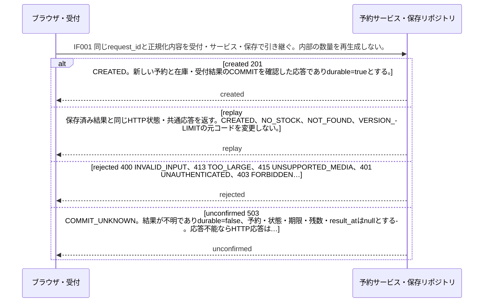
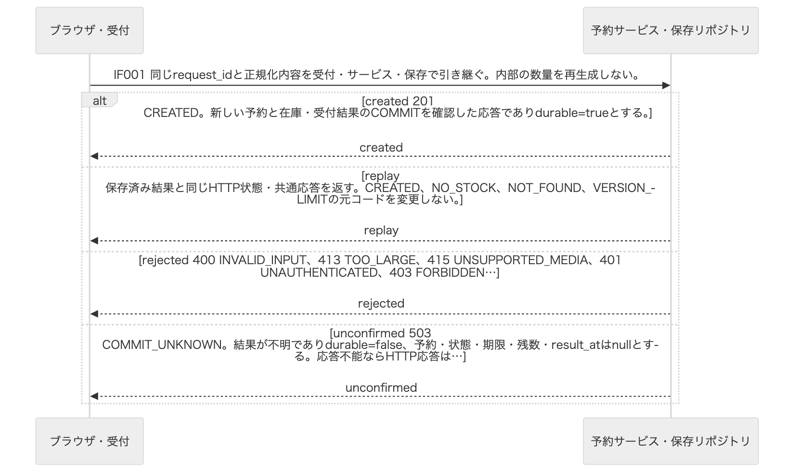
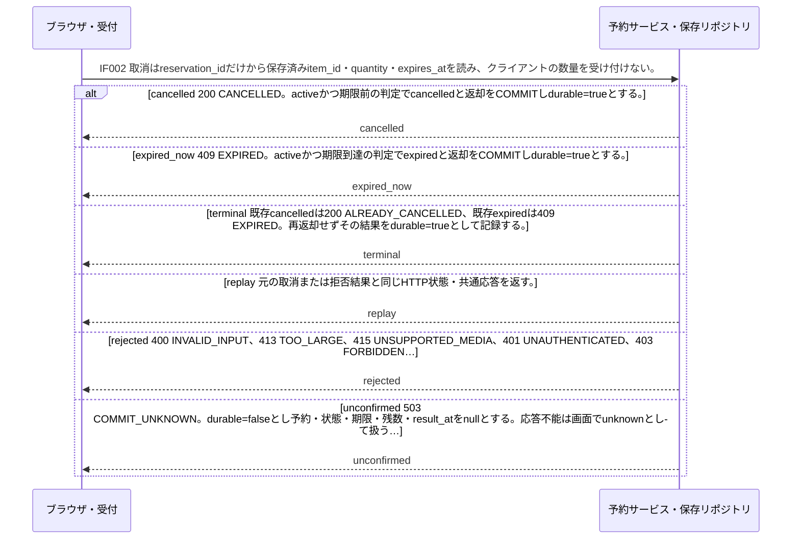
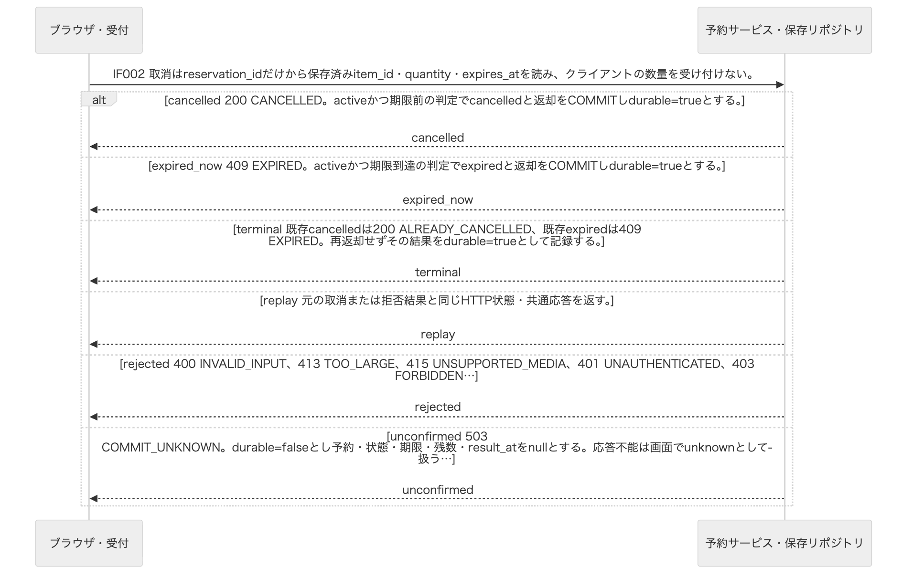
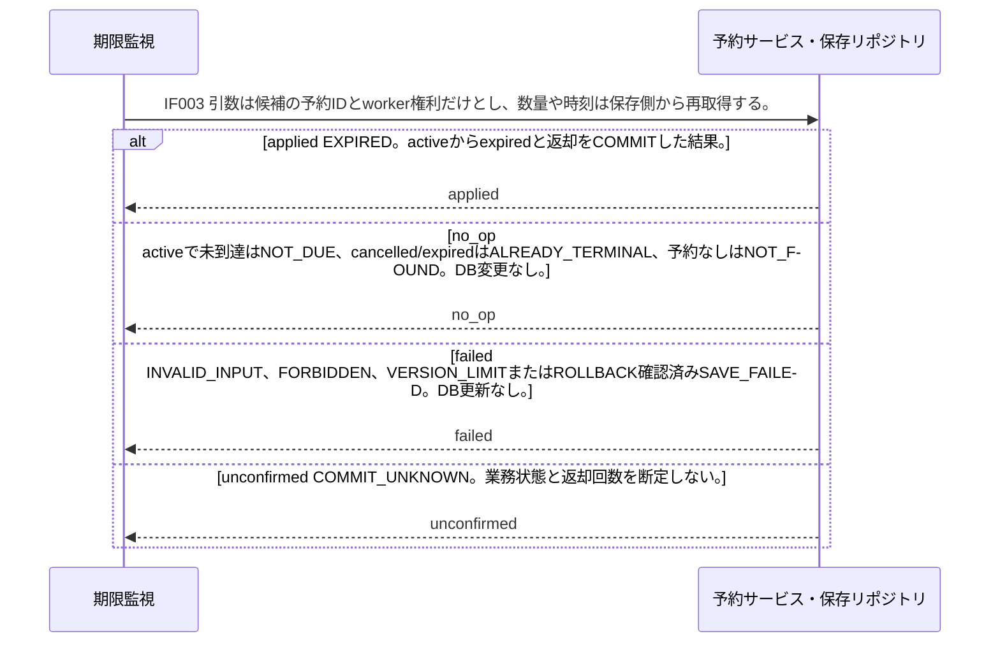
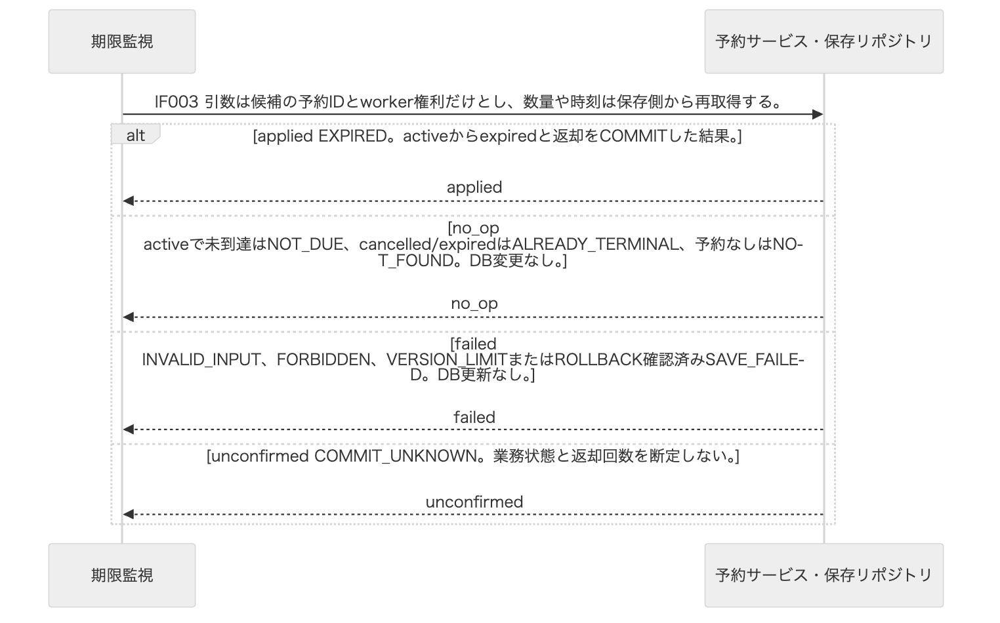
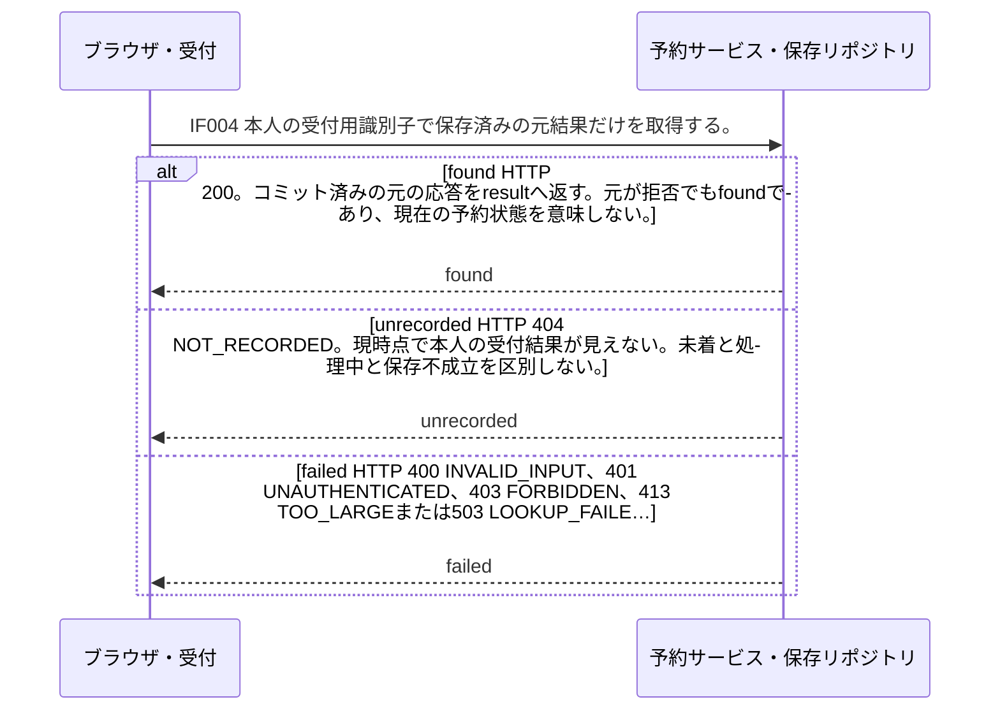
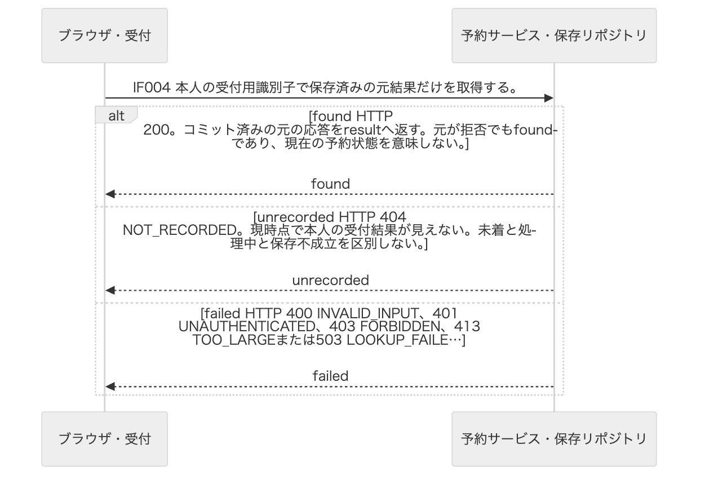
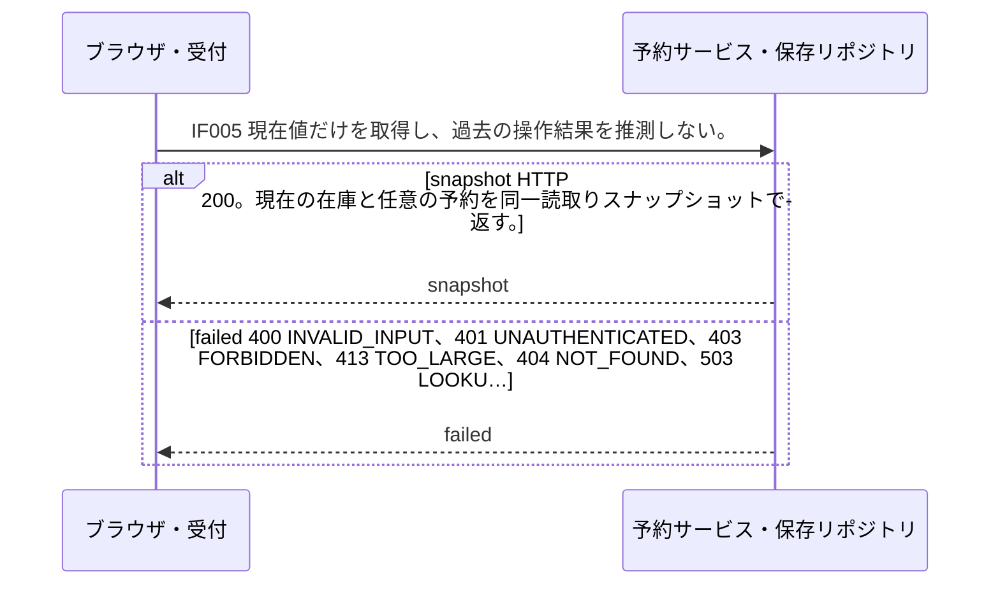
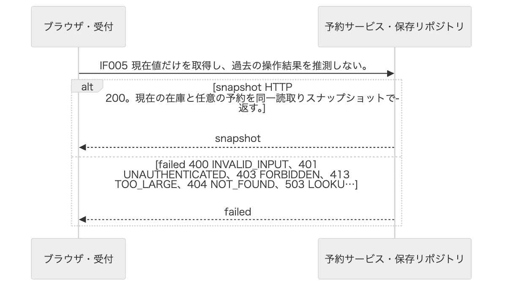

<!-- generated-by: write-detailed-design-document; body-sha256: dbe83ac2311f07aba494a2c97fb818fbc7e5a929ddfbd34907454955548c6a15 -->
# 境界の契約

[入口に戻る](README.md)

境界の両側が同じ意味で実装できるよう、入力、出力、失敗、切断と再送を定義する。

## interfaces

### IF001 予約作成

| 項目 | 内容 |
| --- | --- |
| 呼出し元 | ブラウザ・受付 |
| 呼出し先 | 予約サービス・保存リポジトリ |
| 通信経路 | HTTP POST /api/v1/reservations、内部同期呼出しcreate(request_id,item_id,quantity,owner_id) |
| 入力と制約 | 同じrequest_idと正規化内容を受付・サービス・保存で引き継ぐ。内部の数量を再生成しない。 |
| 要求の項目 | 項目パス: context.owner_id 型: string(uuid) 必須: true NULL可否: false 制約: サーバー認証で確定した利用者。クライアントからの指定を許可しない。 項目パス: body.request_id 型: string(uuid) 必須: true NULL可否: false 制約: 小文字ハイフン付きUUID正規形36文字。異なる世代の操作に再利用しない。 項目パス: body.item_id 型: string(uuid) 必須: true NULL可否: false 制約: 登録済み備品ID。 項目パス: body.quantity 型: integer 必須: true NULL可否: false 制約: 1〜1000000の整数。 |
| 要求の欠落と未知項目 | bodyはJSONオブジェクトとし、必須欠落・全項目のnull・未知キー・重複キー・配列・小数・真偽値の数量・JSON数値の文字列化を拒否する。UTF-8だけを受け付ける。paramsとcontextは本文ではなく受付が組み立て、owner_idはサーバー認証からだけ得る。 |
| 出力 | 応答候補の全項目を返す。確定した業務結果だけを保存し、コミット結果不明を保存済み拒否に変えない。 |
| 応答の種類と項目 | 名前: created 意味と条件: 201 CREATED。新しい予約と在庫・受付結果のCOMMITを確認した応答でありdurable=trueとする。 項目: 項目パス: request_id 型: string(uuid) or null 必須: true NULL可否: true 制約: 妥当な識別子を受理済みならその値を返す。欠落・不正・識別前の拒否ではnullとする。 項目パス: code 型: string 必須: true NULL可否: false 制約: CREATEDだけを返す。 項目パス: message 型: string 必須: true NULL可否: false 制約: 1〜200 Unicode文字かつUTF-8で800バイト以下。利用者向け理由を返し内部例外は含めない。 項目パス: reservation_id 型: string(uuid) or null 必須: true NULL可否: true 制約: 予約に結び付く確定結果ではそのID、それ以外はnullとする。 項目パス: state_at_result 型: string or null 必須: true NULL可否: true 制約: 結果確定時のactive・cancelled・expired。予約がない拒否・保存不成立・確定不明はnullとする。 項目パス: expires_at 型: string(datetime) or null 必須: true NULL可否: true 制約: 予約に結び付く結果では共通UTC形式、それ以外はnullとする。 項目パス: available_at_result 型: integer or null 必須: true NULL可否: true 制約: 0〜1000000000。保存単位で取得した残数。備品がない場合、入力拒否、保存不成立、確定不明はnullとする。 項目パス: result_at 型: string(datetime) or null 必須: true NULL可否: true 制約: durable=trueの確定結果では共通UTC形式の確定判断時刻、durable=falseではnullとする。COMMIT完了時刻と同一とは限らない。 項目パス: durable 型: boolean 必須: true NULL可否: false 制約: T003へCOMMITした応答はtrue、入力拒否・ID_CONFLICT・SAVE_FAILED・COMMIT_UNKNOWN等の非保存応答はfalseとする。 名前: replay 意味と条件: 保存済み結果と同じHTTP状態・共通応答を返す。CREATED、NO_STOCK、NOT_FOUND、VERSION_LIMITの元コードを変更しない。 項目: 項目パス: request_id 型: string(uuid) or null 必須: true NULL可否: true 制約: 妥当な識別子を受理済みならその値を返す。欠落・不正・識別前の拒否ではnullとする。 項目パス: code 型: string 必須: true NULL可否: false 制約: CREATED、NO_STOCK、NOT_FOUND、VERSION_LIMITだけを返す。 項目パス: message 型: string 必須: true NULL可否: false 制約: 1〜200 Unicode文字かつUTF-8で800バイト以下。利用者向け理由を返し内部例外は含めない。 項目パス: reservation_id 型: string(uuid) or null 必須: true NULL可否: true 制約: 予約に結び付く確定結果ではそのID、それ以外はnullとする。 項目パス: state_at_result 型: string or null 必須: true NULL可否: true 制約: 結果確定時のactive・cancelled・expired。予約がない拒否・保存不成立・確定不明はnullとする。 項目パス: expires_at 型: string(datetime) or null 必須: true NULL可否: true 制約: 予約に結び付く結果では共通UTC形式、それ以外はnullとする。 項目パス: available_at_result 型: integer or null 必須: true NULL可否: true 制約: 0〜1000000000。保存単位で取得した残数。備品がない場合、入力拒否、保存不成立、確定不明はnullとする。 項目パス: result_at 型: string(datetime) or null 必須: true NULL可否: true 制約: durable=trueの確定結果では共通UTC形式の確定判断時刻、durable=falseではnullとする。COMMIT完了時刻と同一とは限らない。 項目パス: durable 型: boolean 必須: true NULL可否: false 制約: T003へCOMMITした応答はtrue、入力拒否・ID_CONFLICT・SAVE_FAILED・COMMIT_UNKNOWN等の非保存応答はfalseとする。 名前: rejected 意味と条件: 400 INVALID_INPUT、413 TOO_LARGE、415 UNSUPPORTED_MEDIA、401 UNAUTHENTICATED、403 FORBIDDEN、404 NOT_FOUND、409 ID_CONFLICT、503 SAVE_FAILED、503 VERSION_LIMITとする。SAVE_FAILEDはROLLBACK確認済みに限る。NOT_FOUNDとVERSION_LIMITの有効要求はdurable=trueとして記録し、それ以外の事前拒否はfalseとする。 在庫不足は409 NO_STOCK、durable=trueとする。 項目: 項目パス: request_id 型: string(uuid) or null 必須: true NULL可否: true 制約: 妥当な識別子を受理済みならその値を返す。欠落・不正・識別前の拒否ではnullとする。 項目パス: code 型: string 必須: true NULL可否: false 制約: INVALID_INPUT、TOO_LARGE、UNSUPPORTED_MEDIA、UNAUTHENTICATED、FORBIDDEN、NOT_FOUND、ID_CONFLICT、SAVE_FAILED、VERSION_LIMIT、NO_STOCKだけを返す。 項目パス: message 型: string 必須: true NULL可否: false 制約: 1〜200 Unicode文字かつUTF-8で800バイト以下。利用者向け理由を返し内部例外は含めない。 項目パス: reservation_id 型: string(uuid) or null 必須: true NULL可否: true 制約: 予約に結び付く確定結果ではそのID、それ以外はnullとする。 項目パス: state_at_result 型: string or null 必須: true NULL可否: true 制約: 結果確定時のactive・cancelled・expired。予約がない拒否・保存不成立・確定不明はnullとする。 項目パス: expires_at 型: string(datetime) or null 必須: true NULL可否: true 制約: 予約に結び付く結果では共通UTC形式、それ以外はnullとする。 項目パス: available_at_result 型: integer or null 必須: true NULL可否: true 制約: 0〜1000000000。保存単位で取得した残数。備品がない場合、入力拒否、保存不成立、確定不明はnullとする。 項目パス: result_at 型: string(datetime) or null 必須: true NULL可否: true 制約: durable=trueの確定結果では共通UTC形式の確定判断時刻、durable=falseではnullとする。COMMIT完了時刻と同一とは限らない。 項目パス: durable 型: boolean 必須: true NULL可否: false 制約: T003へCOMMITした応答はtrue、入力拒否・ID_CONFLICT・SAVE_FAILED・COMMIT_UNKNOWN等の非保存応答はfalseとする。 名前: unconfirmed 意味と条件: 503 COMMIT_UNKNOWN。結果が不明でありdurable=false、予約・状態・期限・残数・result_atはnullとする。応答不能ならHTTP応答はなく、画面が切断からunknownへ進む。 項目: 項目パス: request_id 型: string(uuid) or null 必須: true NULL可否: true 制約: 妥当な識別子を受理済みならその値を返す。欠落・不正・識別前の拒否ではnullとする。 項目パス: code 型: string 必須: true NULL可否: false 制約: COMMIT_UNKNOWNだけを返す。 項目パス: message 型: string 必須: true NULL可否: false 制約: 1〜200 Unicode文字かつUTF-8で800バイト以下。利用者向け理由を返し内部例外は含めない。 項目パス: reservation_id 型: string(uuid) or null 必須: true NULL可否: true 制約: 予約に結び付く確定結果ではそのID、それ以外はnullとする。 項目パス: state_at_result 型: string or null 必須: true NULL可否: true 制約: 結果確定時のactive・cancelled・expired。予約がない拒否・保存不成立・確定不明はnullとする。 項目パス: expires_at 型: string(datetime) or null 必須: true NULL可否: true 制約: 予約に結び付く結果では共通UTC形式、それ以外はnullとする。 項目パス: available_at_result 型: integer or null 必須: true NULL可否: true 制約: 0〜1000000000。保存単位で取得した残数。備品がない場合、入力拒否、保存不成立、確定不明はnullとする。 項目パス: result_at 型: string(datetime) or null 必須: true NULL可否: true 制約: durable=trueの確定結果では共通UTC形式の確定判断時刻、durable=falseではnullとする。COMMIT完了時刻と同一とは限らない。 項目パス: durable 型: boolean 必須: true NULL可否: false 制約: T003へCOMMITした応答はtrue、入力拒否・ID_CONFLICT・SAVE_FAILED・COMMIT_UNKNOWN等の非保存応答はfalseとする。 |
| エラーと終了値 | CREATED、NO_STOCK、NOT_FOUND、VERSION_LIMIT、INVALID_INPUT、TOO_LARGE、UNSUPPORTED_MEDIA、UNAUTHENTICATED、FORBIDDEN、ID_CONFLICT、SAVE_FAILED、COMMIT_UNKNOWNを共通応答のcodeで判別する。 |
| 最大サイズ | 要求本文4096バイト以下、応答8192バイト以下とする。HTTPパスとヘッダーは合計2048バイト以下とする提案である。 |
| 検査順 | Content-Typeと生のUTF-8バイト上限→認証→JSON構文・重複/未知/欠落/null→型とUUID/整数範囲→権限→既存識別子内容照合→ロック後の業務条件→保存→COMMIT確認の順とする。 |
| 再送・重複 | owner_id+request_idの保存結果が同内容なら再作成しない。相違はID_CONFLICT。並行INSERT衝突は全ROLLBACK後に元結果を読む。 |
| 切断後の扱い | 自動でPOSTし直さずrequest_idを保持してIF004へ進む。 |
| 共通の状態 | [ST001](common.md#ST001) — absent: 予約が存在しない仮想状態である。DBへabsent行は保存しない。 / active: 数量を在庫から引き当てた予約である。期限到達後も返却コミットまで引当は保持し、取消受付では時刻を再検査する。 / cancelled: 期限より前の利用者取消により一回の返却を確定した終端である。 / expired: 期限到達により一回の返却を確定した終端である。 [ST002](common.md#ST002) — ready: 新しい操作を入力できる状態である。 / sending: 一つの作成または取消の応答を待つ状態である。 / known: 応答または照会により今回の確定結果、更新前拒否、保存不成立のいずれかを確認した状態である。 / unknown: 切断・コミット結果不明・受付結果未記録により成否を断定できない状態である。 |
| 担当する責務 | [M001](common.md#M001) — 画面は入力と操作結果を表示し、受付は認証済みowner_id、サイズとJSON形を検査する。クライアントのowner_idを信用しない。 [M002](common.md#M002) — 作成・取消・照会の規則と権利を検査し、IF001〜IF005の保存境界へ正規化済み項目を渡す。保存不成立と確定不明を分ける。 [M004](common.md#M004) — PostgreSQLの行ロック・条件付き更新・受付結果の衝突を一つのトランザクションに閉じ、コミット成立後にのみ確定結果を返す。スナップショット読取りは書込みを行わない。 |
| 応答と状態の対応 | 状態定義: [ST001](common.md#ST001) — absent: 予約が存在しない仮想状態である。DBへabsent行は保存しない。 / active: 数量を在庫から引き当てた予約である。期限到達後も返却コミットまで引当は保持し、取消受付では時刻を再検査する。 / cancelled: 期限より前の利用者取消により一回の返却を確定した終端である。 / expired: 期限到達により一回の返却を確定した終端である。 現在状態: absent 応答名: created 次状態: active 遷移: [TR001](common.md#TR001) — 在庫行ロック後に数量と上限を検査し受付結果の競合がない。 / 在庫減算・予約INSERT・受付結果INSERTを同じCOMMITで確定する。 / CREATEDをCOMMIT成立後に返す。 理由: 対応する遷移のガードを満たした場合だけ、同じ保存単位で次状態を確定する。 状態定義: [ST001](common.md#ST001) — absent: 予約が存在しない仮想状態である。DBへabsent行は保存しない。 / active: 数量を在庫から引き当てた予約である。期限到達後も返却コミットまで引当は保持し、取消受付では時刻を再検査する。 / cancelled: 期限より前の利用者取消により一回の返却を確定した終端である。 / expired: 期限到達により一回の返却を確定した終端である。 現在状態: absent 応答名: replay 次状態: absent 遷移: 非該当 理由: 確定した業務状態を変更しない。再送照合と読取りは過去結果の取得である。 状態定義: [ST001](common.md#ST001) — absent: 予約が存在しない仮想状態である。DBへabsent行は保存しない。 / active: 数量を在庫から引き当てた予約である。期限到達後も返却コミットまで引当は保持し、取消受付では時刻を再検査する。 / cancelled: 期限より前の利用者取消により一回の返却を確定した終端である。 / expired: 期限到達により一回の返却を確定した終端である。 現在状態: absent 応答名: rejected 次状態: absent 遷移: 非該当 理由: 確定した業務状態を変更しない。再送照合と読取りは過去結果の取得である。 状態定義: [ST001](common.md#ST001) — absent: 予約が存在しない仮想状態である。DBへabsent行は保存しない。 / active: 数量を在庫から引き当てた予約である。期限到達後も返却コミットまで引当は保持し、取消受付では時刻を再検査する。 / cancelled: 期限より前の利用者取消により一回の返却を確定した終端である。 / expired: 期限到達により一回の返却を確定した終端である。 現在状態: active 応答名: replay 次状態: active 遷移: 非該当 理由: 確定した業務状態を変更しない。再送照合と読取りは過去結果の取得である。 状態定義: [ST001](common.md#ST001) — absent: 予約が存在しない仮想状態である。DBへabsent行は保存しない。 / active: 数量を在庫から引き当てた予約である。期限到達後も返却コミットまで引当は保持し、取消受付では時刻を再検査する。 / cancelled: 期限より前の利用者取消により一回の返却を確定した終端である。 / expired: 期限到達により一回の返却を確定した終端である。 現在状態: active 応答名: rejected 次状態: active 遷移: 非該当 理由: 確定した業務状態を変更しない。再送照合と読取りは過去結果の取得である。 状態定義: [ST001](common.md#ST001) — absent: 予約が存在しない仮想状態である。DBへabsent行は保存しない。 / active: 数量を在庫から引き当てた予約である。期限到達後も返却コミットまで引当は保持し、取消受付では時刻を再検査する。 / cancelled: 期限より前の利用者取消により一回の返却を確定した終端である。 / expired: 期限到達により一回の返却を確定した終端である。 現在状態: cancelled 応答名: replay 次状態: cancelled 遷移: 非該当 理由: 確定した業務状態を変更しない。再送照合と読取りは過去結果の取得である。 状態定義: [ST001](common.md#ST001) — absent: 予約が存在しない仮想状態である。DBへabsent行は保存しない。 / active: 数量を在庫から引き当てた予約である。期限到達後も返却コミットまで引当は保持し、取消受付では時刻を再検査する。 / cancelled: 期限より前の利用者取消により一回の返却を確定した終端である。 / expired: 期限到達により一回の返却を確定した終端である。 現在状態: cancelled 応答名: rejected 次状態: cancelled 遷移: 非該当 理由: 確定した業務状態を変更しない。再送照合と読取りは過去結果の取得である。 状態定義: [ST001](common.md#ST001) — absent: 予約が存在しない仮想状態である。DBへabsent行は保存しない。 / active: 数量を在庫から引き当てた予約である。期限到達後も返却コミットまで引当は保持し、取消受付では時刻を再検査する。 / cancelled: 期限より前の利用者取消により一回の返却を確定した終端である。 / expired: 期限到達により一回の返却を確定した終端である。 現在状態: expired 応答名: replay 次状態: expired 遷移: 非該当 理由: 確定した業務状態を変更しない。再送照合と読取りは過去結果の取得である。 状態定義: [ST001](common.md#ST001) — absent: 予約が存在しない仮想状態である。DBへabsent行は保存しない。 / active: 数量を在庫から引き当てた予約である。期限到達後も返却コミットまで引当は保持し、取消受付では時刻を再検査する。 / cancelled: 期限より前の利用者取消により一回の返却を確定した終端である。 / expired: 期限到達により一回の返却を確定した終端である。 現在状態: expired 応答名: rejected 次状態: expired 遷移: 非該当 理由: 確定した業務状態を変更しない。再送照合と読取りは過去結果の取得である。 状態定義: [ST002](common.md#ST002) — ready: 新しい操作を入力できる状態である。 / sending: 一つの作成または取消の応答を待つ状態である。 / known: 応答または照会により今回の確定結果、更新前拒否、保存不成立のいずれかを確認した状態である。 / unknown: 切断・コミット結果不明・受付結果未記録により成否を断定できない状態である。 現在状態: sending 応答名: created 次状態: known 遷移: [TR005](common.md#TR005) — IF001/IF002のunconfirmed以外を受信した。SAVE_FAILEDはROLLBACK確認済みである。 / 結果を画面とsessionStorageへ保持する。durable=falseの拒否は保存済み結果と表示を分ける。 / 成功・期限切れ・拒否・保存不成立を文字で通知する。 理由: 確定応答または保存不成立を受信し、操作結果を確認する。 状態定義: [ST002](common.md#ST002) — ready: 新しい操作を入力できる状態である。 / sending: 一つの作成または取消の応答を待つ状態である。 / known: 応答または照会により今回の確定結果、更新前拒否、保存不成立のいずれかを確認した状態である。 / unknown: 切断・コミット結果不明・受付結果未記録により成否を断定できない状態である。 現在状態: sending 応答名: replay 次状態: known 遷移: [TR005](common.md#TR005) — IF001/IF002のunconfirmed以外を受信した。SAVE_FAILEDはROLLBACK確認済みである。 / 結果を画面とsessionStorageへ保持する。durable=falseの拒否は保存済み結果と表示を分ける。 / 成功・期限切れ・拒否・保存不成立を文字で通知する。 理由: 確定応答または保存不成立を受信し、操作結果を確認する。 状態定義: [ST002](common.md#ST002) — ready: 新しい操作を入力できる状態である。 / sending: 一つの作成または取消の応答を待つ状態である。 / known: 応答または照会により今回の確定結果、更新前拒否、保存不成立のいずれかを確認した状態である。 / unknown: 切断・コミット結果不明・受付結果未記録により成否を断定できない状態である。 現在状態: sending 応答名: rejected 次状態: known 遷移: [TR005](common.md#TR005) — IF001/IF002のunconfirmed以外を受信した。SAVE_FAILEDはROLLBACK確認済みである。 / 結果を画面とsessionStorageへ保持する。durable=falseの拒否は保存済み結果と表示を分ける。 / 成功・期限切れ・拒否・保存不成立を文字で通知する。 理由: 確定応答または保存不成立を受信し、操作結果を確認する。 状態定義: [ST002](common.md#ST002) — ready: 新しい操作を入力できる状態である。 / sending: 一つの作成または取消の応答を待つ状態である。 / known: 応答または照会により今回の確定結果、更新前拒否、保存不成立のいずれかを確認した状態である。 / unknown: 切断・コミット結果不明・受付結果未記録により成否を断定できない状態である。 現在状態: sending 応答名: unconfirmed 次状態: unknown 遷移: [TR006](common.md#TR006) — 応答未受信、通信切断、503 COMMIT_UNKNOWNである。 / 実DB状態を断定せず操作識別子を保持する。 / 未確認と結果照会を表示する。 理由: COMMIT結果不明または応答切断であり、実DB状態は断定しない。 |
| 許可状態と権利と副作用 | 画面readyからTR004でsendingとして一回送信する。業務は新規ならabsent、再送照合ならabsent・active・cancelled・expiredで本人の予約/結果読取権限を許可する。unconfirmedにST001の遷移を定義しないのは実DB状態が不明だからである。作成成功だけTR001、replayとrejectedは業務状態を変えない。 |

#### IF001 予約作成

要求と応答候補を示す。altは応答の選択肢であり、全候補を順次返す意味ではない。入力検査・エラー・状態条件は同じ項目の表にある。

Mermaidの記述を確認する

Mermaid: [local-IF001.mmd](diagrams/local-IF001.mmd) — 要求と応答候補を示す。altは応答の選択肢であり、全候補を順次返す意味ではない。入力検査・エラー・状態条件は同じ項目の表にある。

### IF002 予約取消

| 項目 | 内容 |
| --- | --- |
| 呼出し元 | ブラウザ・受付 |
| 呼出し先 | 予約サービス・保存リポジトリ |
| 通信経路 | HTTP POST /api/v1/reservations/{reservation_id}/cancel、内部同期cancel(request_id,reservation_id,owner_id) |
| 入力と制約 | 取消はreservation_idだけから保存済みitem_id・quantity・expires_atを読み、クライアントの数量を受け付けない。 |
| 要求の項目 | 項目パス: context.owner_id 型: string(uuid) 必須: true NULL可否: false 制約: サーバー認証で確定した利用者。クライアントからの指定を許可しない。 項目パス: body.request_id 型: string(uuid) 必須: true NULL可否: false 制約: 小文字ハイフン付きUUID正規形36文字。異なる世代の操作に再利用しない。 項目パス: params.reservation_id 型: string(uuid) 必須: true NULL可否: false 制約: 本人の予約ID。 |
| 要求の欠落と未知項目 | bodyはJSONオブジェクトとし、必須欠落・全項目のnull・未知キー・重複キー・配列・小数・真偽値の数量・JSON数値の文字列化を拒否する。UTF-8だけを受け付ける。paramsとcontextは本文ではなく受付が組み立て、owner_idはサーバー認証からだけ得る。 |
| 出力 | 応答候補の全項目を返す。確定した業務結果だけを保存し、コミット結果不明を保存済み拒否に変えない。 |
| 応答の種類と項目 | 名前: cancelled 意味と条件: 200 CANCELLED。activeかつ期限前の判定でcancelledと返却をCOMMITしdurable=trueとする。 項目: 項目パス: request_id 型: string(uuid) or null 必須: true NULL可否: true 制約: 妥当な識別子を受理済みならその値を返す。欠落・不正・識別前の拒否ではnullとする。 項目パス: code 型: string 必須: true NULL可否: false 制約: CANCELLEDだけを返す。 項目パス: message 型: string 必須: true NULL可否: false 制約: 1〜200 Unicode文字かつUTF-8で800バイト以下。利用者向け理由を返し内部例外は含めない。 項目パス: reservation_id 型: string(uuid) or null 必須: true NULL可否: true 制約: 予約に結び付く確定結果ではそのID、それ以外はnullとする。 項目パス: state_at_result 型: string or null 必須: true NULL可否: true 制約: 結果確定時のactive・cancelled・expired。予約がない拒否・保存不成立・確定不明はnullとする。 項目パス: expires_at 型: string(datetime) or null 必須: true NULL可否: true 制約: 予約に結び付く結果では共通UTC形式、それ以外はnullとする。 項目パス: available_at_result 型: integer or null 必須: true NULL可否: true 制約: 0〜1000000000。保存単位で取得した残数。備品がない場合、入力拒否、保存不成立、確定不明はnullとする。 項目パス: result_at 型: string(datetime) or null 必須: true NULL可否: true 制約: durable=trueの確定結果では共通UTC形式の確定判断時刻、durable=falseではnullとする。COMMIT完了時刻と同一とは限らない。 項目パス: durable 型: boolean 必須: true NULL可否: false 制約: T003へCOMMITした応答はtrue、入力拒否・ID_CONFLICT・SAVE_FAILED・COMMIT_UNKNOWN等の非保存応答はfalseとする。 名前: expired_now 意味と条件: 409 EXPIRED。activeかつ期限到達の判定でexpiredと返却をCOMMITしdurable=trueとする。 項目: 項目パス: request_id 型: string(uuid) or null 必須: true NULL可否: true 制約: 妥当な識別子を受理済みならその値を返す。欠落・不正・識別前の拒否ではnullとする。 項目パス: code 型: string 必須: true NULL可否: false 制約: EXPIREDだけを返す。 項目パス: message 型: string 必須: true NULL可否: false 制約: 1〜200 Unicode文字かつUTF-8で800バイト以下。利用者向け理由を返し内部例外は含めない。 項目パス: reservation_id 型: string(uuid) or null 必須: true NULL可否: true 制約: 予約に結び付く確定結果ではそのID、それ以外はnullとする。 項目パス: state_at_result 型: string or null 必須: true NULL可否: true 制約: 結果確定時のactive・cancelled・expired。予約がない拒否・保存不成立・確定不明はnullとする。 項目パス: expires_at 型: string(datetime) or null 必須: true NULL可否: true 制約: 予約に結び付く結果では共通UTC形式、それ以外はnullとする。 項目パス: available_at_result 型: integer or null 必須: true NULL可否: true 制約: 0〜1000000000。保存単位で取得した残数。備品がない場合、入力拒否、保存不成立、確定不明はnullとする。 項目パス: result_at 型: string(datetime) or null 必須: true NULL可否: true 制約: durable=trueの確定結果では共通UTC形式の確定判断時刻、durable=falseではnullとする。COMMIT完了時刻と同一とは限らない。 項目パス: durable 型: boolean 必須: true NULL可否: false 制約: T003へCOMMITした応答はtrue、入力拒否・ID_CONFLICT・SAVE_FAILED・COMMIT_UNKNOWN等の非保存応答はfalseとする。 名前: terminal 意味と条件: 既存cancelledは200 ALREADY_CANCELLED、既存expiredは409 EXPIRED。再返却せずその結果をdurable=trueとして記録する。 項目: 項目パス: request_id 型: string(uuid) or null 必須: true NULL可否: true 制約: 妥当な識別子を受理済みならその値を返す。欠落・不正・識別前の拒否ではnullとする。 項目パス: code 型: string 必須: true NULL可否: false 制約: ALREADY_CANCELLED、EXPIREDだけを返す。 項目パス: message 型: string 必須: true NULL可否: false 制約: 1〜200 Unicode文字かつUTF-8で800バイト以下。利用者向け理由を返し内部例外は含めない。 項目パス: reservation_id 型: string(uuid) or null 必須: true NULL可否: true 制約: 予約に結び付く確定結果ではそのID、それ以外はnullとする。 項目パス: state_at_result 型: string or null 必須: true NULL可否: true 制約: 結果確定時のactive・cancelled・expired。予約がない拒否・保存不成立・確定不明はnullとする。 項目パス: expires_at 型: string(datetime) or null 必須: true NULL可否: true 制約: 予約に結び付く結果では共通UTC形式、それ以外はnullとする。 項目パス: available_at_result 型: integer or null 必須: true NULL可否: true 制約: 0〜1000000000。保存単位で取得した残数。備品がない場合、入力拒否、保存不成立、確定不明はnullとする。 項目パス: result_at 型: string(datetime) or null 必須: true NULL可否: true 制約: durable=trueの確定結果では共通UTC形式の確定判断時刻、durable=falseではnullとする。COMMIT完了時刻と同一とは限らない。 項目パス: durable 型: boolean 必須: true NULL可否: false 制約: T003へCOMMITした応答はtrue、入力拒否・ID_CONFLICT・SAVE_FAILED・COMMIT_UNKNOWN等の非保存応答はfalseとする。 名前: replay 意味と条件: 元の取消または拒否結果と同じHTTP状態・共通応答を返す。 項目: 項目パス: request_id 型: string(uuid) or null 必須: true NULL可否: true 制約: 妥当な識別子を受理済みならその値を返す。欠落・不正・識別前の拒否ではnullとする。 項目パス: code 型: string 必須: true NULL可否: false 制約: CANCELLED、EXPIRED、ALREADY_CANCELLED、NOT_FOUND、VERSION_LIMITだけを返す。 項目パス: message 型: string 必須: true NULL可否: false 制約: 1〜200 Unicode文字かつUTF-8で800バイト以下。利用者向け理由を返し内部例外は含めない。 項目パス: reservation_id 型: string(uuid) or null 必須: true NULL可否: true 制約: 予約に結び付く確定結果ではそのID、それ以外はnullとする。 項目パス: state_at_result 型: string or null 必須: true NULL可否: true 制約: 結果確定時のactive・cancelled・expired。予約がない拒否・保存不成立・確定不明はnullとする。 項目パス: expires_at 型: string(datetime) or null 必須: true NULL可否: true 制約: 予約に結び付く結果では共通UTC形式、それ以外はnullとする。 項目パス: available_at_result 型: integer or null 必須: true NULL可否: true 制約: 0〜1000000000。保存単位で取得した残数。備品がない場合、入力拒否、保存不成立、確定不明はnullとする。 項目パス: result_at 型: string(datetime) or null 必須: true NULL可否: true 制約: durable=trueの確定結果では共通UTC形式の確定判断時刻、durable=falseではnullとする。COMMIT完了時刻と同一とは限らない。 項目パス: durable 型: boolean 必須: true NULL可否: false 制約: T003へCOMMITした応答はtrue、入力拒否・ID_CONFLICT・SAVE_FAILED・COMMIT_UNKNOWN等の非保存応答はfalseとする。 名前: rejected 意味と条件: 400 INVALID_INPUT、413 TOO_LARGE、415 UNSUPPORTED_MEDIA、401 UNAUTHENTICATED、403 FORBIDDEN、404 NOT_FOUND、409 ID_CONFLICT、503 SAVE_FAILED、503 VERSION_LIMITとする。SAVE_FAILEDはROLLBACK確認済みに限る。NOT_FOUNDとVERSION_LIMITの有効要求はdurable=trueとして記録し、それ以外の事前拒否はfalseとする。 項目: 項目パス: request_id 型: string(uuid) or null 必須: true NULL可否: true 制約: 妥当な識別子を受理済みならその値を返す。欠落・不正・識別前の拒否ではnullとする。 項目パス: code 型: string 必須: true NULL可否: false 制約: INVALID_INPUT、TOO_LARGE、UNSUPPORTED_MEDIA、UNAUTHENTICATED、FORBIDDEN、NOT_FOUND、ID_CONFLICT、SAVE_FAILED、VERSION_LIMITだけを返す。 項目パス: message 型: string 必須: true NULL可否: false 制約: 1〜200 Unicode文字かつUTF-8で800バイト以下。利用者向け理由を返し内部例外は含めない。 項目パス: reservation_id 型: string(uuid) or null 必須: true NULL可否: true 制約: 予約に結び付く確定結果ではそのID、それ以外はnullとする。 項目パス: state_at_result 型: string or null 必須: true NULL可否: true 制約: 結果確定時のactive・cancelled・expired。予約がない拒否・保存不成立・確定不明はnullとする。 項目パス: expires_at 型: string(datetime) or null 必須: true NULL可否: true 制約: 予約に結び付く結果では共通UTC形式、それ以外はnullとする。 項目パス: available_at_result 型: integer or null 必須: true NULL可否: true 制約: 0〜1000000000。保存単位で取得した残数。備品がない場合、入力拒否、保存不成立、確定不明はnullとする。 項目パス: result_at 型: string(datetime) or null 必須: true NULL可否: true 制約: durable=trueの確定結果では共通UTC形式の確定判断時刻、durable=falseではnullとする。COMMIT完了時刻と同一とは限らない。 項目パス: durable 型: boolean 必須: true NULL可否: false 制約: T003へCOMMITした応答はtrue、入力拒否・ID_CONFLICT・SAVE_FAILED・COMMIT_UNKNOWN等の非保存応答はfalseとする。 名前: unconfirmed 意味と条件: 503 COMMIT_UNKNOWN。durable=falseとし予約・状態・期限・残数・result_atをnullとする。応答不能は画面でunknownとして扱う。 項目: 項目パス: request_id 型: string(uuid) or null 必須: true NULL可否: true 制約: 妥当な識別子を受理済みならその値を返す。欠落・不正・識別前の拒否ではnullとする。 項目パス: code 型: string 必須: true NULL可否: false 制約: COMMIT_UNKNOWNだけを返す。 項目パス: message 型: string 必須: true NULL可否: false 制約: 1〜200 Unicode文字かつUTF-8で800バイト以下。利用者向け理由を返し内部例外は含めない。 項目パス: reservation_id 型: string(uuid) or null 必須: true NULL可否: true 制約: 予約に結び付く確定結果ではそのID、それ以外はnullとする。 項目パス: state_at_result 型: string or null 必須: true NULL可否: true 制約: 結果確定時のactive・cancelled・expired。予約がない拒否・保存不成立・確定不明はnullとする。 項目パス: expires_at 型: string(datetime) or null 必須: true NULL可否: true 制約: 予約に結び付く結果では共通UTC形式、それ以外はnullとする。 項目パス: available_at_result 型: integer or null 必須: true NULL可否: true 制約: 0〜1000000000。保存単位で取得した残数。備品がない場合、入力拒否、保存不成立、確定不明はnullとする。 項目パス: result_at 型: string(datetime) or null 必須: true NULL可否: true 制約: durable=trueの確定結果では共通UTC形式の確定判断時刻、durable=falseではnullとする。COMMIT完了時刻と同一とは限らない。 項目パス: durable 型: boolean 必須: true NULL可否: false 制約: T003へCOMMITした応答はtrue、入力拒否・ID_CONFLICT・SAVE_FAILED・COMMIT_UNKNOWN等の非保存応答はfalseとする。 |
| エラーと終了値 | CANCELLED、ALREADY_CANCELLED、EXPIRED、NOT_FOUND、VERSION_LIMIT、INVALID_INPUT、TOO_LARGE、UNSUPPORTED_MEDIA、UNAUTHENTICATED、FORBIDDEN、ID_CONFLICT、SAVE_FAILED、COMMIT_UNKNOWNをcodeに返す。 |
| 最大サイズ | 要求本文4096バイト以下、応答8192バイト以下とする。HTTPパスとヘッダーは合計2048バイト以下とする提案である。 |
| 検査順 | Content-Typeと生のUTF-8バイト上限→認証→JSON構文・重複/未知/欠落/null→型とUUID/整数範囲→権限→既存識別子内容照合→ロック後の業務条件→保存→COMMIT確認の順とする。 |
| 再送・重複 | 同じ識別子・内容は元結果、異なる内容はID_CONFLICTとする。別識別子で終端を取消してもterminalを記録するだけで返却しない。 |
| 切断後の扱い | 自動再取消と在庫の逆補正をせず、IF004で取消request_idの結果を読む。 |
| 共通の状態 | [ST001](common.md#ST001) — absent: 予約が存在しない仮想状態である。DBへabsent行は保存しない。 / active: 数量を在庫から引き当てた予約である。期限到達後も返却コミットまで引当は保持し、取消受付では時刻を再検査する。 / cancelled: 期限より前の利用者取消により一回の返却を確定した終端である。 / expired: 期限到達により一回の返却を確定した終端である。 [ST002](common.md#ST002) — ready: 新しい操作を入力できる状態である。 / sending: 一つの作成または取消の応答を待つ状態である。 / known: 応答または照会により今回の確定結果、更新前拒否、保存不成立のいずれかを確認した状態である。 / unknown: 切断・コミット結果不明・受付結果未記録により成否を断定できない状態である。 |
| 担当する責務 | [M001](common.md#M001) — 画面は入力と操作結果を表示し、受付は認証済みowner_id、サイズとJSON形を検査する。クライアントのowner_idを信用しない。 [M002](common.md#M002) — 作成・取消・照会の規則と権利を検査し、IF001〜IF005の保存境界へ正規化済み項目を渡す。保存不成立と確定不明を分ける。 [M004](common.md#M004) — PostgreSQLの行ロック・条件付き更新・受付結果の衝突を一つのトランザクションに閉じ、コミット成立後にのみ確定結果を返す。スナップショット読取りは書込みを行わない。 |
| 応答と状態の対応 | 状態定義: [ST001](common.md#ST001) — absent: 予約が存在しない仮想状態である。DBへabsent行は保存しない。 / active: 数量を在庫から引き当てた予約である。期限到達後も返却コミットまで引当は保持し、取消受付では時刻を再検査する。 / cancelled: 期限より前の利用者取消により一回の返却を確定した終端である。 / expired: 期限到達により一回の返却を確定した終端である。 現在状態: active 応答名: cancelled 次状態: cancelled 遷移: [TR002](common.md#TR002) — 全行ロック後の判定時刻<expires_atである。 / 状態条件activeで更新し在庫加算・version増加・取消受付結果を同時COMMITする。 / CANCELLEDと操作時点の残数を返す。 理由: 対応する遷移のガードを満たした場合だけ、同じ保存単位で次状態を確定する。 状態定義: [ST001](common.md#ST001) — absent: 予約が存在しない仮想状態である。DBへabsent行は保存しない。 / active: 数量を在庫から引き当てた予約である。期限到達後も返却コミットまで引当は保持し、取消受付では時刻を再検査する。 / cancelled: 期限より前の利用者取消により一回の返却を確定した終端である。 / expired: 期限到達により一回の返却を確定した終端である。 現在状態: active 応答名: expired_now 次状態: expired 遷移: [TR003](common.md#TR003) — 全行ロック後の判定時刻>=expires_atである。取消または期限監視が同じ条件を使う。 / 状態条件activeで更新し在庫加算・version増加を同時COMMITする。取消起点ならEXPIREDの受付結果も含める。 / 取消にはEXPIRED、監視にはappliedを返し、画面は次の読取りで更新する。 理由: 対応する遷移のガードを満たした場合だけ、同じ保存単位で次状態を確定する。 状態定義: [ST001](common.md#ST001) — absent: 予約が存在しない仮想状態である。DBへabsent行は保存しない。 / active: 数量を在庫から引き当てた予約である。期限到達後も返却コミットまで引当は保持し、取消受付では時刻を再検査する。 / cancelled: 期限より前の利用者取消により一回の返却を確定した終端である。 / expired: 期限到達により一回の返却を確定した終端である。 現在状態: cancelled 応答名: terminal 次状態: cancelled 遷移: 非該当 理由: 確定した業務状態を変更しない。再送照合と読取りは過去結果の取得である。 状態定義: [ST001](common.md#ST001) — absent: 予約が存在しない仮想状態である。DBへabsent行は保存しない。 / active: 数量を在庫から引き当てた予約である。期限到達後も返却コミットまで引当は保持し、取消受付では時刻を再検査する。 / cancelled: 期限より前の利用者取消により一回の返却を確定した終端である。 / expired: 期限到達により一回の返却を確定した終端である。 現在状態: expired 応答名: terminal 次状態: expired 遷移: 非該当 理由: 確定した業務状態を変更しない。再送照合と読取りは過去結果の取得である。 状態定義: [ST001](common.md#ST001) — absent: 予約が存在しない仮想状態である。DBへabsent行は保存しない。 / active: 数量を在庫から引き当てた予約である。期限到達後も返却コミットまで引当は保持し、取消受付では時刻を再検査する。 / cancelled: 期限より前の利用者取消により一回の返却を確定した終端である。 / expired: 期限到達により一回の返却を確定した終端である。 現在状態: absent 応答名: replay 次状態: absent 遷移: 非該当 理由: 確定した業務状態を変更しない。再送照合と読取りは過去結果の取得である。 状態定義: [ST001](common.md#ST001) — absent: 予約が存在しない仮想状態である。DBへabsent行は保存しない。 / active: 数量を在庫から引き当てた予約である。期限到達後も返却コミットまで引当は保持し、取消受付では時刻を再検査する。 / cancelled: 期限より前の利用者取消により一回の返却を確定した終端である。 / expired: 期限到達により一回の返却を確定した終端である。 現在状態: absent 応答名: rejected 次状態: absent 遷移: 非該当 理由: 確定した業務状態を変更しない。再送照合と読取りは過去結果の取得である。 状態定義: [ST001](common.md#ST001) — absent: 予約が存在しない仮想状態である。DBへabsent行は保存しない。 / active: 数量を在庫から引き当てた予約である。期限到達後も返却コミットまで引当は保持し、取消受付では時刻を再検査する。 / cancelled: 期限より前の利用者取消により一回の返却を確定した終端である。 / expired: 期限到達により一回の返却を確定した終端である。 現在状態: active 応答名: replay 次状態: active 遷移: 非該当 理由: 確定した業務状態を変更しない。再送照合と読取りは過去結果の取得である。 状態定義: [ST001](common.md#ST001) — absent: 予約が存在しない仮想状態である。DBへabsent行は保存しない。 / active: 数量を在庫から引き当てた予約である。期限到達後も返却コミットまで引当は保持し、取消受付では時刻を再検査する。 / cancelled: 期限より前の利用者取消により一回の返却を確定した終端である。 / expired: 期限到達により一回の返却を確定した終端である。 現在状態: active 応答名: rejected 次状態: active 遷移: 非該当 理由: 確定した業務状態を変更しない。再送照合と読取りは過去結果の取得である。 状態定義: [ST001](common.md#ST001) — absent: 予約が存在しない仮想状態である。DBへabsent行は保存しない。 / active: 数量を在庫から引き当てた予約である。期限到達後も返却コミットまで引当は保持し、取消受付では時刻を再検査する。 / cancelled: 期限より前の利用者取消により一回の返却を確定した終端である。 / expired: 期限到達により一回の返却を確定した終端である。 現在状態: cancelled 応答名: replay 次状態: cancelled 遷移: 非該当 理由: 確定した業務状態を変更しない。再送照合と読取りは過去結果の取得である。 状態定義: [ST001](common.md#ST001) — absent: 予約が存在しない仮想状態である。DBへabsent行は保存しない。 / active: 数量を在庫から引き当てた予約である。期限到達後も返却コミットまで引当は保持し、取消受付では時刻を再検査する。 / cancelled: 期限より前の利用者取消により一回の返却を確定した終端である。 / expired: 期限到達により一回の返却を確定した終端である。 現在状態: cancelled 応答名: rejected 次状態: cancelled 遷移: 非該当 理由: 確定した業務状態を変更しない。再送照合と読取りは過去結果の取得である。 状態定義: [ST001](common.md#ST001) — absent: 予約が存在しない仮想状態である。DBへabsent行は保存しない。 / active: 数量を在庫から引き当てた予約である。期限到達後も返却コミットまで引当は保持し、取消受付では時刻を再検査する。 / cancelled: 期限より前の利用者取消により一回の返却を確定した終端である。 / expired: 期限到達により一回の返却を確定した終端である。 現在状態: expired 応答名: replay 次状態: expired 遷移: 非該当 理由: 確定した業務状態を変更しない。再送照合と読取りは過去結果の取得である。 状態定義: [ST001](common.md#ST001) — absent: 予約が存在しない仮想状態である。DBへabsent行は保存しない。 / active: 数量を在庫から引き当てた予約である。期限到達後も返却コミットまで引当は保持し、取消受付では時刻を再検査する。 / cancelled: 期限より前の利用者取消により一回の返却を確定した終端である。 / expired: 期限到達により一回の返却を確定した終端である。 現在状態: expired 応答名: rejected 次状態: expired 遷移: 非該当 理由: 確定した業務状態を変更しない。再送照合と読取りは過去結果の取得である。 状態定義: [ST002](common.md#ST002) — ready: 新しい操作を入力できる状態である。 / sending: 一つの作成または取消の応答を待つ状態である。 / known: 応答または照会により今回の確定結果、更新前拒否、保存不成立のいずれかを確認した状態である。 / unknown: 切断・コミット結果不明・受付結果未記録により成否を断定できない状態である。 現在状態: sending 応答名: cancelled 次状態: known 遷移: [TR005](common.md#TR005) — IF001/IF002のunconfirmed以外を受信した。SAVE_FAILEDはROLLBACK確認済みである。 / 結果を画面とsessionStorageへ保持する。durable=falseの拒否は保存済み結果と表示を分ける。 / 成功・期限切れ・拒否・保存不成立を文字で通知する。 理由: 取消成功・期限切れ・終端・拒否の応答を確認する。 状態定義: [ST002](common.md#ST002) — ready: 新しい操作を入力できる状態である。 / sending: 一つの作成または取消の応答を待つ状態である。 / known: 応答または照会により今回の確定結果、更新前拒否、保存不成立のいずれかを確認した状態である。 / unknown: 切断・コミット結果不明・受付結果未記録により成否を断定できない状態である。 現在状態: sending 応答名: expired_now 次状態: known 遷移: [TR005](common.md#TR005) — IF001/IF002のunconfirmed以外を受信した。SAVE_FAILEDはROLLBACK確認済みである。 / 結果を画面とsessionStorageへ保持する。durable=falseの拒否は保存済み結果と表示を分ける。 / 成功・期限切れ・拒否・保存不成立を文字で通知する。 理由: 取消成功・期限切れ・終端・拒否の応答を確認する。 状態定義: [ST002](common.md#ST002) — ready: 新しい操作を入力できる状態である。 / sending: 一つの作成または取消の応答を待つ状態である。 / known: 応答または照会により今回の確定結果、更新前拒否、保存不成立のいずれかを確認した状態である。 / unknown: 切断・コミット結果不明・受付結果未記録により成否を断定できない状態である。 現在状態: sending 応答名: terminal 次状態: known 遷移: [TR005](common.md#TR005) — IF001/IF002のunconfirmed以外を受信した。SAVE_FAILEDはROLLBACK確認済みである。 / 結果を画面とsessionStorageへ保持する。durable=falseの拒否は保存済み結果と表示を分ける。 / 成功・期限切れ・拒否・保存不成立を文字で通知する。 理由: 取消成功・期限切れ・終端・拒否の応答を確認する。 状態定義: [ST002](common.md#ST002) — ready: 新しい操作を入力できる状態である。 / sending: 一つの作成または取消の応答を待つ状態である。 / known: 応答または照会により今回の確定結果、更新前拒否、保存不成立のいずれかを確認した状態である。 / unknown: 切断・コミット結果不明・受付結果未記録により成否を断定できない状態である。 現在状態: sending 応答名: replay 次状態: known 遷移: [TR005](common.md#TR005) — IF001/IF002のunconfirmed以外を受信した。SAVE_FAILEDはROLLBACK確認済みである。 / 結果を画面とsessionStorageへ保持する。durable=falseの拒否は保存済み結果と表示を分ける。 / 成功・期限切れ・拒否・保存不成立を文字で通知する。 理由: 取消成功・期限切れ・終端・拒否の応答を確認する。 状態定義: [ST002](common.md#ST002) — ready: 新しい操作を入力できる状態である。 / sending: 一つの作成または取消の応答を待つ状態である。 / known: 応答または照会により今回の確定結果、更新前拒否、保存不成立のいずれかを確認した状態である。 / unknown: 切断・コミット結果不明・受付結果未記録により成否を断定できない状態である。 現在状態: sending 応答名: rejected 次状態: known 遷移: [TR005](common.md#TR005) — IF001/IF002のunconfirmed以外を受信した。SAVE_FAILEDはROLLBACK確認済みである。 / 結果を画面とsessionStorageへ保持する。durable=falseの拒否は保存済み結果と表示を分ける。 / 成功・期限切れ・拒否・保存不成立を文字で通知する。 理由: 取消成功・期限切れ・終端・拒否の応答を確認する。 状態定義: [ST002](common.md#ST002) — ready: 新しい操作を入力できる状態である。 / sending: 一つの作成または取消の応答を待つ状態である。 / known: 応答または照会により今回の確定結果、更新前拒否、保存不成立のいずれかを確認した状態である。 / unknown: 切断・コミット結果不明・受付結果未記録により成否を断定できない状態である。 現在状態: sending 応答名: unconfirmed 次状態: unknown 遷移: [TR006](common.md#TR006) — 応答未受信、通信切断、503 COMMIT_UNKNOWNである。 / 実DB状態を断定せず操作識別子を保持する。 / 未確認と結果照会を表示する。 理由: コミット成立は照会まで不明である。 |
| 許可状態と権利と副作用 | 画面readyからTR004でsendingへ進める。本人のactive・cancelled・expiredの取消受付と再送照合を許可する。absentと他人の予約はNOT_FOUNDとする。activeの期限到達はTR003、期限内はTR002とし、終端は変更しない。unconfirmedはST001を断定せずST002だけをunknownへ進める。 |

#### IF002 予約取消

要求と応答候補を示す。altは応答の選択肢であり、全候補を順次返す意味ではない。入力検査・エラー・状態条件は同じ項目の表にある。

Mermaidの記述を確認する

Mermaid: [local-IF002.mmd](diagrams/local-IF002.mmd) — 要求と応答候補を示す。altは応答の選択肢であり、全候補を順次返す意味ではない。入力検査・エラー・状態条件は同じ項目の表にある。

### IF003 期限予約を一件処理

| 項目 | 内容 |
| --- | --- |
| 呼出し元 | 期限監視 |
| 呼出し先 | 予約サービス・保存リポジトリ |
| 通信経路 | プロセス内の同期expire(reservation_id,worker_role) |
| 入力と制約 | 引数は候補の予約IDとworker権利だけとし、数量や時刻は保存側から再取得する。 |
| 要求の項目 | 項目パス: reservation_id 型: string(uuid) 必須: true NULL可否: false 制約: 候補検索で取得したID。 項目パス: context.worker_role 型: string 必須: true NULL可否: false 制約: サーバーが付与するexpiry-worker固定値。 |
| 要求の欠落と未知項目 | 必須欠落・null・未知項目・重複項目を拒否する。入力なしの操作は設けない。contextの権利はサーバーが付与する。 |
| 出力 | 応答候補の全項目を返す。確定した業務結果だけを保存し、コミット結果不明を保存済み拒否に変えない。 |
| 応答の種類と項目 | 名前: applied 意味と条件: EXPIRED。activeからexpiredと返却をCOMMITした結果。 項目: 項目パス: reservation_id 型: string(uuid) or null 必須: true NULL可否: true 制約: 有効な要求IDを返し、不正・欠落ならnull。 項目パス: code 型: string 必須: true NULL可否: false 制約: EXPIREDだけを返す。 項目パス: state 型: string or null 必須: true NULL可否: true 制約: 確認したactive・cancelled・expired。不存在、不正、確定不明ではnull。 項目パス: available 型: integer or null 必須: true NULL可否: true 制約: 0〜1000000000。確定したスナップショットがある場合だけ返し、それ以外はnull。 項目パス: evaluated_at 型: string(datetime) or null 必須: true NULL可否: true 制約: ロック後に判定できた共通UTC時刻。確定不明・入力拒否ではnull。 名前: no_op 意味と条件: activeで未到達はNOT_DUE、cancelled/expiredはALREADY_TERMINAL、予約なしはNOT_FOUND。DB変更なし。 項目: 項目パス: reservation_id 型: string(uuid) or null 必須: true NULL可否: true 制約: 有効な要求IDを返し、不正・欠落ならnull。 項目パス: code 型: string 必須: true NULL可否: false 制約: NOT_DUE、ALREADY_TERMINAL、NOT_FOUNDだけを返す。 項目パス: state 型: string or null 必須: true NULL可否: true 制約: 確認したactive・cancelled・expired。不存在、不正、確定不明ではnull。 項目パス: available 型: integer or null 必須: true NULL可否: true 制約: 0〜1000000000。確定したスナップショットがある場合だけ返し、それ以外はnull。 項目パス: evaluated_at 型: string(datetime) or null 必須: true NULL可否: true 制約: ロック後に判定できた共通UTC時刻。確定不明・入力拒否ではnull。 名前: failed 意味と条件: INVALID_INPUT、FORBIDDEN、VERSION_LIMITまたはROLLBACK確認済みSAVE_FAILED。DB更新なし。 項目: 項目パス: reservation_id 型: string(uuid) or null 必須: true NULL可否: true 制約: 有効な要求IDを返し、不正・欠落ならnull。 項目パス: code 型: string 必須: true NULL可否: false 制約: INVALID_INPUT、FORBIDDEN、SAVE_FAILED、VERSION_LIMITだけを返す。 項目パス: state 型: string or null 必須: true NULL可否: true 制約: 確認したactive・cancelled・expired。不存在、不正、確定不明ではnull。 項目パス: available 型: integer or null 必須: true NULL可否: true 制約: 0〜1000000000。確定したスナップショットがある場合だけ返し、それ以外はnull。 項目パス: evaluated_at 型: string(datetime) or null 必須: true NULL可否: true 制約: ロック後に判定できた共通UTC時刻。確定不明・入力拒否ではnull。 名前: unconfirmed 意味と条件: COMMIT_UNKNOWN。業務状態と返却回数を断定しない。 項目: 項目パス: reservation_id 型: string(uuid) or null 必須: true NULL可否: true 制約: 有効な要求IDを返し、不正・欠落ならnull。 項目パス: code 型: string 必須: true NULL可否: false 制約: COMMIT_UNKNOWNだけを返す。 項目パス: state 型: string or null 必須: true NULL可否: true 制約: 確認したactive・cancelled・expired。不存在、不正、確定不明ではnull。 項目パス: available 型: integer or null 必須: true NULL可否: true 制約: 0〜1000000000。確定したスナップショットがある場合だけ返し、それ以外はnull。 項目パス: evaluated_at 型: string(datetime) or null 必須: true NULL可否: true 制約: ロック後に判定できた共通UTC時刻。確定不明・入力拒否ではnull。 |
| エラーと終了値 | EXPIRED、NOT_DUE、ALREADY_TERMINAL、NOT_FOUND、INVALID_INPUT、FORBIDDEN、SAVE_FAILED、VERSION_LIMIT、COMMIT_UNKNOWNをcodeに返す。 |
| 最大サイズ | 内部要求256バイト相当以下、応答1024バイト以下とする提案である。 |
| 検査順 | 信頼済み権利→必須/欠落/null/未知項目→型とUUID→本人またはworkerの権利→保存済み情報の読取り→各業務条件の順とする。 |
| 再送・重複 | 同じIDを再度処理してもactive条件を満たさない終端は返却しない。 |
| 切断後の扱い | タイムアウトは確定不明として再読し、activeかつ期限到達のときだけ次の走査で処理する。 |
| 共通の状態 | [ST001](common.md#ST001) — absent: 予約が存在しない仮想状態である。DBへabsent行は保存しない。 / active: 数量を在庫から引き当てた予約である。期限到達後も返却コミットまで引当は保持し、取消受付では時刻を再検査する。 / cancelled: 期限より前の利用者取消により一回の返却を確定した終端である。 / expired: 期限到達により一回の返却を確定した終端である。 |
| 担当する責務 | [M002](common.md#M002) — 作成・取消・照会の規則と権利を検査し、IF001〜IF005の保存境界へ正規化済み項目を渡す。保存不成立と確定不明を分ける。 [M003](common.md#M003) — 起動時と1秒ごとの候補検索でactiveかつ期限到達の予約IDを最大100件取得し、各IDをIF003へ渡す。処理単位は1予約であり、候補検索の時点で返却を確定しない。間隔と件数はD002の未検証提案である。 [M004](common.md#M004) — PostgreSQLの行ロック・条件付き更新・受付結果の衝突を一つのトランザクションに閉じ、コミット成立後にのみ確定結果を返す。スナップショット読取りは書込みを行わない。 |
| 応答と状態の対応 | 状態定義: [ST001](common.md#ST001) — absent: 予約が存在しない仮想状態である。DBへabsent行は保存しない。 / active: 数量を在庫から引き当てた予約である。期限到達後も返却コミットまで引当は保持し、取消受付では時刻を再検査する。 / cancelled: 期限より前の利用者取消により一回の返却を確定した終端である。 / expired: 期限到達により一回の返却を確定した終端である。 現在状態: active 応答名: applied 次状態: expired 遷移: [TR003](common.md#TR003) — 全行ロック後の判定時刻>=expires_atである。取消または期限監視が同じ条件を使う。 / 状態条件activeで更新し在庫加算・version増加を同時COMMITする。取消起点ならEXPIREDの受付結果も含める。 / 取消にはEXPIRED、監視にはappliedを返し、画面は次の読取りで更新する。 理由: 対応する遷移のガードを満たした場合だけ、同じ保存単位で次状態を確定する。 状態定義: [ST001](common.md#ST001) — absent: 予約が存在しない仮想状態である。DBへabsent行は保存しない。 / active: 数量を在庫から引き当てた予約である。期限到達後も返却コミットまで引当は保持し、取消受付では時刻を再検査する。 / cancelled: 期限より前の利用者取消により一回の返却を確定した終端である。 / expired: 期限到達により一回の返却を確定した終端である。 現在状態: absent 応答名: no_op 次状態: absent 遷移: 非該当 理由: 確定した業務状態を変更しない。再送照合と読取りは過去結果の取得である。 状態定義: [ST001](common.md#ST001) — absent: 予約が存在しない仮想状態である。DBへabsent行は保存しない。 / active: 数量を在庫から引き当てた予約である。期限到達後も返却コミットまで引当は保持し、取消受付では時刻を再検査する。 / cancelled: 期限より前の利用者取消により一回の返却を確定した終端である。 / expired: 期限到達により一回の返却を確定した終端である。 現在状態: absent 応答名: failed 次状態: absent 遷移: 非該当 理由: 確定した業務状態を変更しない。再送照合と読取りは過去結果の取得である。 状態定義: [ST001](common.md#ST001) — absent: 予約が存在しない仮想状態である。DBへabsent行は保存しない。 / active: 数量を在庫から引き当てた予約である。期限到達後も返却コミットまで引当は保持し、取消受付では時刻を再検査する。 / cancelled: 期限より前の利用者取消により一回の返却を確定した終端である。 / expired: 期限到達により一回の返却を確定した終端である。 現在状態: active 応答名: no_op 次状態: active 遷移: 非該当 理由: 確定した業務状態を変更しない。再送照合と読取りは過去結果の取得である。 状態定義: [ST001](common.md#ST001) — absent: 予約が存在しない仮想状態である。DBへabsent行は保存しない。 / active: 数量を在庫から引き当てた予約である。期限到達後も返却コミットまで引当は保持し、取消受付では時刻を再検査する。 / cancelled: 期限より前の利用者取消により一回の返却を確定した終端である。 / expired: 期限到達により一回の返却を確定した終端である。 現在状態: active 応答名: failed 次状態: active 遷移: 非該当 理由: 確定した業務状態を変更しない。再送照合と読取りは過去結果の取得である。 状態定義: [ST001](common.md#ST001) — absent: 予約が存在しない仮想状態である。DBへabsent行は保存しない。 / active: 数量を在庫から引き当てた予約である。期限到達後も返却コミットまで引当は保持し、取消受付では時刻を再検査する。 / cancelled: 期限より前の利用者取消により一回の返却を確定した終端である。 / expired: 期限到達により一回の返却を確定した終端である。 現在状態: cancelled 応答名: no_op 次状態: cancelled 遷移: 非該当 理由: 確定した業務状態を変更しない。再送照合と読取りは過去結果の取得である。 状態定義: [ST001](common.md#ST001) — absent: 予約が存在しない仮想状態である。DBへabsent行は保存しない。 / active: 数量を在庫から引き当てた予約である。期限到達後も返却コミットまで引当は保持し、取消受付では時刻を再検査する。 / cancelled: 期限より前の利用者取消により一回の返却を確定した終端である。 / expired: 期限到達により一回の返却を確定した終端である。 現在状態: cancelled 応答名: failed 次状態: cancelled 遷移: 非該当 理由: 確定した業務状態を変更しない。再送照合と読取りは過去結果の取得である。 状態定義: [ST001](common.md#ST001) — absent: 予約が存在しない仮想状態である。DBへabsent行は保存しない。 / active: 数量を在庫から引き当てた予約である。期限到達後も返却コミットまで引当は保持し、取消受付では時刻を再検査する。 / cancelled: 期限より前の利用者取消により一回の返却を確定した終端である。 / expired: 期限到達により一回の返却を確定した終端である。 現在状態: expired 応答名: no_op 次状態: expired 遷移: 非該当 理由: 確定した業務状態を変更しない。再送照合と読取りは過去結果の取得である。 状態定義: [ST001](common.md#ST001) — absent: 予約が存在しない仮想状態である。DBへabsent行は保存しない。 / active: 数量を在庫から引き当てた予約である。期限到達後も返却コミットまで引当は保持し、取消受付では時刻を再検査する。 / cancelled: 期限より前の利用者取消により一回の返却を確定した終端である。 / expired: 期限到達により一回の返却を確定した終端である。 現在状態: expired 応答名: failed 次状態: expired 遷移: 非該当 理由: 確定した業務状態を変更しない。再送照合と読取りは過去結果の取得である。 |
| 許可状態と権利と副作用 | expiry-worker権利からabsent・active・cancelled・expiredを再読できる。activeかつ期限到達だけTR003を行う。active未到達と終端・不存在のno_opは状態を保つ。failedはROLLBACK確認済みか更新前拒否だけである。unconfirmedは実DB状態を断定できないので状態効果を列挙せずRC003で再読する。 |

#### IF003 期限予約を一件処理

要求と応答候補を示す。altは応答の選択肢であり、全候補を順次返す意味ではない。入力検査・エラー・状態条件は同じ項目の表にある。

Mermaidの記述を確認する

Mermaid: [local-IF003.mmd](diagrams/local-IF003.mmd) — 要求と応答候補を示す。altは応答の選択肢であり、全候補を順次返す意味ではない。入力検査・エラー・状態条件は同じ項目の表にある。

### IF004 受付結果照会

| 項目 | 内容 |
| --- | --- |
| 呼出し元 | ブラウザ・受付 |
| 呼出し先 | 予約サービス・保存リポジトリ |
| 通信経路 | HTTP GET /api/v1/requests/{request_id}、内部同期lookup(request_id,owner_id) |
| 入力と制約 | 本人の受付用識別子で保存済みの元結果だけを取得する。 |
| 要求の項目 | 項目パス: context.owner_id 型: string(uuid) 必須: true NULL可否: false 制約: サーバー認証で確定した利用者。クライアントからの指定を許可しない。 項目パス: params.request_id 型: string(uuid) 必須: true NULL可否: false 制約: 小文字ハイフン付きUUID正規形36文字。異なる世代の操作に再利用しない。 |
| 要求の欠落と未知項目 | GET本文は許可せず0バイトとする。必須params/contextの欠落、null、未知・重複queryを拒否する。context.owner_idは受付が認証から付与する。 |
| 出力 | 応答候補の全項目を返す。確定した業務結果だけを保存し、コミット結果不明を保存済み拒否に変えない。 |
| 応答の種類と項目 | 名前: found 意味と条件: HTTP 200。コミット済みの元の応答をresultへ返す。元が拒否でもfoundであり、現在の予約状態を意味しない。 項目: 項目パス: request_id 型: string(uuid) 必須: true NULL可否: false 制約: 照会対象の妥当なID。 項目パス: result.request_id 型: string(uuid) 必須: true NULL可否: false 制約: 照会対象request_idと同じ保存済みUUIDを必ず返す。NULLを許可しない。 項目パス: result.code 型: string 必須: true NULL可否: false 制約: CREATED、NO_STOCK、NOT_FOUND、VERSION_LIMIT、CANCELLED、ALREADY_CANCELLED、EXPIREDの保存済み元コードを返す。 項目パス: result.message 型: string 必須: true NULL可否: false 制約: 1〜200 Unicode文字かつUTF-8で800バイト以下。利用者向け理由を返し内部例外は含めない。 保存済み共通応答でありresult.durableはtrue固定、result.request_idとresult.result_atはnull不可である。 項目パス: result.reservation_id 型: string(uuid) or null 必須: true NULL可否: true 制約: 予約に結び付く確定結果ではそのID、それ以外はnullとする。 保存済み共通応答でありresult.durableはtrue固定、result.request_idとresult.result_atはnull不可である。 項目パス: result.state_at_result 型: string or null 必須: true NULL可否: true 制約: 結果確定時のactive・cancelled・expired。予約がない拒否・保存不成立・確定不明はnullとする。 保存済み共通応答でありresult.durableはtrue固定、result.request_idとresult.result_atはnull不可である。 項目パス: result.expires_at 型: string(datetime) or null 必須: true NULL可否: true 制約: 予約に結び付く結果では共通UTC形式、それ以外はnullとする。 保存済み共通応答でありresult.durableはtrue固定、result.request_idとresult.result_atはnull不可である。 項目パス: result.available_at_result 型: integer or null 必須: true NULL可否: true 制約: 0〜1000000000。保存単位で取得した残数。備品がない場合、入力拒否、保存不成立、確定不明はnullとする。 保存済み共通応答でありresult.durableはtrue固定、result.request_idとresult.result_atはnull不可である。 項目パス: result.result_at 型: string(datetime) 必須: true NULL可否: false 制約: 保存済みの確定判断時刻を共通UTC形式で必ず返す。NULLを許可しない。COMMIT完了時刻と同一とは限らない。 項目パス: result.durable 型: boolean 必須: true NULL可否: false 制約: 保存済み結果なのでtrue固定とする。 項目パス: http_status 型: integer 必須: true NULL可否: false 制約: 保存済み元応答の200・201・404・409・503のいずれか。 項目パス: observed_at 型: string(datetime) 必須: true NULL可否: false 制約: 照会時の保存側UTC時刻。 名前: unrecorded 意味と条件: HTTP 404 NOT_RECORDED。現時点で本人の受付結果が見えない。未着と処理中と保存不成立を区別しない。 項目: 項目パス: request_id 型: string(uuid) or null 必須: true NULL可否: true 制約: 妥当なID受理済みなら値、欠落・不正ではnull。 項目パス: code 型: string 必須: true NULL可否: false 制約: NOT_RECORDEDだけを返す。 項目パス: message 型: string 必須: true NULL可否: false 制約: 1〜200文字かつUTF-8で800バイト以下。 名前: failed 意味と条件: HTTP 400 INVALID_INPUT、401 UNAUTHENTICATED、403 FORBIDDEN、413 TOO_LARGEまたは503 LOOKUP_FAILED。 項目: 項目パス: request_id 型: string(uuid) or null 必須: true NULL可否: true 制約: 妥当なID受理済みなら値、欠落・不正ではnull。 項目パス: code 型: string 必須: true NULL可否: false 制約: INVALID_INPUT、UNAUTHENTICATED、FORBIDDEN、TOO_LARGE、LOOKUP_FAILEDだけを返す。 項目パス: message 型: string 必須: true NULL可否: false 制約: 1〜200文字かつUTF-8で800バイト以下。 |
| エラーと終了値 | NOT_RECORDED、INVALID_INPUT、UNAUTHENTICATED、FORBIDDEN、TOO_LARGE、LOOKUP_FAILEDはcodeに返す。foundのresult.codeはIF001・IF002の保存済みコードをそのまま返す。 |
| 最大サイズ | GET本文0バイト、パス・ヘッダー2048バイト以下、応答12288バイト以下とする提案である。 |
| 検査順 | 信頼済み権利→必須/欠落/null/未知項目→型とUUID→本人またはworkerの権利→保存済み情報の読取り→各業務条件の順とする。 |
| 再送・重複 | 何度読んでも同じ確定結果を返し、終端結果をpendingにしない。識別子が別利用者のものでも本人キーで検索してNOT_RECORDEDとする。 |
| 切断後の扱い | 読取りだけを再試行できる。未記録や失敗で作成・取消を自動送信しない。 |
| 共通の状態 | [ST002](common.md#ST002) — ready: 新しい操作を入力できる状態である。 / sending: 一つの作成または取消の応答を待つ状態である。 / known: 応答または照会により今回の確定結果、更新前拒否、保存不成立のいずれかを確認した状態である。 / unknown: 切断・コミット結果不明・受付結果未記録により成否を断定できない状態である。 |
| 担当する責務 | [M001](common.md#M001) — 画面は入力と操作結果を表示し、受付は認証済みowner_id、サイズとJSON形を検査する。クライアントのowner_idを信用しない。 [M002](common.md#M002) — 作成・取消・照会の規則と権利を検査し、IF001〜IF005の保存境界へ正規化済み項目を渡す。保存不成立と確定不明を分ける。 [M004](common.md#M004) — PostgreSQLの行ロック・条件付き更新・受付結果の衝突を一つのトランザクションに閉じ、コミット成立後にのみ確定結果を返す。スナップショット読取りは書込みを行わない。 |
| 応答と状態の対応 | 状態定義: [ST002](common.md#ST002) — ready: 新しい操作を入力できる状態である。 / sending: 一つの作成または取消の応答を待つ状態である。 / known: 応答または照会により今回の確定結果、更新前拒否、保存不成立のいずれかを確認した状態である。 / unknown: 切断・コミット結果不明・受付結果未記録により成否を断定できない状態である。 現在状態: ready 応答名: found 次状態: ready 遷移: 非該当 理由: foundだけが今回の保存済み結果を確定できる。未記録・読取失敗は元の確認状態を保つ。 状態定義: [ST002](common.md#ST002) — ready: 新しい操作を入力できる状態である。 / sending: 一つの作成または取消の応答を待つ状態である。 / known: 応答または照会により今回の確定結果、更新前拒否、保存不成立のいずれかを確認した状態である。 / unknown: 切断・コミット結果不明・受付結果未記録により成否を断定できない状態である。 現在状態: ready 応答名: unrecorded 次状態: ready 遷移: 非該当 理由: foundだけが今回の保存済み結果を確定できる。未記録・読取失敗は元の確認状態を保つ。 状態定義: [ST002](common.md#ST002) — ready: 新しい操作を入力できる状態である。 / sending: 一つの作成または取消の応答を待つ状態である。 / known: 応答または照会により今回の確定結果、更新前拒否、保存不成立のいずれかを確認した状態である。 / unknown: 切断・コミット結果不明・受付結果未記録により成否を断定できない状態である。 現在状態: ready 応答名: failed 次状態: ready 遷移: 非該当 理由: foundだけが今回の保存済み結果を確定できる。未記録・読取失敗は元の確認状態を保つ。 状態定義: [ST002](common.md#ST002) — ready: 新しい操作を入力できる状態である。 / sending: 一つの作成または取消の応答を待つ状態である。 / known: 応答または照会により今回の確定結果、更新前拒否、保存不成立のいずれかを確認した状態である。 / unknown: 切断・コミット結果不明・受付結果未記録により成否を断定できない状態である。 現在状態: known 応答名: found 次状態: known 遷移: 非該当 理由: foundだけが今回の保存済み結果を確定できる。未記録・読取失敗は元の確認状態を保つ。 状態定義: [ST002](common.md#ST002) — ready: 新しい操作を入力できる状態である。 / sending: 一つの作成または取消の応答を待つ状態である。 / known: 応答または照会により今回の確定結果、更新前拒否、保存不成立のいずれかを確認した状態である。 / unknown: 切断・コミット結果不明・受付結果未記録により成否を断定できない状態である。 現在状態: known 応答名: unrecorded 次状態: known 遷移: 非該当 理由: foundだけが今回の保存済み結果を確定できる。未記録・読取失敗は元の確認状態を保つ。 状態定義: [ST002](common.md#ST002) — ready: 新しい操作を入力できる状態である。 / sending: 一つの作成または取消の応答を待つ状態である。 / known: 応答または照会により今回の確定結果、更新前拒否、保存不成立のいずれかを確認した状態である。 / unknown: 切断・コミット結果不明・受付結果未記録により成否を断定できない状態である。 現在状態: known 応答名: failed 次状態: known 遷移: 非該当 理由: foundだけが今回の保存済み結果を確定できる。未記録・読取失敗は元の確認状態を保つ。 状態定義: [ST002](common.md#ST002) — ready: 新しい操作を入力できる状態である。 / sending: 一つの作成または取消の応答を待つ状態である。 / known: 応答または照会により今回の確定結果、更新前拒否、保存不成立のいずれかを確認した状態である。 / unknown: 切断・コミット結果不明・受付結果未記録により成否を断定できない状態である。 現在状態: unknown 応答名: found 次状態: known 遷移: [TR007](common.md#TR007) — IF004のfoundでdurable=trueの保存済み結果を得た。 / 元操作の共通応答を表示する。現在値はIF005で別に得る。 / 結果照会で確認できた旨を通知する。 理由: foundだけが今回の保存済み結果を確定できる。未記録・読取失敗は元の確認状態を保つ。 状態定義: [ST002](common.md#ST002) — ready: 新しい操作を入力できる状態である。 / sending: 一つの作成または取消の応答を待つ状態である。 / known: 応答または照会により今回の確定結果、更新前拒否、保存不成立のいずれかを確認した状態である。 / unknown: 切断・コミット結果不明・受付結果未記録により成否を断定できない状態である。 現在状態: unknown 応答名: unrecorded 次状態: unknown 遷移: 非該当 理由: foundだけが今回の保存済み結果を確定できる。未記録・読取失敗は元の確認状態を保つ。 状態定義: [ST002](common.md#ST002) — ready: 新しい操作を入力できる状態である。 / sending: 一つの作成または取消の応答を待つ状態である。 / known: 応答または照会により今回の確定結果、更新前拒否、保存不成立のいずれかを確認した状態である。 / unknown: 切断・コミット結果不明・受付結果未記録により成否を断定できない状態である。 現在状態: unknown 応答名: failed 次状態: unknown 遷移: 非該当 理由: foundだけが今回の保存済み結果を確定できる。未記録・読取失敗は元の確認状態を保つ。 |
| 許可状態と権利と副作用 | ready・known・unknownから本人の結果読取権限で許可し、sending中の多重操作は画面で抑止する。予約の終端でも照会可能である。書込み・返却は行わない。入力方針：GET本文は許可せず0バイトとする。必須params/contextの欠落、null、未知・重複queryを拒否する。context.owner_idは受付が認証から付与する。 |

#### IF004 受付結果照会

要求と応答候補を示す。altは応答の選択肢であり、全候補を順次返す意味ではない。入力検査・エラー・状態条件は同じ項目の表にある。

Mermaidの記述を確認する

Mermaid: [local-IF004.mmd](diagrams/local-IF004.mmd) — 要求と応答候補を示す。altは応答の選択肢であり、全候補を順次返す意味ではない。入力検査・エラー・状態条件は同じ項目の表にある。

### IF005 現在の在庫と予約照会

| 項目 | 内容 |
| --- | --- |
| 呼出し元 | ブラウザ・受付 |
| 呼出し先 | 予約サービス・保存リポジトリ |
| 通信経路 | HTTP GET /api/v1/items/{item_id}?reservation_id={任意ID}、内部同期snapshot(item_id,reservation_id,owner_id) |
| 入力と制約 | 現在値だけを取得し、過去の操作結果を推測しない。 |
| 要求の項目 | 項目パス: context.owner_id 型: string(uuid) 必須: true NULL可否: false 制約: サーバー認証で確定した利用者。クライアントからの指定を許可しない。 項目パス: params.item_id 型: string(uuid) 必須: true NULL可否: false 制約: 登録済み備品ID。 項目パス: query.reservation_id 型: string(uuid) 必須: false NULL可否: false 制約: 欠落時は備品だけを取得する。指定時は本人かつ同じ備品の予約であることを検査する。 |
| 要求の欠落と未知項目 | GET本文は0バイト、任意reservation_idだけ欠落を許し、指定されたnull・未知・重複query・必須params/context欠落を拒否する。contextは受付が付与する。 |
| 出力 | 応答候補の全項目を返す。確定した業務結果だけを保存し、コミット結果不明を保存済み拒否に変えない。 |
| 応答の種類と項目 | 名前: snapshot 意味と条件: HTTP 200。現在の在庫と任意の予約を同一読取りスナップショットで返す。 項目: 項目パス: item_id 型: string(uuid) 必須: true NULL可否: false 制約: 対象備品ID。 項目パス: available 型: integer 必須: true NULL可否: false 制約: 0〜1000000000。observed_atの同一スナップショットの残数。 項目パス: capacity 型: integer 必須: true NULL可否: false 制約: 0〜1000000000の登録済み総数。 項目パス: inventory_version 型: string 必須: true NULL可否: false 制約: 0〜9223372036854775807の10進文字列。JavaScriptの丸めを避ける。 項目パス: observed_at 型: string(datetime) 必須: true NULL可否: false 制約: 保存側の共通UTC時刻。 項目パス: reservation_id 型: string(uuid) or null 必須: true NULL可否: true 制約: 任意の予約IDを指定し本人の予約を確認した場合だけ値、未指定ならnull。 項目パス: state 型: string or null 必須: true NULL可否: true 制約: 予約指定時active・cancelled・expired、未指定ならnull。 項目パス: created_at 型: string(datetime) or null 必須: true NULL可否: true 制約: 予約指定時の保存値、未指定ならnull。 項目パス: expires_at 型: string(datetime) or null 必須: true NULL可否: true 制約: 予約指定時の保存値、未指定ならnull。 項目パス: due 型: boolean or null 必須: true NULL可否: true 制約: 予約指定時はobserved_at>=expires_at。未指定ならnull。activeかつtrueは期限処理待ちであり、読取りは状態変更しない。 名前: failed 意味と条件: 400 INVALID_INPUT、401 UNAUTHENTICATED、403 FORBIDDEN、413 TOO_LARGE、404 NOT_FOUND、503 LOOKUP_FAILED。指定予約がない・他人・別備品の場合はNOT_FOUND。 項目: 項目パス: code 型: string 必須: true NULL可否: false 制約: INVALID_INPUT、UNAUTHENTICATED、FORBIDDEN、TOO_LARGE、NOT_FOUND、LOOKUP_FAILEDだけを返す。 項目パス: message 型: string 必須: true NULL可否: false 制約: 1〜200文字かつUTF-8で800バイト以下。 |
| エラーと終了値 | INVALID_INPUT、UNAUTHENTICATED、FORBIDDEN、TOO_LARGE、NOT_FOUND、LOOKUP_FAILEDをcodeで返す。 |
| 最大サイズ | GET本文0バイト、パス・ヘッダー2048バイト以下、応答4096バイト以下とする提案である。 |
| 検査順 | 信頼済み権利→必須/欠落/null/未知項目→型とUUID→本人またはworkerの権利→保存済み情報の読取り→各業務条件の順とする。 |
| 再送・重複 | 読取りの反復だけを許可し、期限到達を見つけてもこの境界では返却しない。 |
| 切断後の扱い | 現在値の取得失敗は前の表示に取得時刻を付けて残し、操作結果のunknownを解消しない。 |
| 共通の状態 | [ST001](common.md#ST001) — absent: 予約が存在しない仮想状態である。DBへabsent行は保存しない。 / active: 数量を在庫から引き当てた予約である。期限到達後も返却コミットまで引当は保持し、取消受付では時刻を再検査する。 / cancelled: 期限より前の利用者取消により一回の返却を確定した終端である。 / expired: 期限到達により一回の返却を確定した終端である。 |
| 担当する責務 | [M001](common.md#M001) — 画面は入力と操作結果を表示し、受付は認証済みowner_id、サイズとJSON形を検査する。クライアントのowner_idを信用しない。 [M002](common.md#M002) — 作成・取消・照会の規則と権利を検査し、IF001〜IF005の保存境界へ正規化済み項目を渡す。保存不成立と確定不明を分ける。 [M004](common.md#M004) — PostgreSQLの行ロック・条件付き更新・受付結果の衝突を一つのトランザクションに閉じ、コミット成立後にのみ確定結果を返す。スナップショット読取りは書込みを行わない。 |
| 応答と状態の対応 | 状態定義: [ST001](common.md#ST001) — absent: 予約が存在しない仮想状態である。DBへabsent行は保存しない。 / active: 数量を在庫から引き当てた予約である。期限到達後も返却コミットまで引当は保持し、取消受付では時刻を再検査する。 / cancelled: 期限より前の利用者取消により一回の返却を確定した終端である。 / expired: 期限到達により一回の返却を確定した終端である。 現在状態: absent 応答名: snapshot 次状態: absent 遷移: 非該当 理由: 確定した業務状態を変更しない。再送照合と読取りは過去結果の取得である。 状態定義: [ST001](common.md#ST001) — absent: 予約が存在しない仮想状態である。DBへabsent行は保存しない。 / active: 数量を在庫から引き当てた予約である。期限到達後も返却コミットまで引当は保持し、取消受付では時刻を再検査する。 / cancelled: 期限より前の利用者取消により一回の返却を確定した終端である。 / expired: 期限到達により一回の返却を確定した終端である。 現在状態: absent 応答名: failed 次状態: absent 遷移: 非該当 理由: 確定した業務状態を変更しない。再送照合と読取りは過去結果の取得である。 状態定義: [ST001](common.md#ST001) — absent: 予約が存在しない仮想状態である。DBへabsent行は保存しない。 / active: 数量を在庫から引き当てた予約である。期限到達後も返却コミットまで引当は保持し、取消受付では時刻を再検査する。 / cancelled: 期限より前の利用者取消により一回の返却を確定した終端である。 / expired: 期限到達により一回の返却を確定した終端である。 現在状態: active 応答名: snapshot 次状態: active 遷移: 非該当 理由: 確定した業務状態を変更しない。再送照合と読取りは過去結果の取得である。 状態定義: [ST001](common.md#ST001) — absent: 予約が存在しない仮想状態である。DBへabsent行は保存しない。 / active: 数量を在庫から引き当てた予約である。期限到達後も返却コミットまで引当は保持し、取消受付では時刻を再検査する。 / cancelled: 期限より前の利用者取消により一回の返却を確定した終端である。 / expired: 期限到達により一回の返却を確定した終端である。 現在状態: active 応答名: failed 次状態: active 遷移: 非該当 理由: 確定した業務状態を変更しない。再送照合と読取りは過去結果の取得である。 状態定義: [ST001](common.md#ST001) — absent: 予約が存在しない仮想状態である。DBへabsent行は保存しない。 / active: 数量を在庫から引き当てた予約である。期限到達後も返却コミットまで引当は保持し、取消受付では時刻を再検査する。 / cancelled: 期限より前の利用者取消により一回の返却を確定した終端である。 / expired: 期限到達により一回の返却を確定した終端である。 現在状態: cancelled 応答名: snapshot 次状態: cancelled 遷移: 非該当 理由: 確定した業務状態を変更しない。再送照合と読取りは過去結果の取得である。 状態定義: [ST001](common.md#ST001) — absent: 予約が存在しない仮想状態である。DBへabsent行は保存しない。 / active: 数量を在庫から引き当てた予約である。期限到達後も返却コミットまで引当は保持し、取消受付では時刻を再検査する。 / cancelled: 期限より前の利用者取消により一回の返却を確定した終端である。 / expired: 期限到達により一回の返却を確定した終端である。 現在状態: cancelled 応答名: failed 次状態: cancelled 遷移: 非該当 理由: 確定した業務状態を変更しない。再送照合と読取りは過去結果の取得である。 状態定義: [ST001](common.md#ST001) — absent: 予約が存在しない仮想状態である。DBへabsent行は保存しない。 / active: 数量を在庫から引き当てた予約である。期限到達後も返却コミットまで引当は保持し、取消受付では時刻を再検査する。 / cancelled: 期限より前の利用者取消により一回の返却を確定した終端である。 / expired: 期限到達により一回の返却を確定した終端である。 現在状態: expired 応答名: snapshot 次状態: expired 遷移: 非該当 理由: 確定した業務状態を変更しない。再送照合と読取りは過去結果の取得である。 状態定義: [ST001](common.md#ST001) — absent: 予約が存在しない仮想状態である。DBへabsent行は保存しない。 / active: 数量を在庫から引き当てた予約である。期限到達後も返却コミットまで引当は保持し、取消受付では時刻を再検査する。 / cancelled: 期限より前の利用者取消により一回の返却を確定した終端である。 / expired: 期限到達により一回の返却を確定した終端である。 現在状態: expired 応答名: failed 次状態: expired 遷移: 非該当 理由: 確定した業務状態を変更しない。再送照合と読取りは過去結果の取得である。 |
| 許可状態と権利と副作用 | absent・active・cancelled・expiredで認証済みの在庫読取と本人予約読取権限を許可する。状態・在庫・受付結果への副作用はない。入力方針：GET本文は0バイト、任意reservation_idだけ欠落を許し、指定されたnull・未知・重複query・必須params/context欠落を拒否する。contextは受付が付与する。 |

#### IF005 現在の在庫と予約照会

要求と応答候補を示す。altは応答の選択肢であり、全候補を順次返す意味ではない。入力検査・エラー・状態条件は同じ項目の表にある。

Mermaidの記述を確認する

Mermaid: [local-IF005.mmd](diagrams/local-IF005.mmd) — 要求と応答候補を示す。altは応答の選択肢であり、全候補を順次返す意味ではない。入力検査・エラー・状態条件は同じ項目の表にある。
