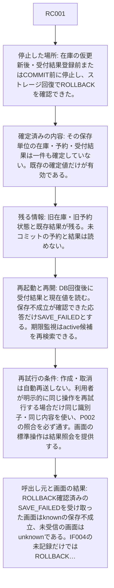
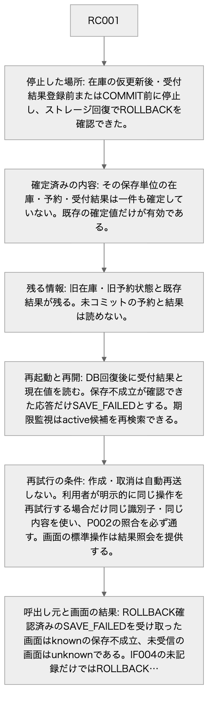
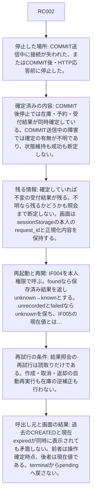
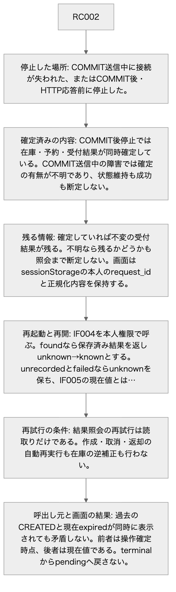
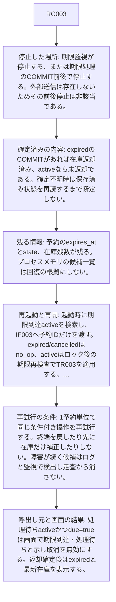
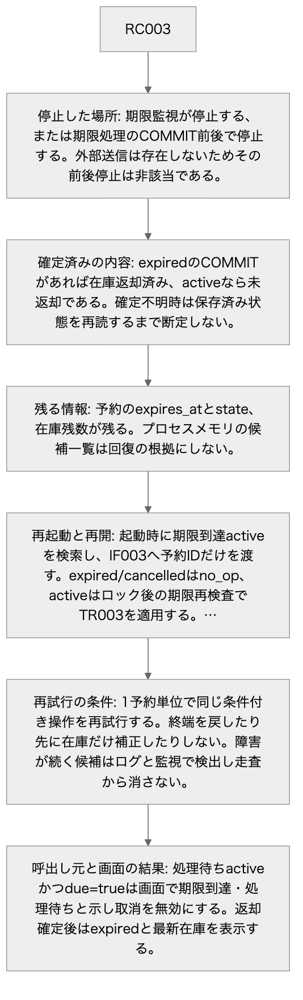

<!-- generated-by: write-detailed-design-document; body-sha256: da96ffe0d23c26ff48076023692a5ebfa543e6c4c6c1d8f4ec13cdaec78ad657 -->
# 障害と再起動

[入口に戻る](README.md)

停止した場所ごとに確定した内容と残る情報を分け、再開と再試行の条件を定義する。

## recovery

### RC001

| 項目 | 内容 |
| --- | --- |
| 停止した場所 | 在庫の仮更新後・受付結果登録前またはCOMMIT前に停止し、ストレージ回復でROLLBACKを確認できた。 |
| 確定済みの内容 | その保存単位の在庫・予約・受付結果は一件も確定していない。既存の確定値だけが有効である。 |
| 残る情報 | 旧在庫・旧予約状態と既存結果が残る。未コミットの予約と結果は読めない。 |
| 再起動と再開 | DB回復後に受付結果と現在値を読む。保存不成立が確認できた応答だけSAVE_FAILEDとする。期限監視はactive候補を再検索できる。 |
| 再試行の条件 | 作成・取消は自動再送しない。利用者が明示的に同じ操作を再試行する場合だけ同じ識別子・同じ内容を使い、P002の照合を必ず通す。画面の標準操作は結果照会を提供する。 |
| 呼出し元と画面の結果 | ROLLBACK確認済みのSAVE_FAILEDを受け取った画面はknownの保存不成立、未受信の画面はunknownである。IF004の未記録だけではROLLBACKを推論しない。 |
| 確認条件 | [C010](verification.md#C010) — 作成・取消・期限処理で在庫更新後、予約更新後、受付結果INSERT後、COMMIT前に失敗を注入する。 / ROLLBACK成立を確認し、DBと応答を読む。 / 旧在庫・旧状態・旧受付結果を保ちSAVE_FAILEDを返す。新規予約や返却だけが残らない。version上限では更新しない。作成・取消はVERSION_LIMITの受付結果を記録し、期限処理はVERSION_LIMITのfailedを返して監視に残す。実行前検査拒否と保存不成立を区別する。 [C011](verification.md#C011) — 作成と取消のCOMMIT送信中、COMMIT後応答前、応答受信後の各切断位置とブラウザ再読込みを用意する。 / 元request_idでIF004を繰り返し読み、IF005も読む。 / 確定済みならfoundの元結果が一致しunknown→known、未記録/照会失敗ならunknownを保つ。送信中切断を旧状態維持と断定しない。作成・取消の自動再実行が0回であり、現在値だけで元操作の成功を断定しない。 |

#### RC001 RC001

矢印は確認の順序または停止後の回復判断を示す。省略した全文は同じ項目の表にある。

Mermaidの記述を確認する

Mermaid: [local-RC001.mmd](diagrams/local-RC001.mmd) — 矢印は確認の順序または停止後の回復判断を示す。省略した全文は同じ項目の表にある。

### RC002

| 項目 | 内容 |
| --- | --- |
| 停止した場所 | COMMIT送信中に接続が失われた、またはCOMMIT後・HTTP応答前に停止した。 |
| 確定済みの内容 | COMMIT後停止では在庫・予約・受付結果が同時確定している。COMMIT送信中の障害では確定の有無が不明であり、状態維持も成功も断定しない。 |
| 残る情報 | 確定していれば不変の受付結果が残る。不明なら残るかどうかも照会まで断定しない。画面はsessionStorageの本人のrequest_idと正規化内容を保持する。 |
| 再起動と再開 | IF004を本人権限で呼ぶ。foundなら保存済み結果を返しunknown→knownとする。unrecordedとfailedならunknownを保ち、IF005の現在値とは区別する。再読み込み時にsendingが残っていた画面はunknownとして復元する。 |
| 再試行の条件 | 結果照会の再試行は読取りだけである。作成・取消・返却の自動再実行も在庫の逆補正も行わない。 |
| 呼出し元と画面の結果 | 過去のCREATEDと現在expiredが同時に表示されても矛盾しない。前者は操作確定時点、後者は現在値である。terminalからpendingへ戻さない。 |
| 確認条件 | [C011](verification.md#C011) — 作成と取消のCOMMIT送信中、COMMIT後応答前、応答受信後の各切断位置とブラウザ再読込みを用意する。 / 元request_idでIF004を繰り返し読み、IF005も読む。 / 確定済みならfoundの元結果が一致しunknown→known、未記録/照会失敗ならunknownを保つ。送信中切断を旧状態維持と断定しない。作成・取消の自動再実行が0回であり、現在値だけで元操作の成功を断定しない。 [C014](verification.md#C014) — 作成成功の受付結果を残し、その予約を期限切れにする。他人のID・欠落ID・任意予約ID未指定の読取りも用意する。 / IF004とIF005を呼ぶ。 / IF004は元CREATED・activeを固定して返し、IF005は現在expiredと返却後残数を返す。終端結果をpendingにしない。他人の結果はNOT_RECORDED、他人/別備品予約はNOT_FOUND、任意予約ID欠落は在庫だけで予約各項目null、指定nullはINVALID_INPUTとなる。 |

#### RC002 RC002

矢印は確認の順序または停止後の回復判断を示す。省略した全文は同じ項目の表にある。

Mermaidの記述を確認する

Mermaid: [local-RC002.mmd](diagrams/local-RC002.mmd) — 矢印は確認の順序または停止後の回復判断を示す。省略した全文は同じ項目の表にある。

### RC003

| 項目 | 内容 |
| --- | --- |
| 停止した場所 | 期限監視が停止する、または期限処理のCOMMIT前後で停止する。外部送信は存在しないためその前後停止は非該当である。 |
| 確定済みの内容 | expiredのCOMMITがあれば在庫返却済み、activeなら未返却である。確定不明時は保存済み状態を再読するまで断定しない。 |
| 残る情報 | 予約のexpires_atとstate、在庫残数が残る。プロセスメモリの候補一覧は回復の根拠にしない。 |
| 再起動と再開 | 起動時に期限到達activeを検索し、IF003へ予約IDだけを渡す。expired/cancelledはno_op、activeはロック後の期限再検査でTR003を適用する。取消からも同じ期限条件で返却できる。 |
| 再試行の条件 | 1予約単位で同じ条件付き操作を再試行する。終端を戻したり先に在庫だけ補正したりしない。障害が続く候補はログと監視で検出し走査から消さない。 |
| 呼出し元と画面の結果 | 処理待ちactiveかつdue=trueは画面で期限到達・処理待ちと示し取消を無効にする。返却確定後はexpiredと最新在庫を表示する。 |
| 確認条件 | [C005](verification.md#C005) — active予約の期限T、監視遅延、判定時刻TとT+1マイクロ秒の二条件を用意する。 / IF002またはIF003を呼び、後で同じ予約を再処理する。 / どちらもTR003でexpiredと一回返却になる。取消の応答はEXPIRED、監視はappliedであり、次回はterminal/no_opで二回目の返却がない。 [C007](verification.md#C007) — 期限到達activeを含む複数予約と監視停止・再起動を用意する。 / 監視を止め期限を越え、起動時に候補を最大100件ずつ処理する。 / 期限到達activeは返却まで処理待ち表示となり取消受付は期限再検査でEXPIREDとなる。各予約の返却一回と不変条件を保ち、候補が次の走査で消失しない。 [C012](verification.md#C012) — 期限処理のCOMMIT直前と直後で停止し、結果不明も作る。 / 保存済み予約を再読して監視を再起動する。 / activeなら条件を再検査し一回返却、expired/cancelledならno_opである。結果照会/現在値読取りは副作用0回、availableの逆補正をしない。 |

#### RC003 RC003

矢印は確認の順序または停止後の回復判断を示す。省略した全文は同じ項目の表にある。

Mermaidの記述を確認する

Mermaid: [local-RC003.mmd](diagrams/local-RC003.mmd) — 矢印は確認の順序または停止後の回復判断を示す。省略した全文は同じ項目の表にある。
