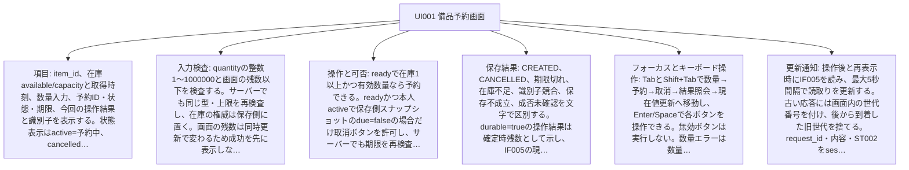
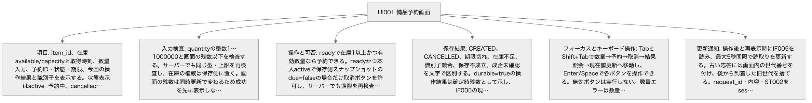

<!-- generated-by: write-detailed-design-document; body-sha256: d5ec99805ed620258ad6d4c31c0556dd0e5de9463ae1b81b55605c969d9ae6d2 -->
# 画面と操作

[入口に戻る](README.md)

利用者が保存状態と操作結果を判断できるよう、項目、操作、表示とフォーカスを定義する。

## screens

### UI001 備品予約画面

| 項目 | 内容 |
| --- | --- |
| 項目 | item_id、在庫available/capacityと取得時刻、数量入力、予約ID・状態・期限、今回の操作結果と識別子を表示する。状態表示はactive=予約中、cancelled=取消済み、expired=期限切れ、absent=予約なしとする。過去のstate_at_resultと現在のstateはラベルを分ける。 |
| 入力検査 | quantityの整数1〜1000000と画面の残数以下を検査する。サーバーでも同じ型・上限を再検査し、在庫の権威は保存側に置く。画面の残数は同時更新で変わるため成功を先に表示しない。 |
| 表示状態 | ST002のready=入力可能、sending=結果待ち、known=結果確認済み、unknown=成否未確認とする。初回読込・読取中は状態表示に読込中を添え、結果取得まで該当操作を無効にする。読取失敗は旧値に取得時刻と失敗を添える。activeかつdue=trueは期限到達・返却処理待ちを添え、expiredとは分ける。 |
| 操作と可否 | readyで在庫1以上かつ有効数量なら予約できる。readyかつ本人activeで保存側スナップショットのdue=falseの場合だけ取消ボタンを許可し、サーバーでも期限を再検査する。画面の期限到達で取消を即無効化しIF005を読む。sendingは多重操作不可。unknownは結果照会と現在値読取りだけを許可し作成・取消の自動送信をしない。knownから新操作は最新IF005を取得してTR008でreadyへ進める。期限切れ・取消済みは取消不可である。 |
| 保存結果 | CREATED、CANCELLED、期限切れ、在庫不足、識別子競合、保存不成立、成否未確認を文字で区別する。durable=trueの操作結果は確定時残数として示し、IF005の現在残数と混同しない。IF004のNOT_RECORDEDではunknownを保つ。 |
| フォーカスとキーボード操作 | TabとShift+Tabで数量→予約→取消→結果照会→現在値更新へ移動し、Enter/Spaceで各ボタンを操作できる。無効ボタンは実行しない。数量エラーは数量へ、他エラーと操作結果はライブ領域へ通知する。取消や期限切れで押下ボタンが無効になったら結果見出しへフォーカスを移し、結果照会後もそこへ移す。 |
| 更新通知 | 操作後と再表示時にIF005を読み、最大5秒間隔で読取りを更新する。古い応答には画面内の世代番号を付け、後から到着した旧世代を捨てる。request_id・内容・ST002をsessionStorageへ保持し、再読込み後のsendingはunknownとして復元する。明示的なログアウトでは本人の画面内記録を消去し、他人へ表示しない。ブラウザ保存を失った場合の履歴検索は対象外である。 |
| 共通の状態 | [ST001](common.md#ST001) — absent: 予約が存在しない仮想状態である。DBへabsent行は保存しない。 / active: 数量を在庫から引き当てた予約である。期限到達後も返却コミットまで引当は保持し、取消受付では時刻を再検査する。 / cancelled: 期限より前の利用者取消により一回の返却を確定した終端である。 / expired: 期限到達により一回の返却を確定した終端である。 [ST002](common.md#ST002) — ready: 新しい操作を入力できる状態である。 / sending: 一つの作成または取消の応答を待つ状態である。 / known: 応答または照会により今回の確定結果、更新前拒否、保存不成立のいずれかを確認した状態である。 / unknown: 切断・コミット結果不明・受付結果未記録により成否を断定できない状態である。 |
| 使う境界 | [IF001](interfaces.md#IF001) — 同じrequest_idと正規化内容を受付・サービス・保存で引き継ぐ。内部の数量を再生成しない。 / 応答候補の全項目を返す。確定した業務結果だけを保存し、コミット結果不明を保存済み拒否に変えない。 / CREATED、NO_STOCK、NOT_FOUND、VERSION_LIMIT、INVALID_INPUT、TOO_LARGE、UNSUPPORTED_MEDIA、UNAUTHENTICATED、FORBIDDEN、ID_CONFLICT、SAVE_FAILED、COMMIT_UNKNOWNを共通応答のcodeで判別する。 / 入力: context.owner_id: string(uuid) 必須 NULL不可, サーバー認証で確定した利用者。クライアントからの指定を許可しない。 / body.request_id: string(uuid) 必須 NULL不可, 小文字ハイフン付きUUID正規形36文字。異なる世代の操作に再利用しない。 / body.item_id: string(uuid) 必須 NULL不可, 登録済み備品ID。 / body.quantity: integer 必須 NULL不可, 1〜1000000の整数。 / 応答: created: 201 CREATED。新しい予約と在庫・受付結果のCOMMITを確認した応答でありdurable=trueとする。 (request_id: string(uuid) or null 必須 NULL可, 妥当な識別子を受理済みならその値を返す。欠落・不正・識別前の拒否ではnullとする。; code: string 必須 NULL不可, CREATEDだけを返す。; message: string 必須 NULL不可, 1〜200 Unicode文字かつUTF-8で800バイト以下。利用者向け理由を返し内部例外は含めない。; reservation_id: string(uuid) or null 必須 NULL可, 予約に結び付く確定結果ではそのID、それ以外はnullとする。; state_at_result: string or null 必須 NULL可, 結果確定時のactive・cancelled・expired。予約がない拒否・保存不成立・確定不明はnullとする。; expires_at: string(datetime) or null 必須 NULL可, 予約に結び付く結果では共通UTC形式、それ以外はnullとする。; available_at_result: integer or null 必須 NULL可, 0〜1000000000。保存単位で取得した残数。備品がない場合、入力拒否、保存不成立、確定不明はnullとする。; result_at: string(datetime) or null 必須 NULL可, durable=trueの確定結果では共通UTC形式の確定判断時刻、durable=falseではnullとする。COMMIT完了時刻と同一とは限らない。; durable: boolean 必須 NULL不可, T003へCOMMITした応答はtrue、入力拒否・ID_CONFLICT・SAVE_FAILED・COMMIT_UNKNOWN等の非保存応答はfalseとする。) / replay: 保存済み結果と同じHTTP状態・共通応答を返す。CREATED、NO_STOCK、NOT_FOUND、VERSION_LIMITの元コードを変更しない。 (request_id: string(uuid) or null 必須 NULL可, 妥当な識別子を受理済みならその値を返す。欠落・不正・識別前の拒否ではnullとする。; code: string 必須 NULL不可, CREATED、NO_STOCK、NOT_FOUND、VERSION_LIMITだけを返す。; message: string 必須 NULL不可, 1〜200 Unicode文字かつUTF-8で800バイト以下。利用者向け理由を返し内部例外は含めない。; reservation_id: string(uuid) or null 必須 NULL可, 予約に結び付く確定結果ではそのID、それ以外はnullとする。; state_at_result: string or null 必須 NULL可, 結果確定時のactive・cancelled・expired。予約がない拒否・保存不成立・確定不明はnullとする。; expires_at: string(datetime) or null 必須 NULL可, 予約に結び付く結果では共通UTC形式、それ以外はnullとする。; available_at_result: integer or null 必須 NULL可, 0〜1000000000。保存単位で取得した残数。備品がない場合、入力拒否、保存不成立、確定不明はnullとする。; result_at: string(datetime) or null 必須 NULL可, durable=trueの確定結果では共通UTC形式の確定判断時刻、durable=falseではnullとする。COMMIT完了時刻と同一とは限らない。; durable: boolean 必須 NULL不可, T003へCOMMITした応答はtrue、入力拒否・ID_CONFLICT・SAVE_FAILED・COMMIT_UNKNOWN等の非保存応答はfalseとする。) / rejected: 400 INVALID_INPUT、413 TOO_LARGE、415 UNSUPPORTED_MEDIA、401 UNAUTHENTICATED、403 FORBIDDEN、404 NOT_FOUND、409 ID_CONFLICT、503 SAVE_FAILED、503 VERSION_LIMITとする。SAVE_FAILEDはROLLBACK確認済みに限る。NOT_FOUNDとVERSION_LIMITの有効要求はdurable=trueとして記録し、それ以外の事前拒否はfalseとする。 在庫不足は409 NO_STOCK、durable=trueとする。 (request_id: string(uuid) or null 必須 NULL可, 妥当な識別子を受理済みならその値を返す。欠落・不正・識別前の拒否ではnullとする。; code: string 必須 NULL不可, INVALID_INPUT、TOO_LARGE、UNSUPPORTED_MEDIA、UNAUTHENTICATED、FORBIDDEN、NOT_FOUND、ID_CONFLICT、SAVE_FAILED、VERSION_LIMIT、NO_STOCKだけを返す。; message: string 必須 NULL不可, 1〜200 Unicode文字かつUTF-8で800バイト以下。利用者向け理由を返し内部例外は含めない。; reservation_id: string(uuid) or null 必須 NULL可, 予約に結び付く確定結果ではそのID、それ以外はnullとする。; state_at_result: string or null 必須 NULL可, 結果確定時のactive・cancelled・expired。予約がない拒否・保存不成立・確定不明はnullとする。; expires_at: string(datetime) or null 必須 NULL可, 予約に結び付く結果では共通UTC形式、それ以外はnullとする。; available_at_result: integer or null 必須 NULL可, 0〜1000000000。保存単位で取得した残数。備品がない場合、入力拒否、保存不成立、確定不明はnullとする。; result_at: string(datetime) or null 必須 NULL可, durable=trueの確定結果では共通UTC形式の確定判断時刻、durable=falseではnullとする。COMMIT完了時刻と同一とは限らない。; durable: boolean 必須 NULL不可, T003へCOMMITした応答はtrue、入力拒否・ID_CONFLICT・SAVE_FAILED・COMMIT_UNKNOWN等の非保存応答はfalseとする。) / unconfirmed: 503 COMMIT_UNKNOWN。結果が不明でありdurable=false、予約・状態・期限・残数・result_atはnullとする。応答不能ならHTTP応答はなく、画面が切断からunknownへ進む。 (request_id: string(uuid) or null 必須 NULL可, 妥当な識別子を受理済みならその値を返す。欠落・不正・識別前の拒否ではnullとする。; code: string 必須 NULL不可, COMMIT_UNKNOWNだけを返す。; message: string 必須 NULL不可, 1〜200 Unicode文字かつUTF-8で800バイト以下。利用者向け理由を返し内部例外は含めない。; reservation_id: string(uuid) or null 必須 NULL可, 予約に結び付く確定結果ではそのID、それ以外はnullとする。; state_at_result: string or null 必須 NULL可, 結果確定時のactive・cancelled・expired。予約がない拒否・保存不成立・確定不明はnullとする。; expires_at: string(datetime) or null 必須 NULL可, 予約に結び付く結果では共通UTC形式、それ以外はnullとする。; available_at_result: integer or null 必須 NULL可, 0〜1000000000。保存単位で取得した残数。備品がない場合、入力拒否、保存不成立、確定不明はnullとする。; result_at: string(datetime) or null 必須 NULL可, durable=trueの確定結果では共通UTC形式の確定判断時刻、durable=falseではnullとする。COMMIT完了時刻と同一とは限らない。; durable: boolean 必須 NULL不可, T003へCOMMITした応答はtrue、入力拒否・ID_CONFLICT・SAVE_FAILED・COMMIT_UNKNOWN等の非保存応答はfalseとする。) / 最大サイズ: 要求本文4096バイト以下、応答8192バイト以下とする。HTTPパスとヘッダーは合計2048バイト以下とする提案である。 [IF002](interfaces.md#IF002) — 取消はreservation_idだけから保存済みitem_id・quantity・expires_atを読み、クライアントの数量を受け付けない。 / 応答候補の全項目を返す。確定した業務結果だけを保存し、コミット結果不明を保存済み拒否に変えない。 / CANCELLED、ALREADY_CANCELLED、EXPIRED、NOT_FOUND、VERSION_LIMIT、INVALID_INPUT、TOO_LARGE、UNSUPPORTED_MEDIA、UNAUTHENTICATED、FORBIDDEN、ID_CONFLICT、SAVE_FAILED、COMMIT_UNKNOWNをcodeに返す。 / 入力: context.owner_id: string(uuid) 必須 NULL不可, サーバー認証で確定した利用者。クライアントからの指定を許可しない。 / body.request_id: string(uuid) 必須 NULL不可, 小文字ハイフン付きUUID正規形36文字。異なる世代の操作に再利用しない。 / params.reservation_id: string(uuid) 必須 NULL不可, 本人の予約ID。 / 応答: cancelled: 200 CANCELLED。activeかつ期限前の判定でcancelledと返却をCOMMITしdurable=trueとする。 (request_id: string(uuid) or null 必須 NULL可, 妥当な識別子を受理済みならその値を返す。欠落・不正・識別前の拒否ではnullとする。; code: string 必須 NULL不可, CANCELLEDだけを返す。; message: string 必須 NULL不可, 1〜200 Unicode文字かつUTF-8で800バイト以下。利用者向け理由を返し内部例外は含めない。; reservation_id: string(uuid) or null 必須 NULL可, 予約に結び付く確定結果ではそのID、それ以外はnullとする。; state_at_result: string or null 必須 NULL可, 結果確定時のactive・cancelled・expired。予約がない拒否・保存不成立・確定不明はnullとする。; expires_at: string(datetime) or null 必須 NULL可, 予約に結び付く結果では共通UTC形式、それ以外はnullとする。; available_at_result: integer or null 必須 NULL可, 0〜1000000000。保存単位で取得した残数。備品がない場合、入力拒否、保存不成立、確定不明はnullとする。; result_at: string(datetime) or null 必須 NULL可, durable=trueの確定結果では共通UTC形式の確定判断時刻、durable=falseではnullとする。COMMIT完了時刻と同一とは限らない。; durable: boolean 必須 NULL不可, T003へCOMMITした応答はtrue、入力拒否・ID_CONFLICT・SAVE_FAILED・COMMIT_UNKNOWN等の非保存応答はfalseとする。) / expired_now: 409 EXPIRED。activeかつ期限到達の判定でexpiredと返却をCOMMITしdurable=trueとする。 (request_id: string(uuid) or null 必須 NULL可, 妥当な識別子を受理済みならその値を返す。欠落・不正・識別前の拒否ではnullとする。; code: string 必須 NULL不可, EXPIREDだけを返す。; message: string 必須 NULL不可, 1〜200 Unicode文字かつUTF-8で800バイト以下。利用者向け理由を返し内部例外は含めない。; reservation_id: string(uuid) or null 必須 NULL可, 予約に結び付く確定結果ではそのID、それ以外はnullとする。; state_at_result: string or null 必須 NULL可, 結果確定時のactive・cancelled・expired。予約がない拒否・保存不成立・確定不明はnullとする。; expires_at: string(datetime) or null 必須 NULL可, 予約に結び付く結果では共通UTC形式、それ以外はnullとする。; available_at_result: integer or null 必須 NULL可, 0〜1000000000。保存単位で取得した残数。備品がない場合、入力拒否、保存不成立、確定不明はnullとする。; result_at: string(datetime) or null 必須 NULL可, durable=trueの確定結果では共通UTC形式の確定判断時刻、durable=falseではnullとする。COMMIT完了時刻と同一とは限らない。; durable: boolean 必須 NULL不可, T003へCOMMITした応答はtrue、入力拒否・ID_CONFLICT・SAVE_FAILED・COMMIT_UNKNOWN等の非保存応答はfalseとする。) / terminal: 既存cancelledは200 ALREADY_CANCELLED、既存expiredは409 EXPIRED。再返却せずその結果をdurable=trueとして記録する。 (request_id: string(uuid) or null 必須 NULL可, 妥当な識別子を受理済みならその値を返す。欠落・不正・識別前の拒否ではnullとする。; code: string 必須 NULL不可, ALREADY_CANCELLED、EXPIREDだけを返す。; message: string 必須 NULL不可, 1〜200 Unicode文字かつUTF-8で800バイト以下。利用者向け理由を返し内部例外は含めない。; reservation_id: string(uuid) or null 必須 NULL可, 予約に結び付く確定結果ではそのID、それ以外はnullとする。; state_at_result: string or null 必須 NULL可, 結果確定時のactive・cancelled・expired。予約がない拒否・保存不成立・確定不明はnullとする。; expires_at: string(datetime) or null 必須 NULL可, 予約に結び付く結果では共通UTC形式、それ以外はnullとする。; available_at_result: integer or null 必須 NULL可, 0〜1000000000。保存単位で取得した残数。備品がない場合、入力拒否、保存不成立、確定不明はnullとする。; result_at: string(datetime) or null 必須 NULL可, durable=trueの確定結果では共通UTC形式の確定判断時刻、durable=falseではnullとする。COMMIT完了時刻と同一とは限らない。; durable: boolean 必須 NULL不可, T003へCOMMITした応答はtrue、入力拒否・ID_CONFLICT・SAVE_FAILED・COMMIT_UNKNOWN等の非保存応答はfalseとする。) / replay: 元の取消または拒否結果と同じHTTP状態・共通応答を返す。 (request_id: string(uuid) or null 必須 NULL可, 妥当な識別子を受理済みならその値を返す。欠落・不正・識別前の拒否ではnullとする。; code: string 必須 NULL不可, CANCELLED、EXPIRED、ALREADY_CANCELLED、NOT_FOUND、VERSION_LIMITだけを返す。; message: string 必須 NULL不可, 1〜200 Unicode文字かつUTF-8で800バイト以下。利用者向け理由を返し内部例外は含めない。; reservation_id: string(uuid) or null 必須 NULL可, 予約に結び付く確定結果ではそのID、それ以外はnullとする。; state_at_result: string or null 必須 NULL可, 結果確定時のactive・cancelled・expired。予約がない拒否・保存不成立・確定不明はnullとする。; expires_at: string(datetime) or null 必須 NULL可, 予約に結び付く結果では共通UTC形式、それ以外はnullとする。; available_at_result: integer or null 必須 NULL可, 0〜1000000000。保存単位で取得した残数。備品がない場合、入力拒否、保存不成立、確定不明はnullとする。; result_at: string(datetime) or null 必須 NULL可, durable=trueの確定結果では共通UTC形式の確定判断時刻、durable=falseではnullとする。COMMIT完了時刻と同一とは限らない。; durable: boolean 必須 NULL不可, T003へCOMMITした応答はtrue、入力拒否・ID_CONFLICT・SAVE_FAILED・COMMIT_UNKNOWN等の非保存応答はfalseとする。) / rejected: 400 INVALID_INPUT、413 TOO_LARGE、415 UNSUPPORTED_MEDIA、401 UNAUTHENTICATED、403 FORBIDDEN、404 NOT_FOUND、409 ID_CONFLICT、503 SAVE_FAILED、503 VERSION_LIMITとする。SAVE_FAILEDはROLLBACK確認済みに限る。NOT_FOUNDとVERSION_LIMITの有効要求はdurable=trueとして記録し、それ以外の事前拒否はfalseとする。 (request_id: string(uuid) or null 必須 NULL可, 妥当な識別子を受理済みならその値を返す。欠落・不正・識別前の拒否ではnullとする。; code: string 必須 NULL不可, INVALID_INPUT、TOO_LARGE、UNSUPPORTED_MEDIA、UNAUTHENTICATED、FORBIDDEN、NOT_FOUND、ID_CONFLICT、SAVE_FAILED、VERSION_LIMITだけを返す。; message: string 必須 NULL不可, 1〜200 Unicode文字かつUTF-8で800バイト以下。利用者向け理由を返し内部例外は含めない。; reservation_id: string(uuid) or null 必須 NULL可, 予約に結び付く確定結果ではそのID、それ以外はnullとする。; state_at_result: string or null 必須 NULL可, 結果確定時のactive・cancelled・expired。予約がない拒否・保存不成立・確定不明はnullとする。; expires_at: string(datetime) or null 必須 NULL可, 予約に結び付く結果では共通UTC形式、それ以外はnullとする。; available_at_result: integer or null 必須 NULL可, 0〜1000000000。保存単位で取得した残数。備品がない場合、入力拒否、保存不成立、確定不明はnullとする。; result_at: string(datetime) or null 必須 NULL可, durable=trueの確定結果では共通UTC形式の確定判断時刻、durable=falseではnullとする。COMMIT完了時刻と同一とは限らない。; durable: boolean 必須 NULL不可, T003へCOMMITした応答はtrue、入力拒否・ID_CONFLICT・SAVE_FAILED・COMMIT_UNKNOWN等の非保存応答はfalseとする。) / unconfirmed: 503 COMMIT_UNKNOWN。durable=falseとし予約・状態・期限・残数・result_atをnullとする。応答不能は画面でunknownとして扱う。 (request_id: string(uuid) or null 必須 NULL可, 妥当な識別子を受理済みならその値を返す。欠落・不正・識別前の拒否ではnullとする。; code: string 必須 NULL不可, COMMIT_UNKNOWNだけを返す。; message: string 必須 NULL不可, 1〜200 Unicode文字かつUTF-8で800バイト以下。利用者向け理由を返し内部例外は含めない。; reservation_id: string(uuid) or null 必須 NULL可, 予約に結び付く確定結果ではそのID、それ以外はnullとする。; state_at_result: string or null 必須 NULL可, 結果確定時のactive・cancelled・expired。予約がない拒否・保存不成立・確定不明はnullとする。; expires_at: string(datetime) or null 必須 NULL可, 予約に結び付く結果では共通UTC形式、それ以外はnullとする。; available_at_result: integer or null 必須 NULL可, 0〜1000000000。保存単位で取得した残数。備品がない場合、入力拒否、保存不成立、確定不明はnullとする。; result_at: string(datetime) or null 必須 NULL可, durable=trueの確定結果では共通UTC形式の確定判断時刻、durable=falseではnullとする。COMMIT完了時刻と同一とは限らない。; durable: boolean 必須 NULL不可, T003へCOMMITした応答はtrue、入力拒否・ID_CONFLICT・SAVE_FAILED・COMMIT_UNKNOWN等の非保存応答はfalseとする。) / 最大サイズ: 要求本文4096バイト以下、応答8192バイト以下とする。HTTPパスとヘッダーは合計2048バイト以下とする提案である。 [IF004](interfaces.md#IF004) — 本人の受付用識別子で保存済みの元結果だけを取得する。 / 応答候補の全項目を返す。確定した業務結果だけを保存し、コミット結果不明を保存済み拒否に変えない。 / NOT_RECORDED、INVALID_INPUT、UNAUTHENTICATED、FORBIDDEN、TOO_LARGE、LOOKUP_FAILEDはcodeに返す。foundのresult.codeはIF001・IF002の保存済みコードをそのまま返す。 / 入力: context.owner_id: string(uuid) 必須 NULL不可, サーバー認証で確定した利用者。クライアントからの指定を許可しない。 / params.request_id: string(uuid) 必須 NULL不可, 小文字ハイフン付きUUID正規形36文字。異なる世代の操作に再利用しない。 / 応答: found: HTTP 200。コミット済みの元の応答をresultへ返す。元が拒否でもfoundであり、現在の予約状態を意味しない。 (request_id: string(uuid) 必須 NULL不可, 照会対象の妥当なID。; result.request_id: string(uuid) 必須 NULL不可, 照会対象request_idと同じ保存済みUUIDを必ず返す。NULLを許可しない。; result.code: string 必須 NULL不可, CREATED、NO_STOCK、NOT_FOUND、VERSION_LIMIT、CANCELLED、ALREADY_CANCELLED、EXPIREDの保存済み元コードを返す。; result.message: string 必須 NULL不可, 1〜200 Unicode文字かつUTF-8で800バイト以下。利用者向け理由を返し内部例外は含めない。 保存済み共通応答でありresult.durableはtrue固定、result.request_idとresult.result_atはnull不可である。; result.reservation_id: string(uuid) or null 必須 NULL可, 予約に結び付く確定結果ではそのID、それ以外はnullとする。 保存済み共通応答でありresult.durableはtrue固定、result.request_idとresult.result_atはnull不可である。; result.state_at_result: string or null 必須 NULL可, 結果確定時のactive・cancelled・expired。予約がない拒否・保存不成立・確定不明はnullとする。 保存済み共通応答でありresult.durableはtrue固定、result.request_idとresult.result_atはnull不可である。; result.expires_at: string(datetime) or null 必須 NULL可, 予約に結び付く結果では共通UTC形式、それ以外はnullとする。 保存済み共通応答でありresult.durableはtrue固定、result.request_idとresult.result_atはnull不可である。; result.available_at_result: integer or null 必須 NULL可, 0〜1000000000。保存単位で取得した残数。備品がない場合、入力拒否、保存不成立、確定不明はnullとする。 保存済み共通応答でありresult.durableはtrue固定、result.request_idとresult.result_atはnull不可である。; result.result_at: string(datetime) 必須 NULL不可, 保存済みの確定判断時刻を共通UTC形式で必ず返す。NULLを許可しない。COMMIT完了時刻と同一とは限らない。; result.durable: boolean 必須 NULL不可, 保存済み結果なのでtrue固定とする。; http_status: integer 必須 NULL不可, 保存済み元応答の200・201・404・409・503のいずれか。; observed_at: string(datetime) 必須 NULL不可, 照会時の保存側UTC時刻。) / unrecorded: HTTP 404 NOT_RECORDED。現時点で本人の受付結果が見えない。未着と処理中と保存不成立を区別しない。 (request_id: string(uuid) or null 必須 NULL可, 妥当なID受理済みなら値、欠落・不正ではnull。; code: string 必須 NULL不可, NOT_RECORDEDだけを返す。; message: string 必須 NULL不可, 1〜200文字かつUTF-8で800バイト以下。) / failed: HTTP 400 INVALID_INPUT、401 UNAUTHENTICATED、403 FORBIDDEN、413 TOO_LARGEまたは503 LOOKUP_FAILED。 (request_id: string(uuid) or null 必須 NULL可, 妥当なID受理済みなら値、欠落・不正ではnull。; code: string 必須 NULL不可, INVALID_INPUT、UNAUTHENTICATED、FORBIDDEN、TOO_LARGE、LOOKUP_FAILEDだけを返す。; message: string 必須 NULL不可, 1〜200文字かつUTF-8で800バイト以下。) / 最大サイズ: GET本文0バイト、パス・ヘッダー2048バイト以下、応答12288バイト以下とする提案である。 [IF005](interfaces.md#IF005) — 現在値だけを取得し、過去の操作結果を推測しない。 / 応答候補の全項目を返す。確定した業務結果だけを保存し、コミット結果不明を保存済み拒否に変えない。 / INVALID_INPUT、UNAUTHENTICATED、FORBIDDEN、TOO_LARGE、NOT_FOUND、LOOKUP_FAILEDをcodeで返す。 / 入力: context.owner_id: string(uuid) 必須 NULL不可, サーバー認証で確定した利用者。クライアントからの指定を許可しない。 / params.item_id: string(uuid) 必須 NULL不可, 登録済み備品ID。 / query.reservation_id: string(uuid) 任意 NULL不可, 欠落時は備品だけを取得する。指定時は本人かつ同じ備品の予約であることを検査する。 / 応答: snapshot: HTTP 200。現在の在庫と任意の予約を同一読取りスナップショットで返す。 (item_id: string(uuid) 必須 NULL不可, 対象備品ID。; available: integer 必須 NULL不可, 0〜1000000000。observed_atの同一スナップショットの残数。; capacity: integer 必須 NULL不可, 0〜1000000000の登録済み総数。; inventory_version: string 必須 NULL不可, 0〜9223372036854775807の10進文字列。JavaScriptの丸めを避ける。; observed_at: string(datetime) 必須 NULL不可, 保存側の共通UTC時刻。; reservation_id: string(uuid) or null 必須 NULL可, 任意の予約IDを指定し本人の予約を確認した場合だけ値、未指定ならnull。; state: string or null 必須 NULL可, 予約指定時active・cancelled・expired、未指定ならnull。; created_at: string(datetime) or null 必須 NULL可, 予約指定時の保存値、未指定ならnull。; expires_at: string(datetime) or null 必須 NULL可, 予約指定時の保存値、未指定ならnull。; due: boolean or null 必須 NULL可, 予約指定時はobserved_at>=expires_at。未指定ならnull。activeかつtrueは期限処理待ちであり、読取りは状態変更しない。) / failed: 400 INVALID_INPUT、401 UNAUTHENTICATED、403 FORBIDDEN、413 TOO_LARGE、404 NOT_FOUND、503 LOOKUP_FAILED。指定予約がない・他人・別備品の場合はNOT_FOUND。 (code: string 必須 NULL不可, INVALID_INPUT、UNAUTHENTICATED、FORBIDDEN、TOO_LARGE、NOT_FOUND、LOOKUP_FAILEDだけを返す。; message: string 必須 NULL不可, 1〜200文字かつUTF-8で800バイト以下。) / 最大サイズ: GET本文0バイト、パス・ヘッダー2048バイト以下、応答4096バイト以下とする提案である。 |

#### UI001 備品予約画面

矢印は項目と条件の対応を示す。実行順序ではない。厳密な全文は同じ項目の表にある。

Mermaidの記述を確認する

Mermaid: [local-UI001.mmd](diagrams/local-UI001.mmd) — 矢印は項目と条件の対応を示す。実行順序ではない。厳密な全文は同じ項目の表にある。
