<!-- generated-by: write-detailed-design-document; body-sha256: f076da45324af8c36e9571feae2abf3816f603aae6ad33bd9eb81ab061ff43d2 -->
# 要件との対応と確認条件

[入口に戻る](README.md)

要件を設計と観測できる結果へ対応付ける。試験条件は実施結果を意味しない。

## requirements

### R001

| 項目 | 内容 |
| --- | --- |
| 内容 | 数量指定の予約と残数表示、最後の1個の同時作成でも在庫を負にしない。 |
| 理由 | 共通仕様・対応する機能・確認条件へ具体化する。 |
| 根拠 | [S001](evidence.md#S001) — 利用者は備品の数量を指定して予約し、予約結果と残数を確認できる。最後の1個へ同時に予約しても、在庫は負にならず、成立する予約は1件だけである。 |
| 対象機能 | [F001](features.md#F001) — 在庫を超えずに予約を一回だけ確定し、後から同じ結果を確認できるようにする。 |
| 確認条件 | [C001](verification.md#C001) — 在庫3、本人の新しい受付用識別子、quantity=2を用意する。 / IF001で作成し、IF004とIF005を読む。 / CREATED、予約active、残数1、expires_at=created_at+10分、受付結果一件となる。保存済み共通応答と操作表示が一致する。 [C002](verification.md#C002) — 数量0・1・1000000・1000001、小数・真偽値・文字列、UUID不正、必須欠落、null、未知/重複キー、4096/4097バイトの要求を用意する。 / IF001とIF002を呼ぶ。 / 整数と範囲・サイズ・形を全て満たす要求だけが業務処理へ進む。不正はINVALID_INPUTまたはTOO_LARGE等で在庫・予約・受付結果を更新しない。欠落IDの応答request_idはnullであり欠落値を必須UUIDとして返さない。 [C003](verification.md#C003) — 同じ備品のavailable=1と異なる受付識別子二つを用意する。 / quantity=1の作成を同期して同時到着させる。 / CREATEDは一件、他方NO_STOCK、available=0、active合計=1となる。二件の受付結果を記録し、負在庫と二重引当を生じない。 |
| 関連する未決 | なし |
| 設計の状態 | designed |

[S001](evidence.md#S001)

> 利用者は備品の数量を指定して予約し、予約結果と残数を確認できる。最後の1個へ同時に予約しても、在庫は負にならず、成立する予約は1件だけである。

出典: [docs/requirement.md 3行目](/private/tmp/detailed-design-public-nu7gtxsu/docs/requirement.md:3:1)

#### R001 R001

矢印は項目と条件の対応を示す。実行順序ではない。厳密な全文は同じ項目の表にある。

Mermaidの記述を確認する

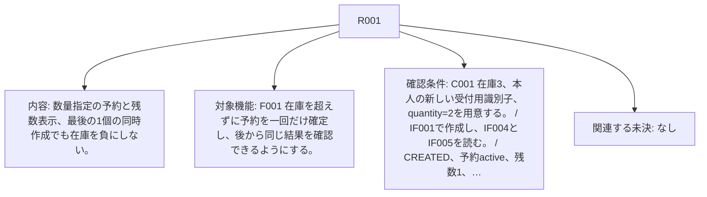

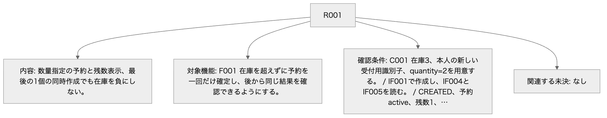

Mermaid: [local-R001.mmd](diagrams/local-R001.mmd) — 矢印は項目と条件の対応を示す。実行順序ではない。厳密な全文は同じ項目の表にある。

### R002

| 項目 | 内容 |
| --- | --- |
| 内容 | 作成から10分、取消または期限切れで一回だけ返却し、保存側時刻の等号は期限切れとする。 |
| 理由 | 共通仕様・対応する機能・確認条件へ具体化する。 |
| 根拠 | [S002](evidence.md#S002) — 予約の有効期間は作成から10分とする。利用者の取消か期限切れで予約分の数量を在庫へ戻す。取消と期限処理が競合しても返却は1回だけとする。保存側の判定時刻が期限と等しければ期限切れとする。 |
| 対象機能 | [F002](features.md#F002) — 期限内の本人取消または期限到達の確定を一回の返却に制限する。 [F003](features.md#F003) — 監視遅延や再起動があっても期限切れの引当を一回だけ解放する。 |
| 確認条件 | [C004](verification.md#C004) — active予約の期限をTとし、ロック後に採る判定時刻をT-1マイクロ秒に固定できる試験構成とする。 / 本人がIF002で取消する。 / TR002でcancelled、一回だけquantityを返却しCANCELLEDを記録する。ended_at<Tであり受付結果・在庫・状態が同時確定する。 [C005](verification.md#C005) — active予約の期限T、監視遅延、判定時刻TとT+1マイクロ秒の二条件を用意する。 / IF002またはIF003を呼び、後で同じ予約を再処理する。 / どちらもTR003でexpiredと一回返却になる。取消の応答はEXPIRED、監視はappliedであり、次回はterminal/no_opで二回目の返却がない。 [C006](verification.md#C006) — active予約に本人取消二件と期限処理を用意し、期限直前・等号・直後を制御する。 / 全処理を同時開始し備品ロック待機を注入する。 / ロック取得後の時刻で勝敗が決まり、期限前に確定した取消だけcancelled、期限到達ならexpiredとなる。available増分はquantity一回、version増分一回で終端を覆さない。待機前時刻を使わない。 [C007](verification.md#C007) — 期限到達activeを含む複数予約と監視停止・再起動を用意する。 / 監視を止め期限を越え、起動時に候補を最大100件ずつ処理する。 / 期限到達activeは返却まで処理待ち表示となり取消受付は期限再検査でEXPIREDとなる。各予約の返却一回と不変条件を保ち、候補が次の走査で消失しない。 |
| 関連する未決 | なし |
| 設計の状態 | designed |

[S002](evidence.md#S002)

> 予約の有効期間は作成から10分とする。利用者の取消か期限切れで予約分の数量を在庫へ戻す。取消と期限処理が競合しても返却は1回だけとする。保存側の判定時刻が期限と等しければ期限切れとする。

出典: [docs/requirement.md 4行目](/private/tmp/detailed-design-public-nu7gtxsu/docs/requirement.md:4:1)

#### R002 R002

矢印は項目と条件の対応を示す。実行順序ではない。厳密な全文は同じ項目の表にある。

Mermaidの記述を確認する

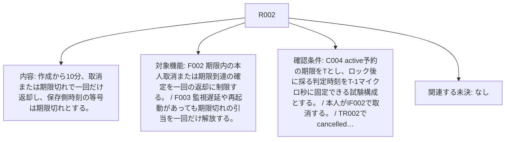

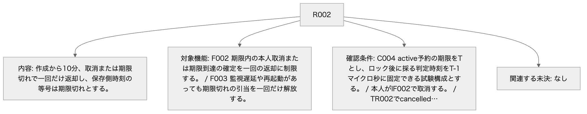

Mermaid: [local-R002.mmd](diagrams/local-R002.mmd) — 矢印は項目と条件の対応を示す。実行順序ではない。厳密な全文は同じ項目の表にある。

### R003

| 項目 | 内容 |
| --- | --- |
| 内容 | 同じ受付用識別子と同じ内容は再作成せず、違う内容は競合にする。 |
| 理由 | 共通仕様・対応する機能・確認条件へ具体化する。 |
| 根拠 | [S003](evidence.md#S003) — 作成の同じ受付用識別子・同じ内容の再送は新しい予約を作らない。違う内容なら競合として返す。 |
| 対象機能 | [F001](features.md#F001) — 在庫を超えずに予約を一回だけ確定し、後から同じ結果を確認できるようにする。 [F002](features.md#F002) — 期限内の本人取消または期限到達の確定を一回の返却に制限する。 |
| 確認条件 | [C008](verification.md#C008) — 同一owner_id+request_idで同じ作成内容または同じ取消内容を二件用意する。 / 同時に送信し、受付結果最終INSERTの前後で待機を注入する。 / 共通応答は一つの保存結果に一致し、作成予約は一件、取消返却は一回である。仮更新敗者は全ROLLBACKし、再送で期限を延ばさない。 [C009](verification.md#C009) — 同一受付識別子で異なるquantity・item_id・操作種別を用意する。既存結果ありと未登録の同時到着を分ける。 / IF001/IF002を競合させる。 / 勝者の結果だけが固定され、相違側はID_CONFLICT、相違側の在庫・予約仮更新は全て戻る。別ownerの同じIDは独立し情報を漏らさない。 |
| 関連する未決 | なし |
| 設計の状態 | designed |

[S003](evidence.md#S003)

> 作成の同じ受付用識別子・同じ内容の再送は新しい予約を作らない。違う内容なら競合として返す。

出典: [docs/requirement.md 5行目](/private/tmp/detailed-design-public-nu7gtxsu/docs/requirement.md:5:1)

#### R003 R003

矢印は項目と条件の対応を示す。実行順序ではない。厳密な全文は同じ項目の表にある。

Mermaidの記述を確認する

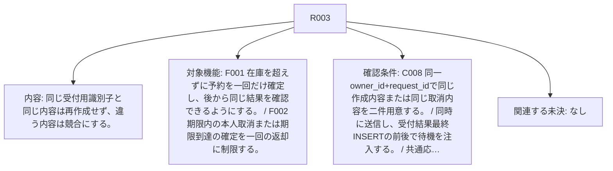

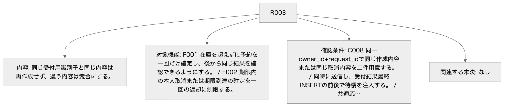

Mermaid: [local-R003.mmd](diagrams/local-R003.mmd) — 矢印は項目と条件の対応を示す。実行順序ではない。厳密な全文は同じ項目の表にある。

### R004

| 項目 | 内容 |
| --- | --- |
| 内容 | 保存後に応答し、切断と再起動後は識別子で確定結果を照会し更新を自動再実行しない。 |
| 理由 | 共通仕様・対応する機能・確認条件へ具体化する。 |
| 根拠 | [S004](evidence.md#S004) — 保存確定後に応答する。応答切断後は識別子で確定した結果を照会し、予約や在庫の更新を自動で繰り返さない。 [S008](evidence.md#S008) — 作成は在庫確認と数量の引当と予約と受付結果を一つの保存単位で確定する。同時再送は受付用識別子の一意制約で照合する。取消と期限処理は同じ予約の状態を条件にして一方だけが在庫を戻す。 時刻は保存側のUTCとし、画面の押下時刻を期限判定に使わない。期限処理が遅れても、取消の受付では期限を再検査する。 通知は保存確定後に画面へ返す。通信切断後や再起動後も受付用識別子で確定結果を照会し、外部への更新を再実行したことにしない。 |
| 対象機能 | [F001](features.md#F001) — 在庫を超えずに予約を一回だけ確定し、後から同じ結果を確認できるようにする。 [F002](features.md#F002) — 期限内の本人取消または期限到達の確定を一回の返却に制限する。 [F003](features.md#F003) — 監視遅延や再起動があっても期限切れの引当を一回だけ解放する。 [F004](features.md#F004) — 切断後の確定結果を識別子で読み、過去の操作と現在の在庫・予約を区別する。 |
| 確認条件 | [C010](verification.md#C010) — 作成・取消・期限処理で在庫更新後、予約更新後、受付結果INSERT後、COMMIT前に失敗を注入する。 / ROLLBACK成立を確認し、DBと応答を読む。 / 旧在庫・旧状態・旧受付結果を保ちSAVE_FAILEDを返す。新規予約や返却だけが残らない。version上限では更新しない。作成・取消はVERSION_LIMITの受付結果を記録し、期限処理はVERSION_LIMITのfailedを返して監視に残す。実行前検査拒否と保存不成立を区別する。 [C011](verification.md#C011) — 作成と取消のCOMMIT送信中、COMMIT後応答前、応答受信後の各切断位置とブラウザ再読込みを用意する。 / 元request_idでIF004を繰り返し読み、IF005も読む。 / 確定済みならfoundの元結果が一致しunknown→known、未記録/照会失敗ならunknownを保つ。送信中切断を旧状態維持と断定しない。作成・取消の自動再実行が0回であり、現在値だけで元操作の成功を断定しない。 [C012](verification.md#C012) — 期限処理のCOMMIT直前と直後で停止し、結果不明も作る。 / 保存済み予約を再読して監視を再起動する。 / activeなら条件を再検査し一回返却、expired/cancelledならno_opである。結果照会/現在値読取りは副作用0回、availableの逆補正をしない。 |
| 関連する未決 | なし |
| 設計の状態 | designed |

[S004](evidence.md#S004)

> 保存確定後に応答する。応答切断後は識別子で確定した結果を照会し、予約や在庫の更新を自動で繰り返さない。

出典: [docs/requirement.md 6行目](/private/tmp/detailed-design-public-nu7gtxsu/docs/requirement.md:6:1)

[S008](evidence.md#S008)

> 作成は在庫確認と数量の引当と予約と受付結果を一つの保存単位で確定する。同時再送は受付用識別子の一意制約で照合する。取消と期限処理は同じ予約の状態を条件にして一方だけが在庫を戻す。
> 時刻は保存側のUTCとし、画面の押下時刻を期限判定に使わない。期限処理が遅れても、取消の受付では期限を再検査する。
> 通知は保存確定後に画面へ返す。通信切断後や再起動後も受付用識別子で確定結果を照会し、外部への更新を再実行したことにしない。

出典: [docs/basic-design.md 6行目](/private/tmp/detailed-design-public-nu7gtxsu/docs/basic-design.md:6:1)

#### R004 R004

矢印は項目と条件の対応を示す。実行順序ではない。厳密な全文は同じ項目の表にある。

Mermaidの記述を確認する

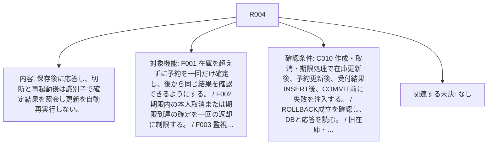

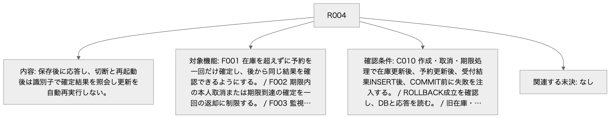

Mermaid: [local-R004.mmd](diagrams/local-R004.mmd) — 矢印は項目と条件の対応を示す。実行順序ではない。厳密な全文は同じ項目の表にある。

### R005

| 項目 | 内容 |
| --- | --- |
| 内容 | 画面で残数・予約状態・操作結果を分け、期限切れ後の取消を受け付けずキーボード操作を可能にする。 |
| 理由 | 共通仕様・対応する機能・確認条件へ具体化する。 |
| 根拠 | [S005](evidence.md#S005) — 画面は在庫数、予約の状態、操作結果を表示し、期限切れ後は取消を受け付けない。キーボードで予約・取消・結果照会を行える。 |
| 対象機能 | [F001](features.md#F001) — 在庫を超えずに予約を一回だけ確定し、後から同じ結果を確認できるようにする。 [F002](features.md#F002) — 期限内の本人取消または期限到達の確定を一回の返却に制限する。 [F004](features.md#F004) — 切断後の確定結果を識別子で読み、過去の操作と現在の在庫・予約を区別する。 |
| 確認条件 | [C013](verification.md#C013) — UI001をキーボードだけで操作し、在庫変化と入力不正・成功・切断を用意する。 / 予約・取消・結果照会・現在値更新と新しい操作への移行を行う。 / フォーカス順・エラー復帰・結果ライブ通知が機能し、sending多重送信を防ぐ。unknownは照会だけ、knownからは最新取得後readyへ進む。旧世代の読取応答で現在値を巻き戻さない。 [C014](verification.md#C014) — 作成成功の受付結果を残し、その予約を期限切れにする。他人のID・欠落ID・任意予約ID未指定の読取りも用意する。 / IF004とIF005を呼ぶ。 / IF004は元CREATED・activeを固定して返し、IF005は現在expiredと返却後残数を返す。終端結果をpendingにしない。他人の結果はNOT_RECORDED、他人/別備品予約はNOT_FOUND、任意予約ID欠落は在庫だけで予約各項目null、指定nullはINVALID_INPUTとなる。 |
| 関連する未決 | なし |
| 設計の状態 | designed |

[S005](evidence.md#S005)

> 画面は在庫数、予約の状態、操作結果を表示し、期限切れ後は取消を受け付けない。キーボードで予約・取消・結果照会を行える。

出典: [docs/requirement.md 7行目](/private/tmp/detailed-design-public-nu7gtxsu/docs/requirement.md:7:1)

#### R005 R005

矢印は項目と条件の対応を示す。実行順序ではない。厳密な全文は同じ項目の表にある。

Mermaidの記述を確認する

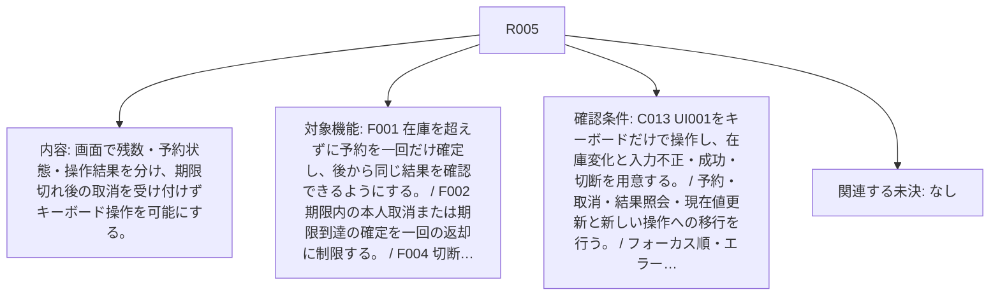

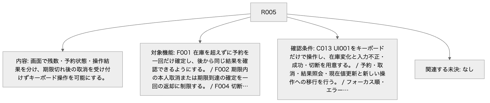

Mermaid: [local-R005.mmd](diagrams/local-R005.mmd) — 矢印は項目と条件の対応を示す。実行順序ではない。厳密な全文は同じ項目の表にある。

## checks

### C001

| 項目 | 内容 |
| --- | --- |
| 区分 | normal |
| 開始時の条件 | 在庫3、本人の新しい受付用識別子、quantity=2を用意する。 |
| 行う操作・発生する事象 | IF001で作成し、IF004とIF005を読む。 |
| 観測する結果 | CREATED、予約active、残数1、expires_at=created_at+10分、受付結果一件となる。保存済み共通応答と操作表示が一致する。 |
| 対象機能 | [F001](features.md#F001) — 在庫を超えずに予約を一回だけ確定し、後から同じ結果を確認できるようにする。 |
| 関連する未決 | [U001](evidence.md#U001) — PostgreSQL対象版・実装・実DBの原子性、競合、停止注入、負荷と移行は未検証である。外部サービスへの接続試験も今回実施していない。 / 全不変条件・返却一回・確定結果照会が観測値で一致し、期限監視の遅延と負荷の目標値を関係者が決定し実測が満たすことを採用条件とする。文書検査では代替しない。 / 検証: 開発側が対象版を記録し、C001〜C014、READ COMMITTEDの待機後再読、受付結果衝突の全ROLLBACK、時刻精度、DB回復、索引実行計画と移行失敗を隔離環境で試験する。外部サービスは採用する場合に別途接続契約を検証する。 |

#### C001 C001

矢印は確認の順序または停止後の回復判断を示す。省略した全文は同じ項目の表にある。

Mermaidの記述を確認する

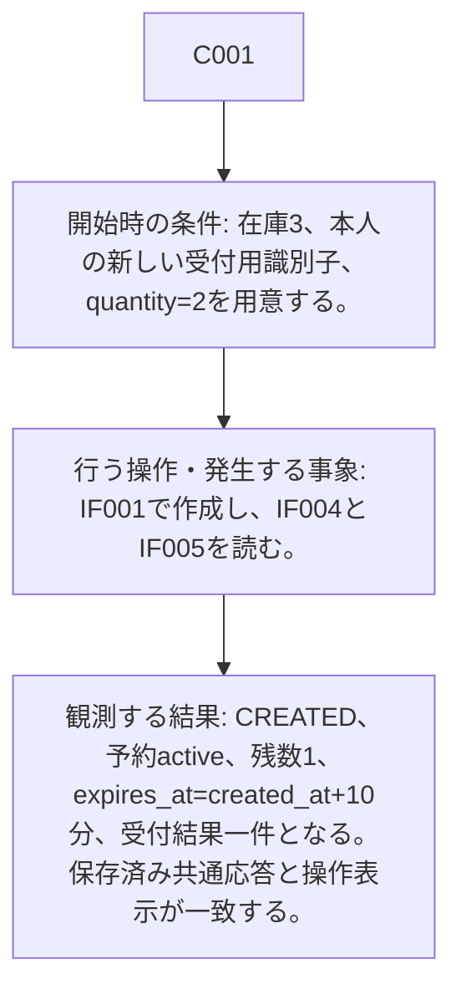

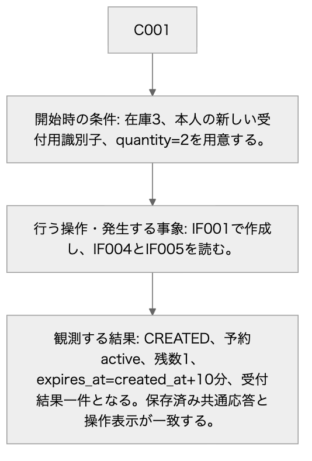

Mermaid: [local-C001.mmd](diagrams/local-C001.mmd) — 矢印は確認の順序または停止後の回復判断を示す。省略した全文は同じ項目の表にある。

### C002

| 項目 | 内容 |
| --- | --- |
| 区分 | boundary |
| 開始時の条件 | 数量0・1・1000000・1000001、小数・真偽値・文字列、UUID不正、必須欠落、null、未知/重複キー、4096/4097バイトの要求を用意する。 |
| 行う操作・発生する事象 | IF001とIF002を呼ぶ。 |
| 観測する結果 | 整数と範囲・サイズ・形を全て満たす要求だけが業務処理へ進む。不正はINVALID_INPUTまたはTOO_LARGE等で在庫・予約・受付結果を更新しない。欠落IDの応答request_idはnullであり欠落値を必須UUIDとして返さない。 |
| 対象機能 | [F001](features.md#F001) — 在庫を超えずに予約を一回だけ確定し、後から同じ結果を確認できるようにする。 |
| 関連する未決 | [U001](evidence.md#U001) — PostgreSQL対象版・実装・実DBの原子性、競合、停止注入、負荷と移行は未検証である。外部サービスへの接続試験も今回実施していない。 / 全不変条件・返却一回・確定結果照会が観測値で一致し、期限監視の遅延と負荷の目標値を関係者が決定し実測が満たすことを採用条件とする。文書検査では代替しない。 / 検証: 開発側が対象版を記録し、C001〜C014、READ COMMITTEDの待機後再読、受付結果衝突の全ROLLBACK、時刻精度、DB回復、索引実行計画と移行失敗を隔離環境で試験する。外部サービスは採用する場合に別途接続契約を検証する。 |

#### C002 C002

矢印は確認の順序または停止後の回復判断を示す。省略した全文は同じ項目の表にある。

Mermaidの記述を確認する

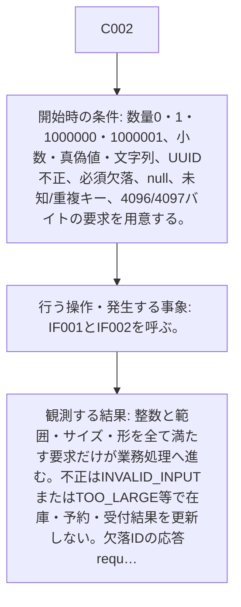

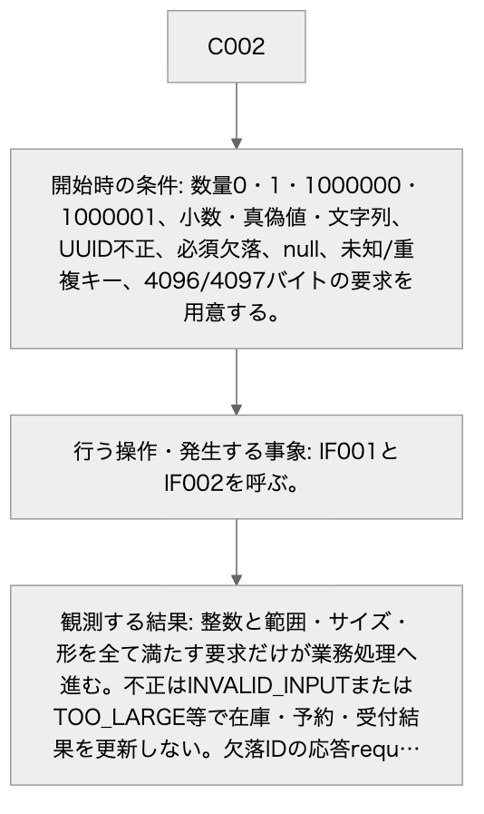

Mermaid: [local-C002.mmd](diagrams/local-C002.mmd) — 矢印は確認の順序または停止後の回復判断を示す。省略した全文は同じ項目の表にある。

### C003

| 項目 | 内容 |
| --- | --- |
| 区分 | race |
| 開始時の条件 | 同じ備品のavailable=1と異なる受付識別子二つを用意する。 |
| 行う操作・発生する事象 | quantity=1の作成を同期して同時到着させる。 |
| 観測する結果 | CREATEDは一件、他方NO_STOCK、available=0、active合計=1となる。二件の受付結果を記録し、負在庫と二重引当を生じない。 |
| 対象機能 | [F001](features.md#F001) — 在庫を超えずに予約を一回だけ確定し、後から同じ結果を確認できるようにする。 |
| 関連する未決 | [U001](evidence.md#U001) — PostgreSQL対象版・実装・実DBの原子性、競合、停止注入、負荷と移行は未検証である。外部サービスへの接続試験も今回実施していない。 / 全不変条件・返却一回・確定結果照会が観測値で一致し、期限監視の遅延と負荷の目標値を関係者が決定し実測が満たすことを採用条件とする。文書検査では代替しない。 / 検証: 開発側が対象版を記録し、C001〜C014、READ COMMITTEDの待機後再読、受付結果衝突の全ROLLBACK、時刻精度、DB回復、索引実行計画と移行失敗を隔離環境で試験する。外部サービスは採用する場合に別途接続契約を検証する。 |

#### C003 C003

矢印は確認の順序または停止後の回復判断を示す。省略した全文は同じ項目の表にある。

Mermaidの記述を確認する

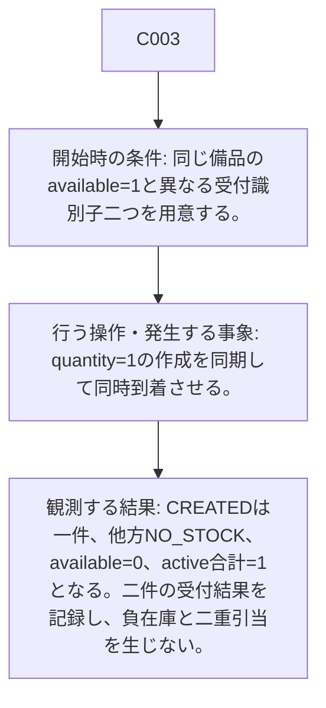

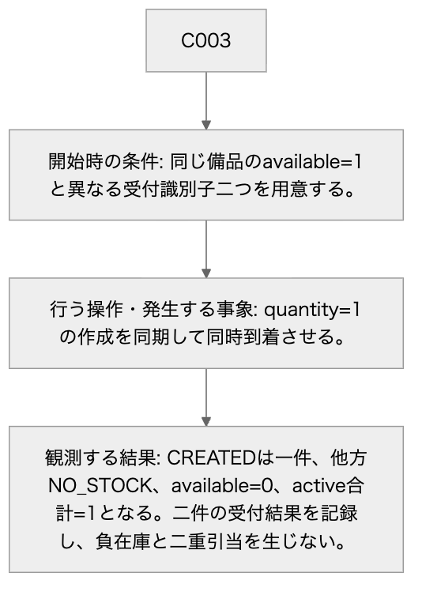

Mermaid: [local-C003.mmd](diagrams/local-C003.mmd) — 矢印は確認の順序または停止後の回復判断を示す。省略した全文は同じ項目の表にある。

### C004

| 項目 | 内容 |
| --- | --- |
| 区分 | boundary |
| 開始時の条件 | active予約の期限をTとし、ロック後に採る判定時刻をT-1マイクロ秒に固定できる試験構成とする。 |
| 行う操作・発生する事象 | 本人がIF002で取消する。 |
| 観測する結果 | TR002でcancelled、一回だけquantityを返却しCANCELLEDを記録する。ended_at<Tであり受付結果・在庫・状態が同時確定する。 |
| 対象機能 | [F002](features.md#F002) — 期限内の本人取消または期限到達の確定を一回の返却に制限する。 |
| 関連する未決 | [U001](evidence.md#U001) — PostgreSQL対象版・実装・実DBの原子性、競合、停止注入、負荷と移行は未検証である。外部サービスへの接続試験も今回実施していない。 / 全不変条件・返却一回・確定結果照会が観測値で一致し、期限監視の遅延と負荷の目標値を関係者が決定し実測が満たすことを採用条件とする。文書検査では代替しない。 / 検証: 開発側が対象版を記録し、C001〜C014、READ COMMITTEDの待機後再読、受付結果衝突の全ROLLBACK、時刻精度、DB回復、索引実行計画と移行失敗を隔離環境で試験する。外部サービスは採用する場合に別途接続契約を検証する。 |

#### C004 C004

矢印は確認の順序または停止後の回復判断を示す。省略した全文は同じ項目の表にある。

Mermaidの記述を確認する

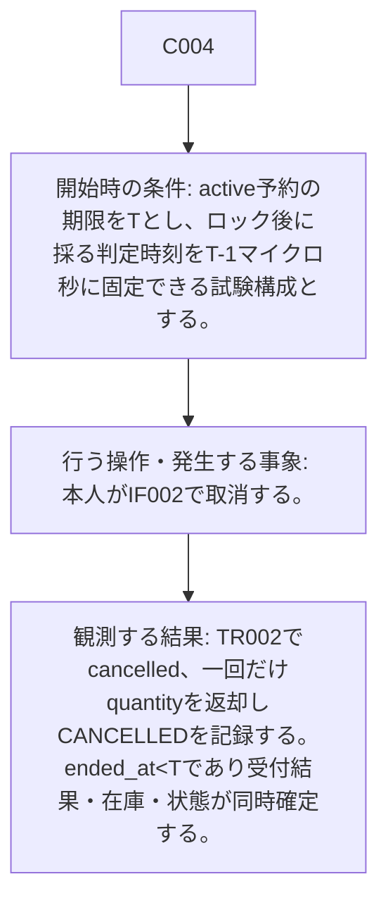

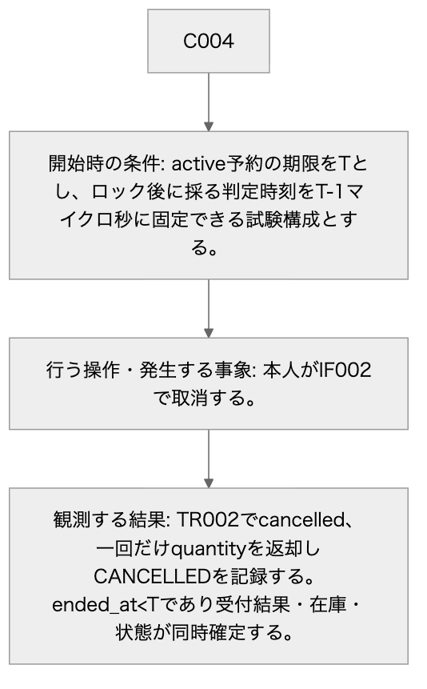

Mermaid: [local-C004.mmd](diagrams/local-C004.mmd) — 矢印は確認の順序または停止後の回復判断を示す。省略した全文は同じ項目の表にある。

### C005

| 項目 | 内容 |
| --- | --- |
| 区分 | boundary |
| 開始時の条件 | active予約の期限T、監視遅延、判定時刻TとT+1マイクロ秒の二条件を用意する。 |
| 行う操作・発生する事象 | IF002またはIF003を呼び、後で同じ予約を再処理する。 |
| 観測する結果 | どちらもTR003でexpiredと一回返却になる。取消の応答はEXPIRED、監視はappliedであり、次回はterminal/no_opで二回目の返却がない。 |
| 対象機能 | [F002](features.md#F002) — 期限内の本人取消または期限到達の確定を一回の返却に制限する。 [F003](features.md#F003) — 監視遅延や再起動があっても期限切れの引当を一回だけ解放する。 |
| 関連する未決 | [U001](evidence.md#U001) — PostgreSQL対象版・実装・実DBの原子性、競合、停止注入、負荷と移行は未検証である。外部サービスへの接続試験も今回実施していない。 / 全不変条件・返却一回・確定結果照会が観測値で一致し、期限監視の遅延と負荷の目標値を関係者が決定し実測が満たすことを採用条件とする。文書検査では代替しない。 / 検証: 開発側が対象版を記録し、C001〜C014、READ COMMITTEDの待機後再読、受付結果衝突の全ROLLBACK、時刻精度、DB回復、索引実行計画と移行失敗を隔離環境で試験する。外部サービスは採用する場合に別途接続契約を検証する。 |

#### C005 C005

矢印は確認の順序または停止後の回復判断を示す。省略した全文は同じ項目の表にある。

Mermaidの記述を確認する

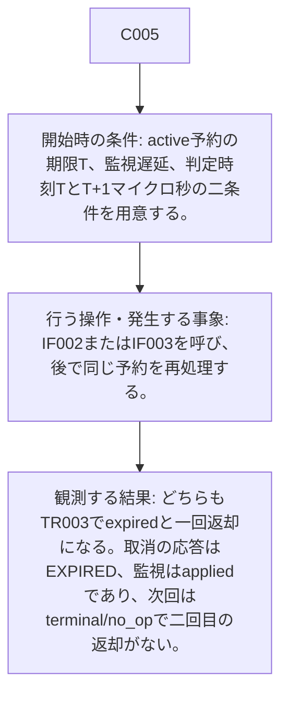

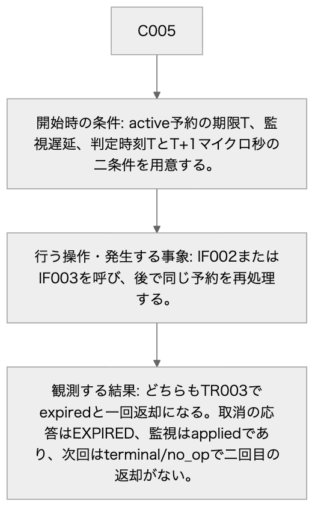

Mermaid: [local-C005.mmd](diagrams/local-C005.mmd) — 矢印は確認の順序または停止後の回復判断を示す。省略した全文は同じ項目の表にある。

### C006

| 項目 | 内容 |
| --- | --- |
| 区分 | race |
| 開始時の条件 | active予約に本人取消二件と期限処理を用意し、期限直前・等号・直後を制御する。 |
| 行う操作・発生する事象 | 全処理を同時開始し備品ロック待機を注入する。 |
| 観測する結果 | ロック取得後の時刻で勝敗が決まり、期限前に確定した取消だけcancelled、期限到達ならexpiredとなる。available増分はquantity一回、version増分一回で終端を覆さない。待機前時刻を使わない。 |
| 対象機能 | [F002](features.md#F002) — 期限内の本人取消または期限到達の確定を一回の返却に制限する。 [F003](features.md#F003) — 監視遅延や再起動があっても期限切れの引当を一回だけ解放する。 |
| 関連する未決 | [U001](evidence.md#U001) — PostgreSQL対象版・実装・実DBの原子性、競合、停止注入、負荷と移行は未検証である。外部サービスへの接続試験も今回実施していない。 / 全不変条件・返却一回・確定結果照会が観測値で一致し、期限監視の遅延と負荷の目標値を関係者が決定し実測が満たすことを採用条件とする。文書検査では代替しない。 / 検証: 開発側が対象版を記録し、C001〜C014、READ COMMITTEDの待機後再読、受付結果衝突の全ROLLBACK、時刻精度、DB回復、索引実行計画と移行失敗を隔離環境で試験する。外部サービスは採用する場合に別途接続契約を検証する。 |

#### C006 C006

矢印は確認の順序または停止後の回復判断を示す。省略した全文は同じ項目の表にある。

Mermaidの記述を確認する

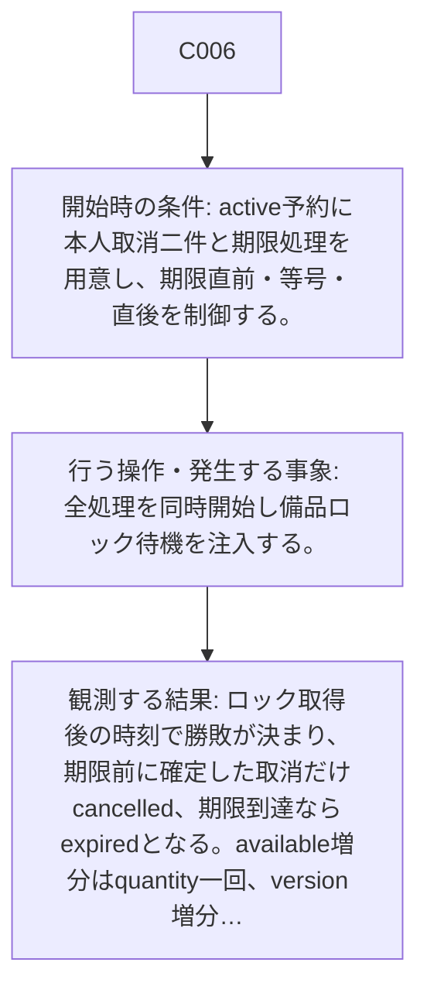

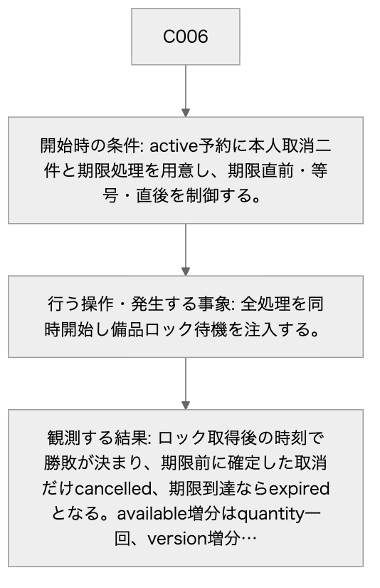

Mermaid: [local-C006.mmd](diagrams/local-C006.mmd) — 矢印は確認の順序または停止後の回復判断を示す。省略した全文は同じ項目の表にある。

### C007

| 項目 | 内容 |
| --- | --- |
| 区分 | restart |
| 開始時の条件 | 期限到達activeを含む複数予約と監視停止・再起動を用意する。 |
| 行う操作・発生する事象 | 監視を止め期限を越え、起動時に候補を最大100件ずつ処理する。 |
| 観測する結果 | 期限到達activeは返却まで処理待ち表示となり取消受付は期限再検査でEXPIREDとなる。各予約の返却一回と不変条件を保ち、候補が次の走査で消失しない。 |
| 対象機能 | [F003](features.md#F003) — 監視遅延や再起動があっても期限切れの引当を一回だけ解放する。 |
| 関連する未決 | [U001](evidence.md#U001) — PostgreSQL対象版・実装・実DBの原子性、競合、停止注入、負荷と移行は未検証である。外部サービスへの接続試験も今回実施していない。 / 全不変条件・返却一回・確定結果照会が観測値で一致し、期限監視の遅延と負荷の目標値を関係者が決定し実測が満たすことを採用条件とする。文書検査では代替しない。 / 検証: 開発側が対象版を記録し、C001〜C014、READ COMMITTEDの待機後再読、受付結果衝突の全ROLLBACK、時刻精度、DB回復、索引実行計画と移行失敗を隔離環境で試験する。外部サービスは採用する場合に別途接続契約を検証する。 |

#### C007 C007

矢印は確認の順序または停止後の回復判断を示す。省略した全文は同じ項目の表にある。

Mermaidの記述を確認する

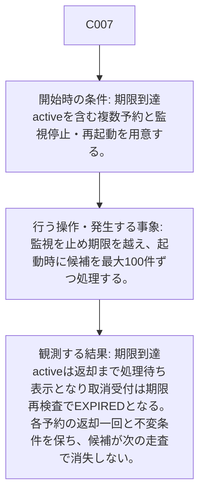

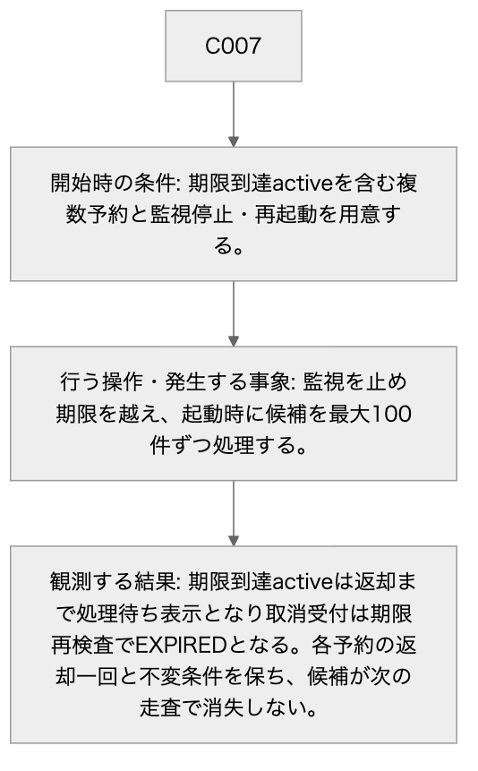

Mermaid: [local-C007.mmd](diagrams/local-C007.mmd) — 矢印は確認の順序または停止後の回復判断を示す。省略した全文は同じ項目の表にある。

### C008

| 項目 | 内容 |
| --- | --- |
| 区分 | race |
| 開始時の条件 | 同一owner_id+request_idで同じ作成内容または同じ取消内容を二件用意する。 |
| 行う操作・発生する事象 | 同時に送信し、受付結果最終INSERTの前後で待機を注入する。 |
| 観測する結果 | 共通応答は一つの保存結果に一致し、作成予約は一件、取消返却は一回である。仮更新敗者は全ROLLBACKし、再送で期限を延ばさない。 |
| 対象機能 | [F001](features.md#F001) — 在庫を超えずに予約を一回だけ確定し、後から同じ結果を確認できるようにする。 [F002](features.md#F002) — 期限内の本人取消または期限到達の確定を一回の返却に制限する。 |
| 関連する未決 | [U001](evidence.md#U001) — PostgreSQL対象版・実装・実DBの原子性、競合、停止注入、負荷と移行は未検証である。外部サービスへの接続試験も今回実施していない。 / 全不変条件・返却一回・確定結果照会が観測値で一致し、期限監視の遅延と負荷の目標値を関係者が決定し実測が満たすことを採用条件とする。文書検査では代替しない。 / 検証: 開発側が対象版を記録し、C001〜C014、READ COMMITTEDの待機後再読、受付結果衝突の全ROLLBACK、時刻精度、DB回復、索引実行計画と移行失敗を隔離環境で試験する。外部サービスは採用する場合に別途接続契約を検証する。 |

#### C008 C008

矢印は確認の順序または停止後の回復判断を示す。省略した全文は同じ項目の表にある。

Mermaidの記述を確認する

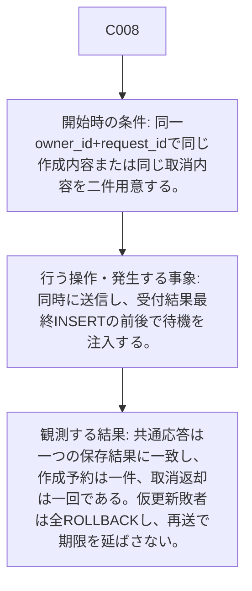

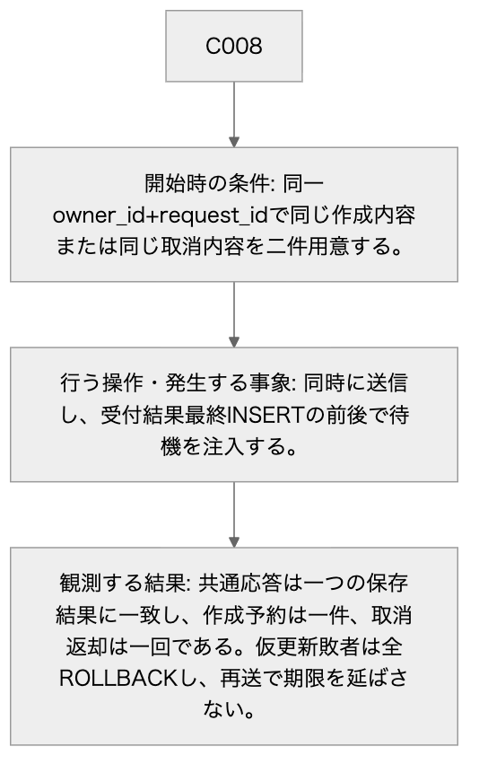

Mermaid: [local-C008.mmd](diagrams/local-C008.mmd) — 矢印は確認の順序または停止後の回復判断を示す。省略した全文は同じ項目の表にある。

### C009

| 項目 | 内容 |
| --- | --- |
| 区分 | race |
| 開始時の条件 | 同一受付識別子で異なるquantity・item_id・操作種別を用意する。既存結果ありと未登録の同時到着を分ける。 |
| 行う操作・発生する事象 | IF001/IF002を競合させる。 |
| 観測する結果 | 勝者の結果だけが固定され、相違側はID_CONFLICT、相違側の在庫・予約仮更新は全て戻る。別ownerの同じIDは独立し情報を漏らさない。 |
| 対象機能 | [F001](features.md#F001) — 在庫を超えずに予約を一回だけ確定し、後から同じ結果を確認できるようにする。 [F002](features.md#F002) — 期限内の本人取消または期限到達の確定を一回の返却に制限する。 |
| 関連する未決 | [U001](evidence.md#U001) — PostgreSQL対象版・実装・実DBの原子性、競合、停止注入、負荷と移行は未検証である。外部サービスへの接続試験も今回実施していない。 / 全不変条件・返却一回・確定結果照会が観測値で一致し、期限監視の遅延と負荷の目標値を関係者が決定し実測が満たすことを採用条件とする。文書検査では代替しない。 / 検証: 開発側が対象版を記録し、C001〜C014、READ COMMITTEDの待機後再読、受付結果衝突の全ROLLBACK、時刻精度、DB回復、索引実行計画と移行失敗を隔離環境で試験する。外部サービスは採用する場合に別途接続契約を検証する。 |

[IF001](interfaces.md#IF001)

> 同じrequest_idと正規化内容を受付・サービス・保存で引き継ぐ。内部の数量を再生成しない。 / 応答候補の全項目を返す。確定した業務結果だけを保存し、コミット結果不明を保存済み拒否に変えない。 / CREATED、NO_STOCK、NOT_FOUND、VERSION_LIMIT、INVALID_INPUT、TOO_LARGE、UNSUPPORTED_MEDIA、UNAUTHENTICATED、FORBIDDEN、ID_CONFLICT、SAVE_FAILED、COMMIT_UNKNOWNを共通応答のcodeで判別する。 / 入力: context.owner_id: string(uuid) 必須 NULL不可, サーバー認証で確定した利用者。クライアントからの指定を許可しない。 / body.request_id: string(uuid) 必須 NULL不可, 小文字ハイフン付きUUID正規形36文字。異なる世代の操作に再利用しない。 / body.item_id: string(uuid) 必須 NULL不可, 登録済み備品ID。 / body.quantity: integer 必須 NULL不可, 1〜1000000の整数。 / 応答: created: 201 CREATED。新しい予約と在庫・受付結果のCOMMITを確認した応答でありdurable=trueとする。 (request_id: string(uuid) or null 必須 NULL可, 妥当な識別子を受理済みならその値を返す。欠落・不正・識別前の拒否ではnullとする。; code: string 必須 NULL不可, CREATEDだけを返す。; message: string 必須 NULL不可, 1〜200 Unicode文字かつUTF-8で800バイト以下。利用者向け理由を返し内部例外は含めない。; reservation_id: string(uuid) or null 必須 NULL可, 予約に結び付く確定結果ではそのID、それ以外はnullとする。; state_at_result: string or null 必須 NULL可, 結果確定時のactive・cancelled・expired。予約がない拒否・保存不成立・確定不明はnullとする。; expires_at: string(datetime) or null 必須 NULL可, 予約に結び付く結果では共通UTC形式、それ以外はnullとする。; available_at_result: integer or null 必須 NULL可, 0〜1000000000。保存単位で取得した残数。備品がない場合、入力拒否、保存不成立、確定不明はnullとする。; result_at: string(datetime) or null 必須 NULL可, durable=trueの確定結果では共通UTC形式の確定判断時刻、durable=falseではnullとする。COMMIT完了時刻と同一とは限らない。; durable: boolean 必須 NULL不可, T003へCOMMITした応答はtrue、入力拒否・ID_CONFLICT・SAVE_FAILED・COMMIT_UNKNOWN等の非保存応答はfalseとする。) / replay: 保存済み結果と同じHTTP状態・共通応答を返す。CREATED、NO_STOCK、NOT_FOUND、VERSION_LIMITの元コードを変更しない。 (request_id: string(uuid) or null 必須 NULL可, 妥当な識別子を受理済みならその値を返す。欠落・不正・識別前の拒否ではnullとする。; code: string 必須 NULL不可, CREATED、NO_STOCK、NOT_FOUND、VERSION_LIMITだけを返す。; message: string 必須 NULL不可, 1〜200 Unicode文字かつUTF-8で800バイト以下。利用者向け理由を返し内部例外は含めない。; reservation_id: string(uuid) or null 必須 NULL可, 予約に結び付く確定結果ではそのID、それ以外はnullとする。; state_at_result: string or null 必須 NULL可, 結果確定時のactive・cancelled・expired。予約がない拒否・保存不成立・確定不明はnullとする。; expires_at: string(datetime) or null 必須 NULL可, 予約に結び付く結果では共通UTC形式、それ以外はnullとする。; available_at_result: integer or null 必須 NULL可, 0〜1000000000。保存単位で取得した残数。備品がない場合、入力拒否、保存不成立、確定不明はnullとする。; result_at: string(datetime) or null 必須 NULL可, durable=trueの確定結果では共通UTC形式の確定判断時刻、durable=falseではnullとする。COMMIT完了時刻と同一とは限らない。; durable: boolean 必須 NULL不可, T003へCOMMITした応答はtrue、入力拒否・ID_CONFLICT・SAVE_FAILED・COMMIT_UNKNOWN等の非保存応答はfalseとする。) / rejected: 400 INVALID_INPUT、413 TOO_LARGE、415 UNSUPPORTED_MEDIA、401 UNAUTHENTICATED、403 FORBIDDEN、404 NOT_FOUND、409 ID_CONFLICT、503 SAVE_FAILED、503 VERSION_LIMITとする。SAVE_FAILEDはROLLBACK確認済みに限る。NOT_FOUNDとVERSION_LIMITの有効要求はdurable=trueとして記録し、それ以外の事前拒否はfalseとする。 在庫不足は409 NO_STOCK、durable=trueとする。 (request_id: string(uuid) or null 必須 NULL可, 妥当な識別子を受理済みならその値を返す。欠落・不正・識別前の拒否ではnullとする。; code: string 必須 NULL不可, INVALID_INPUT、TOO_LARGE、UNSUPPORTED_MEDIA、UNAUTHENTICATED、FORBIDDEN、NOT_FOUND、ID_CONFLICT、SAVE_FAILED、VERSION_LIMIT、NO_STOCKだけを返す。; message: string 必須 NULL不可, 1〜200 Unicode文字かつUTF-8で800バイト以下。利用者向け理由を返し内部例外は含めない。; reservation_id: string(uuid) or null 必須 NULL可, 予約に結び付く確定結果ではそのID、それ以外はnullとする。; state_at_result: string or null 必須 NULL可, 結果確定時のactive・cancelled・expired。予約がない拒否・保存不成立・確定不明はnullとする。; expires_at: string(datetime) or null 必須 NULL可, 予約に結び付く結果では共通UTC形式、それ以外はnullとする。; available_at_result: integer or null 必須 NULL可, 0〜1000000000。保存単位で取得した残数。備品がない場合、入力拒否、保存不成立、確定不明はnullとする。; result_at: string(datetime) or null 必須 NULL可, durable=trueの確定結果では共通UTC形式の確定判断時刻、durable=falseではnullとする。COMMIT完了時刻と同一とは限らない。; durable: boolean 必須 NULL不可, T003へCOMMITした応答はtrue、入力拒否・ID_CONFLICT・SAVE_FAILED・COMMIT_UNKNOWN等の非保存応答はfalseとする。) / unconfirmed: 503 COMMIT_UNKNOWN。結果が不明でありdurable=false、予約・状態・期限・残数・result_atはnullとする。応答不能ならHTTP応答はなく、画面が切断からunknownへ進む。 (request_id: string(uuid) or null 必須 NULL可, 妥当な識別子を受理済みならその値を返す。欠落・不正・識別前の拒否ではnullとする。; code: string 必須 NULL不可, COMMIT_UNKNOWNだけを返す。; message: string 必須 NULL不可, 1〜200 Unicode文字かつUTF-8で800バイト以下。利用者向け理由を返し内部例外は含めない。; reservation_id: string(uuid) or null 必須 NULL可, 予約に結び付く確定結果ではそのID、それ以外はnullとする。; state_at_result: string or null 必須 NULL可, 結果確定時のactive・cancelled・expired。予約がない拒否・保存不成立・確定不明はnullとする。; expires_at: string(datetime) or null 必須 NULL可, 予約に結び付く結果では共通UTC形式、それ以外はnullとする。; available_at_result: integer or null 必須 NULL可, 0〜1000000000。保存単位で取得した残数。備品がない場合、入力拒否、保存不成立、確定不明はnullとする。; result_at: string(datetime) or null 必須 NULL可, durable=trueの確定結果では共通UTC形式の確定判断時刻、durable=falseではnullとする。COMMIT完了時刻と同一とは限らない。; durable: boolean 必須 NULL不可, T003へCOMMITした応答はtrue、入力拒否・ID_CONFLICT・SAVE_FAILED・COMMIT_UNKNOWN等の非保存応答はfalseとする。) / 最大サイズ: 要求本文4096バイト以下、応答8192バイト以下とする。HTTPパスとヘッダーは合計2048バイト以下とする提案である。

#### C009 C009

矢印は確認の順序または停止後の回復判断を示す。省略した全文は同じ項目の表にある。

Mermaidの記述を確認する

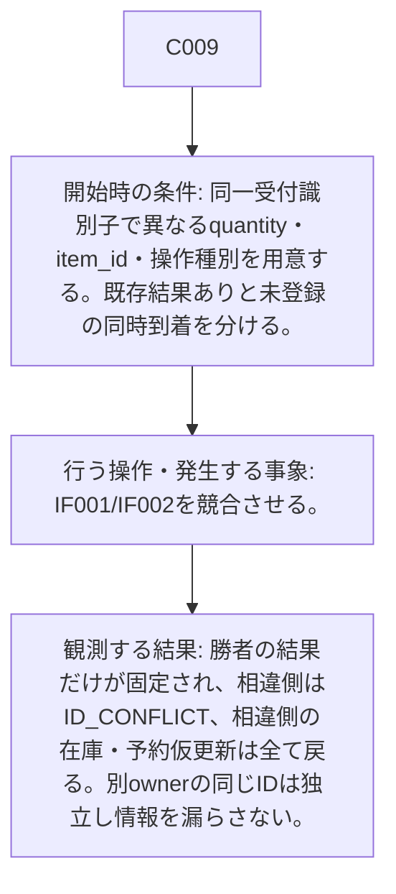

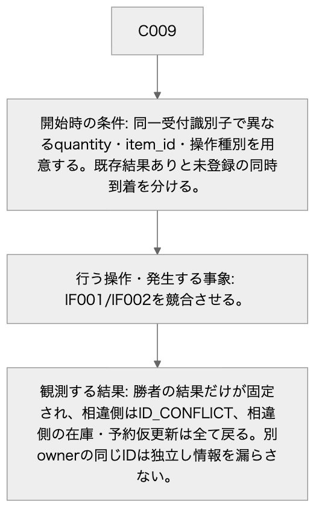

Mermaid: [local-C009.mmd](diagrams/local-C009.mmd) — 矢印は確認の順序または停止後の回復判断を示す。省略した全文は同じ項目の表にある。

### C010

| 項目 | 内容 |
| --- | --- |
| 区分 | error |
| 開始時の条件 | 作成・取消・期限処理で在庫更新後、予約更新後、受付結果INSERT後、COMMIT前に失敗を注入する。 |
| 行う操作・発生する事象 | ROLLBACK成立を確認し、DBと応答を読む。 |
| 観測する結果 | 旧在庫・旧状態・旧受付結果を保ちSAVE_FAILEDを返す。新規予約や返却だけが残らない。version上限では更新しない。作成・取消はVERSION_LIMITの受付結果を記録し、期限処理はVERSION_LIMITのfailedを返して監視に残す。実行前検査拒否と保存不成立を区別する。 |
| 対象機能 | [F001](features.md#F001) — 在庫を超えずに予約を一回だけ確定し、後から同じ結果を確認できるようにする。 [F002](features.md#F002) — 期限内の本人取消または期限到達の確定を一回の返却に制限する。 [F003](features.md#F003) — 監視遅延や再起動があっても期限切れの引当を一回だけ解放する。 |
| 関連する未決 | [U001](evidence.md#U001) — PostgreSQL対象版・実装・実DBの原子性、競合、停止注入、負荷と移行は未検証である。外部サービスへの接続試験も今回実施していない。 / 全不変条件・返却一回・確定結果照会が観測値で一致し、期限監視の遅延と負荷の目標値を関係者が決定し実測が満たすことを採用条件とする。文書検査では代替しない。 / 検証: 開発側が対象版を記録し、C001〜C014、READ COMMITTEDの待機後再読、受付結果衝突の全ROLLBACK、時刻精度、DB回復、索引実行計画と移行失敗を隔離環境で試験する。外部サービスは採用する場合に別途接続契約を検証する。 |

#### C010 C010

矢印は確認の順序または停止後の回復判断を示す。省略した全文は同じ項目の表にある。

Mermaidの記述を確認する

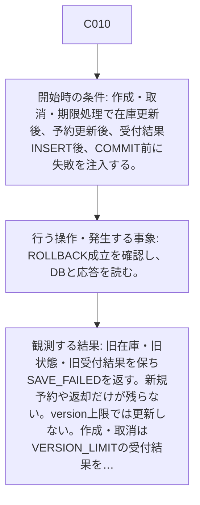

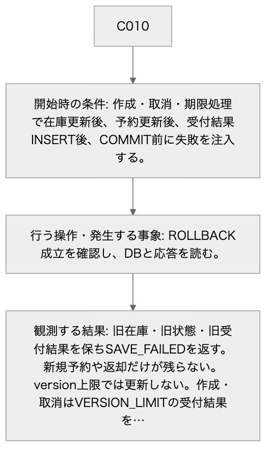

Mermaid: [local-C010.mmd](diagrams/local-C010.mmd) — 矢印は確認の順序または停止後の回復判断を示す。省略した全文は同じ項目の表にある。

### C011

| 項目 | 内容 |
| --- | --- |
| 区分 | restart |
| 開始時の条件 | 作成と取消のCOMMIT送信中、COMMIT後応答前、応答受信後の各切断位置とブラウザ再読込みを用意する。 |
| 行う操作・発生する事象 | 元request_idでIF004を繰り返し読み、IF005も読む。 |
| 観測する結果 | 確定済みならfoundの元結果が一致しunknown→known、未記録/照会失敗ならunknownを保つ。送信中切断を旧状態維持と断定しない。作成・取消の自動再実行が0回であり、現在値だけで元操作の成功を断定しない。 |
| 対象機能 | [F001](features.md#F001) — 在庫を超えずに予約を一回だけ確定し、後から同じ結果を確認できるようにする。 [F002](features.md#F002) — 期限内の本人取消または期限到達の確定を一回の返却に制限する。 [F004](features.md#F004) — 切断後の確定結果を識別子で読み、過去の操作と現在の在庫・予約を区別する。 |
| 関連する未決 | [U001](evidence.md#U001) — PostgreSQL対象版・実装・実DBの原子性、競合、停止注入、負荷と移行は未検証である。外部サービスへの接続試験も今回実施していない。 / 全不変条件・返却一回・確定結果照会が観測値で一致し、期限監視の遅延と負荷の目標値を関係者が決定し実測が満たすことを採用条件とする。文書検査では代替しない。 / 検証: 開発側が対象版を記録し、C001〜C014、READ COMMITTEDの待機後再読、受付結果衝突の全ROLLBACK、時刻精度、DB回復、索引実行計画と移行失敗を隔離環境で試験する。外部サービスは採用する場合に別途接続契約を検証する。 |

#### C011 C011

矢印は確認の順序または停止後の回復判断を示す。省略した全文は同じ項目の表にある。

Mermaidの記述を確認する

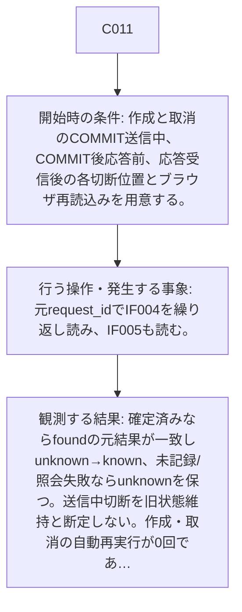

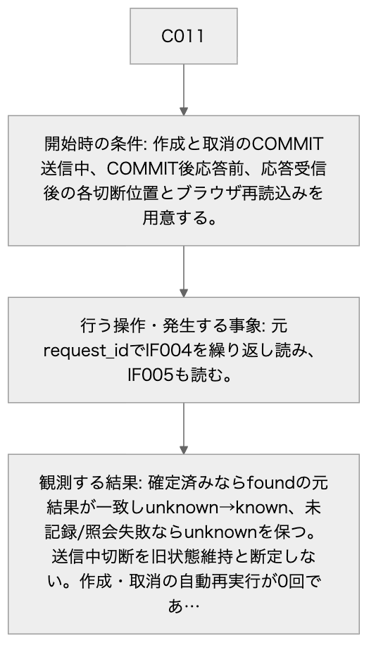

Mermaid: [local-C011.mmd](diagrams/local-C011.mmd) — 矢印は確認の順序または停止後の回復判断を示す。省略した全文は同じ項目の表にある。

### C012

| 項目 | 内容 |
| --- | --- |
| 区分 | restart |
| 開始時の条件 | 期限処理のCOMMIT直前と直後で停止し、結果不明も作る。 |
| 行う操作・発生する事象 | 保存済み予約を再読して監視を再起動する。 |
| 観測する結果 | activeなら条件を再検査し一回返却、expired/cancelledならno_opである。結果照会/現在値読取りは副作用0回、availableの逆補正をしない。 |
| 対象機能 | [F003](features.md#F003) — 監視遅延や再起動があっても期限切れの引当を一回だけ解放する。 [F004](features.md#F004) — 切断後の確定結果を識別子で読み、過去の操作と現在の在庫・予約を区別する。 |
| 関連する未決 | [U001](evidence.md#U001) — PostgreSQL対象版・実装・実DBの原子性、競合、停止注入、負荷と移行は未検証である。外部サービスへの接続試験も今回実施していない。 / 全不変条件・返却一回・確定結果照会が観測値で一致し、期限監視の遅延と負荷の目標値を関係者が決定し実測が満たすことを採用条件とする。文書検査では代替しない。 / 検証: 開発側が対象版を記録し、C001〜C014、READ COMMITTEDの待機後再読、受付結果衝突の全ROLLBACK、時刻精度、DB回復、索引実行計画と移行失敗を隔離環境で試験する。外部サービスは採用する場合に別途接続契約を検証する。 |

#### C012 C012

矢印は確認の順序または停止後の回復判断を示す。省略した全文は同じ項目の表にある。

Mermaidの記述を確認する

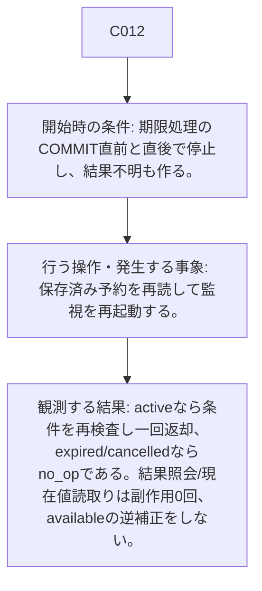

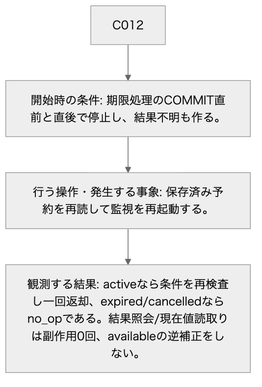

Mermaid: [local-C012.mmd](diagrams/local-C012.mmd) — 矢印は確認の順序または停止後の回復判断を示す。省略した全文は同じ項目の表にある。

### C013

| 項目 | 内容 |
| --- | --- |
| 区分 | normal |
| 開始時の条件 | UI001をキーボードだけで操作し、在庫変化と入力不正・成功・切断を用意する。 |
| 行う操作・発生する事象 | 予約・取消・結果照会・現在値更新と新しい操作への移行を行う。 |
| 観測する結果 | フォーカス順・エラー復帰・結果ライブ通知が機能し、sending多重送信を防ぐ。unknownは照会だけ、knownからは最新取得後readyへ進む。旧世代の読取応答で現在値を巻き戻さない。 |
| 対象機能 | [F001](features.md#F001) — 在庫を超えずに予約を一回だけ確定し、後から同じ結果を確認できるようにする。 [F002](features.md#F002) — 期限内の本人取消または期限到達の確定を一回の返却に制限する。 [F004](features.md#F004) — 切断後の確定結果を識別子で読み、過去の操作と現在の在庫・予約を区別する。 |
| 関連する未決 | [U001](evidence.md#U001) — PostgreSQL対象版・実装・実DBの原子性、競合、停止注入、負荷と移行は未検証である。外部サービスへの接続試験も今回実施していない。 / 全不変条件・返却一回・確定結果照会が観測値で一致し、期限監視の遅延と負荷の目標値を関係者が決定し実測が満たすことを採用条件とする。文書検査では代替しない。 / 検証: 開発側が対象版を記録し、C001〜C014、READ COMMITTEDの待機後再読、受付結果衝突の全ROLLBACK、時刻精度、DB回復、索引実行計画と移行失敗を隔離環境で試験する。外部サービスは採用する場合に別途接続契約を検証する。 [U002](evidence.md#U002) — 認証方式・権限の供給とHTTP/画面実装は未確認である。 / 利用者が他人の予約・結果を読書きできず、期限・状態・操作結果とフォーカスがUI001と一致することを採用条件とする。 / 検証: owner_idとworker_roleの信頼境界、本人以外の照会拒否、JSONとNULLの写像、キーボード・ライブ領域・sessionStorage復元とログアウトを実装で試験する。外部認証サービスへは接続していない。 |

#### C013 C013

矢印は確認の順序または停止後の回復判断を示す。省略した全文は同じ項目の表にある。

Mermaidの記述を確認する

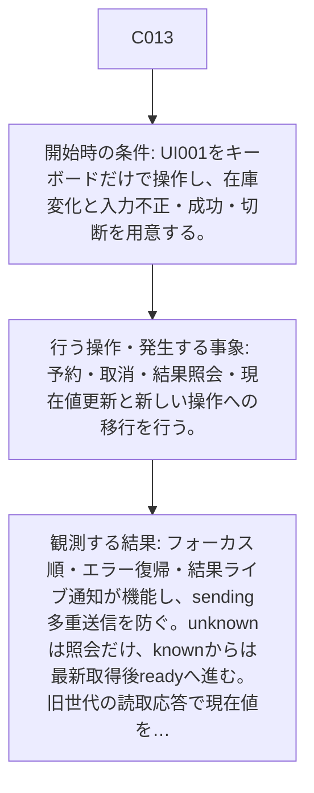

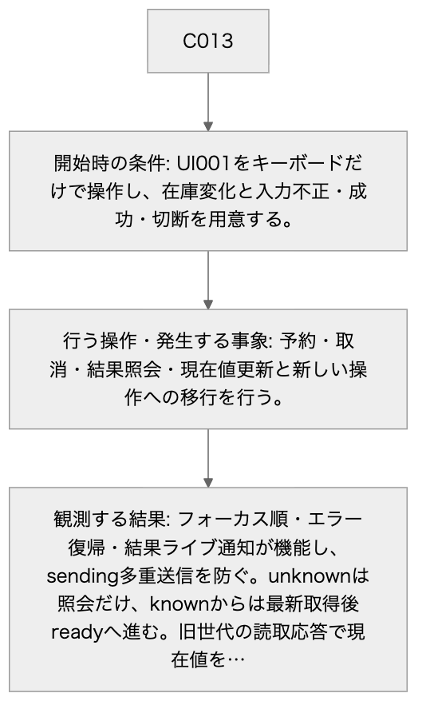

Mermaid: [local-C013.mmd](diagrams/local-C013.mmd) — 矢印は確認の順序または停止後の回復判断を示す。省略した全文は同じ項目の表にある。

### C014

| 項目 | 内容 |
| --- | --- |
| 区分 | boundary |
| 開始時の条件 | 作成成功の受付結果を残し、その予約を期限切れにする。他人のID・欠落ID・任意予約ID未指定の読取りも用意する。 |
| 行う操作・発生する事象 | IF004とIF005を呼ぶ。 |
| 観測する結果 | IF004は元CREATED・activeを固定して返し、IF005は現在expiredと返却後残数を返す。終端結果をpendingにしない。他人の結果はNOT_RECORDED、他人/別備品予約はNOT_FOUND、任意予約ID欠落は在庫だけで予約各項目null、指定nullはINVALID_INPUTとなる。 |
| 対象機能 | [F002](features.md#F002) — 期限内の本人取消または期限到達の確定を一回の返却に制限する。 [F004](features.md#F004) — 切断後の確定結果を識別子で読み、過去の操作と現在の在庫・予約を区別する。 |
| 関連する未決 | [U001](evidence.md#U001) — PostgreSQL対象版・実装・実DBの原子性、競合、停止注入、負荷と移行は未検証である。外部サービスへの接続試験も今回実施していない。 / 全不変条件・返却一回・確定結果照会が観測値で一致し、期限監視の遅延と負荷の目標値を関係者が決定し実測が満たすことを採用条件とする。文書検査では代替しない。 / 検証: 開発側が対象版を記録し、C001〜C014、READ COMMITTEDの待機後再読、受付結果衝突の全ROLLBACK、時刻精度、DB回復、索引実行計画と移行失敗を隔離環境で試験する。外部サービスは採用する場合に別途接続契約を検証する。 |

#### C014 C014

矢印は確認の順序または停止後の回復判断を示す。省略した全文は同じ項目の表にある。

Mermaidの記述を確認する

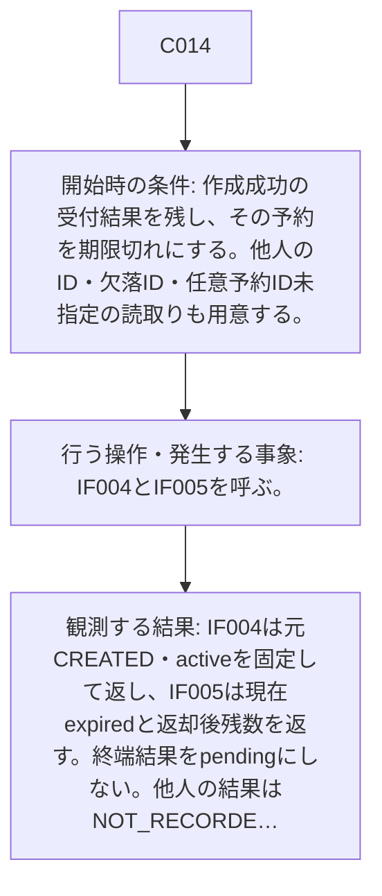

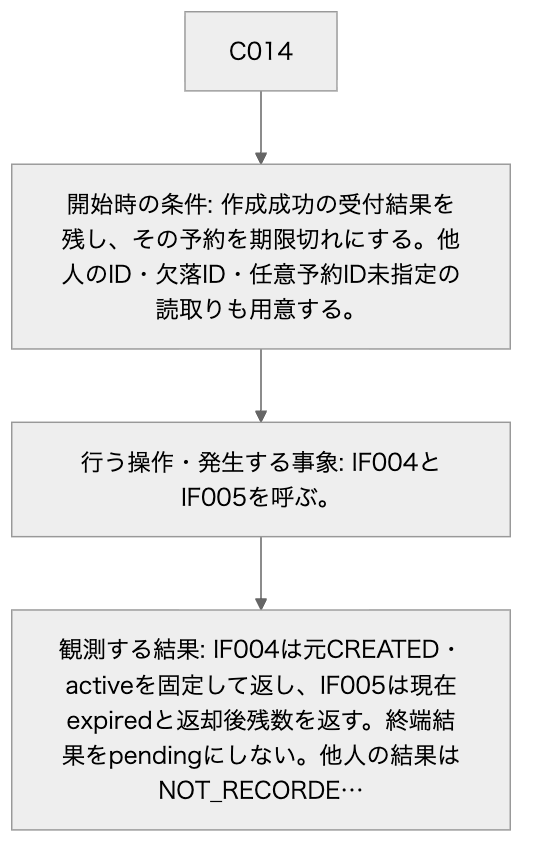

Mermaid: [local-C014.mmd](diagrams/local-C014.mmd) — 矢印は確認の順序または停止後の回復判断を示す。省略した全文は同じ項目の表にある。
