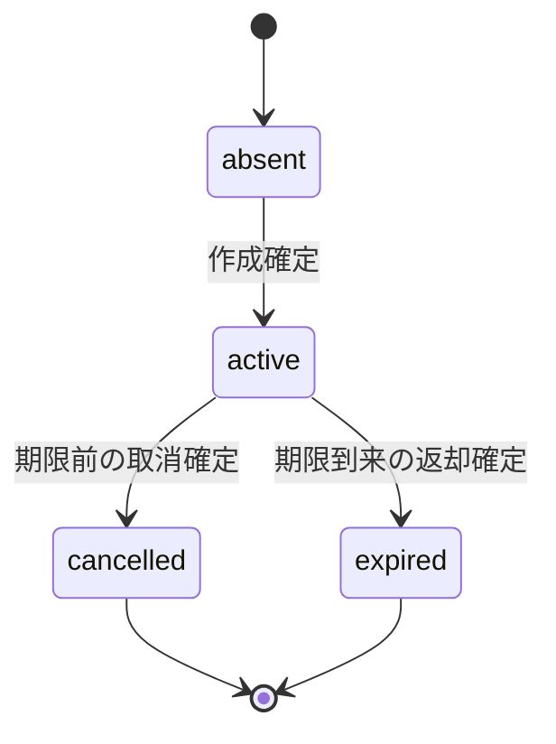

<!-- generated-by: write-detailed-design-document; body-sha256: 155d3adbc3a9b3271598110009f239a1fc6c98de32757bc9b31869b6420db398 -->
# 共通仕様

[入口に戻る](README.md)

責務、用語、状態、時間条件を先に定義し、機能ごとの判断を揃える。

## 用語と時刻

保存時刻はPostgreSQL側のUTC、物理型はtimestamptz、JSON表現はUTCのRFC3339（小数6桁、末尾Z）を提案する。作成では備品行のロック取得後のclock_timestamp()をcreated_atとして一度取得し、expires_at=created_at+10分とする。取消・期限処理は必要な行ロックを全て取った直後にclock_timestamp()を一度取得して判定時刻tとし、t<expires_atだけを取消可能、t>=expires_atを期限切れとする。待機前のトランザクション開始時刻や画面時刻では判定しない。判定後にコミットが期限を跨いでも、ロック中に決めた勝敗は覆さない。通信待ち時間は確定条件でない。時計補正・フェイルオーバー時の連続性はU002で未検証とする。

- **受付用識別子**: 利用者が一つの更新操作に付けるUUIDである。actor_idとrequest_idの組で受付結果を識別し、作成と取消で共通の名前空間とする。再送で変えない。
- **同じ内容**: operationと、作成ならitem_id・quantity、取消ならreservation_idの型付き値が同じことである。JSONの空白とキー順は無視し、UUIDは小文字に正規化する。未知項目と重複キーは受け付けない。
- **確定した操作結果**: 受付結果に保存した不変のスナップショットである。作成後に取消・期限切れになっても作成の成立は取り消さない。現在の予約状態・残数と分けて表示する。
- **結果未確認**: 更新要求に応答が届かず、保存確定の有無をまだ知らない画面状態である。失敗でも成功でもなく、GETの照会だけを行う。
- **残数**: items.available_quantityの保存値である。期限監視が遅れたactiveの数量はまだ含まない。期限到来と返却完了は区別する。
- **actor_id**: 認証済みの利用者を示す不変UUIDである。HTTP本文からは受け取らず、同一オリジンの認証・CSRF検査済みコンテキストから得る追加提案である。

## modules

### M001 ブラウザ画面

| 項目 | 内容 |
| --- | --- |
| 責務 | 数量と操作を受け取り、受付用識別子を送信前に利用者別のブラウザ保存領域へ保存する。確定した操作結果、現在値、結果未確認を分けて表示する。 |
| 依存先 | [M002](common.md#M002) |

### M002 受付

| 項目 | 内容 |
| --- | --- |
| 責務 | HTTP v1の構造・サイズ・認証・CSRFを検査し、利用者コンテキストを固定する。予約サービスの確定結果をHTTPへ写像し、未確定を成功にしない。 |
| 依存先 | [M003](common.md#M003) |

### M003 予約サービス

| 項目 | 内容 |
| --- | --- |
| 責務 | 同じ受付の照合、権利、在庫、期限を判定し、保存単位と応答を組み立てる。保存リポジトリの処理途中を呼出し元へ公開しない。 |
| 依存先 | [M005](common.md#M005) |

### M004 期限監視

| 項目 | 内容 |
| --- | --- |
| 責務 | 期限到来候補を読み、一予約ずつIF005を呼ぶ。再起動後も候補を再走査し、更新前に実際の状態と期限を再確認する。 |
| 依存先 | [M003](common.md#M003) [M005](common.md#M005) |

### M005 保存リポジトリ

| 項目 | 内容 |
| --- | --- |
| 責務 | PostgreSQLの行ロック、条件付き更新、受付結果の衝突、コミット・ロールバック確認、整合した読取りを担当する。個々のSQLはIF001〜IF005の処理内に閉じるため、独立した外部境界とはしない。 |
| 依存先 | なし |

## state_sets

### ST001 予約の保存状態。absentは予約行がない論理状態であり、status列へ保存しない。

| 項目 | 内容 |
| --- | --- |
| 対象 | 予約の保存状態。absentは予約行がない論理状態であり、status列へ保存しない。 |
| 状態と意味 | 名前: absent 意味: 予約が保存されていない。 名前: active 意味: 数量を引当済みで返却未了である。期限到来後も期限処理の確定前はこの保存状態である。 名前: cancelled 意味: 期限前の取消と数量返却が同じ保存単位で確定した終端状態である。 名前: expired 意味: 期限到来による数量返却が同じ保存単位で確定した終端状態である。 |

### ST002 画面の更新結果の観測状態。予約の業務状態とは別でありDBへ保存しない。

| 項目 | 内容 |
| --- | --- |
| 対象 | 画面の更新結果の観測状態。予約の業務状態とは別でありDBへ保存しない。 |
| 状態と意味 | 名前: ready 意味: 入力と新しい更新操作を行える。 名前: sending 意味: 一つの更新要求の応答を待っている。 名前: unknown 意味: 結果未確認であり、同じ受付の結果照会と現在値のGETだけを行う。更新要求は再送しない。 名前: result 意味: 今回の操作の確定結果か識別子競合を受信した。 |

### ST003 期限監視の一候補の実行結果の観測状態。DBの予約状態を代用しない。

| 項目 | 内容 |
| --- | --- |
| 対象 | 期限監視の一候補の実行結果の観測状態。DBの予約状態を代用しない。 |
| 状態と意味 | 名前: ready 意味: 候補の再読取りを開始できる。 名前: running 意味: 候補一件の保存処理を実行している。 名前: known 意味: 処理の確定またはロールバックを確認した。 名前: unknown 意味: コミット確認ができず、予約の再読取りが必要である。 |

## decisions

### D001

| 項目 | 内容 |
| --- | --- |
| 区分 | inherited |
| 内容 | 数量引当・予約・受付結果の一括確定、UTCの保存側時刻、状態を条件とする一回だけの返却、確定結果の照会という基本設計案を引き継ぐ。基本設計は採用済みでも検証済みでもない。 |
| 根拠 | [S001](evidence.md#S001) [S002](evidence.md#S002) [S003](evidence.md#S003) [S004](evidence.md#S004) [S006](evidence.md#S006) [S007](evidence.md#S007) [S008](evidence.md#S008) [S009](evidence.md#S009) [S010](evidence.md#S010) |
| 採用判断 | proposed |
| 判断の証拠 | なし |
| 検証内容・状態 | unverified |
| 検証の証拠 | なし |
| 外部検証への依存 | false |
| 関連する未決 | なし |

### D002

| 項目 | 内容 |
| --- | --- |
| 区分 | proposed |
| 内容 | HTTP /api/v1、UUID識別子、quantityと総数の上限1000000、備品名100文字、JSON本文1024バイト、HTTP要求ヘッダー8192バイト、応答8192バイト、URL512バイト、エラー文160文字を提案する。要求はUTF-8の単一オブジェクトとし、重複・未知項目とnullを拒否する。応答は項目ごとのnullable定義に従う。値は入力資料にない追加提案であり、採用前にU004で確認する。 |
| 根拠 | [S011](evidence.md#S011) |
| 採用判断 | proposed |
| 判断の証拠 | なし |
| 検証内容・状態 | unverified |
| 検証の証拠 | なし |
| 外部検証への依存 | false |
| 関連する未決 | [U004](evidence.md#U004) |

### D003

| 項目 | 内容 |
| --- | --- |
| 区分 | proposed |
| 内容 | PostgreSQLのREAD COMMITTED、備品→予約→受付結果挿入の取得順、active条件付き更新と数量返却の一トランザクションを提案する。受付結果は最後に完成形だけをINSERTし、同じ(actor_id,request_id)の衝突では全変更をロールバックした後に勝者を読み、同じ内容ならその結果、違えば競合を返す。PostgreSQL対象版・ロック・耐久性はU001で未検証とする。 |
| 根拠 | [S007](evidence.md#S007) [S008](evidence.md#S008) |
| 採用判断 | proposed |
| 判断の証拠 | なし |
| 検証内容・状態 | unverified |
| 検証の証拠 | なし |
| 外部検証への依存 | true |
| 関連する未決 | [U001](evidence.md#U001) |

### D004

| 項目 | 内容 |
| --- | --- |
| 区分 | proposed |
| 内容 | 取消にも受付用識別子を必須とし、作成と同じ不変の受付結果を残す。結果には操作時の残数と状態を保存し、結果照会は現在値を別の読取りスナップショットで返す。受付結果と終端予約は削除せず、保存期間を短縮する場合は再送照合が失われない別の保持契約を先に決める。 |
| 根拠 | [S003](evidence.md#S003) [S004](evidence.md#S004) [S010](evidence.md#S010) |
| 採用判断 | proposed |
| 判断の証拠 | なし |
| 検証内容・状態 | unverified |
| 検証の証拠 | なし |
| 外部検証への依存 | false |
| 関連する未決 | [U003](evidence.md#U003) |

### D005

| 項目 | 内容 |
| --- | --- |
| 区分 | proposed |
| 内容 | 認証済みactor_idの本人だけが予約を作成・取消・照会できる権利を提案する。期限監視だけはアプリケーション内の専用実行権で全利用者の期限処理を行う。本人以外の予約はNOT_FOUNDとして情報を隠す。認証・CSRFの実装と結合は未確認である。 |
| 根拠 | [S005](evidence.md#S005) [S007](evidence.md#S007) [S011](evidence.md#S011) |
| 採用判断 | proposed |
| 判断の証拠 | なし |
| 検証内容・状態 | unverified |
| 検証の証拠 | なし |
| 外部検証への依存 | false |
| 関連する未決 | [U004](evidence.md#U004) |

### D006

| 項目 | 内容 |
| --- | --- |
| 区分 | proposed |
| 内容 | 期限監視は1秒ごとに期限到来候補を最大100件読む案とする。複数監視が同じ候補を読んでも、備品と予約の再検査後にactiveから更新できた一方だけが返却する。ロック待ち5秒・SQL実行10秒・HTTP待ち15秒を提案する。タイムアウトで未確定を失敗へ読み替えず、DB時計と処理遅延の妥当性をU002で検証する。 |
| 根拠 | [S002](evidence.md#S002) [S009](evidence.md#S009) |
| 採用判断 | proposed |
| 判断の証拠 | なし |
| 検証内容・状態 | unverified |
| 検証の証拠 | なし |
| 外部検証への依存 | true |
| 関連する未決 | [U001](evidence.md#U001) [U002](evidence.md#U002) |

### D007

| 項目 | 内容 |
| --- | --- |
| 区分 | proposed |
| 内容 | 画面は受付用識別子と操作内容を送信前に利用者別のブラウザ保存領域へ保持し、再読込後も結果照会できるようにする。保存不能なら送信を開始しない。切断後はGETだけを行い、未登録という照会結果でも自動で作成・取消を再実行しない。 |
| 根拠 | [S004](evidence.md#S004) [S005](evidence.md#S005) |
| 採用判断 | proposed |
| 判断の証拠 | なし |
| 検証内容・状態 | unverified |
| 検証の証拠 | なし |
| 外部検証への依存 | false |
| 関連する未決 | [U003](evidence.md#U003) [U005](evidence.md#U005) |

## transitions

### TR001

| 項目 | 内容 |
| --- | --- |
| 状態定義 | [ST001](common.md#ST001) |
| 現在状態 | absent |
| イベント | 作成の保存確定 |
| 遷移条件 | 本人の新規受付で必要残数がありT003も挿入できた。 |
| 次状態 | active |
| 保存の内容と原子性 | 備品減算・予約挿入・受付結果挿入を一括COMMITする。 |
| 通知 | 確定後にcreatedを返す。 |
| 確認条件 | [C001](verification.md#C001) [C003](verification.md#C003) [C004](verification.md#C004) [C010](verification.md#C010) |

### TR002

| 項目 | 内容 |
| --- | --- |
| 状態定義 | [ST001](common.md#ST001) |
| 現在状態 | active |
| イベント | 期限前の取消の保存確定 |
| 遷移条件 | 全ロック後のt<expires_atかつ本人である。 |
| 次状態 | cancelled |
| 保存の内容と原子性 | active条件付き更新・備品加算・取消の受付結果を一括COMMITする。 |
| 通知 | 確定後にcancelledを返す。 |
| 確認条件 | [C006](verification.md#C006) [C007](verification.md#C007) [C008](verification.md#C008) [C010](verification.md#C010) |

### TR003

| 項目 | 内容 |
| --- | --- |
| 状態定義 | [ST001](common.md#ST001) |
| 現在状態 | active |
| イベント | 期限到来の返却確定 |
| 遷移条件 | 全ロック後のt>=expires_atである。 |
| 次状態 | expired |
| 保存の内容と原子性 | active条件付き更新と備品加算を一括COMMITする。取消受付からの処理なら拒否の受付結果も含める。 |
| 通知 | 取消にはDEADLINE_EXPIRED、監視にはchangedを返す。 |
| 確認条件 | [C007](verification.md#C007) [C008](verification.md#C008) [C009](verification.md#C009) [C013](verification.md#C013) |

### TR004

| 項目 | 内容 |
| --- | --- |
| 状態定義 | [ST002](common.md#ST002) |
| 現在状態 | ready |
| イベント | 新しい更新を送る |
| 遷移条件 | 入力検査と送信前の識別子保持が成功した。 |
| 次状態 | sending |
| 保存の内容と原子性 | 画面の観測状態だけを更新する。 |
| 通知 | 更新操作を無効にし待機を通知する。 |
| 確認条件 | [C001](verification.md#C001) [C015](verification.md#C015) |

### TR005

| 項目 | 内容 |
| --- | --- |
| 状態定義 | [ST002](common.md#ST002) |
| 現在状態 | result |
| イベント | 別の新しい更新を送る |
| 遷移条件 | 直前の結果を確認し、新しい操作に新しい識別子を用意した。 |
| 次状態 | sending |
| 保存の内容と原子性 | 直前の確定記録を保持し新しい観測を開始する。 |
| 通知 | 更新操作を無効にする。 |
| 確認条件 | [C006](verification.md#C006) [C015](verification.md#C015) |

### TR006

| 項目 | 内容 |
| --- | --- |
| 状態定義 | [ST002](common.md#ST002) |
| 現在状態 | sending |
| イベント | 確定結果または識別子競合を受信 |
| 遷移条件 | committed・rejected・conflictの本文を受信した。 |
| 次状態 | result |
| 保存の内容と原子性 | 受信した操作結果を画面へ反映する。 |
| 通知 | 結果見出しへ通知し、現在値は別に更新する。 |
| 確認条件 | [C001](verification.md#C001) [C005](verification.md#C005) [C006](verification.md#C006) |

### TR007

| 項目 | 内容 |
| --- | --- |
| 状態定義 | [ST002](common.md#ST002) |
| 現在状態 | sending |
| イベント | 入力拒否またはロールバック確認 |
| 遷移条件 | invalidまたはrollbackを受信した。 |
| 次状態 | ready |
| 保存の内容と原子性 | 保存済み失敗状態を新設せず、入力と識別子を保持する。 |
| 通知 | 入力修正または明示した再操作を許可する。 |
| 確認条件 | [C002](verification.md#C002) [C010](verification.md#C010) [C015](verification.md#C015) |

### TR008

| 項目 | 内容 |
| --- | --- |
| 状態定義 | [ST002](common.md#ST002) |
| 現在状態 | sending |
| イベント | 応答未取得 |
| 遷移条件 | 切断・タイムアウト・COMMIT確認不能である。 |
| 次状態 | unknown |
| 保存の内容と原子性 | 保持した識別子を残しDBの結果を推測しない。 |
| 通知 | 結果未確認と結果照会を表示する。 |
| 確認条件 | [C011](verification.md#C011) [C012](verification.md#C012) |

### TR009

| 項目 | 内容 |
| --- | --- |
| 状態定義 | [ST002](common.md#ST002) |
| 現在状態 | unknown |
| イベント | 結果照会でrecordを取得 |
| 遷移条件 | IF003のfoundを受信した。 |
| 次状態 | result |
| 保存の内容と原子性 | 同じ識別子の不変recordを操作結果として反映する。 |
| 通知 | 現在値と過去の結果を分けて通知する。 |
| 確認条件 | [C011](verification.md#C011) [C014](verification.md#C014) |

### TR010

| 項目 | 内容 |
| --- | --- |
| 状態定義 | [ST002](common.md#ST002) |
| 現在状態 | ready |
| イベント | 指定した結果を照会する |
| 遷移条件 | IF003のfoundを受信した。 |
| 次状態 | result |
| 保存の内容と原子性 | 指定した本人の確定recordを画面へ反映する。 |
| 通知 | 結果見出しへ通知する。 |
| 確認条件 | [C014](verification.md#C014) [C015](verification.md#C015) |

### TR011

| 項目 | 内容 |
| --- | --- |
| 状態定義 | [ST003](common.md#ST003) |
| 現在状態 | ready |
| イベント | 期限候補の処理開始 |
| 遷移条件 | 候補を再読取りして一予約の処理を開始する。 |
| 次状態 | running |
| 保存の内容と原子性 | プロセス内の観測だけを変える。 |
| 通知 | 監視ログに対象IDを記す。 |
| 確認条件 | [C009](verification.md#C009) [C013](verification.md#C013) |

### TR012

| 項目 | 内容 |
| --- | --- |
| 状態定義 | [ST003](common.md#ST003) |
| 現在状態 | running |
| イベント | 監視の確定またはロールバック確認 |
| 遷移条件 | changed・no_change・rollback・invalidである。 |
| 次状態 | known |
| 保存の内容と原子性 | 保存結果そのものと区別して観測を記録する。 |
| 通知 | 結果と理由を記録する。 |
| 確認条件 | [C008](verification.md#C008) [C009](verification.md#C009) [C013](verification.md#C013) |

### TR013

| 項目 | 内容 |
| --- | --- |
| 状態定義 | [ST003](common.md#ST003) |
| 現在状態 | running |
| イベント | 監視の確定不明 |
| 遷移条件 | COMMIT確認不能またはプロセス停止の回復観測である。 |
| 次状態 | unknown |
| 保存の内容と原子性 | 保存状態を推測せずIDと停止位置を記録する。 |
| 通知 | 次回の再読取りが必要と記録する。 |
| 確認条件 | [C010](verification.md#C010) [C013](verification.md#C013) |

### TR014

| 項目 | 内容 |
| --- | --- |
| 状態定義 | [ST003](common.md#ST003) |
| 現在状態 | known |
| イベント | 次の候補走査 |
| 遷移条件 | 前の行ロックを全て解放した。 |
| 次状態 | ready |
| 保存の内容と原子性 | 新しい走査から現在の状態を読む。 |
| 通知 | 次の候補を選ぶ。 |
| 確認条件 | [C009](verification.md#C009) |

### TR015

| 項目 | 内容 |
| --- | --- |
| 状態定義 | [ST003](common.md#ST003) |
| 現在状態 | unknown |
| イベント | 保存側回復後の候補走査 |
| 遷移条件 | 読み取れるまで待ち、以前の更新文をそのまま再実行しない。 |
| 次状態 | ready |
| 保存の内容と原子性 | 現在のstatusと期限を再取得し終端なら変更しない。 |
| 通知 | 回復後の観測を記録する。 |
| 確認条件 | [C013](verification.md#C013) |

## concurrency

### P001

| 項目 | 内容 |
| --- | --- |
| 保護するデータ | 一備品のavailable_quantity、作成する予約、本人の受付結果を保護する。 |
| 排他の範囲 | 備品行のFOR UPDATEと残数条件で引当を直列化する。T003の(actor_id,request_id)の制約で同時受付の勝者を決める。排他はDBで行い画面だけに依存しない。 |
| 取得順序 | 既存結果の読取りはロックなしとする。新規処理は備品→必要な予約→最後のT003挿入の順で行う。一保存単位は備品一件・予約一件・受付一件だけを扱う。複数備品を横断する処理は対象外である。 |
| 確保する時点 | 構造と既存受付の照合後に保存単位を開始し、備品行のロックを確保する。 |
| 解放する時点 | COMMITまたは全体ROLLBACKで全て解放する。応答送信・照会・次の候補待機中は保持しない。 |
| 上限の更新 | available>=quantityのときだけ減算し、0〜total_quantityの範囲を維持する。数量の消費確定点は予約と受付結果を含むCOMMITである。実行枠と別の回数上限は設けない。 |
| 時刻と等号 | 作成のロック後にcreated_atを取得する。再送は元の期限を延長しない。 |
| 競合の勝敗 | 最後の一個に異なる受付が来ると一件だけが作成成立する。同じ受付の競合ではT003の先にコミットした結果だけを残し、敗者の仮の引当・返却も全て戻す。 |
| 確認条件 | [C003](verification.md#C003) [C004](verification.md#C004) [C005](verification.md#C005) [C010](verification.md#C010) |

### P002

| 項目 | 内容 |
| --- | --- |
| 保護するデータ | 一予約のstatus・quantity・closed_atと、その備品の残数を保護する。 |
| 排他の範囲 | 取消と期限処理は同じ備品→予約の行ロックを用いる。UPDATEのWHERE status=activeを必須とし、更新件数1のときだけ数量を戻す。終端からの再返却はない。 |
| 取得順序 | 予約の不変item_idを先にロックなしで読む。備品→予約の順でロックし、存在・item_id・権利・statusを読み直す。監視も同じ順とし、候補取得中のロックは持ち越さない。 |
| 確保する時点 | 本人確認に必要な予備読取り後、備品と予約の更新前に確保する。監視の実行権は利用者の権利と分ける。 |
| 解放する時点 | 返却と状態と必要な受付結果のCOMMITまたは全体ROLLBACKで解放する。 |
| 上限の更新 | 返却はactiveからの状態変更と同じ保存単位でquantityを加算する。quantity・total_quantityは本対象内で変更せず、available<=total_quantityを維持する。 |
| 時刻と等号 | 全ロック後にtを一度取得する。t<expires_atだけ取消、t=expires_atとt>expires_atは期限切れとする。待機していた取消もロック取得後に再判定する。 |
| 競合の勝敗 | 期限前にロック後判定した取消が確定すればcancelledとなる。先行処理が期限切れを確定した場合や、後続取消の判定時刻が期限到来ならexpiredとなる。先行処理がROLLBACKすれば後続が新しい時刻で判断する。返却はどちらが勝っても合計一回である。 |
| 確認条件 | [C006](verification.md#C006) [C007](verification.md#C007) [C008](verification.md#C008) [C010](verification.md#C010) [C013](verification.md#C013) |

### P003

| 項目 | 内容 |
| --- | --- |
| 保護するデータ | 読取り時点の受付結果、予約状態、残数と画面の操作履歴を保護する。 |
| 排他の範囲 | GETは読取り専用REPEATABLE READで同じスナップショットから読む。期限処理や更新を呼ばない。画面はsending中に別操作を送らず、非同期応答は最新の照会番号に一致する場合だけ現在値へ反映する。 |
| 取得順序 | GETは書込みロックを取らず、受付結果→関連予約・備品を同じ読取り単位で読む。照会結果と現在値の取得が別要求のときは取得時刻も別に表示する。 |
| 確保する時点 | 読取り開始時にDBスナップショットを確保する。ブラウザの保存領域は利用者IDで分け、送信前に識別子を保持する。 |
| 解放する時点 | 読取りの終了直後にスナップショットを解放する。HTTP返却中にトランザクションを保持しない。 |
| 上限の更新 | GETの書込みは0件とし、未登録の照会でも数量を消費しない。 |
| 時刻と等号 | 読取り中の保存側server_nowでdeadline_reachedとcancel_allowedを計算する。画面時刻は表示上の早期無効化の補助だけとし、取消の最終判定は保存側で行う。 |
| 競合の勝敗 | 古いGET応答は新しい現在値を上書きしない。結果照会は不変recordの成立・拒否を維持し、期限後の現在状態で過去の結果を覆さない。 |
| 確認条件 | [C011](verification.md#C011) [C012](verification.md#C012) [C014](verification.md#C014) [C016](verification.md#C016) |

## 図と厳密な条件

G001は画面から保存確定と切断後照会までの順序、G002は予約の保存状態、G003は備品・予約・受付結果の参照関係を示す。三種類とも必要なため省略しない。画面と期限監視の観測状態は共通の遷移表に置く。図は厳密な検査条件を対応IDへ委ねる。ブラウザを起動しないため実描画は未確認でありU005に残す。

### G002 予約の引当と一回だけの返却

activeは返却前の保存状態であり、期限到来だけでは残数を増やさない。終端からの取消・監視は状態を保ち返却しない。観測のunknownはこの業務状態へ保存しない。

[TR001](common.md#TR001) [TR002](common.md#TR002) [TR003](common.md#TR003) [P002](common.md#P002) [C007](verification.md#C007) [C008](verification.md#C008)
