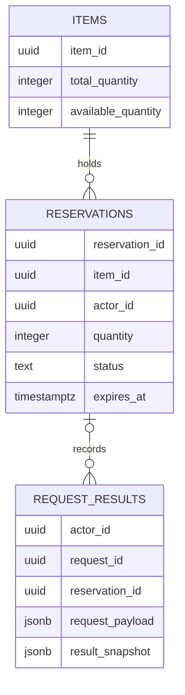

<!-- generated-by: write-detailed-design-document; body-sha256: fd19cc0f7ca2f48a4e97e3a85cf7a4239c09899f62beed6138aaaca1ce2d6d6e -->
# 物理データ

[入口に戻る](README.md)

状態を何に保存し、どの制約と更新単位で整合性を保つかを定義する。

## tables

### T001 items

| 項目 | 内容 |
| --- | --- |
| 目的 | 備品ごとの総数と現在の引当可能数を保持する。総数変更は今回の対象外である。 |
| 主キーの列構成 | item_id |
| 一意キーの列構成 | なし |
| キーの理由 | item_idで一備品を識別する。他の識別キーは設けない。 |
| 制約 | CHECK: 0<=available_quantity AND available_quantity<=total_quantity AND total_quantity<=1000000とする。 運用不変条件: total_quantity-available_quantity=同一備品のactive予約quantityの総和とする。表間の総和はCHECKで保証せず、同一保存単位とC003・C008・C010で確認する。 |
| 索引 | なし |
| 索引の採用理由 | 備品一件のロックと取得はitem_idで行うため追加索引は設けない。 |
| 更新の単位 | 作成時の減算または取消・期限処理時の加算を、対応するT002と必要なT003の確定と同じ保存単位で行う。 |
| 削除の単位と順序 | 参照する予約と受付結果が残るため削除しない。備品廃止は対象外とする。 |
| 移行手順 | 初回はAPIと監視を止め、T001→T002→T003の順に同じ移行トランザクションで作る。失敗は全て戻し、書込み受付を開始しない。既存データがある場合は列追加→値の埋戻し→件数・在庫整合確認→NOT NULL/CHECK適用→アプリ切替の順を別の移行として承認する。混在版の書込みと破壊的な自動巻戻しは許可しない。移行は未実施でU001の対象とする。 |

#### 物理列

| 名前 | 型 | NULL可否 | 既定値 | 制約 | 参照先 | 状態定義 | キーへの所属 |
| --- | --- | --- | --- | --- | --- | --- | --- |
| item_id | uuid | false | 既定値なし。書込側が明示する。 | 備品識別子である。 | 参照先なし。 | 非該当 | PK 1 |
| name | varchar(100) | false | 既定値なし。書込側が明示する。 | 1〜100文字とする。 | 参照先なし。 | 非該当 | — |
| total_quantity | integer | false | 既定値なし。書込側が明示する。 | 0〜1000000とする。 | 参照先なし。 | 非該当 | — |
| available_quantity | integer | false | 既定値なし。書込側が明示する。 | 0以上total_quantity以下とする。 | 参照先なし。 | 非該当 | — |
| updated_at | timestamptz | false | 既定値なし。書込側が明示する。 | 保存側のUTC時刻とする。 | 参照先なし。 | 非該当 | — |

### T002 reservations

| 項目 | 内容 |
| --- | --- |
| 目的 | 予約数量、所有者、期限、返却済みの状態を保持する。 |
| 主キーの列構成 | reservation_id |
| 一意キーの列構成 | なし |
| キーの理由 | reservation_idで一予約を識別する。受付用識別子はT003だけに置く。 |
| 制約 | CHECK: quantity BETWEEN 1 AND 1000000、status IN (active,cancelled,expired)、expires_at=created_at+10分とする。 CHECK: activeならclosed_at IS NULL、終端ならclosed_at IS NOT NULLとする。cancelledではclosed_at<expires_at、expiredではclosed_at>=expires_atとする。 参照: item_idはT001を参照し、削除時の連鎖削除を行わない。 |
| 索引 | (expires_at,reservation_id) WHERE status=activeの部分B-tree索引とする。 |
| 索引の採用理由 | 期限候補を期限とIDの安定順で走査するため部分索引を設ける。実際の利用計画と負荷はU001・U002で未確認とする。 |
| 更新の単位 | active条件付き更新でclosed_atとstatusを同時更新する。更新件数が1のときだけT001のavailable_quantityへ当該予約のquantityを加える。作成・返却の途中状態をコミットしない。 |
| 削除の単位と順序 | 終端も照会と受付結果の参照に必要なため削除しない。保持方針の変更はU003で別途判断する。 |
| 移行手順 | 初回はAPIと監視を止め、T001→T002→T003の順に同じ移行トランザクションで作る。失敗は全て戻し、書込み受付を開始しない。既存データがある場合は列追加→値の埋戻し→件数・在庫整合確認→NOT NULL/CHECK適用→アプリ切替の順を別の移行として承認する。混在版の書込みと破壊的な自動巻戻しは許可しない。移行は未実施でU001の対象とする。 |

#### 物理列

| 名前 | 型 | NULL可否 | 既定値 | 制約 | 参照先 | 状態定義 | キーへの所属 |
| --- | --- | --- | --- | --- | --- | --- | --- |
| reservation_id | uuid | false | 既定値なし。書込側が明示する。 | 保存側で生成し、成立した予約を識別する。 | 参照先なし。 | 非該当 | PK 1 |
| item_id | uuid | false | 既定値なし。書込側が明示する。 | 予約中は変更しない。 | T001.items.item_idへ参照する。削除を拒否する。 | 非該当 | — |
| actor_id | uuid | false | 既定値なし。書込側が明示する。 | 本人を示す不変の識別子とする。 | 認証コンテキストの識別子であり、本設計内に利用者表は設けない。 | 非該当 | — |
| quantity | integer | false | 既定値なし。書込側が明示する。 | 1〜1000000、作成後は変更しない。 | 参照先なし。 | 非該当 | — |
| status | text | false | 既定値なし。書込側が明示する。 | active、cancelled、expiredだけとする。absentは保存しない。 | 参照先なし。 | [ST001](common.md#ST001) | — |
| created_at | timestamptz | false | 既定値なし。書込側が明示する。 | ロック後に取得した保存側UTC時刻とする。 | 参照先なし。 | 非該当 | — |
| expires_at | timestamptz | false | 既定値なし。書込側が明示する。 | created_at+10分とする。 | 参照先なし。 | 非該当 | — |
| closed_at | timestamptz | true | NULL | activeならnull、cancelled・expiredなら返却判定の保存側時刻とする。 | 参照先なし。 | 非該当 | — |

### T003 request_results

| 項目 | 内容 |
| --- | --- |
| 目的 | 本人の受付用識別子、比較用の内容、確定した操作結果を不変で保持する。処理中の行を作らない。 |
| 主キーの列構成 | actor_id request_id |
| 一意キーの列構成 | なし |
| キーの理由 | 利用者と受付識別子の複合構成だけで再送を照合する。一つのrequest_idを別利用者が使用しても混ざらない。作成と取消の識別子衝突はoperationの内容不一致として扱う。 |
| 制約 | CHECK: operation IN (create,cancel)、http_status IN (200,201,404,409)とする。 参照: reservation_idが非nullならT002を参照する。result_snapshotのrequest_idとoperationとdecided_atは行の対応値と一致させる。 request_payload・result_snapshotはINSERT時に完成させ、確定後のUPDATEをアプリケーション権限で禁止する。結果の書式はIF001/IF002と同じ検査を保存前に行う。 |
| 索引 | なし |
| 索引の採用理由 | 本人の受付識別子による一点照会だけを行うため追加索引は設けない。 |
| 更新の単位 | T001・T002の更新がある場合は同一トランザクションの最後に完成形をINSERTする。衝突時は例外となった保存単位全体を戻して、別の読取りで勝者を照合する。 |
| 削除の単位と順序 | 自動削除しない。拒否も残して同じ識別子の意味を維持する。容量・個人情報・保持期間の採用はU003で未決とする。 |
| 移行手順 | 初回はAPIと監視を止め、T001→T002→T003の順に同じ移行トランザクションで作る。失敗は全て戻し、書込み受付を開始しない。既存データがある場合は列追加→値の埋戻し→件数・在庫整合確認→NOT NULL/CHECK適用→アプリ切替の順を別の移行として承認する。混在版の書込みと破壊的な自動巻戻しは許可しない。移行は未実施でU001の対象とする。 |

#### 物理列

| 名前 | 型 | NULL可否 | 既定値 | 制約 | 参照先 | 状態定義 | キーへの所属 |
| --- | --- | --- | --- | --- | --- | --- | --- |
| actor_id | uuid | false | 既定値なし。書込側が明示する。 | 認証済み利用者を示す。 | 参照先なし。 | 非該当 | PK 1 |
| request_id | uuid | false | 既定値なし。書込側が明示する。 | 作成と取消で共通の受付識別子である。 | 参照先なし。 | 非該当 | PK 2 |
| operation | text | false | 既定値なし。書込側が明示する。 | createまたはcancelとする。 | 参照先なし。 | 非該当 | — |
| request_payload | jsonb | false | 既定値なし。書込側が明示する。 | createはitem_idとquantity、cancelはreservation_idだけの正規化値とする。本文1024バイト以内から作る。ハッシュだけで同内容と判定しない。 | 参照先なし。 | 非該当 | — |
| reservation_id | uuid | true | NULL | 本人の成立・対象予約がある場合だけ設定する。拒否で対象なし・非開示ならnullとする。 | 非null時はT002.reservations.reservation_idを参照し削除を拒否する。 | 非該当 | — |
| result_snapshot | jsonb | false | 既定値なし。書込側が明示する。 | IF001/IF002のcommittedまたはrejectedの全項目と同じ完成した値である。unknown・processing・invalid・KEY_CONFLICTを保存しない。 | 参照先なし。 | 非該当 | — |
| http_status | smallint | false | 既定値なし。書込側が明示する。 | 保存結果のHTTP201・200・404・409のいずれかとする。 | 参照先なし。 | 非該当 | — |
| decided_at | timestamptz | false | 既定値なし。書込側が明示する。 | 結果本文のdecided_atと一致させる。 | 参照先なし。 | 非該当 | — |

## 図と厳密な条件

G001は画面から保存確定と切断後照会までの順序、G002は予約の保存状態、G003は備品・予約・受付結果の参照関係を示す。三種類とも必要なため省略しない。画面と期限監視の観測状態は共通の遷移表に置く。図は厳密な検査条件を対応IDへ委ねる。ブラウザを起動しないため実描画は未確認でありU005に残す。

### G003 備品と予約と受付結果

一備品が複数予約を持ち、一予約に作成・取消など複数の受付結果が結び付く。拒否結果は予約を持たない場合がある。キーとNULLの正本は物理表の定義である。

[T001](data.md#T001) [T002](data.md#T002) [T003](data.md#T003) [P001](common.md#P001) [P002](common.md#P002)
