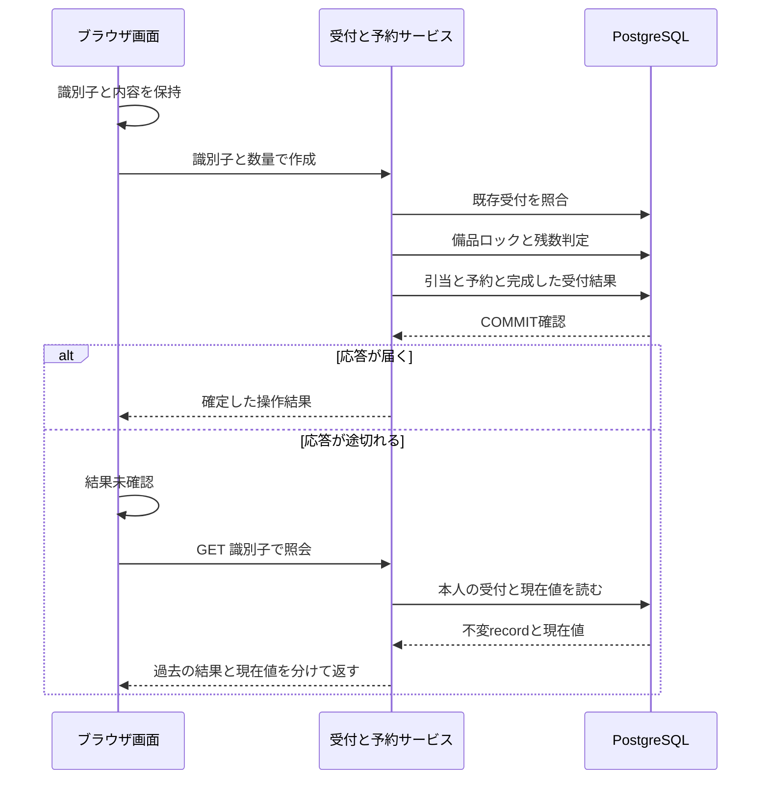

<!-- generated-by: write-detailed-design-document; body-sha256: b5129ae499e9d6007cfaeb957bb1c599b1570cb1f19cdb14364292061a52c177 -->
# 機能ごとの詳細

[入口に戻る](README.md)

開始条件から保存と結果までを追い、異常時の回復と確認方法へつなぐ。

## features

## F001 予約を作成する

### 目的と根拠

一つの受付に一つの確定結果を残し、残数を超えない数量だけを引き当てる。
[S001](evidence.md#S001) [S003](evidence.md#S003) [S004](evidence.md#S004) [S007](evidence.md#S007) [S008](evidence.md#S008)
[M001](common.md#M001) [M002](common.md#M002) [M003](common.md#M003) [M005](common.md#M005)

### 開始条件と入力

認証済み利用者が新しい作成を開始する。UIはreadyかresultからsendingへ進む。
既存受付の再送は予約がactive・cancelled・expiredのどの状態でも結果読取りとして許可する。新規予約はabsentから開始する。
[IF001](interfaces.md#IF001)

### 処理の流れ

1. 画面は入力を検査し、request_idと内容を送信前に保存してTR004またはTR005へ進む。受付はIF001の順で検査する。
2. 型付き内容を正規化して既存のT003を読む。同じ内容なら結果をそのまま返し、数量・期限を更新しない。違う内容ならKEY_CONFLICTを返す。新規に限り数量範囲を検査する。
3. 新規の保存単位を開始し、T001の対象備品をFOR UPDATEで取得する。備品なし・残数不足なら更新を行わず、拒否結果を組み立てる。残数が足りればロック後の保存側時刻を取得し、available_quantityからquantityを減らし、activeのT002を作る。 成立・拒否ともdecided_atは当該判定時にDBから取得する。備品がない場合もDB時刻を取得して拒否結果を完成する。
4. 最後に完成したT003をINSERTし、同じ保存単位をCOMMITする。挿入の識別子衝突では、引当・予約を含めて全てROLLBACKする。新しい読取りで勝者の内容を比較し、同じなら保存済み結果、違えばKEY_CONFLICTを返す。残数不足という仮の判定よりも、この照合結果を優先する。
5. COMMIT成功を確認した後だけ、作成成立または保存済み拒否を応答する。採番した予約IDに保存前の欠番が生じても再利用しない。
[T001](data.md#T001) [T002](data.md#T002) [T003](data.md#T003)
[ST001](common.md#ST001) [ST002](common.md#ST002)

### 結果

成立ではTR001でactiveを保存し、作成時の残数・期限を含む不変の操作結果を返す。再送でも同じsnapshotを返すため、現在の残数はIF004またはIF003で別に取得する。拒否も受付結果に保存され、同じ識別子では後で在庫が増えても成立へ変わらない。
[UI001](ui.md#UI001)

### 異常・競合・中断

保存前またはロールバック確認済みの障害では予約・在庫・受付結果の全変更を残さない。COMMITの成否が不明なら成功も失敗も返さず、画面ではunknown、期限監視ではST003のunknownとして扱う。自動の更新再実行は行わず、読み取って確定状態を調べる。 同じ識別子の競合では勝者の受付結果を上書きしない。
[RC001](recovery.md#RC001) [RC002](recovery.md#RC002) [RC003](recovery.md#RC003)
[U001](evidence.md#U001) [U003](evidence.md#U003) [U004](evidence.md#U004)

### 確認方法

[C001](verification.md#C001) [C002](verification.md#C002) [C003](verification.md#C003) [C004](verification.md#C004) [C005](verification.md#C005) [C010](verification.md#C010) [C011](verification.md#C011) [C012](verification.md#C012) [C015](verification.md#C015)

## F002 予約を取り消す

### 目的と根拠

期限前の本人のactive予約だけを取消し、数量を一度だけ戻す。期限到来済みなら期限切れとして確定する。
[S002](evidence.md#S002) [S004](evidence.md#S004) [S005](evidence.md#S005) [S008](evidence.md#S008) [S009](evidence.md#S009)
[M001](common.md#M001) [M002](common.md#M002) [M003](common.md#M003) [M005](common.md#M005)

### 開始条件と入力

本人の予約IDと新しい取消のrequest_idを指定する。UIはreadyかresultからsendingへ進む。
保存側はactive・cancelled・expired・absentを受け付けて各結果を区別する。期限到来が画面で既知なら取消ボタンを使えないが、直接呼出しは保存側で再検査する。
[IF002](interfaces.md#IF002)

### 処理の流れ

1. 作成と同じ識別子照合を先に行い、同じ取消は保存済み結果を返す。作成と同じ識別子の使い回しはoperationが異なるためKEY_CONFLICTとする。
2. 予約のitem_idをロックなしで読み、備品行、次いで予約行をロックして本人・不変のitem_id・状態を再確認する。予約なしまたは他人の予約は同じNOT_FOUNDの拒否を作り、在庫値は開示しない。 対象がない場合もDB時刻でdecided_atを設定する。対象がある場合はロック後の判定時刻tをdecided_atとする。
3. 全ロックの取得後に保存側時刻tを取得する。activeかつt<expires_atならTR002でcancelledへ、activeかつt>=expires_atならTR003でexpiredへ条件付き更新する。更新できた一件だけ、そのquantityを同じ備品のavailable_quantityへ加える。
4. cancelled・expiredなら数量を加えない。新しい取消識別子にはALREADY_CANCELLEDまたはDEADLINE_EXPIREDの拒否結果を残す。期限到来のactiveを閉じた場合も取消成立ではなくDEADLINE_EXPIREDとする。
5. 完成した取消のT003を最後に挿入し、予約状態・返却・受付結果を同時に確定する。受付結果挿入の衝突は全変更を戻してから勝者を読む。COMMIT確認後に結果を応答する。
[T001](data.md#T001) [T002](data.md#T002) [T003](data.md#T003)
[ST001](common.md#ST001) [ST002](common.md#ST002)

### 結果

期限前の取消はcancelledと返却後残数を返す。期限到来はexpiredと返却後残数を保存した拒否結果を返す。別の取消や期限処理が先に閉じた場合はその終端状態を保つ。
[UI001](ui.md#UI001)

### 異常・競合・中断

保存前またはロールバック確認済みの障害では予約・在庫・受付結果の全変更を残さない。COMMITの成否が不明なら成功も失敗も返さず、画面ではunknown、期限監視ではST003のunknownとして扱う。自動の更新再実行は行わず、読み取って確定状態を調べる。 取消と期限処理の勝敗はP002に従い、終端をactiveへ戻さない。
[RC001](recovery.md#RC001) [RC002](recovery.md#RC002) [RC003](recovery.md#RC003)
[U001](evidence.md#U001) [U002](evidence.md#U002) [U004](evidence.md#U004)

### 確認方法

[C004](verification.md#C004) [C005](verification.md#C005) [C006](verification.md#C006) [C007](verification.md#C007) [C008](verification.md#C008) [C010](verification.md#C010) [C011](verification.md#C011) [C012](verification.md#C012) [C015](verification.md#C015)

## F003 期限が来た予約を閉じる

### 目的と根拠

期限監視が遅れても再起動しても、期限到来済みactive予約の数量を一回だけ戻す。
[S002](evidence.md#S002) [S007](evidence.md#S007) [S008](evidence.md#S008) [S009](evidence.md#S009)
[M004](common.md#M004) [M003](common.md#M003) [M005](common.md#M005)

### 開始条件と入力

期限監視の専用実行権で候補走査を行う。停止中に期限を過ぎた行も対象とする。
保存状態がactiveの候補を読むが、候補取得後にcancelled・expired・absentへ変わっていてもIF005で再確認する。
[IF005](interfaces.md#IF005)

### 処理の流れ

1. 保存側時刻でexpires_at<=候補時刻のactiveを(expires_at,reservation_id)順に最大100件だけ読み、候補読取りの保存単位を閉じる。候補の読取りでは更新ロックを保持しない。
2. 候補一件ごとにST003をreadyからrunningへ進め、IF005を呼ぶ。トランザクションごとに備品→予約の順でロックを取り、保存状態と本人に依存しない期限処理権を再確認する。
3. ロック後のt>=expires_atかつactiveのときだけTR003でexpiredへ更新し、数量を返却して同時に確定する。未到来、終端、行なしは書き込まず、理由付きのno_changeを返す。
4. 確定・ロールバック確認はknown、確定不明はunknownとして観測する。次の走査では予約を再読取りしてから状態条件を満たす新しい処理を始める。以前のUPDATE文を無条件に再送しない。
[T001](data.md#T001) [T002](data.md#T002)
[ST001](common.md#ST001) [ST003](common.md#ST003)

### 結果

返却確定はexpiredと増加した残数として後続GETに現れる。利用者への自発送信は行わない。候補が重複しても返却は一回である。
[UI001](ui.md#UI001)

### 異常・競合・中断

保存前またはロールバック確認済みの障害では予約・在庫・受付結果の全変更を残さない。COMMITの成否が不明なら成功も失敗も返さず、画面ではunknown、期限監視ではST003のunknownとして扱う。自動の更新再実行は行わず、読み取って確定状態を調べる。 候補一件の失敗で他の備品の処理を止めず、次回走査で再評価する。
[RC001](recovery.md#RC001) [RC002](recovery.md#RC002) [RC004](recovery.md#RC004)
[U001](evidence.md#U001) [U002](evidence.md#U002)

### 確認方法

[C007](verification.md#C007) [C008](verification.md#C008) [C009](verification.md#C009) [C010](verification.md#C010) [C013](verification.md#C013) [C016](verification.md#C016)

## F004 確定結果と現在値を照会する

### 目的と根拠

切断後の受付結果を再実行せずに読み、過去の操作結果と現在の在庫・予約状態を区別する。
[S001](evidence.md#S001) [S004](evidence.md#S004) [S005](evidence.md#S005) [S010](evidence.md#S010)
[M001](common.md#M001) [M002](common.md#M002) [M003](common.md#M003) [M005](common.md#M005)

### 開始条件と入力

同じactor_idの受付用識別子を保持する。ST002のunknown・ready・resultから結果照会でき、予約のactive権は要求しない。
IF004は画面の現在値の更新に使い、操作結果の代わりには使わない。
[IF003](interfaces.md#IF003) [IF004](interfaces.md#IF004)

### 処理の流れ

1. 再読込時は利用者別に保持した未確認識別子を読み、unknownと表示する。別利用者の保存値を読み込まず、元の更新を自動再送しない。
2. IF003は同じactor_idの受付結果を、明示した読取り専用REPEATABLE READの同一スナップショットで予約・備品と共に読む。受付結果は不変のrecordとして返し、現在値はcurrentとして別に返す。書込みや期限処理を呼ばない。 現在値の備品は作成ならrequest_payload.item_id、取消なら本人の対象予約のitem_idから辿る。対象不明の拒否だけはcurrent=nullとする。
3. 受付結果が見えなければnot_recordedを返す。これは未到着・処理中・ロールバックを区別できず、成功でも確定失敗でもない。元の更新がunknownならその状態を保ち、結果照会の再実行だけを許す。ready・resultから別の識別子を照会した場合は元の観測状態を保ち、未登録という照会結果だけを併記する。読取り失敗でも前の確定結果を覆さない。
4. 完了済みのrecordがある場合にpendingや未完了を返さない。期限到来済みactiveの現在値ではdeadline_reached=true、cancel_allowed=falseを返し、「期限到来・返却待ち」と表示する。現在の備品残数はまだ返却されていない保存値を示す。
5. IF004は備品と、指定があれば本人の予約を同じ読取りスナップショットで返す。取得時刻とdeadline_reachedを併記し、後続の書込みが行われるまでこの値は閲覧時点の値であると表示する。
[T001](data.md#T001) [T002](data.md#T002) [T003](data.md#T003)
[ST001](common.md#ST001) [ST002](common.md#ST002)

### 結果

foundはrecordの成立・拒否を確定結果として示す。作成recordがactiveで現在の予約がexpiredでも過去の成立を維持する。照会だけで予約作成、返却、受付結果の追加は行わない。
[UI001](ui.md#UI001)

### 異常・競合・中断

読取りの入力不正・未認証・保存側停止はcodeで区別して返す。not_recordedは確定した拒否のrecordではなく、元の成否を未確認のまま保つ。実装・運用で未到着を確定できる手順はU003とする。
[RC002](recovery.md#RC002) [RC003](recovery.md#RC003)
[U003](evidence.md#U003) [U004](evidence.md#U004) [U005](evidence.md#U005)

### 確認方法

[C001](verification.md#C001) [C010](verification.md#C010) [C011](verification.md#C011) [C012](verification.md#C012) [C014](verification.md#C014) [C015](verification.md#C015) [C016](verification.md#C016)

## 図と厳密な条件

G001は画面から保存確定と切断後照会までの順序、G002は予約の保存状態、G003は備品・予約・受付結果の参照関係を示す。三種類とも必要なため省略しない。画面と期限監視の観測状態は共通の遷移表に置く。図は厳密な検査条件を対応IDへ委ねる。ブラウザを起動しないため実描画は未確認でありU005に残す。

### G001 予約の保存確定と切断後の結果照会

更新の確定後に通知する。再送衝突の全体ROLLBACK、未登録の照会、COMMIT確認不能は対応条件で補う。

[F001](features.md#F001) [IF001](interfaces.md#IF001) [IF003](interfaces.md#IF003) [P001](common.md#P001) [RC001](recovery.md#RC001) [RC002](recovery.md#RC002) [RC003](recovery.md#RC003) [C004](verification.md#C004) [C012](verification.md#C012)
