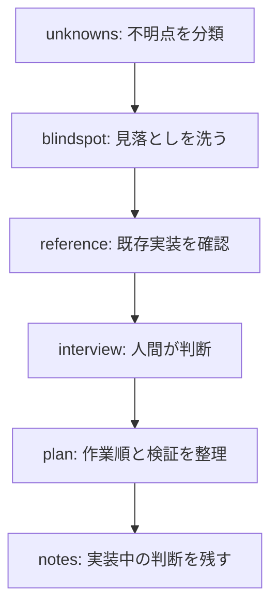

# ワークフロー

スキルをつなぐときは、前の成果物が次の入力になるように進めます。以下は代表的な組み合わせです。途中で目的を満たした場合はそこで終え、必要な段階だけを選んでください。

## 曖昧な依頼から実装計画を作る

たとえば「依頼一覧を使いやすくしたい」だけでは、操作の問題と表示項目の問題を区別できません。[unknowns](discovery/unknowns.md)で不明点を分け、[blindspot](discovery/blindspot.md)で見落としを探し、[reference](discovery/reference.md)で既存画面の仕様を確認します。

コードでは決められない優先順位は[interview](discovery/interview.md)で一問ずつ確認します。確定した判断を[plan](planning/plan.md)へ渡し、実装中に変わった判断は[notes](documentation/notes.md)で残します。確認する成果物は「不明点 → 根拠 → 決定 → 計画 → 実装時の判断」です。

## 画面を見ながら要件を固める

1. [prototype](discovery/prototype.md)で何を見て判断したいかを整理します。
2. 単体HTMLで比較したい場合は[html-requirements-workshop](design/html-requirements-workshop.md)、Reactで操作を確かめたい場合は[react-requirements-workshop](design/react-requirements-workshop.md)へ渡します。
3. エージェントが画面案を提示し、人間が対象項目へコメントします。
4. エージェントが新しい案へ反映し、承認された画面と要件を保管します。
5. 承認済み要件から[plan](planning/plan.md)で本実装の計画を作ります。

画面案は本番アプリの完成を意味しません。動く画面の承認と、バックエンドやデータ保存を含む実装の依頼を分けて伝えてください。

## 大きな計画をIssueに分けて進める

[grill-issue](planning/grill-issue.md)で要件と判断を詰め、[to-issues](planning/to-issues.md)で利用者が確認できる単位へ分割します。「DBだけ」「画面だけ」ではなく、「依頼を登録し一覧で確認できる」のように一連の動作を完結させます。

分割案を承認した後にIssueを作成し、各Issueは[issue-trace](documentation/issue-trace.md)で調査・計画・実装・確認の記録を残しながら進められます。計画の承認時には、依存関係と各Issueの完了条件を確認します。

## レビューして変更を共有する

実装中の[notes](documentation/notes.md)と差分を使い、[self-review-html](development/self-review-html.md)で行ごとの評価を確認します。[pitch](documentation/pitch.md)で変更理由とレビュー観点をまとめ、[quiz](discovery/quiz.md)で判断や影響の理解を確かめます。

修正が済んだら[commit](development/commit.md)で変更をコミットし、[pr](development/pr.md)でPRを作ります。コミットやPRの作成を進める段階では、その操作を依頼に含めてください。

## 説明資料や図を作る

[explanation-design](documentation/explanation-design.md)で読者の前提と説明順を整理します。構造や呼び出し順序を示す必要があれば[archify-jp](design/archify-jp.md)、似た仕組みの違いを追いたければ[compare](discovery/compare.md)、一つの題材を図と具体例から掘り下げたければ[explain-html](discovery/explain-html.md)を使います。

図を作るために必要なのは、ノードの名前だけではありません。誰が何を呼ぶか、どのデータを渡すか、どこまで根拠を確認したかを、参照するコードや仕様と一緒に渡します。

## スキルを作り、管理する

[my-skill-creator](authoring/my-skill-creator.md)で目的・構成を合意し、候補版を作成して検証します。その後、[skill-authoring](authoring/skill-authoring.md)で共通／プロジェクト固有の配置先とカタログを整備します。

新しい内容の作成、既存内容の改善、配置だけの変更は依頼の範囲が異なります。何を変えてよいかを明示しておくと、内容の変更と配置の変更を別々に確認できます。
