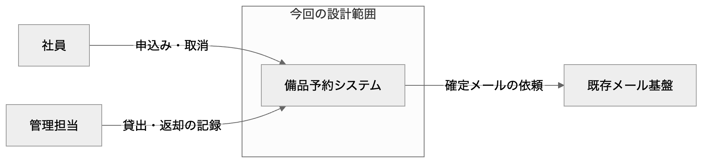
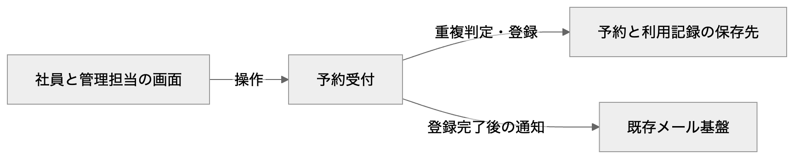
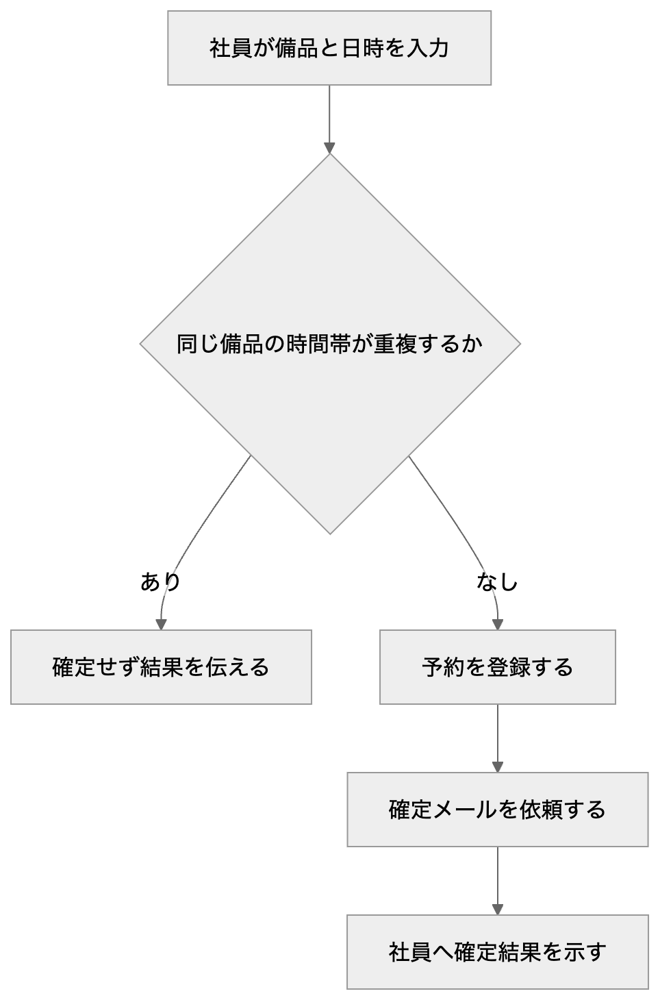
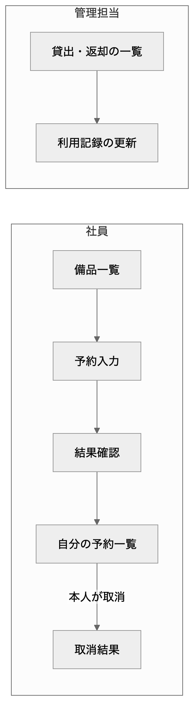
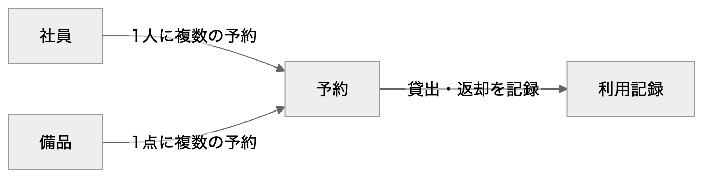
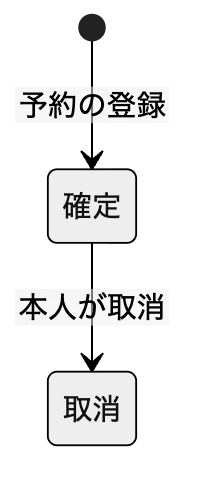
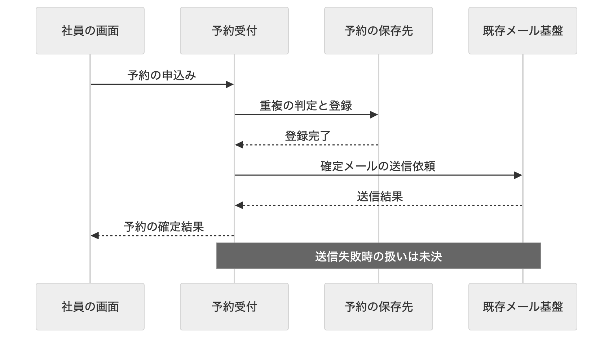

# 社内備品予約の基本設計書

本書は、開発者が構成・画面・データ・外部連携の実現方式と採用理由を確認し、未決条件を整理して詳細設計へ進めるための基本設計書である。記載する設計案は、採用承認を示すものではない。

紙台帳による重複予約を防ぐため、予約受付へ重複の判定と登録を集める案を示す。社員の画面、予約データ、既存メールとの関係を図で確認し、未決の取消期限と送信失敗時の扱いを詳細設計へ引き継ぐ。

読者：開発者

目次

- [1. 概要](#1-概要)
- [2. 前提と要望](#2-前提と要望)
- [3. 全体構成](#3-全体構成)
- [4. 画面と操作](#4-画面と操作)
- [5. データ設計](#5-データ設計)
- [6. 外部連携](#6-外部連携)
- [7. 品質と運用](#7-品質と運用)
- [8. 未決事項と詳細設計への引継ぎ](#8-未決事項と詳細設計への引継ぎ)
- [9. 根拠と補足](#9-根拠と補足)

## 1. 概要

### 1.1 解く課題

紙台帳では同じ備品に重複する予約が入る。

社員の予約・取消と、管理担当の貸出・返却を一つの仕組みで扱う。

### 1.2 設計の目的

開発者が責務・画面・データ・連携と理由を理解し、未決条件を確認して詳細設計へ進める。

### 1.3 対象

- 備品と時間帯を指定した予約と本人による取消
- 管理担当による貸出・返却の記録
- 予約確定後のメール通知

### 1.4 対象外

- 対象外の業務は未指定。「今回扱わない業務の範囲」で確認する。

## 2. 前提と要望

用語と役割を確認してから、入力で求められた振る舞いを読む。実現方式と採用理由は後の設計の章で示す。

### 2.1 用語

| 用語 | 意味 | 根拠 |
| --- | --- | --- |
| 予約の確定 | 備品と時間帯を受け付け、重複する予約として扱われないよう登録した状態を指す。 | [備品予約の会話メモ · 検証用の会話メモ・発言1](#91-備品予約の会話メモ) |

### 2.2 利用者と役割

| 利用者 | 行うこと | 根拠 |
| --- | --- | --- |
| 社員 | 備品と日時を選んで申し込み、自分の予約を取り消す。 | [備品予約の会話メモ · 検証用の会話メモ・発言1](#91-備品予約の会話メモ) |
| 管理担当 | 備品の貸出と返却を記録する。 | [備品予約の会話メモ · 検証用の会話メモ・発言1](#91-備品予約の会話メモ) |

### 2.3 備品を予約して重複を防ぐ

社員は備品と開始・終了日時を指定して申し込み、重複する時間帯の予約を確定させない。

対応する設計：[予約の判定と登録を一つの責務へ集める](#31-予約の判定と登録を一つの責務へ集める)、[目的別に画面と操作を分ける](#41-目的別に画面と操作を分ける)、[予約と利用記録を分けて保持する](#51-予約と利用記録を分けて保持する)、[利用する技術を既存環境と合わせて選ぶ](#32-利用する技術を既存環境と合わせて選ぶ)

根拠：[備品予約の会話メモ · 検証用の会話メモ・発言1](#91-備品予約の会話メモ)

### 2.4 自分の予約を取り消す

社員は自分の予約を取り消せる。

対応する設計：[予約の判定と登録を一つの責務へ集める](#31-予約の判定と登録を一つの責務へ集める)、[目的別に画面と操作を分ける](#41-目的別に画面と操作を分ける)、[予約と利用記録を分けて保持する](#51-予約と利用記録を分けて保持する)

根拠：[備品予約の会話メモ · 検証用の会話メモ・発言1](#91-備品予約の会話メモ)

### 2.5 貸出と返却を記録する

管理担当は備品の貸出と返却を記録する。

対応する設計：[予約の判定と登録を一つの責務へ集める](#31-予約の判定と登録を一つの責務へ集める)、[目的別に画面と操作を分ける](#41-目的別に画面と操作を分ける)、[予約と利用記録を分けて保持する](#51-予約と利用記録を分けて保持する)

根拠：[備品予約の会話メモ · 検証用の会話メモ・発言1](#91-備品予約の会話メモ)

### 2.6 予約確定を本人へ通知する

予約確定後、既存の社内メール基盤から本人へ通知する。

対応する設計：[予約の判定と登録を一つの責務へ集める](#31-予約の判定と登録を一つの責務へ集める)、[確定した予約を既存メールへ渡す](#61-確定した予約を既存メールへ渡す)、[利用する技術を既存環境と合わせて選ぶ](#32-利用する技術を既存環境と合わせて選ぶ)

根拠：[備品予約の会話メモ · 検証用の会話メモ・発言1](#91-備品予約の会話メモ)

## 3. 全体構成

受付判定・保存・画面・メールの責務を分けて、重複防止と通知の順序を説明する。

根拠：[備品予約の会話メモ · 検証用の会話メモ・発言1](#91-備品予約の会話メモ)

### 3.1 予約の判定と登録を一つの責務へ集める

状態：設計案

画面から予約受付を呼び出し、同じ備品への重複の判定と登録を一つの単位で扱う設計案とする。

- 社員の申込み・取消と管理担当の貸出・返却は、予約受付へ集める。
- 既存メール基盤への依頼は、予約の登録完了後に行う。
- 同時申込みの採否を決める順序と、境界時刻の扱いは詳細設計で確認する。

採用理由：画面ごとに判定が分かれることを避け、重複する予約を確定させないため。

元の要望：[備品を予約して重複を防ぐ](#23-備品を予約して重複を防ぐ)、[自分の予約を取り消す](#24-自分の予約を取り消す)、[貸出と返却を記録する](#25-貸出と返却を記録する)、[予約確定を本人へ通知する](#26-予約確定を本人へ通知する)

関連図：[対象システムの境界](#33-対象システムの境界)、[受付と保存と通知の責務](#34-受付と保存と通知の責務)、[予約が確定するまでの処理](#35-予約が確定するまでの処理)

確認する条件：[同時申込みと時刻の境界](#86-同時申込みと時刻の境界)

根拠：[備品予約の会話メモ · 検証用の会話メモ・発言1](#91-備品予約の会話メモ)

### 3.2 利用する技術を既存環境と合わせて選ぶ

状態：未決

既存の実行環境と運用の条件を確認してから、保存先と受付処理の実装技術を決める。

- ここに示す責務の分担は製品の採用を意味しない。

採用理由：利用技術が会話に指定されておらず、採用済みの製品として確定できないため。

元の要望：[備品を予約して重複を防ぐ](#23-備品を予約して重複を防ぐ)、[予約確定を本人へ通知する](#26-予約確定を本人へ通知する)

関連図：[受付と保存と通知の責務](#34-受付と保存と通知の責務)

確認する条件：[利用技術と接続方式](#83-利用技術と接続方式)

根拠：[備品予約の会話メモ · 検証用の会話メモ・発言1](#91-備品予約の会話メモ)

### 3.3 対象システムの境界

社員・管理担当・既存メール基盤と、今回設計する範囲の境界を見る。

[図を拡大する](diagrams/d-01-context.png) · [図の定義を確認する](diagrams/d-01-context.mmd)

要点：社員と管理担当の操作を対象とし、通知は既存メール基盤へ依頼する。

関連設計：[予約の判定と登録を一つの責務へ集める](#31-予約の判定と登録を一つの責務へ集める)

根拠：[備品予約の会話メモ · 検証用の会話メモ・発言1](#91-備品予約の会話メモ)

### 3.4 受付と保存と通知の責務

画面から受けた操作を、どの責務が判定・保存・通知するかを見る。

[図を拡大する](diagrams/d-02-component.png) · [図の定義を確認する](diagrams/d-02-component.mmd)

要点：予約受付が重複の判定と登録を一つの単位で扱い、登録完了後にメールへ依頼する案である。

関連設計：[予約の判定と登録を一つの責務へ集める](#31-予約の判定と登録を一つの責務へ集める)、[利用する技術を既存環境と合わせて選ぶ](#32-利用する技術を既存環境と合わせて選ぶ)

根拠：[備品予約の会話メモ · 検証用の会話メモ・発言1](#91-備品予約の会話メモ)

### 3.5 予約が確定するまでの処理

時間帯の重複の有無で、受付の結果が分かれる順序を見る。

[図を拡大する](diagrams/d-03-workflow.png) · [図の定義を確認する](diagrams/d-03-workflow.mmd)

要点：重複する予約は確定させず、重複しない予約の登録完了後に通知を依頼する案である。同時申込みの採否は確認事項へ残す。

関連設計：[予約の判定と登録を一つの責務へ集める](#31-予約の判定と登録を一つの責務へ集める)

根拠：[備品予約の会話メモ · 検証用の会話メモ・発言1](#91-備品予約の会話メモ)

## 4. 画面と操作

社員の予約・取消と管理担当の貸出・返却を、目的別の操作として説明する。

根拠：[備品予約の会話メモ · 検証用の会話メモ・発言1](#91-備品予約の会話メモ)

### 4.1 目的別に画面と操作を分ける

状態：設計案

社員には備品一覧・予約入力・結果確認・自分の予約一覧を示し、管理担当には貸出・返却の一覧を設ける案とする。

- 予約入力は備品、開始日時、終了日時を受け取る。
- 重複する予約は確定させず、結果確認で重複を伝える。
- 本人の取消は自分の予約一覧から行う。受付期限は「取消期限」で確認する。
- 管理担当は貸出・返却の一覧から利用記録を更新する。

採用理由：社員が自分の申込みと取消を確認でき、管理担当の記録操作と区別できるため。

元の要望：[備品を予約して重複を防ぐ](#23-備品を予約して重複を防ぐ)、[自分の予約を取り消す](#24-自分の予約を取り消す)、[貸出と返却を記録する](#25-貸出と返却を記録する)

関連図：[社員と管理担当の画面](#42-社員と管理担当の画面)

確認する条件：[取消期限](#81-取消期限)

根拠：[備品予約の会話メモ · 検証用の会話メモ・発言1](#91-備品予約の会話メモ)

### 4.2 社員と管理担当の画面

申込みから結果確認・取消までと、貸出・返却の入口を見る。

[図を拡大する](diagrams/d-04-screen.png) · [図の定義を確認する](diagrams/d-04-screen.mmd)

要点：社員の取消は自分の予約一覧から行い、管理担当は利用記録を扱う案である。

関連設計：[目的別に画面と操作を分ける](#41-目的別に画面と操作を分ける)

根拠：[備品予約の会話メモ · 検証用の会話メモ・発言1](#91-備品予約の会話メモ)

## 5. データ設計

社員・備品・予約・利用記録の関係と、重複を判定する情報を説明する。

根拠：[備品予約の会話メモ · 検証用の会話メモ・発言1](#91-備品予約の会話メモ)

### 5.1 予約と利用記録を分けて保持する

状態：設計案

予約を社員と備品へ関連付け、貸出と返却は予約に対応する利用記録として保持する案とする。

- 予約は申込者・備品・開始日時・終了日時・状態を持つ。
- 社員1人と備品1点に対し、それぞれ複数の予約が対応する。
- 予約の状態は確定・取消を扱い、利用記録に貸出・返却を残す。
- 予約受付で同じ備品の重複判定と登録を一つの単位として扱い、物理制約は詳細設計へ渡す。

採用理由：重複の判定に使う予約と、実際の貸出・返却の履歴を別の目的で扱うため。

元の要望：[備品を予約して重複を防ぐ](#23-備品を予約して重複を防ぐ)、[自分の予約を取り消す](#24-自分の予約を取り消す)、[貸出と返却を記録する](#25-貸出と返却を記録する)

関連図：[社員と備品と予約の関係](#52-社員と備品と予約の関係)、[予約の確定と取消](#53-予約の確定と取消)

確認する条件：[同時申込みと時刻の境界](#86-同時申込みと時刻の境界)

根拠：[備品予約の会話メモ · 検証用の会話メモ・発言1](#91-備品予約の会話メモ)

### 5.2 社員と備品と予約の関係

誰が、どの備品を、どの時間帯に予約したかをたどる。

[図を拡大する](diagrams/d-05-data.png) · [図の定義を確認する](diagrams/d-05-data.mmd)

要点：予約が社員と備品に属し、実際の貸出・返却を利用記録へ分ける案である。物理的な列の定義は詳細設計へ渡す。

関連設計：[予約と利用記録を分けて保持する](#51-予約と利用記録を分けて保持する)

根拠：[備品予約の会話メモ · 検証用の会話メモ・発言1](#91-備品予約の会話メモ)

### 5.3 予約の確定と取消

予約の状態と本人による取消の関係を見る。

[図を拡大する](diagrams/d-07-state.png) · [図の定義を確認する](diagrams/d-07-state.mmd)

要点：確定した予約を本人が取り消す。取消期限は「取消期限」が決まるまで確定しない。

関連設計：[予約と利用記録を分けて保持する](#51-予約と利用記録を分けて保持する)

根拠：[備品予約の会話メモ · 検証用の会話メモ・発言1](#91-備品予約の会話メモ)

## 6. 外部連携

既存メール基盤への依頼と、失敗時に未決の条件を説明する。

根拠：[備品予約の会話メモ · 検証用の会話メモ・発言1](#91-備品予約の会話メモ)

### 6.1 確定した予約を既存メールへ渡す

状態：設計案

予約の登録が完了してから、本人の通知先と予約内容を既存メール基盤へ渡す案とする。

- 正常時は登録完了、送信依頼、結果確認の順とする。
- 接続方式と送信結果の形式は利用技術と合わせて確認する。
- 送信失敗時の再送と予約結果への影響は未決であり、「メール送信失敗時の扱い」で確認する。

採用理由：未確定の予約を確定通知として送らず、要望にある既存の通知経路を使うため。

元の要望：[予約確定を本人へ通知する](#26-予約確定を本人へ通知する)

関連図：[予約登録後の確定メール](#62-予約登録後の確定メール)

確認する条件：[メール送信失敗時の扱い](#82-メール送信失敗時の扱い)、[利用技術と接続方式](#83-利用技術と接続方式)

根拠：[備品予約の会話メモ · 検証用の会話メモ・発言1](#91-備品予約の会話メモ)

### 6.2 予約登録後の確定メール

登録が完了する時点と、メールへ送信を依頼する順序を見る。

[図を拡大する](diagrams/d-06-sequence.png) · [図の定義を確認する](diagrams/d-06-sequence.mmd)

要点：正常時は登録完了後に通知する案とする。メール送信失敗時の予約結果と再送は、対応する確認事項が決まるまで確定しない。

関連設計：[確定した予約を既存メールへ渡す](#61-確定した予約を既存メールへ渡す)

根拠：[備品予約の会話メモ · 検証用の会話メモ・発言1](#91-備品予約の会話メモ)

## 7. 品質と運用

品質と運用の条件を確認する。入力の事実・設計案・未決を分け、未指定の目標値は確定しない。

### 7.1 性能 / 可用性 / セキュリティ / 個人情報 / 運用 / アクセシビリティ

状態：未決

入力に目標と条件の指定がない。「品質と運用の条件」で確認し、設計への影響を定める。

根拠：[備品予約の会話メモ · 検証用の会話メモ・発言1](#91-備品予約の会話メモ)

確認する条件：[品質と運用の条件](#84-品質と運用の条件)

### 7.2 指定された制約

入力に技術・配置の制約の指定はない。

## 8. 未決事項と詳細設計への引継ぎ

次の質問に、決まるまで確定できない範囲を添える。その後で、詳細設計で具体化する作業を示す。

### 8.1 取消期限

社員の取消をいつまで受け付けるか。決まるまで、取消画面と受付処理の期限条件を確定できない。

根拠：[備品予約の会話メモ · 検証用の会話メモ・発言1](#91-備品予約の会話メモ)

### 8.2 メール送信失敗時の扱い

失敗した通知を再送するか、予約結果へ影響させるかを確認する。決まるまで、連携の異常系と結果確認の表示を確定できない。

根拠：[備品予約の会話メモ · 検証用の会話メモ・発言1](#91-備品予約の会話メモ)

### 8.3 利用技術と接続方式

既存の技術・運用環境とメールの接続方式を確認する。決まるまで、製品・配置・接続の実装を確定できない。

根拠：[備品予約の会話メモ · 検証用の会話メモ・発言1](#91-備品予約の会話メモ)

### 8.4 品質と運用の条件

性能、可用性、権限、個人情報、監視、アクセシビリティの条件を確認する。決まるまで、品質目標と運用・検証の方法を確定できない。

根拠：[備品予約の会話メモ · 検証用の会話メモ・発言1](#91-備品予約の会話メモ)

### 8.5 今回扱わない業務の範囲

対象外の業務を確認する。決まるまで、今回の実装の対象外を追加で断定しない。

根拠：[備品予約の会話メモ · 検証用の会話メモ・発言1](#91-備品予約の会話メモ)

### 8.6 同時申込みと時刻の境界

同時に申し込まれた予約の採否と、終了時刻が次の開始時刻と一致する場合を確認する。決まるまで、採否の順序と境界の受付条件を確定できない。

根拠：[備品予約の会話メモ · 検証用の会話メモ・発言1](#91-備品予約の会話メモ)

### 8.7 詳細設計へ引き継ぐ作業

- 画面ごとの入力項目・検査条件・権限を、本人の取消と管理担当の操作を分けて具体化する。
- 論理データの関係から、物理的な列・型・制約・索引を定め、同時申込みでも重複を確定させない方法を検証する。
- メール送信失敗時の扱いと接続方式を確認し、要求・応答・再送・監視の仕様を具体化する。

## 9. 根拠と補足

設計の根拠を、資料の場所と実際の記述で確かめる。「入力に記載」は資料にあるという意味であり、承認済みを意味しない。

### 9.1 備品予約の会話メモ

検証用の会話メモ・発言1

> 社内備品の予約を紙台帳で管理しており、同じ備品に重複予約が入る。社員は備品と開始・終了日時を選んで申し込み、本人が予約を取り消す。管理担当は貸出と返却を記録する。重複する時間帯の予約を確定させない。予約が確定したら既存の社内メール基盤から本人へ通知する。利用技術、取消期限、メール送信に失敗したときの扱いはまだ決まっていない。

### 9.2 図を選んだ理由・省いた理由

| 図 | 採否 | 理由 | 根拠 |
| --- | --- | --- | --- |
| 境界と外部の関係図 | 採用 | この観点の関係と順序を、対応する設計と照合するため。 | [備品予約の会話メモ · 検証用の会話メモ・発言1](#91-備品予約の会話メモ) |
| 責務の分担図 | 採用 | この観点の関係と順序を、対応する設計と照合するため。 | [備品予約の会話メモ · 検証用の会話メモ・発言1](#91-備品予約の会話メモ) |
| 処理フロー図 | 採用 | この観点の関係と順序を、対応する設計と照合するため。 | [備品予約の会話メモ · 検証用の会話メモ・発言1](#91-備品予約の会話メモ) |
| 画面遷移図 | 採用 | この観点の関係と順序を、対応する設計と照合するため。 | [備品予約の会話メモ · 検証用の会話メモ・発言1](#91-備品予約の会話メモ) |
| 論理データの関係図 | 採用 | この観点の関係と順序を、対応する設計と照合するため。 | [備品予約の会話メモ · 検証用の会話メモ・発言1](#91-備品予約の会話メモ) |
| 連携のシーケンス図 | 採用 | この観点の関係と順序を、対応する設計と照合するため。 | [備品予約の会話メモ · 検証用の会話メモ・発言1](#91-備品予約の会話メモ) |
| 状態遷移図 | 採用 | この観点の関係と順序を、対応する設計と照合するため。 | [備品予約の会話メモ · 検証用の会話メモ・発言1](#91-備品予約の会話メモ) |
| 配置図 | 省略 | 実行する場所と利用技術が未指定のため。配置は「利用技術と接続方式」で確認する。 | [備品予約の会話メモ · 検証用の会話メモ・発言1](#91-備品予約の会話メモ) |
