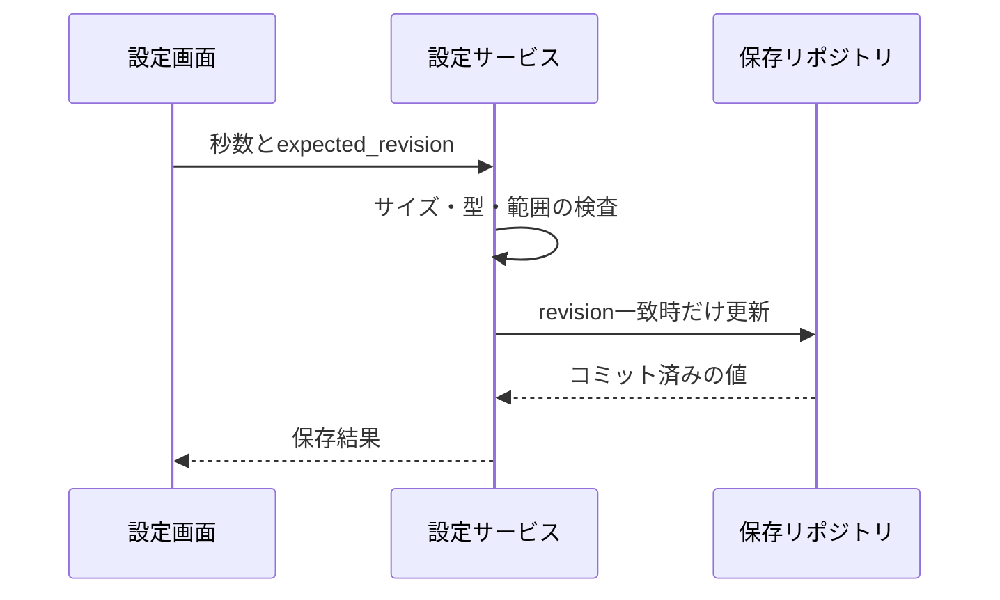

# 承認待ち時間の設定保存（詳細設計の抜粋）

対象は設定保存の1機能である。実アダプターへの接続は呼ばず、この機能の確認に結合検証は必要ない。以下の物理項目・範囲・制御方法は追加提案であり、実装済み・検証済みではない。

## 目的と根拠

要件は待ち時間を設定できること。本機能を確認条件C1〜C4へ対応付ける。

[requirement.mdの引用 7行目](../inputs/agent2agent/requirement-excerpts.md#L7)

> 承認の待ち時間を設定でき、時間内に回答がなければ拒否として扱う。

初期値120秒は基本設計から引き継ぐ設計案であり、採用承認や実測の根拠とは扱わない。

[basic-design.mdの引用 23行目](../inputs/agent2agent/basic-design-excerpts.md#L23)

> 承認要求を保存した時点から120秒を初期の待ち時間とし、画面が非表示でも計測を始める。

## 共通仕様と責務

画面は設定サービスだけを呼び、設定サービスが検査と保存リポジトリを呼ぶ。保存リポジトリだけがDBを更新する。時刻はUTCのミリ秒整数、秒数は整数とする。エラーはcode、field、messageを持つ。画面がDBを直接更新しない。

## 入力と結果

| 項目 | 型と検査 | 根拠の区分 |
|---|---|---|
| approval_wait_seconds | JSONの整数、1〜3600。小数、文字列、真偽値、null、欠落を拒否 | 追加提案 |
| expected_revision | 0以上の整数。保存済みrevisionと一致が必要 | 追加提案 |

JSONはUTF-8で4096バイト以下とし、サイズ、構文、型、範囲、revisionの順に検査する。成功は保存済み秒数とrevisionを返す。INVALID_INPUTは項目の不正、REVISION_CONFLICTは他の保存との競合、SAVE_FAILEDは保存未成立を表す。これはWails経由の設定APIであり、CLIの終了値は適用しない。

## 保存と処理

settingsは1行だけ持つ。setting_idはTEXTの主キーで固定値main、approval_wait_secondsはINTEGER NOT NULL CHECK(1〜3600)、revisionはINTEGER NOT NULL CHECK(0以上)、updated_atはUTCミリ秒のINTEGER NOT NULLとする。別の索引はこの機能には不要。

1. 設定サービスが入力を検査する。不正ならDBを呼ばずINVALID_INPUTを返す。
2. リポジトリが1件の更新トランザクションを開始し、expected_revisionが一致する行だけ秒数を更新し、revisionを1増やす。
3. 更新0件なら競合としてロールバックする。更新1件ならupdated_atと合わせてコミットする。
4. コミット成立後に保存済み値を画面へ返す。既存の承認要求のdeadlineは変更せず、新しく作る承認要求から新しい秒数を使う。この適用時点は追加提案である。

## 異常と画面

コミット前の失敗はロールバックしSAVE_FAILEDを返す。確定結果が不明な接続断では未保存と断定せず再取得する。コミット後に応答が失われた場合も最新値を再取得し、更新要求を自動再送してrevisionを二重に増やさない。

画面は読込中・編集可能・保存中・保存成功・入力エラー・競合・保存結果未確認を表示する。保存中は保存ボタンを無効にする。入力エラーは該当項目にフォーカスを戻す。競合では最新値と未保存の入力を表示し、再読込か再編集を選べる。成功は文字で通知する。

## 確認条件

| 条件 | 観測できれば正しい結果 |
|---|---|
| C1: 0、1、3600、3601、小数、true、欠落を入力 | 1と3600だけが範囲検査を通り、不正入力ではDB更新がない |
| C2: 同じrevisionから同時に2回保存 | 1件だけが成立し、他方は競合。保存値と画面の再取得値が一致する |
| C3: コミット前の失敗、コミット後の応答切断 | 前者は旧値、後者は新値を再取得でき、自動再送で2回目の更新をしない |
| C4: 既存承認がある間に設定変更 | 既存のdeadlineは変わらず、新規承認だけが新しい秒数を参照する |
